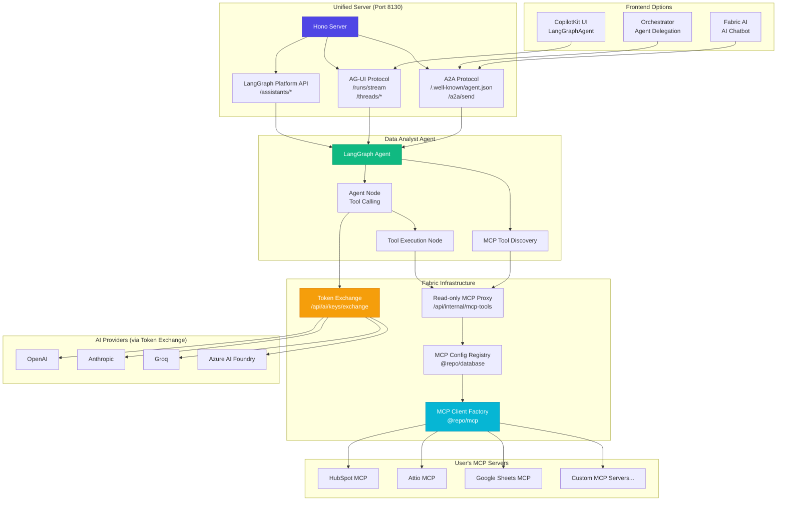

# Data Analyst Agent - Fabric Integration Architecture

Fabric integration and runtime architecture for the Data Analyst agent.

- **Audience**: Agent developers
- **Owner**: Fabric engineering

## Overview

The Data Analyst Agent has been integrated with Fabric's agent infrastructure to support:

1. **A2A Protocol** - Agent-to-Agent communication for orchestrator integration
2. **AG-UI Protocol** - For CopilotKit frontend integration
3. **Fabric MCP** - Lists and calls read-only tools through Fabric's internal proxy
4. **Token Exchange** - AI provider configuration via secure token exchange
5. **Multi-Tenancy** - Token user scoped to the token's organization

## Architecture Diagram



## Key Components

### 1. Unified Server (`unified-server.ts`)

The entry point that exposes the agent via multiple protocols:

```typescript
// A2A endpoints (for orchestrator)
GET  /.well-known/agent.json  // Agent discovery
POST /a2a/send                 // Execute task
POST /a2a/send/stream          // Stream execution

// AG-UI endpoints (for CopilotKit)
POST /runs/stream              // Stream a run
POST /threads/:id/runs/stream  // Stream on thread

// Health
GET  /health                   // Health check
```

### 2. LangGraph Agent (`lib/agent/graph.ts`)

A LangGraph StateGraph with the following nodes:

1. **discover_tools** - Lists read-only tools through the Fabric proxy
2. **agent** - Reasoning node with tool calling
3. **tools** - Executes read-only tools through the Fabric proxy

### 3. MCP Integration

The LangGraph service has no database access or direct MCP connections. It sends
`X-AI-Token` to `POST /api/internal/mcp-tools` on `RUNTIME_API_URL` (falling back
to `FABRIC_API_URL`). The proxy derives the user and organization from that token;
a token without an organization is refused.

- `{ operation: "list" }` returns `{ servers: [{ configId, name, serverName, tools }] }`.
- `{ operation: "call", configId, toolName, arguments }` returns `{ result }`, the raw MCP call result.

Fabric loads the user's enabled configs within that organization in stable order,
using the shared OAuth reauthentication rule (including GitLab personal
connections). It opens guarded clients with `connect` access for both listing
and calls, so discovery requires the same permission as execution. Tool listing
follows pagination with a 100-page and
repeated-cursor bound. Fabric filters tools using explicit `readOnlyHint: true`
and rechecks the requested tool on the call client immediately before execution.
Missing or false hints are refused. Connections close in `finally` blocks;
failing configs are omitted from discovery.

The agent adapts each server's raw definitions to `loadMcpTools`, which projects
input schemas to provider-safe JSON Schema and allocates unique tool names.
Execution sends the original tool name and arguments back to Fabric. Non-OK
responses become model-visible errors with the tool name and HTTP status.
For 409 (reconnect required), 422 (a server JSON-RPC tool error), and 429 (rate
limit), the agent also includes the proxy's message or error, bounded to 500
characters. Other failures stay generic. Fabric logs the failure stage, server
name where known, and typed error code or error name without logging raw errors.
A tool result with `isError: true` passes through as a normal 200 response.
Fabric retains MCP API keys and OAuth tokens;
the agent does not decrypt them and needs no encryption key for this path.

### 4. Token Exchange

AI provider credentials are obtained via token exchange:

```typescript
// Token is passed via X-AI-Token header
const credentials = await exchangeTokenForCredentials(token);
// credentials: { apiKey, provider, model, baseUrl }
```

## Running the Agent

### Development

```bash
# Run unified server only
pnpm dev:server

# Run both Next.js frontend and unified server
pnpm dev:all
```

### Production

```bash
# Build
pnpm build

# Start unified server
pnpm start:server
```

### Docker

```bash
docker build -t data-analyst-agent .
docker run -p 8130:8130 \
  -e FABRIC_API_URL="http://web:3001" \
  -e AGENT_API_KEY="your_agent_api_key" \
  data-analyst-agent
```

## Agent Skills (A2A Discovery)

The agent exposes these skills for orchestrator discovery:

| Skill | Description |
|-------|-------------|
| `analyze-data` | Analyze data from connected sources and generate insights |
| `create-visualization` | Generate charts (bar, line, pie, scatter, histogram) |
| `generate-report` | Generate comprehensive data reports |
| `query-data` | Query and retrieve data from MCP sources |

## Environment Variables

| Variable | Description | Required |
|----------|-------------|----------|
| `PORT` | Server port (default: 8130) | No |
| `HOST` | Server host (default: 0.0.0.0) | No |
| `BASE_URL` | Public URL for agent card | No |
| `FABRIC_API_URL` | Fabric API URL for tool router | Yes |
| `AGENT_API_KEY` | API key for agent authentication | Yes |

**Note:** AI provider keys (OpenAI, Anthropic, etc.) are NOT configured as environment variables. They are provided via token exchange at runtime from Fabric's AI configuration.

## Comparison: Composio vs Fabric MCP

| Feature | Composio | Fabric MCP |
|---------|----------|------------|
| Tool Discovery | Composio Tool Router | User's configured MCP servers |
| Authentication | Composio OAuth | Fabric auth + MCP OAuth |
| AI Providers | Direct API keys | Token exchange (secure) |
| Multi-Tenancy | Per-user session | Full tenant isolation |
| Integrations | Composio managed | User managed in Settings |
| Pricing | Composio subscription | Self-hosted |

## Migration Notes

### Removed Dependencies

- `@composio/core` - Tool discovery is handled by the Fabric proxy
- Direct `@repo/utils` and `@modelcontextprotocol/sdk` dependencies - The LangGraph graph no longer decrypts MCP keys or constructs transports

### New Dependencies

- `@repo/agent-core` - Unified server, model factory
- `@repo/agent-runtime` - Multi-tenant runtime
- `@repo/ai-token` - Token exchange

### Breaking Changes

1. The standalone Next.js app still works for development
2. For production, use the unified server (`pnpm start:server`)
3. AI providers must be configured in Fabric Settings
4. MCP servers must be installed in Fabric MCP Settings
