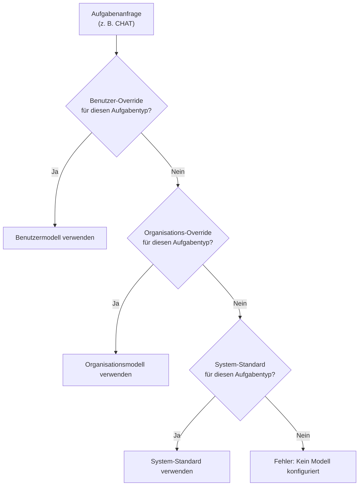
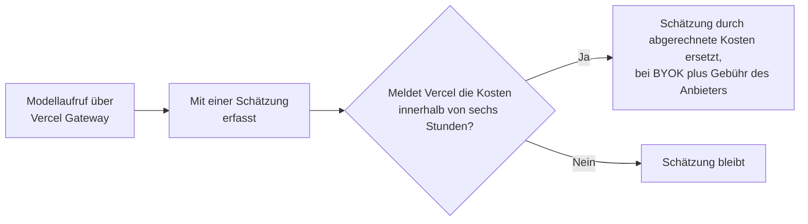

Fabric AI unterstützt 20+ KI-Anbieter. Konfigurieren Sie Ihre bevorzugten Anbieter, legen Sie Modellpräferenzen pro Aufgabentyp fest und verwalten Sie Einbettungen für die Dokumentensuche.

Die gesamte Modellauswahl wird durch Fabrics KI-Modellkatalog gesteuert, der 50+ kanonische Modelle mit Anbieter-Mappings und Aufgaben-Standardwerten enthält. Es werden keine hardcodierten Fallbacks verwendet.

## Anbieterkategorien

### KI-Gateways

Gateways bieten einheitlichen Zugriff auf mehrere Modelle über einen einzigen API-Schlüssel:

| Gateway | Beschreibung |
|---------|-------------|
| **Vercel Gateway** | Weiterleitung zu mehreren Anbietern über Vercel AI |
| **OpenRouter** | Zugriff auf 100+ Modelle über eine API |
| **Cloudflare AI** | Edge-optimierter KI-Inference |

### Direkte Anbieter

Direkte Verbindung zu einem bestimmten KI-Anbieter:

| Anbieter | Wichtige Modelle |
|----------|------------|
| **OpenAI** | GPT-4o, GPT-4o-mini, o1 |
| **Anthropic** | Claude Sonnet, Claude Opus |
| **Groq** | Llama 3.3, Mixtral (schneller Inference) |
| **Together AI** | Open-Source-Modelle im Maßstab |
| **DeepSeek** | DeepSeek R1, DeepSeek V3 |
| **Cohere** | Command R+, Embed |
| **Mistral AI** | Mistral Large, Codestral |
| **Fireworks** | Schneller Open-Source-Inference |
| **Perplexity** | Sucherweiterte Modelle |
| **XAI** | Grok-Modelle |
| **Cerebras** | Ultraschneller Inference |
| **Replicate** | Open-Source-Modell-Hosting |
| **Hugging Face** | Community-Modell-Hub |

### Cloud-Anbieter

Enterprise-Cloud-KI-Dienste:

| Anbieter | Beschreibung |
|----------|-------------|
| **Azure AI Foundry** | Microsoft Azure-gehostete Modelle |
| **AWS Bedrock** | Amazon-gehostete Modelle |
| **Google Vertex AI** | Google Cloud-gehostete Modelle |

## Einen Anbieter einrichten

<Steps>
  <Step>
    ### Zu KI-Anbietern navigieren

    Gehen Sie in der linken Seitenleiste zu **Einstellungen → KI-Anbieter**.
  </Step>

  <Step>
    ### Einen Anbieter auswählen

    Klicken Sie auf den Anbieter, den Sie konfigurieren möchten.
  </Step>

  <Step>
    ### Ihren API-Schlüssel eingeben

    Geben Sie Ihren API-Schlüssel an (und die Basis-URL, falls erforderlich, z. B. für Azure-Deployments). API-Schlüssel werden vor der Speicherung verschlüsselt.
  </Step>

  <Step>
    ### Verbindung testen

    Klicken Sie auf **Verbindung testen**, um Ihre Zugangsdaten zu überprüfen. Der Test zeigt die Latenz an und bestätigt, dass der Anbieter erreichbar ist.
  </Step>

  <Step>
    ### Speichern und als Standard festlegen

    Speichern Sie die Konfiguration. Legen Sie sie optional als Ihren **Standard-Anbieter** fest – dies ist der Fallback, wenn kein spezifisches Modell-Override festgelegt ist.
  </Step>
</Steps>

## Organisations- und persönliche Schlüssel

**Einstellungen → KI-Anbieter** hat zwei Tabs:

- **Organisation** – die Schlüssel, mit denen die ganze Organisation arbeitet. Organisations-Admins konfigurieren sie; alle anderen sehen sie schreibgeschützt.
- **Persönlich** – Ihre eigenen Schlüssel und Ihr eigener ChatGPT-Plan. Jedes Mitglied kann diesen Tab verwalten.

Ein persönlicher Schlüssel ist ein Fallback. Fabric verwendet ihn nur, wenn die Organisation keinen eigenen nutzbaren Schlüssel hat, und die damit erledigte Arbeit wird Ihnen berechnet. Solange das so ist, zeigt Fabric einen Hinweis, dass Ihre Arbeit in dieser Organisation über Ihren persönlichen Schlüssel läuft. Ein ChatGPT-Plan, den Sie auf dem Tab Persönlich verbinden, dient Ihrer eigenen Arbeit und hat Vorrang vor jedem Schlüssel.

### Wenn der ChatGPT-Plan aufgebraucht ist

Wo Ihre Organisation ChatGPT-Pläne nutzt, versucht Ihre eigene Arbeit diese Quellen der Reihe nach, wie **Einstellungen → KI-Modelle** zeigt:

1. Ihren eigenen ChatGPT-Plan;
2. die geteilten ChatGPT-Konten der Organisation;
3. die API-Abrechnung der Organisation, also deren eigenen Schlüssel;
4. Ihren persönlichen Schlüssel, falls Sie einen freigegeben haben.

Der vierte Schritt ist pro Schlüssel freiwillig. Aktivieren Sie auf dem Tab **Persönlich** bei einem Ihrer Schlüssel **Verwenden, wenn der ChatGPT-Plan aufgebraucht ist**. Sobald jeder Plan für Ihre Arbeit aufgebraucht ist, laufen Ihre Chats, der Advisor und die von Ihnen gestartete Generierung über diesen Schlüssel, statt anzuhalten, und werden Ihnen berechnet. Das gilt nur dort, wo die Organisation Ihre Arbeit sonst anhalten würde: Ihre Einstellung für die eigene Arbeit von Personen ist **Anhalten und Rücksetzzeit zeigen**, oder sie hat keinen Schlüssel für Chat und Generierung. Bei **API-Abrechnung nutzen** mit eigenem Schlüssel wird wie bisher der Schlüssel der Organisation verwendet.

- Hintergrund-, geplante und Massenarbeit läuft nie über einen persönlichen Schlüssel.
- Ein Schlüssel **Nur Embeddings** kann nicht freigegeben werden.
- Sind mehrere Schlüssel freigegeben, wird der Standardschlüssel verwendet, sonst der zuletzt aktualisierte.
- Eine Antwort, die Ihren Schlüssel verwendet hat, sagt das darunter, mit der Rücksetzzeit der Pläne. Hält Ihre Arbeit an, weil der Plan aufgebraucht ist, und ist kein Schlüssel freigegeben, verlinkt die Meldung auf den Tab Persönlich.

KI-Modelle zeigt für diesen Schritt nur Ihren eigenen Schlüssel, nie den eines anderen Mitglieds.

## Modellpräferenzen

### Wie die Modellauflösung funktioniert

Wenn Fabric ein KI-Modell benötigt (für Chat, Dokumentengenerierung usw.), folgt es dieser Priorität:

### Aufgabentypen

Verschiedene Modelle für verschiedene Arbeitstypen festlegen:

| Aufgabentyp | Anwendungsfall | Empfohlen |
|-----------|----------|-------------|
| **Einfach** | Schnelle Aufgaben – Titel, Zusammenfassungen, Labels | Schnelles, günstiges Modell (z. B. GPT-4o-mini) |
| **Komplex** | Dokumentengenerierung, Analyse | Qualitätsmodell (z. B. GPT-4o) |
| **Chat** | Konversationelle KI | Ausgewogenes Modell (z. B. Claude Sonnet) |
| **Tool-Aufruf** | Funktionsaufrufe, MCP-Tools | Tool-fähiges Modell (z. B. GPT-4o) |
| **Reasoning** | Tiefe Analyse, mehrstufige Logik | Reasoning-Modell (z. B. o1, DeepSeek R1) |
| **Einbettung** | Vektorgenerierung für die Dokumentensuche | Einbettungsmodell (z. B. text-embedding-3-small) |

### Modellpräferenzen festlegen

1. Gehen Sie zu **Einstellungen → KI-Anbieter**
2. Scrollen Sie zu **Modellpräferenzen**
3. Wählen Sie einen Aufgabentyp
4. Wählen Sie Ihr bevorzugtes Modell aus dem Katalog
5. Speichern

### Organisationspräferenzen

Organisations-Administratoren können Präferenzen auf Organisationsebene festlegen:

1. Wechseln Sie in Ihren Organisationskontext
2. Gehen Sie zu **Einstellungen → KI-Anbieter**
3. Standardwerte auf Organisationsebene festlegen

Organisationspräferenzen gelten für alle Mitglieder, es sei denn, ein Mitglied hat sein eigenes persönliches Override.

## Einbettungskonfiguration

Einbettungen sind für die Dokumentensuche und RAG-Funktionen erforderlich. Nicht alle Anbieter unterstützen Einbettungen.

### Einbettungsfähige Anbieter

- OpenAI (text-embedding-3-small, text-embedding-3-large)
- Azure AI Foundry
- Google Vertex AI
- Cohere (embed-english-v3.0)
- Together AI
- Fireworks
- Mistral AI

### Einen Einbettungsanbieter festlegen

1. Den Anbieter mit einem API-Schlüssel konfigurieren (falls noch nicht geschehen)
2. Auf **Als Einbettungsanbieter festlegen** klicken
3. Der Einbettungsanbieter wird für alle Dokumentenverarbeitung und RAG-Abruf verwendet

## Konfigurationsstatus

Die Einstellungsseite zeigt eine visuelle Übersicht:

- Welche Anbieter konfiguriert sind
- Welcher Anbieter der **Standard** ist
- Welcher Anbieter **Einbettungen** verarbeitet
- Warnungen, wenn erforderliche Anbieter fehlen

## Gateway-Sub-Anbieter-Verwaltung

Bei Verwendung eines Gateways (z. B. Vercel Gateway oder OpenRouter) können Sie bestimmte Sub-Anbieter aktivieren oder deaktivieren:

1. Gateway mit Ihrem API-Schlüssel konfigurieren
2. Den Abschnitt **Aktivierte Anbieter** erweitern
3. Einzelne Anbieter ein- oder ausschalten
4. Nur aktivierte Sub-Anbieter erscheinen bei der Modellauswahl

## Kosten von Gateway-Aufrufen

**Settings → AI Usage** erfasst jeden Modellaufruf mit seinen Kosten. Ein Aufruf über Vercel Gateway wird zunächst mit einer Schätzung erfasst. Innerhalb weniger Minuten ersetzt Fabric die Schätzung durch die Kosten, die Vercel abgerechnet hat, abgefragt mit demselben Organisations- oder persönlichen Schlüssel, der den Aufruf gemacht hat.

Erreicht das Gateway ein Modell mit Ihrem eigenen Anbieterschlüssel (BYOK), rechnet der Anbieter direkt mit Ihnen ab, und die erfassten Kosten enthalten diese Gebühr so, wie Vercel sie meldet. Meldet Vercel für einen Aufruf innerhalb von sechs Stunden keine Kosten, behält er seine Schätzung.

## Best Practices

- **Immer einen Standard-Anbieter festlegen** – Dies stellt sicher, dass KI-Funktionen auch ohne spezifische Overrides funktionieren
- **Einbettungen konfigurieren** – Erforderlich für Dokument-Upload, RAG und Suchfunktionen
- **Gateways für Flexibilität verwenden** – Gateways ermöglichen den Wechsel von Modellen ohne Code-Änderungen
- **Aufgabenspezifische Modelle festlegen** – Schnelle Modelle für einfache Aufgaben und Qualitätsmodelle für komplexe Arbeit
- **Verbindungen testen** – Zugangsdaten überprüfen, bevor man sich auf einen Anbieter verlässt

---

## Nächste Schritte

<Cards>
  <Card title="KI-Chat" href="/docs/features/ai-chat">
    Ihre konfigurierten KI-Anbieter im Chat verwenden
  </Card>
  <Card title="RAG" href="/docs/core-concepts/rag">
    Verstehen, wie Dokumenteinbettungen den Abruf unterstützen
  </Card>
</Cards>
