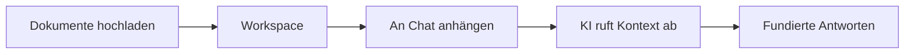

Workspaces sind gemeinsame Dokument-Repositories, die Fabrics RAG-Fähigkeiten (Retrieval-Augmented Generation) antreiben. Laden Sie Dokumente in eine Workspace hoch, laden Sie Mitarbeiter ein, hängen Sie sie an KI-Gespräche an und lassen Sie die KI auf Ihre Dokumente verweisen, wenn sie antwortet.

<Callout type="info">
  **Workspaces** bündeln hochgeladene Dokumente für Suche und Dokumentchat. **[Pages](/docs/features/workspace-pages)** sind die separaten interaktiven Seiten, die Fabric Agent erstellt. Alte `/libraries`-Links werden zu Workspaces weitergeleitet; API- und MCP-Namen bleiben unverändert.
</Callout>

## Was ist eine Workspace?

Eine Workspace ist ein Container für Dokumente, der mit Teammitgliedern geteilt und an KI-Chat-Gespräche angehängt werden kann. Wenn eine Workspace an ein Gespräch angehängt ist, kann die KI relevante Inhalte aus allen Dokumenten in dieser Workspace suchen und abrufen.

## Eine Workspace erstellen

<Steps>
  <Step>
    ### Zu Workspaces navigieren

    Klicken Sie in der linken Seitenleiste auf **Workspaces**, um Ihre bestehenden Workspaces anzuzeigen.
  </Step>

  <Step>
    ### Neue Workspace erstellen

    Klicken Sie auf **New Library** und geben Sie an:

    - **Name** — Ein beschreibender Name (bis zu 100 Zeichen)
    - **Beschreibung** — Optionale Zusammenfassung des Zwecks der Workspace (bis zu 500 Zeichen)
    - **Dokumentenlimit** — Maximale Anzahl erlaubter Dokumente (1 bis 100)
  </Step>

  <Step>
    ### Dokumente hochladen

    Fügen Sie Dokumente zu Ihrer Workspace per Drag & Drop oder über die Upload-Schaltfläche hinzu. Dokumente werden automatisch durch eine Pipeline aus Extraktion, Aufteilung und Einbettung verarbeitet.
  </Step>
</Steps>

## Dokumentenverwaltung

### Upload-Prozess

Wenn Sie ein Dokument hochladen, verarbeitet Fabric es automatisch durch mehrere Stufen:

| Status | Beschreibung |
|--------|-------------|
| **Ausstehend** | Dokument hochgeladen, wartet auf Verarbeitung |
| **Wird hochgeladen** | Dateiübertragung läuft |
| **Hochgeladen** | Datei gespeichert, wartet auf Extraktion |
| **Wird extrahiert** | Inhalt wird aus der Datei extrahiert |
| **Wird aufgeteilt** | Inhalt wird in durchsuchbare Segmente aufgeteilt |
| **Wird eingebettet** | Vektoreinbettungen werden generiert |
| **Wird gespeichert** | Einbettungen werden in der Vektordatenbank gespeichert |
| **Bereit** | Dokument für RAG-Abruf verfügbar |
| **Fehlgeschlagen** | Verarbeitung hat einen Fehler gefunden (kann wiederholt werden) |

**Maximale Dateigröße:** 50 MB pro Datei

### Fehlgeschlagene Dokumente wiederholen

Wenn ein Dokument bei der Verarbeitung fehlschlägt, können Sie es aus der Dokumentenliste heraus wiederholen. Fabric startet einen neuen Verarbeitungsworkflow, der dort weitermacht, wo der vorherige aufgehört hat.

### Dokumentstatistiken

Jede Workspace zeigt Dokumentstatistiken einschließlich Gesamtanzahl, Statusaufschlüsselung und Speichernutzung.

## Dokumente in einem Projekt wiederverwenden

Öffnen Sie den Tab **Kontext** eines Projekts. Wählen Sie unter **Workspace-Dokumente** die Aktion
**Aus Workspace hinzufügen**. Wählen Sie eine Workspace und bis zu 12 fertige Dokumente.
Die Auswahl kann Dokumente aus mehreren Workspaces enthalten.

Das Original bleibt in seiner Workspace. Die Vorschau liest den aktuellen Inhalt; die Aktion zum
Entfernen löscht nur die Projektreferenz. Ein Hinweis auf Änderungen seit dem Hinzufügen bedeutet
nicht, dass eine alte Version gespeichert wurde. Andere Mitglieder benötigen weiterhin Zugriff
auf die ursprüngliche Workspace, um Dokumentdetails und Inhalte zu sehen. Nicht verfügbare Quellen
zeigen keine privaten Namen. Die Verknüpfung fügt Dokumente nicht automatisch zur projektweiten
Suche hinzu und sendet sie nicht an Remote-Agents.

Die gleichen autorisierten Referenzen sind über die SDK-Ressource `contexts`, die CLI-Befehle
`fabric context documents` und die Workspace-Dokument-Tools des Portal-MCP-Servers verfügbar.
Projekt- und Workspace-Berechtigungen werden auf jeder Oberfläche getrennt geprüft.

## Mitgliederverwaltung

Workspaces unterstützen drei Zugriffsebenen, die in Gruppen organisiert sind:

| Gruppe | Berechtigungen |
|-------|-------------|
| **Administratoren** | Vollständige Kontrolle: Mitglieder verwalten, Dokumente hochladen/löschen, Einstellungen aktualisieren, Workspace archivieren/löschen |
| **Mitwirkende** | Dokumente hochladen und verwalten, alle Inhalte der Workspace ansehen |
| **Interessierte** | Nur-Lese-Zugriff auf Dokumente und Inhalte der Workspace |

### Mitglieder hinzufügen

<Steps>
  <Step>
    ### Mitglieder-Panel öffnen

    Zu Ihrer Workspace navigieren und die Registerkarte **Mitglieder** öffnen.
  </Step>

  <Step>
    ### Nach Benutzern suchen

    Name oder E-Mail eingeben, um nach Benutzern zu suchen. Die Suche ist auf Organisationsmitglieder beschränkt.
  </Step>

  <Step>
    ### Eine Gruppe zuweisen

    Den Benutzer auswählen und seine Gruppe wählen: **Administratoren**, **Mitwirkende** oder **Interessierte**.
  </Step>
</Steps>

### Rollen ändern

Administratoren können die Gruppe eines Mitglieds jederzeit ändern oder es vollständig aus der Workspace entfernen.

## Agenten in Workspaces

Sie können KI-Agenten an eine Workspace anhängen und ihnen Zugriff auf den Dokumentenkontext der Workspace geben. Administratoren können Agenten zu einer Workspace hinzufügen oder entfernen.

Dies ermöglicht Agenten, Dokumente der Workspace als Referenzmaterial bei der Ausführung von Aufgaben zu nutzen.

## Gesprächsintegration

Workspaces können an KI-Chat-Gespräche angehängt werden, um während Ihrer Interaktionen Dokumentenkontext bereitzustellen.

### Eine Workspace anhängen

1. Ein KI-Chat-Gespräch öffnen
2. Die Option zum Anhängen einer Workspace auswählen
3. Eine oder mehrere Workspaces zum Anhängen auswählen
4. Die KI hat jetzt Zugriff auf alle bereiten Dokumente in den angehängten Workspaces

### Wie Abruf funktioniert

Wenn Sie eine Nachricht in einem Gespräch mit angehängten Workspaces senden:

1. Die KI identifiziert relevante Dokumentabschnitte mithilfe von Vektorähnlichkeitssuche
2. Passender Inhalt wird als Kontext in den Prompt der KI einbezogen
3. Die KI verweist auf diesen Kontext bei der Generierung ihrer Antwort

Sie können eine Workspace jederzeit von einem Gespräch trennen, ohne den Gesprächsverlauf zu verlieren.

## RAG-Einstellungen

Jede Workspace hat konfigurierbare RAG-Einstellungen, die steuern, wie Dokumente verarbeitet und abgerufen werden:

| Einstellung | Beschreibung | Standardbereich |
|---------|-------------|---------------|
| **Abschnittsgröße** | Größe der Textsegmente in Zeichen | 100 - 10.000 |
| **Abschnittsüberlappung** | Überlappung zwischen benachbarten Abschnitten | 0 - 2.000 |
| **Aufteilungsmethode** | Wie Text in Abschnitte aufgeteilt wird | Absatz, Satz, Fest, Rekursiv, Dokument, Semantisch |
| **Einbettungsmodell** | Modell für Vektorgenerierung | text-embedding-3-small, text-embedding-3-large |
| **Top K** | Anzahl der Ergebnisse pro Anfrage | 1 - 50 |
| **Ähnlichkeitsschwelle** | Mindestzählicherheitswert für Ergebnisse | 0,0 - 1,0 |
| **Neu-Rangierung aktivieren** | Ob Ergebnisse nach Relevanz neu geordnet werden | Ein/Aus |

Das Ändern von RAG-Einstellungen wirkt sich auf zukünftige Dokumentenverarbeitung aus. Vorhandene Dokumente behalten ihre aktuellen Einbettungen, es sei denn, sie werden neu verarbeitet.

## Lebenszyklus einer Workspace

| Status | Beschreibung |
|--------|-------------|
| **Aktiv** | Workspace wird genutzt, Dokumente zugänglich |
| **Archiviert** | Workspace aus Standardansichten ausgeblendet, Dokumente erhalten |

- Eine Workspace **archivieren**, um sie ohne Datenlöschung auszublenden
- Eine archivierte Workspace **reaktivieren**, um sie wiederherzustellen
- Eine Workspace **löschen**, um sie und alle ihre Dokumente dauerhaft zu entfernen

## Arten von Workspaces

| Typ | Beschreibung |
|------|-------------|
| **Persönlich** | Standardbibliothek, die für jeden Benutzer erstellt wird |
| **Benutzerdefiniert** | Vom Benutzer erstellte Workspace mit konfigurierbaren Einstellungen |

## Mandantenfähige Unterstützung

Workspaces gehören zu einer Organisation:

- Sie liegen unter `/app/{org}/libraries` und werden unter den hinzugefügten Mitgliedern geteilt
- Jede Organisation hat eigene Workspaces mit strikter Datenisolierung
- Mitglieder können nur aus derselben Organisation hinzugefügt werden
- Dokument-Uploads sind nach Eigentümerschaft der Workspace isoliert

---

## Nächste Schritte

<Cards>
  <Card title="KI-Chat" href="/docs/features/ai-chat">
    Workspaces an Gespräche für dokumentenbewusste KI anhängen
  </Card>
  <Card title="KI-Anbieter" href="/docs/features/ai-providers">
    Einbettungsmodelle für die Dokumentenverarbeitung konfigurieren
  </Card>
  <Card title="Agenten-Vorlagen" href="/docs/features/agent-templates">
    Agenten erstellen, die Dokumente von Workspaces als Kontext nutzen
  </Card>
</Cards>
