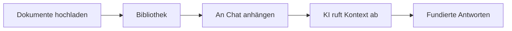

Bibliotheken sind gemeinsame Dokument-Repositories, die Fabrics RAG-Fähigkeiten (Retrieval-Augmented Generation) antreiben. Laden Sie Dokumente in eine Bibliothek hoch, laden Sie Mitarbeiter ein, hängen Sie sie an KI-Gespräche an und lassen Sie die KI auf Ihre Dokumente verweisen, wenn sie antwortet.

<Callout type="info">
  Bibliotheken hießen früher **Workspaces**. **Workspaces** in der Seitenleiste sind jetzt [Seiten, die Fabric Agent für Ihre Organisation schreibt](/docs/features/workspace-pages). Links auf `/workspaces/<Bibliotheks-ID>` öffnen weiterhin die Bibliothek, und die Namen in API und MCP (`fabric_list_workspaces` und die übrigen Tools) bleiben unverändert.
</Callout>

## Was ist eine Bibliothek?

Eine Bibliothek ist ein Container für Dokumente, der mit Teammitgliedern geteilt und an KI-Chat-Gespräche angehängt werden kann. Wenn eine Bibliothek an ein Gespräch angehängt ist, kann die KI relevante Inhalte aus allen Dokumenten in dieser Bibliothek suchen und abrufen.

## Eine Bibliothek erstellen

<Steps>
  <Step>
    ### Zu Bibliotheken navigieren

    Klicken Sie in der linken Seitenleiste auf **Libraries**, um Ihre bestehenden Bibliotheken anzuzeigen.
  </Step>

  <Step>
    ### Neue Bibliothek erstellen

    Klicken Sie auf **New Library** und geben Sie an:

    - **Name** — Ein beschreibender Name (bis zu 100 Zeichen)
    - **Beschreibung** — Optionale Zusammenfassung des Zwecks der Bibliothek (bis zu 500 Zeichen)
    - **Dokumentenlimit** — Maximale Anzahl erlaubter Dokumente (1 bis 100)
  </Step>

  <Step>
    ### Dokumente hochladen

    Fügen Sie Dokumente zu Ihrer Bibliothek per Drag & Drop oder über die Upload-Schaltfläche hinzu. Dokumente werden automatisch durch eine Pipeline aus Extraktion, Aufteilung und Einbettung verarbeitet.
  </Step>
</Steps>

## Dokumentenverwaltung

### Upload-Prozess

Wenn Sie ein Dokument hochladen, verarbeitet Fabric es automatisch durch mehrere Stufen:

| Status | Beschreibung |
|--------|-------------|
| **Ausstehend** | Dokument hochgeladen, wartet auf Verarbeitung |
| **Wird hochgeladen** | Dateiübertragung läuft |
| **Hochgeladen** | Datei gespeichert, wartet auf Extraktion |
| **Wird extrahiert** | Inhalt wird aus der Datei extrahiert |
| **Wird aufgeteilt** | Inhalt wird in durchsuchbare Segmente aufgeteilt |
| **Wird eingebettet** | Vektoreinbettungen werden generiert |
| **Wird gespeichert** | Einbettungen werden in der Vektordatenbank gespeichert |
| **Bereit** | Dokument für RAG-Abruf verfügbar |
| **Fehlgeschlagen** | Verarbeitung hat einen Fehler gefunden (kann wiederholt werden) |

**Maximale Dateigröße:** 50 MB pro Datei

### Fehlgeschlagene Dokumente wiederholen

Wenn ein Dokument bei der Verarbeitung fehlschlägt, können Sie es aus der Dokumentenliste heraus wiederholen. Fabric startet einen neuen Verarbeitungsworkflow, der dort weitermacht, wo der vorherige aufgehört hat.

### Dokumentstatistiken

Jede Bibliothek zeigt Dokumentstatistiken einschließlich Gesamtanzahl, Statusaufschlüsselung und Speichernutzung.

## Mitgliederverwaltung

Bibliotheken unterstützen drei Zugriffsebenen, die in Gruppen organisiert sind:

| Gruppe | Berechtigungen |
|-------|-------------|
| **Administratoren** | Vollständige Kontrolle: Mitglieder verwalten, Dokumente hochladen/löschen, Einstellungen aktualisieren, Bibliothek archivieren/löschen |
| **Mitwirkende** | Dokumente hochladen und verwalten, alle Inhalte der Bibliothek ansehen |
| **Interessierte** | Nur-Lese-Zugriff auf Dokumente und Inhalte der Bibliothek |

### Mitglieder hinzufügen

<Steps>
  <Step>
    ### Mitglieder-Panel öffnen

    Zu Ihrer Bibliothek navigieren und die Registerkarte **Mitglieder** öffnen.
  </Step>

  <Step>
    ### Nach Benutzern suchen

    Name oder E-Mail eingeben, um nach Benutzern zu suchen. Die Suche ist auf Organisationsmitglieder beschränkt.
  </Step>

  <Step>
    ### Eine Gruppe zuweisen

    Den Benutzer auswählen und seine Gruppe wählen: **Administratoren**, **Mitwirkende** oder **Interessierte**.
  </Step>
</Steps>

### Rollen ändern

Administratoren können die Gruppe eines Mitglieds jederzeit ändern oder es vollständig aus der Bibliothek entfernen.

## Agenten in Bibliotheken

Sie können KI-Agenten an eine Bibliothek anhängen und ihnen Zugriff auf den Dokumentenkontext der Bibliothek geben. Administratoren können Agenten zu einer Bibliothek hinzufügen oder entfernen.

Dies ermöglicht Agenten, Dokumente der Bibliothek als Referenzmaterial bei der Ausführung von Aufgaben zu nutzen.

## Gesprächsintegration

Bibliotheken können an KI-Chat-Gespräche angehängt werden, um während Ihrer Interaktionen Dokumentenkontext bereitzustellen.

### Eine Bibliothek anhängen

1. Ein KI-Chat-Gespräch öffnen
2. Die Option zum Anhängen einer Bibliothek auswählen
3. Eine oder mehrere Bibliotheken zum Anhängen auswählen
4. Die KI hat jetzt Zugriff auf alle bereiten Dokumente in den angehängten Bibliotheken

### Wie Abruf funktioniert

Wenn Sie eine Nachricht in einem Gespräch mit angehängten Bibliotheken senden:

1. Die KI identifiziert relevante Dokumentabschnitte mithilfe von Vektorähnlichkeitssuche
2. Passender Inhalt wird als Kontext in den Prompt der KI einbezogen
3. Die KI verweist auf diesen Kontext bei der Generierung ihrer Antwort

Sie können eine Bibliothek jederzeit von einem Gespräch trennen, ohne den Gesprächsverlauf zu verlieren.

## RAG-Einstellungen

Jede Bibliothek hat konfigurierbare RAG-Einstellungen, die steuern, wie Dokumente verarbeitet und abgerufen werden:

| Einstellung | Beschreibung | Standardbereich |
|---------|-------------|---------------|
| **Abschnittsgröße** | Größe der Textsegmente in Zeichen | 100 - 10.000 |
| **Abschnittsüberlappung** | Überlappung zwischen benachbarten Abschnitten | 0 - 2.000 |
| **Aufteilungsmethode** | Wie Text in Abschnitte aufgeteilt wird | Absatz, Satz, Fest, Rekursiv, Dokument, Semantisch |
| **Einbettungsmodell** | Modell für Vektorgenerierung | text-embedding-3-small, text-embedding-3-large |
| **Top K** | Anzahl der Ergebnisse pro Anfrage | 1 - 50 |
| **Ähnlichkeitsschwelle** | Mindestzählicherheitswert für Ergebnisse | 0,0 - 1,0 |
| **Neu-Rangierung aktivieren** | Ob Ergebnisse nach Relevanz neu geordnet werden | Ein/Aus |

Das Ändern von RAG-Einstellungen wirkt sich auf zukünftige Dokumentenverarbeitung aus. Vorhandene Dokumente behalten ihre aktuellen Einbettungen, es sei denn, sie werden neu verarbeitet.

## Lebenszyklus einer Bibliothek

| Status | Beschreibung |
|--------|-------------|
| **Aktiv** | Bibliothek wird genutzt, Dokumente zugänglich |
| **Archiviert** | Bibliothek aus Standardansichten ausgeblendet, Dokumente erhalten |

- Eine Bibliothek **archivieren**, um sie ohne Datenlöschung auszublenden
- Eine archivierte Bibliothek **reaktivieren**, um sie wiederherzustellen
- Eine Bibliothek **löschen**, um sie und alle ihre Dokumente dauerhaft zu entfernen

## Arten von Bibliotheken

| Typ | Beschreibung |
|------|-------------|
| **Persönlich** | Standardbibliothek, die für jeden Benutzer erstellt wird |
| **Benutzerdefiniert** | Vom Benutzer erstellte Bibliothek mit konfigurierbaren Einstellungen |

## Mandantenfähige Unterstützung

Bibliotheken gehören zu einer Organisation:

- Sie liegen unter `/app/{org}/libraries` und werden unter den hinzugefügten Mitgliedern geteilt
- Jede Organisation hat eigene Bibliotheken mit strikter Datenisolierung
- Mitglieder können nur aus derselben Organisation hinzugefügt werden
- Dokument-Uploads sind nach Eigentümerschaft der Bibliothek isoliert

---

## Nächste Schritte

<Cards>
  <Card title="KI-Chat" href="/docs/features/ai-chat">
    Bibliotheken an Gespräche für dokumentenbewusste KI anhängen
  </Card>
  <Card title="KI-Anbieter" href="/docs/features/ai-providers">
    Einbettungsmodelle für die Dokumentenverarbeitung konfigurieren
  </Card>
  <Card title="Agenten-Vorlagen" href="/docs/features/agent-templates">
    Agenten erstellen, die Dokumente von Bibliotheken als Kontext nutzen
  </Card>
</Cards>
