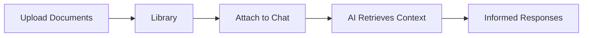

Libraries are shared document repositories that power Fabric's Retrieval-Augmented Generation (RAG) capabilities. Upload documents to a library, invite collaborators, attach it to AI conversations, and let the AI reference your documents when responding.

<Callout type="info">
  Libraries used to be called **Workspaces**. **Workspaces** in the sidebar are now [pages that Fabric Agent writes for your organization](/docs/features/workspace-pages). Links to `/workspaces/<library id>` still open the library, and the API and MCP tool names (`fabric_list_workspaces` and the others) are unchanged.
</Callout>

## What is a Library?

A library is a container for documents that can be shared with team members and attached to AI chat conversations. When a library is attached to a conversation, the AI can search and retrieve relevant content from all documents in that library.

## Creating a Library

<Steps>
  <Step>
    ### Navigate to Libraries

    Click **Libraries** in the left sidebar to view your existing libraries.
  </Step>

  <Step>
    ### Create New Library

    Click **New Library** and provide:

    - **Name** — A descriptive name (up to 100 characters)
    - **Description** — Optional summary of the library purpose (up to 500 characters)
    - **Document Limit** — Maximum number of documents allowed (1 to 100)
  </Step>

  <Step>
    ### Upload Documents

    Add documents to your library using drag-and-drop or the upload button. Documents are automatically processed through a pipeline of extraction, chunking, and embedding.
  </Step>
</Steps>

## Document Management

### Upload Process

When you upload a document, Fabric automatically processes it through several stages:

| Status | Description |
|--------|-------------|
| **Pending** | Document uploaded, waiting to be processed |
| **Uploading** | File transfer in progress |
| **Uploaded** | File stored, awaiting extraction |
| **Extracting** | Content being extracted from the file |
| **Chunking** | Content being split into searchable segments |
| **Embedding** | Vector embeddings being generated |
| **Storing** | Embeddings being stored in the vector database |
| **Ready** | Document available for RAG retrieval |
| **Failed** | Processing encountered an error (can be retried) |

**Maximum file size:** 50 MB per file

### Retrying Failed Documents

If a document fails processing, you can retry it from the document list. Fabric starts a new processing workflow that picks up where the previous one left off.

### Document Statistics

Each library shows document statistics including total count, status breakdown, and storage usage.

## Member Management

Libraries support three access levels organized into groups:

| Group | Permissions |
|-------|-------------|
| **Administrators** | Full control: manage members, upload/delete documents, update settings, archive/delete library |
| **Contributors** | Upload and manage documents, view all library content |
| **Stakeholders** | View-only access to library documents and content |

### Adding Members

<Steps>
  <Step>
    ### Open Members Panel

    Navigate to your library and open the **Members** tab.
  </Step>

  <Step>
    ### Search for Users

    Type a name or email to search for users. The search is scoped to organization members.
  </Step>

  <Step>
    ### Assign a Group

    Select the user and choose their group: **Administrators**, **Contributors**, or **Stakeholders**.
  </Step>
</Steps>

### Changing Roles

Administrators can change a member's group at any time or remove them from the library entirely.

## Agents in Libraries

You can attach AI agents to a library, giving them access to the library's document context. Administrators can add or remove agents from a library.

This enables agents to use library documents as reference material when executing tasks.

## Conversation Integration

Libraries can be attached to AI Chat conversations to provide document context during your interactions.

### Attaching a Library

1. Open an AI Chat conversation
2. Select the library attachment option
3. Choose one or more libraries to attach
4. The AI now has access to all ready documents in the attached libraries

### How Retrieval Works

When you send a message in a conversation with attached libraries:

1. The AI identifies relevant document chunks using vector similarity search
2. Matching content is included as context in the AI's prompt
3. The AI references this context when generating its response

You can detach a library from a conversation at any time without losing the conversation history.

## RAG Settings

Each library has configurable RAG settings that control how documents are processed and retrieved:

| Setting | Description | Default Range |
|---------|-------------|---------------|
| **Chunk Size** | Size of text segments in characters | 100 - 10,000 |
| **Chunk Overlap** | Overlap between adjacent chunks | 0 - 2,000 |
| **Split Method** | How text is divided into chunks | Paragraph, Sentence, Fixed, Recursive, Document, Semantic |
| **Embedding Model** | Model used for vector generation | text-embedding-3-small, text-embedding-3-large |
| **Top K** | Number of results returned per query | 1 - 50 |
| **Similarity Threshold** | Minimum similarity score for results | 0.0 - 1.0 |
| **Enable Reranking** | Whether to rerank results for relevance | On/Off |

Changing RAG settings affects future document processing. Existing documents retain their current embeddings unless reprocessed.

## Library Lifecycle

| Status | Description |
|--------|-------------|
| **Active** | Library is in use, documents accessible |
| **Archived** | Library hidden from default views, documents preserved |

- **Archive** a library to hide it without deleting data
- **Reactivate** an archived library to restore it
- **Delete** a library to permanently remove it and all its documents

## Library Types

| Type | Description |
|------|-------------|
| **Personal** | Default library created for each user |
| **Custom** | User-created library with configurable settings |

## Multi-Tenant Support

Libraries belong to an organization:

- They live at `/app/{org}/libraries`, shared among the members you add
- Each organization has separate libraries with strict data isolation
- Members can only be added from the same organization
- Document uploads are isolated by library ownership

---

## Next Steps

<Cards>
  <Card title="AI Chat" href="/docs/features/ai-chat">
    Attach libraries to conversations for document-aware AI
  </Card>
  <Card title="AI Providers" href="/docs/features/ai-providers">
    Configure embedding models for document processing
  </Card>
  <Card title="Agent Templates" href="/docs/features/agent-templates">
    Create agents that use library documents as context
  </Card>
</Cards>
