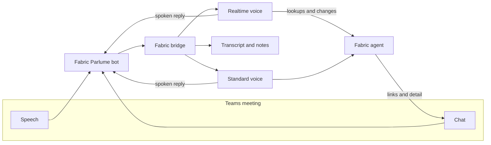
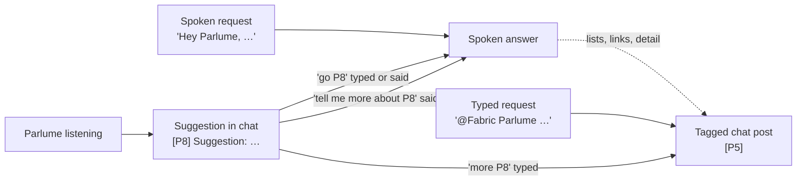
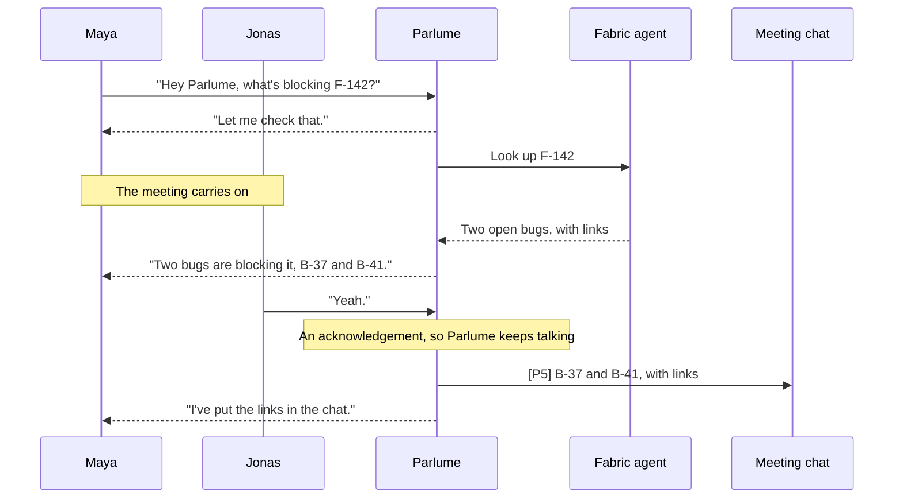

Parlume brings a Fabric agent into a Microsoft Teams meeting. You paste the meeting's join link, Parlume joins as a guest called **Fabric Parlume**, and anyone in the meeting can ask it about the project by voice or in the meeting chat. It answers from the project's knowledge, posts links and longer detail to the chat, and, if you allow it, makes the changes people ask for.

Each organization project has a **Parlume** page, opened from the **Open Parlume** link on the project's **Meeting Digest** tab. Project administrators invite and remove Parlume there. Everyone who can read the project can review past sessions, every request, and what Parlume spent.

<Callout type="info">
Parlume is turned on per organization by an administrator. If your project's Meeting Digest tab has no **Open Parlume** link, it is not enabled for your organization yet.
</Callout>

## How a meeting reaches Fabric

Parlume hears the whole meeting and reads its chat, but it only answers when someone addresses it. Speech and chat pass through a meeting bot to Fabric's bridge, which keeps the transcript and hands each request to one of two voices.

The agent is the one you chose when you invited Parlume, with its usual instructions, knowledge, tools and permission checks. Parlume adds the meeting around it: what was said recently, what was typed in the chat, and who has spoken.

## Invite Parlume

![The Parlume page for a project: the label "Voice agent · Microsoft Teams" above the title Fabric Parlume, then the "Invite Parlume to a meeting" card. It holds a Teams meeting link field filled with a meet link that keeps its ?p= passcode, a green "Teams meeting link" check under it and an Invite Parlume button; an Agent menu set to "Fabric Agent — this project" with a Built-in tag; a "What Parlume can do" choice between Read-only, which is selected, and Actions; a Chat suggestions switch turned on; and a footer reminding you that Parlume records and transcribes the meeting and that participants should be told first](/images/docs/parlume/parlume-invite.png)

<Steps>
  <Step>
    ### Paste the meeting link

    Copy the join link from the meeting invite in Teams or Outlook. Both common formats work: a `teams.microsoft.com/l/meetup-join/…` link as copied, and a `teams.microsoft.com/meet/…` link as long as it keeps its `?p=` passcode, which Parlume needs to join. The page checks the link before you can invite. Fabric passes the link to the meeting provider and does not store it.
  </Step>

  <Step>
    ### Choose the agent

    The default is **Fabric Agent — this project**, which answers from the project's current knowledge. You can pick one of your own custom agents instead if it is bound to this project. Each request loads the agent's current version, so a change you make to the agent applies to the next question.
  </Step>

  <Step>
    ### Choose what Parlume can do

    **Read-only** answers questions and looks things up, and refuses every change. **Actions** makes the changes people ask for, using your permissions in the project, as soon as they ask. See [Actions mode](#actions-mode) before you choose it.
  </Step>

  <Step>
    ### Decide on chat suggestions

    **Chat suggestions** is on by default. With it on, Parlume may now and then post a short suggestion in the meeting chat, and speaks it only when someone replies `go`. Turn it off for this invitation if you only want Parlume to answer when asked.
  </Step>

  <Step>
    ### Tell participants, then invite

    The card reminds you that Parlume records and transcribes the meeting. This is a notice. There is nothing to tick, and Fabric keeps no consent record, so tell the people in the meeting before you press **Invite Parlume**.
  </Step>
</Steps>

Parlume joins as an anonymous external guest. The organizer may have to admit it from the lobby. While it waits, the page shows the invite's progress; if nobody admits it within three minutes, it leaves on its own.

Once it is in, the page shows a live card: how long Parlume has been in the meeting, the agent and mode, the spend so far, and the latest requests. **Remove from meeting** asks you to confirm, then Parlume leaves and saves the transcript.

![The live session card and the Requests list below it. The card reads "Live in meeting" with an elapsed time of 31:08 and "Joined 10:02 AM", a Remove from meeting button, the agent Fabric Agent — this project, the mode Actions, and spend so far of $0.38 with the note that bot time is added after the meeting. Its Live activity list shows three requests: Priya asking who owns F-142, Jonas's typed request to put the link to F-142 in the chat, answered with a note that the link was sent as P3, and Maya asking to create a feature for exporting invoices to CSV, answered that it was not created because Parlume was interrupted and that replying "go P2" in the chat will do it. Below, the Requests tab is filtered to Actions and shows Maya's request with an Action block marked Cancelled, reading "Create feature 'Export invoices to CSV'" and "Held before dispatch: the meeting spoke over Parlume. Offered again in the meeting chat."](/images/docs/parlume/parlume-live-session.png)

## Talk to Parlume

Start with one of the wake phrases: **"Hey Fabric"**, **"Hey Parlume"** or **"Hey Fabric Parlume"**. You can ask in the same breath ("Hey Fabric, what is the status of F-142?") or say the wake phrase, pause, and then ask; Parlume waits until you have finished speaking. Starting with just the name also works ("Parlume, what changed today?"), even when the transcript drops the comma; a sentence about Parlume, such as "Parlume is slow today", does not wake it. Wake phrases are matched by sound, so the usual ways a transcript misspells "Fabric" or "Parlume" still work, while words like "fabrication" or "parliament" do not wake it.

Spoken answers are short: one or two sentences. When there is more to say, such as a list, a link or a longer explanation, Parlume speaks the headline and posts the rest to the meeting chat as one tagged post.

### Voice and chat

Parlume answers in the way it was asked. A spoken request gets a spoken answer, with any detail in the chat alongside it. A typed request gets its answer in the chat, unless it asks to be said aloud. When Parlume is only listening, it never speaks up on its own: something useful it notices goes to the chat as a short [suggestion](#suggestions), and you decide whether to hear it. Every post carries a tag such as `[P3]`, and you can refer to it by voice ("Parlume, tell me more about P3") or in the chat (`more P3`).

### Realtime voice and standard voice

Parlume has two ways of speaking, and picks one automatically for each meeting.

The **realtime voice** is used when your organization has an OpenAI key set up in [AI Providers](/docs/features/ai-providers). It is a speech-to-speech session that listens to the meeting continuously and answers in the same session, so you can go back and forth with it the way you would with a colleague. It speaks only when someone addresses it. When a question needs the project's data or a change, it hands the request to the Fabric agent, says a short holding line such as "Let me check that", and the meeting carries on while Fabric works. When the result arrives, Parlume says it. One lookup runs at a time; if you ask for another meanwhile, Parlume tells you it is still on the first. An answer longer than a few sentences is also posted to the chat in full.

The **standard voice** is used otherwise, and whenever the realtime voice cannot start. It transcribes what was said, runs the agent, and speaks the answer a sentence at a time as the agent writes it. The first sentence plays as soon as it is written, so a short line such as "Let me check the roadmap" covers the time the agent spends looking things up.

A realtime session lasts up to an hour, so Parlume renews it at a quiet moment before then and carries the conversation over. While the connection is being restored, the standard voice answers, so a question asked in that moment is not lost. If the connection cannot be restored after a few attempts, Parlume switches to the standard voice for the rest of the meeting.

### Interrupting Parlume

You can talk over Parlume. Short acknowledgements such as "yeah", "mm-hmm", "right" or "got it, thanks", and single-word remarks, do not stop it. Speech that wants the floor does:

- With the **realtime voice**, Parlume stops talking and the conversation goes on. A lookup it already started keeps running, and Parlume still gives you its result.
- With the **standard voice**, the audio stops but the answer is still completed. Everything the meeting did not hear to the end is posted to the chat as one tagged post, so an answer that was cut off is in the chat.

To end an answer outright, say **"stop"**, **"cancel"**, **"never mind"**, **"not that"**, **"hold on"** or **"wait"**, on its own or after a wake phrase ("Parlume, stop"). A new wake phrase also replaces the current answer, and typing `stop` in the chat does the same. Cancelling ends the work behind the answer too, including a running lookup.

Parlume tells its own voice apart from other speakers using the speaker labels Teams provides. Those labels arrive slightly after the audio, so recognizing an interruption is best-effort.

### Held changes

With the standard voice in an Actions meeting, if someone talks over Parlume after it decided to make a change but before the change started, the change is not made. Parlume posts what it held back to the chat, for example `[P2] I did not create feature "Export invoices to CSV" because I was interrupted. Reply "go P2" to do it.` Replying `go P2` asks for the change again, once. The request records the change as cancelled, held before dispatch.

## The meeting chat

Every message Parlume posts starts with a tag, `[P1]`, `[P2]` and so on, numbered per meeting. The tag is how you refer back to a post, because a meeting chat has no buttons.

![A meeting chat panel. Jonas writes "@Fabric Parlume put the link to F-142 in the chat". Fabric Parlume replies "[P3] F-142 · Usage-based invoice line items" followed by a link on an example domain. Priya writes "say P3". Later Fabric Parlume posts "[P4] Suggestion: F-142 has no acceptance criterion for invoices that span two billing cycles, which Jonas just described. (reply "go P4" and I'll say it)", and Maya replies "go P4"](/images/docs/parlume/parlume-meeting-chat.png)

### Ask Parlume to post something

Ask out loud for something to go in the chat: "put the link to F-123 in the chat" or "post that summary". This works in Read-only meetings too, because it changes nothing in Fabric. Parlume sends at most three messages per answer. Links to work items, documents, Context sources and the project's tabs are built from the meeting's own project after an access check; a reference to another project is refused. Parlume says it has sent the message, and confirms it when the message appears in the chat, usually within a few seconds. A post that has not appeared within 15 seconds is noted on its request in the Requests list; if it shows up later, the note says when.

Posts are plain text. Teams receives each post as a single line, so Parlume drops Markdown emphasis and separates list items with bullets.

### Type to Parlume

A chat message addressed to Parlume becomes a request, just like a spoken one. Address it by:

- mentioning the bot (`@Fabric Parlume …`),
- starting the message with "Fabric Parlume", "Fabric," or "Parlume,",
- starting with a wake phrase ("Hey Fabric …"), or
- sending the bot a private message.

A typed request replaces whatever Parlume was answering, and its answer goes back to the chat without being spoken. If the message asks for a spoken answer ("say …", "tell everyone …", "announce …", "… out loud"), Parlume answers by voice.

These short commands work whether or not you address Parlume:

| Command | What it does |
|---------|--------------|
| `say P3` | Reads post P3 aloud. A web address is read as "the link". |
| `more P3` | Asks for more on post P3, with the answer in the chat. |
| `go P4` | Speaks suggestion P4, or asks again for a change Parlume held back. |
| `stop` | Cancels what Parlume is answering, like a spoken "stop". |

You can say the same commands after a wake phrase: "Parlume, read P3", "Parlume, go P4" or "Parlume, tell me more about P3". A spoken command is answered aloud, in either voice. Speech recognition may write the tag as "P3", "P 3" or "P three", and may drop the pause after "Parlume"; all of them work.

### Parlume reads the chat

Parlume stores every chat message with the meeting's transcript, on the same timeline as the speech around it. Each request, spoken or typed, gets the most recent chat messages as context, so "Parlume, what did they write in the chat?" works.

### Suggestions

With **Chat suggestions** on, Parlume looks at the conversation about every 90 seconds while it is neither speaking nor answering, once enough new speech has come in. If it has something useful to add, it posts one short suggestion:

`[P8] Suggestion: … (reply "go P8" and I'll say it)`

It posts at most one suggestion per pass and twelve an hour, skips one that repeats a suggestion from the last hour, and speaks a suggestion only when someone replies `go P8` or says "Parlume, go P8". To ask about it instead, type `more P8` or say "Parlume, tell me more about P8". A suggestion is written by a model from what was said, so it can be wrong, and something said in the meeting can steer it. It can only be posted or read aloud; it cannot call tools or change anything.

Organization administrators can edit the instructions behind suggestions and the realtime voice in the [Prompt Library](/docs/features/prompts), as **Parlume Meeting Suggestions** and **Parlume Realtime Voice** under Meetings & Intake.

## When Parlume can't write in the chat

As an anonymous guest, Parlume has no chat box in a channel meeting, or in a meeting whose chat policy excludes anonymous users. Teams drops its messages there without an error, so Parlume watches for its posts to appear. If it has seen no chat message at all since it joined, it treats the chat as unavailable and says once, aloud: "I can't write in this meeting's chat. Guests may not have chat here."

From then on Parlume speaks instead of posting: an answer it would have split includes its detail aloud, up to a limit, and ends with "There's more; ask me to continue." As soon as any chat message appears, Parlume writes to the chat again. In a meeting where nobody has typed yet, this means Parlume may treat the chat as unavailable after its first post, until someone writes in it.

An anonymous guest also cannot join a meeting that only admits signed-in or same-organization users. For those meetings, your Fabric operator can set Parlume up to join signed in: they create a Microsoft 365 account for the bot named **Fabric Parlume**, add it to the team for channel meetings, and configure Parlume to sign in for every meeting or only when a meeting refuses an anonymous guest.

## Actions mode

In an **Actions** meeting, Parlume makes a change as soon as the agent asks for it, with no confirmation step, using the inviting administrator's current permissions in the project. That means anyone who can speak or type in the meeting can cause any change the inviter could make, and so could an instruction that reaches the agent through the transcript or a tool's result. Choose Actions only for meetings where that is acceptable.

Some limits apply in every meeting:

- A change that names another project is refused. Parlume works in the meeting's project only.
- Each change is recorded before it runs, with the requester's label, the tool and its exact arguments, and later its outcome. It also appears in the organization's audit log as "Parlume action executed".
- The same change asked twice in one answer runs once.
- An outcome Parlume cannot confirm, such as a timeout, is recorded as unknown and is not retried. Check the destination before asking again.

A new feature or bug is created within a few seconds from what was said, and its description is drafted afterwards in the background.

Speaker names come from Teams, and Fabric does not check them against anyone's Fabric account. People sharing a microphone may share a label, and a change asked for by a speaker Teams did not label is recorded as unattributed.

## What Parlume saves

| What | Where |
|------|-------|
| Transcript of the meeting, including chat lines marked `[chat]` | Project Context, after the meeting |
| Meeting notes, generated from the transcript | Project Context, after the meeting |
| Each request: who asked, when, the answer, and for changes the exact action details, status and outcome | The **Requests** tab on the Parlume page |
| Spend per session | The Parlume page |

The notes take Parlume's records into account: a change that failed or could not be confirmed is not reported as done. Parlume does not create a profile of the people in the meeting. After the session ends, Fabric asks the meeting provider to delete its copy of the bot's data.

Parlume leaves, and saves the transcript, when:

- an administrator removes it from the Parlume page,
- the meeting host removes it, or the meeting ends,
- for three minutes nobody has spoken or written in the meeting chat while Parlume was silent,
- the inviting administrator loses access to the project, or
- it has been in the meeting for four hours.

The Sessions list shows why each session ended.

## Cost

Parlume's spend is recorded in the project's AI usage and shown on the Parlume page, per session and in total, in cents (`< $0.01` for less than a cent). It covers the agent's answers, speech, the meeting notes, suggestions, the realtime voice's usage on your organization's OpenAI key, the meeting bot's time and live transcription. The live card's figure leaves out the bot's time and the live transcription; both are added when the session ends.

Parlume costs money only while it is in a meeting, including while it waits in a lobby. Prices depend on your providers and models, so check the Parlume page for what a session actually cost.

## Troubleshooting

| What you see | What to check |
|--------------|---------------|
| No **Open Parlume** link on Meeting Digest | Parlume is not enabled for your organization, or the project is a personal one. Ask an organization administrator. |
| The invite fails with "needs operator setup" | Parlume has not been configured in this Fabric environment. Ask your Fabric operator. |
| Parlume never joins | Check that a `/meet/…` link still has its `?p=` passcode, and that someone admitted Parlume from the lobby within three minutes. A meeting that only admits signed-in or same-organization users refuses an anonymous guest; see [When Parlume can't write in the chat](#when-parlume-cant-write-in-the-chat) for the signed-in option. |
| Parlume doesn't answer | Start with "Hey Fabric" or "Hey Parlume". Check that the session is still live on the Parlume page; after three minutes without speech or chat messages it leaves. |
| An answer stopped partway | Someone spoke over Parlume. With the standard voice, the rest of the answer is in the meeting chat. With the realtime voice, ask again. |
| Parlume says it can't write in the chat | The meeting gives anonymous guests no chat. Parlume will speak its answers instead. If people can type in the chat, a single message from anyone brings Parlume's posts back. |
| Nothing from Parlume appears in the chat | Same cause as above. Check the request in the Requests tab for a note that its post never appeared. |
| A change wasn't made | Read-only meetings refuse every change. In an Actions meeting, look for a held change in the chat and reply `go P<n>`, or check the request's action status. |
| No suggestions appear | Chat suggestions may be off for this invitation, the chat may be unavailable, or there has not been enough new conversation. Parlume posts at most twelve an hour. |
| Parlume uses the standard voice | Your organization has no OpenAI key in AI Providers, or the realtime session could not start or reconnect. |

## Next Steps

<Cards>
  <Card title="Channels & Meetings as Context" href="/docs/features/channel-context">
    Sync Teams meeting transcripts into a project as context
  </Card>
  <Card title="AI Providers" href="/docs/features/ai-providers">
    Connect the OpenAI key the realtime voice uses
  </Card>
  <Card title="Prompts" href="/docs/features/prompts">
    Edit the instructions behind suggestions and the realtime voice
  </Card>
  <Card title="Projects" href="/docs/features/projects">
    Where meeting transcripts and notes are kept
  </Card>
</Cards>
