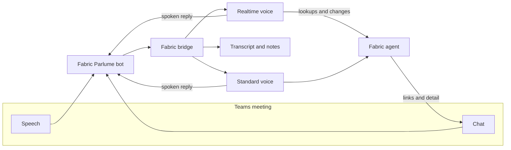
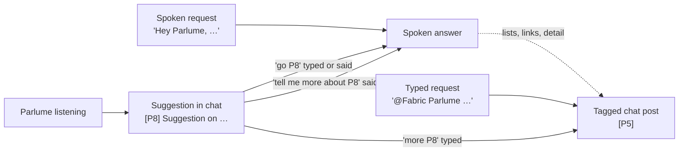
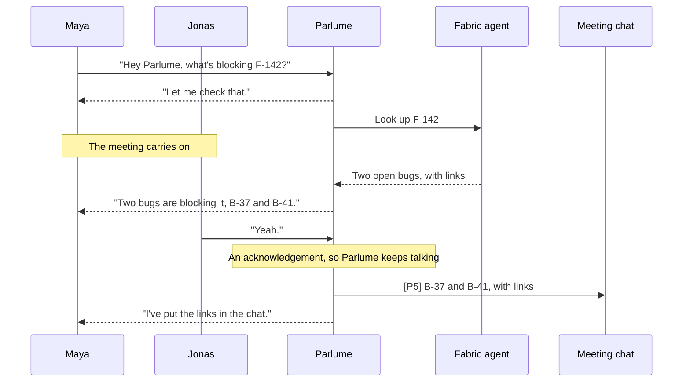

Parlume brings a Fabric agent into a Microsoft Teams meeting. You paste the meeting's join link, or let Parlume join every meeting of a recurring series, and it joins as a guest called **Fabric Parlume**. Anyone in the meeting can ask it about the project by voice or in the meeting chat. It answers from the project's knowledge, posts links and longer detail to the chat, and, if you allow it, makes the changes people ask for.

Each organization project has a **Parlume** page, opened from the **Open Parlume** link on the project's **Meeting Digest** tab. Project administrators invite and remove Parlume there. Everyone who can read the project can review past sessions, every request, and what Parlume spent.

<Callout type="info">
Parlume is a preview that your Fabric operator turns on per organization. If your project's Meeting Digest tab has no **Open Parlume** link, and your organization settings have no **Meeting assistant** page, it is not enabled for your organization yet.
</Callout>

## How a meeting reaches Fabric

Parlume hears the whole meeting and reads its chat, but it only answers when someone addresses it. Speech and chat pass through a meeting bot to Fabric's bridge, which keeps the transcript and hands each request to one of two voices.

The agent is the one you chose when you invited Parlume, with its usual instructions, knowledge, tools and permission checks. Parlume adds the meeting around it: what was said recently, what was typed in the chat, and who has spoken.

## Set up Parlume for your organization

Parlume needs three things before it can join a meeting:

- a **meeting bot**: an [Attendee](https://app.attendee.dev) account that runs the bot in Teams, set in **Settings → Meeting assistant**;
- a **voice provider**: an AI provider key Parlume speaks through, set in **Settings → AI Providers**;
- the **media bridge**, which your Fabric operator configures for the whole Fabric environment.

Your Fabric operator turns Parlume on for your organization and runs the bridge. Everything else is in your organization's settings.

### Who can do what

| Task | Who |
|------|-----|
| Change the **Meeting assistant** settings and run its tests | Organization owners and admins. Other members see the page read-only. |
| Add the voice provider's key on the **Organization** tab of AI Providers | Organization owners and admins |
| Invite and remove Parlume, and turn on [auto-join](#join-a-recurring-meeting-automatically) | Project administrators: the project's owners and project admins. An organization owner or admin who has no role on the project has the same rights. |
| Open the Parlume page and review sessions, requests and spend | Everyone who can read the project |

### The meeting bot

Open **Settings → Meeting assistant** (under **AI** in your organization's settings). The **Meeting bot** card holds the Attendee account Parlume's bot runs on.

The line at the top of the card says which Attendee account invitations use now:

| The card says | What it means |
|---------------|---------------|
| Invitations use your organization's Attendee key. | Your organization's own key is saved. Bot time is charged to your Attendee account. |
| Invitations use the Attendee project the Fabric operator set up. Add a key to use your own. | You have no key of your own, and your Fabric operator provides a shared Attendee account for this Fabric environment. |
| No meeting bot is configured. Add an Attendee API key so Parlume can join meetings. | Neither exists. Parlume cannot join until you add a key. |

<Steps>
  <Step>
    ### Get an Attendee API key

    Create an API key in your Attendee account's dashboard. Credits and billing are managed in the Attendee account, not in Fabric: Attendee charges each bot's time to the account's credits, so make sure the account has credits before your first meeting.
  </Step>

  <Step>
    ### Enter the key

    Paste it into **Attendee API key**. Once saved, the field shows only the key's last four characters; leave it empty to keep the saved key.
  </Step>

  <Step>
    ### Set the Attendee URL, if you host Attendee yourself

    **Attendee URL** is only for a self-hosted Attendee. Leave it empty to use Attendee's hosted service. The address must be `https`; an address on a private or internal network is refused. The saved key is only ever sent to the URL it was saved with, so changing the URL, including clearing it, asks you to enter the key again.
  </Step>

  <Step>
    ### Choose how the bot signs in to Teams

    **Teams sign-in** has three choices:

    - **Anonymous guest** (the default) joins without signing in. Some meetings keep anonymous guests out of the lobby or the chat.
    - **Sign in when the meeting requires it** joins as a guest, and signs in only where the meeting admits signed-in users alone.
    - **Always sign in** joins every meeting signed in to Teams.

    The two sign-in choices need a Microsoft 365 account for the bot, set up as the Teams bot login in the Attendee dashboard; Fabric cannot set it. Name the account **Fabric Parlume** so its voice and chat posts are recognized as the bot's own, and, for channel meetings, add it to the team. Choose a sign-in mode only once that account exists.
  </Step>

  <Step>
    ### Test, then save

    **Test connection** asks Attendee for its list of bots with the key and URL in the form, using the saved key when the key field is empty. It creates no bot and costs nothing, and tells a rejected key ("Attendee rejected the key") apart from an Attendee that could not be reached. **Save** stores the key, the URL and the sign-in mode together.
  </Step>
</Steps>

The URL and the sign-in mode belong to your organization's own key. **Remove the saved key** removes all three, and invitations then use the operator's shared Attendee account, if there is one.

### Voice providers

Parlume speaks through your organization's AI providers. Only keys on the **Organization** tab of [AI Providers](/docs/features/ai-providers) count; personal keys are not used. Which voice a meeting gets depends on the providers you have:

| Provider in AI Providers | Voice |
|--------------------------|-------|
| **Azure AI Foundry**, with its endpoint and an API key | [Realtime voice](#realtime-voice-and-standard-voice), from a realtime deployment in your Azure resource |
| **OpenAI**, with an API key | Realtime voice |
| **Vercel AI Gateway** only | Standard voice |
| None of these | Parlume cannot join. The readiness checklist names what is missing, and an invitation is refused. |

When both Azure AI Foundry and OpenAI are set up, Azure AI Foundry is tried first, then OpenAI. A ChatGPT plan serves text only and gives Parlume no voice.

The **Voice** card on the Meeting assistant page sets the Azure side:

- **Azure realtime deployment** is the name of the deployment in your Azure resource that serves `gpt-realtime-2.1`. Leave it empty to use a deployment named `gpt-realtime-2.1`. Names may use lowercase letters, digits, dots and hyphens. The deployment must exist in Azure; Fabric cannot create it. Without it, Azure refuses the realtime voice and Parlume moves on to your OpenAI key, or to the standard voice.
- **Test realtime voice** checks each configured provider the way a meeting would, but opens no voice session and is not billed. It shows each provider's result, such as "ready for realtime voice" or the provider's own reason for refusing. Save a changed deployment name before you test it.

### The readiness checklist

When something is missing, the **Invite Parlume to a meeting** card on the Parlume page shows **Parlume is not ready to join meetings yet.** with one line per missing item, and **Invite Parlume** stays disabled ("Finish Parlume's setup first"):

| Item | Where it is fixed |
|------|-------------------|
| No meeting bot is set up for your organization. | **Set up the meeting bot** opens Settings → Meeting assistant. |
| No AI provider can give Parlume a voice. | **Add an AI provider** opens Settings → AI Providers. |
| Parlume's media bridge is not configured in this environment. | Your Fabric operator; it is not an organization setting. |

Each link opens the settings page with a **Return to project** link back to the Parlume page. If you cannot change organization settings, the item says that an organization owner or admin can set it up instead of showing a link.

## Invite Parlume

![The Parlume page for a project: the label "Voice agent · Microsoft Teams" above the title Fabric Parlume, then the "Invite Parlume to a meeting" card. It holds a Teams meeting link field filled with a meet link that keeps its ?p= passcode, a green "Teams meeting link" check under it and an Invite Parlume button; an Agent menu set to "Fabric Agent — this project" with a Built-in tag; a "What Parlume can do" choice between Read-only, which is selected, and Actions; a Chat suggestions switch turned on; and a footer reminding you that Parlume records and transcribes the meeting and that participants should be told first](/images/docs/parlume/parlume-invite.png)

<Steps>
  <Step>
    ### Paste the meeting link

    Copy the join link from the meeting invite in Teams or Outlook. Both common formats work: a `teams.microsoft.com/l/meetup-join/…` link as copied, and a `teams.microsoft.com/meet/…` link as long as it keeps its `?p=` passcode, which Parlume needs to join. The page checks the link before you can invite. Fabric passes the link to the meeting provider and does not store it.
  </Step>

  <Step>
    ### Choose the agent

    The default is **Fabric Agent — this project**, which answers from the project's current knowledge. You can pick one of your own custom agents instead if it is bound to this project. Each request loads the agent's current version, so a change you make to the agent applies to the next question.
  </Step>

  <Step>
    ### Choose what Parlume can do

    **Read-only** answers questions and looks things up, and refuses every change. **Actions** makes the changes people ask for, using your permissions in the project, as soon as they ask. See [Actions mode](#actions-mode) before you choose it.
  </Step>

  <Step>
    ### Decide on chat suggestions

    **Chat suggestions** is on by default. With it on, Parlume may now and then post a short [suggestion](#suggestions) in the meeting chat, and speaks it only when someone replies `go`. In a meeting of a linked series it also opens with a [recap of the last meeting](#since-last-time). Turn it off for this invitation if you only want Parlume to answer when asked.
  </Step>

  <Step>
    ### Tell participants, then invite

    The card reminds you that Parlume records and transcribes the meeting. This is a notice. There is nothing to tick, and Fabric keeps no consent record, so tell the people in the meeting before you press **Invite Parlume**.
  </Step>
</Steps>

Parlume joins as an anonymous external guest, unless your organization has chosen a [Teams sign-in](#the-meeting-bot). The organizer may have to admit it from the lobby. While it waits, the page shows the invite's progress; if nobody admits it within ten minutes, it gives up, and the session ends as **Not admitted from the lobby**.

If the invitation is refused, the card says why: a setting that is missing, or the meeting provider's own reason, such as "Attendee refused the invitation" followed by Attendee's explanation.

Once it is in, the page shows a live card: how long Parlume has been in the meeting, the agent and mode, the spend so far, and the latest requests. **Remove from meeting** asks you to confirm, then Parlume leaves and saves the transcript.

![The live session card and the Requests list below it. The card reads "Live in meeting" with an elapsed time of 31:08 and "Joined 10:02 AM", a Remove from meeting button, the agent Fabric Agent — this project, the mode Actions, and spend so far of $0.38 with the note that bot time is added after the meeting. Its Live activity list shows three requests: Priya asking who owns F-142, Jonas's typed request to put the link to F-142 in the chat, answered with a note that the link was sent as P3, and Maya asking to create a feature for exporting invoices to CSV, answered that it was not created because Parlume was interrupted and that replying "go P2" in the chat will do it. Below, the Requests tab is filtered to Actions and shows Maya's request with an Action block marked Cancelled, reading "Create feature 'Export invoices to CSV'" and "Held before dispatch: the meeting spoke over Parlume. Offered again in the meeting chat."](/images/docs/parlume/parlume-live-session.png)

## Join a recurring meeting automatically

Parlume can join every meeting of a recurring Teams series that is linked to the project, so nobody has to paste the link each time. It is set per series; there is no switch that joins every meeting.

Before you start, check that:

- Parlume is ready: the [readiness checklist](#the-readiness-checklist) on the Parlume page is empty;
- your Microsoft account is connected in **Settings → Integrations** (the [Teams](/docs/integrations/teams) card), because Parlume reads your Teams calendar;
- the series is on your own Teams calendar;
- you are a project administrator.

The switch also needs the Meeting Digest's upcoming meetings, which your Fabric operator turns on for the organization. Without them, **Configure meetings** shows no Parlume switch.

<Steps>
  <Step>
    ### Link the series

    On the project's **Meeting Digest** tab, choose **Add meeting**. The list shows the meetings on your Teams calendar for the next 14 days and for a past range you choose (the last 7 to 90 days, 30 by default), so you can link a series, and turn on auto-join, before it first meets.
  </Step>

  <Step>
    ### Turn on auto-join

    Choose **Configure meetings**, find the series and switch on **Parlume joins automatically**. If something is missing, the switch stays off and a message, "Parlume auto-join was not changed", says what to fix and where.
  </Step>

  <Step>
    ### Choose the mode and chat suggestions

    The switch reveals the same choices as the invite card: **Read-only** or **Actions**, and **Chat suggestions**. A change saves straight away. Automatic joins always use **Fabric Agent — this project**.
  </Step>

  <Step>
    ### Tell the series' attendees

    Parlume will record and transcribe every meeting of the series without anyone inviting it again, so tell its regular attendees before the next one.
  </Step>
</Steps>

### Whose calendar and permissions

The person who turns the switch on becomes the series' enabler, and the series shows "Turned on by" their name. Fabric reads the enabler's Teams calendar to find each meeting, and every join runs as them, with their project permissions and the organization's voice provider. A meeting of the series that is not on their calendar is not found and not joined. Anyone who later changes the mode or chat suggestions becomes the enabler instead.

If the enabler stops being a project administrator, joins stop, and the series says that a project admin needs to turn auto-join on again. If their Microsoft connection stops working, the series asks for Microsoft to be reconnected in Settings → Integrations. If their account is deleted, the series asks for the switch to be turned off and on again.

### When Parlume joins

Every five minutes, Fabric reads each enabler's calendar for the series' meetings that start within the next 15 minutes. Parlume asks to join about a minute before each meeting starts, so it can wait in the lobby. If a meeting is found late, Parlume still joins up to ten minutes after its start, and leaves alone a meeting that began longer ago. Just before joining, Fabric checks the calendar again: a cancelled meeting is skipped, and a moved one is joined at its new time.

The organizer may have to admit Parlume from the lobby, as for an invitation, and it gives up after ten minutes. Parlume joins a meeting only once: if it is already there, for example because someone invited it with the series' link, auto-join sends no second bot, and a second invitation is refused with "Parlume is already in this meeting."

Auto-join does not join while the project is in Read-only mode. It also cannot be turned on for a series whose syncing is stopped; resume syncing in the project's **Settings → Meeting Transcript Sync** first. A switch that was already on stays on but does nothing until syncing resumes, and the series says so.

### Seeing what happened

Sessions that auto-join started appear in the Parlume page's Sessions list marked with the series' name, for example **Auto-joined · Weekly planning**.

When a join could not happen, the series in **Configure meetings** shows why, with a link to the settings page that fixes it where there is one: a Microsoft connection to reconnect, a calendar that could not be read (Parlume tries again in a few minutes), Read-only mode, a missing meeting bot or voice provider, the enabler's lost permission, or the meeting provider's own reason for refusing the bot. A cancelled or moved meeting, or one Parlume is already in, is skipped without a notice. The notice clears after the next successful join or when someone sets the switch again; a calendar notice also clears as soon as the calendar can be read.

### Turn it off

Switch off **Parlume joins automatically** for the series. A join that was already scheduled checks the switch first and does not happen. To make Parlume leave a meeting it has already joined, use **Remove from meeting** on the Parlume page.

## Talk to Parlume

Start with one of the wake phrases: **"Hey Fabric"**, **"Hey Parlume"** or **"Hey Fabric Parlume"**. You can ask in the same breath ("Hey Fabric, what is the status of F-142?") or say the wake phrase, pause, and then ask; Parlume waits until you have finished speaking. Starting with just the name also works ("Parlume, what changed today?"), even when the transcript drops the comma; a sentence about Parlume, such as "Parlume is slow today", does not wake it. Wake phrases are matched by sound, so the usual ways a transcript misspells "Fabric" or "Parlume" still work, while words like "fabrication" or "parliament" do not wake it.

"Parlume, …" also works partway through a turn. When you start speaking before someone else has finished, the transcript can run your question into the end of their sentence, as in "…before we call it done. Parlume, what is the status of F-12?". Parlume still hears the question, and the request is yours. This works only with "Parlume" opening a sentence, not with "Fabric", which is an ordinary word.

Spoken answers are short: one or two sentences. When there is more to say, such as a list, a link or a longer explanation, Parlume speaks the headline and posts the rest to the meeting chat as one tagged post.

### Voice and chat

Parlume answers in the way it was asked. A spoken request gets a spoken answer, with any detail in the chat alongside it. A typed request gets its answer in the chat, unless it asks to be said aloud. When Parlume is only listening, it never speaks up on its own: something useful it notices goes to the chat as a short [suggestion](#suggestions), and you decide whether to hear it. Every post carries a tag such as `[P3]`, and you can refer to it by voice ("Parlume, tell me more about P3") or in the chat (`more P3`).

### Realtime voice and standard voice

Parlume has two ways of speaking, and picks one automatically for each meeting.

The **realtime voice** is used when your organization has an Azure AI Foundry resource or an OpenAI key that can serve it (see [Voice providers](#voice-providers)). It is a speech-to-speech session that listens to the meeting continuously and answers in the same session, so you can go back and forth with it the way you would with a colleague. It speaks only when someone addresses it. When a question needs the project's data or a change, it hands the request to the Fabric agent, says a short holding line such as "Let me check that", and the meeting carries on while Fabric works. When the result arrives, Parlume says it. One lookup runs at a time; if you ask for another meanwhile, Parlume tells you it is still on the first. An answer longer than a few sentences is also posted to the chat in full.

The **standard voice** is used otherwise, and whenever the realtime voice cannot start. It transcribes what was said, runs the agent, and speaks the answer a sentence at a time as the agent writes it. The first sentence plays as soon as it is written, so a short line such as "Let me check the roadmap" covers the time the agent spends looking things up.

A realtime session lasts up to an hour, so Parlume renews it at a quiet moment before then and carries the conversation over. While the connection is being restored, the standard voice answers, so a question asked in that moment is not lost. If the connection cannot be restored after a few attempts, Parlume switches to the standard voice for the rest of the meeting.

### Interrupting Parlume

You can talk over Parlume. Short acknowledgements such as "yeah", "mm-hmm", "right" or "got it, thanks", and single-word remarks, do not stop it. Speech that wants the floor does:

- With the **realtime voice**, Parlume stops talking and the conversation goes on. A lookup it already started keeps running, and Parlume still gives you its result.
- With the **standard voice**, the audio stops but the answer is still completed. Everything the meeting did not hear to the end is posted to the chat as one tagged post, so an answer that was cut off is in the chat.

To end an answer outright, say **"stop"**, **"cancel"**, **"never mind"**, **"not that"**, **"hold on"** or **"wait"**, on its own or after a wake phrase ("Parlume, stop"). A new wake phrase also replaces the current answer, and typing `stop` in the chat does the same. Cancelling ends the work behind the answer too, including a running lookup.

Parlume tells its own voice apart from other speakers using the speaker labels Teams provides. Those labels arrive slightly after the audio, so recognizing an interruption is best-effort.

### Held changes

With the standard voice in an Actions meeting, if someone talks over Parlume after it decided to make a change but before the change started, the change is not made. Parlume posts what it held back to the chat, for example `[P2] I did not create feature "Export invoices to CSV" because I was interrupted. Reply "go P2" to do it.` Replying `go P2` asks for the change again, once. The request records the change as cancelled, held before dispatch.

## The meeting chat

Every message Parlume posts starts with a tag, `[P1]`, `[P2]` and so on, numbered per meeting. The tag is how you refer back to a post, because a meeting chat has no buttons.

![A meeting chat panel. Jonas writes "@Fabric Parlume put the link to F-142 in the chat". Fabric Parlume replies "[P3] F-142 · Usage-based invoice line items" followed by a link on an example domain. Priya writes "say P3". Later Fabric Parlume posts "[P4] Suggestion: F-142 has no acceptance criterion for invoices that span two billing cycles, which Jonas just described. (reply "go P4" and I'll say it)", and Maya replies "go P4"](/images/docs/parlume/parlume-meeting-chat.png)

### Ask Parlume to post something

Ask out loud for something to go in the chat: "put the link to F-123 in the chat" or "post that summary". This works in Read-only meetings too, because it changes nothing in Fabric. Parlume sends at most three messages per answer. Links to work items, documents, Context sources and the project's tabs are built from the meeting's own project after an access check; a reference to another project is refused. Parlume says it has sent the message, and confirms it when the message appears in the chat, usually within a few seconds. A post that has not appeared within 15 seconds is noted on its request in the Requests list; if it shows up later, the note says when.

Posts are plain text. Teams receives each post as a single line, so Parlume drops Markdown emphasis and separates list items with bullets.

### Type to Parlume

A chat message addressed to Parlume becomes a request, just like a spoken one. Address it by:

- mentioning the bot (`@Fabric Parlume …`),
- starting the message with "Fabric Parlume", "Fabric," or "Parlume,",
- starting with a wake phrase ("Hey Fabric …"), or
- sending the bot a private message.

A typed request replaces whatever Parlume was answering, and its answer goes back to the chat without being spoken. If the message asks for a spoken answer ("say …", "tell everyone …", "announce …", "… out loud"), Parlume answers by voice.

These short commands work whether or not you address Parlume:

| Command | What it does |
|---------|--------------|
| `say P3` | Reads post P3 aloud. A web address is read as "the link". |
| `more P3` | Asks for more on post P3, with the answer in the chat. |
| `go P4` | Speaks suggestion P4, or asks again for a change Parlume held back. |
| `stop` | Cancels what Parlume is answering, like a spoken "stop". |

You can say the same commands after a wake phrase: "Parlume, read P3", "Parlume, go P4" or "Parlume, tell me more about P3". A spoken command is answered aloud, in either voice. Speech recognition may write the tag as "P3", "P 3" or "P three", and may drop the pause after "Parlume"; all of them work.

### Parlume reads the chat

Parlume stores every chat message with the meeting's transcript, on the same timeline as the speech around it. Each request, spoken or typed, gets the most recent chat messages as context, so "Parlume, what did they write in the chat?" works.

### Suggestions

With **Chat suggestions** on, Parlume looks at the conversation soon after new remarks come in, at most every 45 seconds, while it is neither speaking nor answering. It reads the last few minutes of the meeting, the recent chat, the project's open work items and its knowledge. If it has something useful to add, such as the answer to a question someone just asked, it posts one short suggestion that names the remark it answers:

`[P8] Suggestion on export owner, re Jonas: "who owns the export". … (reply "go P8" and I'll say it)`

It posts at most one suggestion every two minutes and ten an hour, and skips one that answers a remark it already answered, or repeats a suggestion, from the last hour. It speaks a suggestion only when someone replies `go P8` or says "Parlume, go P8", and then starts with whose remark it answers ("Jonas, on export owner: …"). To ask about it instead, type `more P8` or say "Parlume, tell me more about P8". A suggestion is written by a model from what was said, so it can be wrong, and something said in the meeting can steer it. It can only be posted or read aloud; it cannot call tools or change anything.

### Since last time

When Parlume joins a meeting of a series linked to the project, either through [auto-join](#join-a-recurring-meeting-automatically) or because someone invited it with the series' own join link, it posts one short recap in the chat before anyone asks. It starts with "Since last time" and has at most five short lines: what the previous meeting decided, what it left open, and the most important work item changes since.

The recap is built from:

- the notes of the series' previous Parlume meeting in this project, or, if no earlier Parlume meeting of the series has notes, the series' latest synced transcript with its summary, decisions, open questions and open action items, as long as that meeting was in the last 90 days;
- the project's work items created or edited since that meeting, up to 15, with their current status.

**Chat suggestions** controls the recap too: with it off on the invite card, or in the series' auto-join settings, Parlume posts no recap. The recap goes to the chat only and is never spoken unprompted; `say P1` reads it aloud like any other post. A session gets at most one recap. Nothing is posted when there is no earlier meeting to recap or nothing worth saying. Like a suggestion, the recap is written by a model and can be wrong.

Organization administrators can edit the instructions behind suggestions, the recap and the realtime voice in the [Prompt Library](/docs/features/prompts), as **Parlume Meeting Suggestions**, **Parlume Series Recap** and **Parlume Realtime Voice** under Meetings & Intake.

## When Parlume can't write in the chat

As an anonymous guest, Parlume has no chat box in a channel meeting, or in a meeting whose chat policy excludes anonymous users. Teams drops its messages there without an error, so Parlume watches for its posts to appear. If it has seen no chat message at all since it joined, it treats the chat as unavailable and says once, aloud: "I can't write in this meeting's chat. Guests may not have chat here."

From then on Parlume speaks instead of posting: an answer it would have split includes its detail aloud, up to a limit, and ends with "There's more; ask me to continue." As soon as any chat message appears, Parlume writes to the chat again. In a meeting where nobody has typed yet, this means Parlume may treat the chat as unavailable after its first post, until someone writes in it. While the chat is unavailable, Parlume posts no suggestions.

An anonymous guest also cannot join a meeting that only admits signed-in or same-organization users. For those meetings, set up a Microsoft 365 account for the bot and choose a sign-in mode under [Teams sign-in](#the-meeting-bot). That setting comes with your organization's own Attendee key; if invitations use the operator's shared Attendee account, ask your Fabric operator.

## Actions mode

In an **Actions** meeting, Parlume makes a change as soon as the agent asks for it, with no confirmation step, using the inviting administrator's current permissions in the project. That means anyone who can speak or type in the meeting can cause any change the inviter could make, and so could an instruction that reaches the agent through the transcript or a tool's result. Choose Actions only for meetings where that is acceptable. For an automatic join, the inviter is the series' enabler.

Some limits apply in every meeting:

- A change that names another project is refused. Parlume works in the meeting's project only.
- Each change is recorded before it runs, with the requester's label, the tool and its exact arguments, and later its outcome. It also appears in the organization's audit log as "Parlume action executed".
- The same change asked twice in one answer runs once.
- An outcome Parlume cannot confirm, such as a timeout, is recorded as unknown and is not retried. Check the destination before asking again.

A new feature or bug is created within a few seconds from what was said, and its description is drafted afterwards in the background.

Speaker names come from Teams, and Fabric does not check them against anyone's Fabric account. People sharing a microphone may share a label, and a change asked for by a speaker Teams did not label is recorded as unattributed.

## What Parlume saves

| What | Where |
|------|-------|
| Transcript of the meeting, including chat lines marked `[chat]` | Project Context, after the meeting |
| Meeting notes, generated from the transcript | Project Context, after the meeting |
| Each request: who asked, when, the answer, and for changes the exact action details, status and outcome | The **Requests** tab on the Parlume page |
| Spend per session | The Parlume page |

The notes take Parlume's records into account: a change that failed or could not be confirmed is not reported as done. Parlume does not create a profile of the people in the meeting. After the session ends, Fabric asks the meeting provider to delete its copy of the bot's data.

Parlume leaves, and saves the transcript, when:

- an administrator removes it from the Parlume page,
- the meeting host removes it, or the meeting ends,
- for three minutes nobody has spoken or written in the meeting chat while Parlume was silent,
- it has been the only participant for three minutes,
- the person who invited it, or the series' enabler, loses access to the project, or
- it has been in the meeting for four hours.

The Sessions list shows why each session ended, and the error for a session that failed, such as a provider's reason.

## Cost

Parlume's spend is recorded in the project's AI usage and shown on the Parlume page, per session and in total, in cents (`< $0.01` for less than a cent). It covers the agent's answers, speech, the meeting notes, suggestions and the recap, the realtime voice's usage on your organization's Azure AI Foundry or OpenAI key, the meeting bot's time and live transcription. The live card's figure leaves out the bot's time and the live transcription; both are added when the session ends.

The meeting bot's time appears in AI usage as **Attendee · Teams meeting bot**. Fabric records it at Attendee's entry rate of one credit, $0.50, per bot-hour, so spend is never understated; Attendee may charge less at volume. It runs from the invitation until the bot leaves, so time spent waiting in a lobby is billed too: an invitation nobody admits within ten minutes costs about $0.08. Attendee charges it to the credits of the account whose key the invitation used, your organization's own or the operator's shared one.

Parlume costs money only while it is in a meeting or waiting in a lobby. Prices depend on your providers and models, so check the Parlume page for what a session actually cost.

## Troubleshooting

| What you see | What to check |
|--------------|---------------|
| No **Open Parlume** link on Meeting Digest, or no **Meeting assistant** in Settings | Parlume is not enabled for your organization, or the project is a personal one. Ask your Fabric operator to turn it on. |
| "Parlume is not ready to join meetings yet." on the invite card | Follow the [readiness checklist](#the-readiness-checklist): each line names what is missing and where it is fixed. |
| The invite says Attendee rejected the meeting bot's API key | The key is wrong or revoked. Enter a working key in Settings → Meeting assistant and use **Test connection**. |
| "Attendee refused the invitation", for example because the account has run out of credits, or a session that ended with "The Attendee account has run out of credits." | Read Attendee's reason in the message. Add credits in the Attendee account, or save another Attendee key in Settings → Meeting assistant. If invitations use the operator's shared account, ask your Fabric operator. |
| Parlume never joins | Check that a `/meet/…` link still has its `?p=` passcode, and that someone admitted Parlume from the lobby within ten minutes. The session's row in the Sessions list says why it ended. A meeting that only admits signed-in or same-organization users refuses an anonymous guest; see [Teams sign-in](#the-meeting-bot). |
| Parlume doesn't answer | Start with "Hey Fabric" or "Hey Parlume". Check that the session is still live on the Parlume page; after three minutes without speech or chat messages it leaves. |
| An answer stopped partway | Someone spoke over Parlume. With the standard voice, the rest of the answer is in the meeting chat. With the realtime voice, ask again. |
| Parlume says it can't write in the chat | The meeting gives anonymous guests no chat. Parlume will speak its answers instead. If people can type in the chat, a single message from anyone brings Parlume's posts back. |
| Nothing from Parlume appears in the chat | Same cause as above. Check the request in the Requests tab for a note that its post never appeared. |
| A change wasn't made | Read-only meetings refuse every change. In an Actions meeting, look for a held change in the chat and reply `go P<n>`, or check the request's action status. |
| No suggestions appear | Chat suggestions may be off for this invitation or series, the chat may be unavailable, or there has not been enough new conversation. Parlume posts at most one suggestion every two minutes and ten an hour. |
| No "Since last time" recap | The meeting must belong to a linked series: an automatic join, or an invitation with the series' own join link. Check that Chat suggestions is on, and that the series had a meeting in the last 90 days with Parlume's notes or a synced transcript. Parlume also stays quiet when it finds nothing worth recapping. |
| Parlume did not join a meeting of an auto-join series | Read the notice under the series in **Configure meetings**. The meeting must be on the enabler's Teams calendar, with the series' join link, and must not have started more than ten minutes before Parlume found it. Auto-join also skips a project in Read-only mode and a series whose syncing is stopped. |
| No **Parlume joins automatically** switch in Configure meetings | The Meeting Digest's upcoming meetings are not enabled for your organization. Ask your Fabric operator. |
| Parlume uses the standard voice | Your organization has no Azure AI Foundry or OpenAI key on the Organization tab of AI Providers, the Azure resource has no deployment with the name set under **Azure realtime deployment**, or the realtime session could not start or reconnect. **Test realtime voice** shows each provider's answer. |

## Next Steps

<Cards>
  <Card title="AI Providers" href="/docs/features/ai-providers">
    Add the Azure AI Foundry, OpenAI or Vercel AI Gateway key Parlume speaks through
  </Card>
  <Card title="Microsoft Teams" href="/docs/integrations/teams">
    Connect the Microsoft account auto-join reads your calendar through
  </Card>
  <Card title="Channels & Meetings as Context" href="/docs/features/channel-context">
    Sync Teams meeting transcripts into a project as context
  </Card>
  <Card title="Prompts" href="/docs/features/prompts">
    Edit the instructions behind suggestions, the recap and the realtime voice
  </Card>
  <Card title="Projects" href="/docs/features/projects">
    Where meeting transcripts and notes are kept
  </Card>
</Cards>
