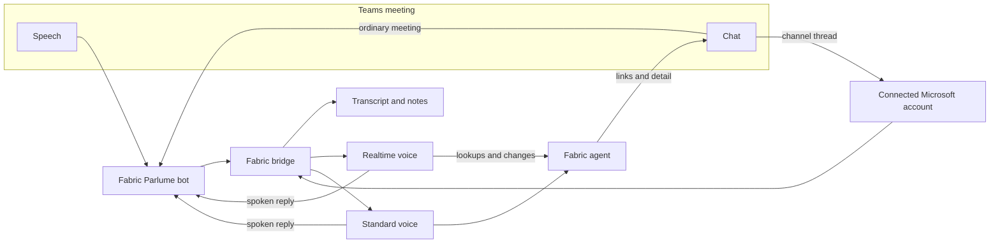
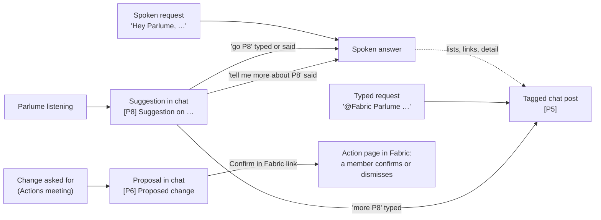
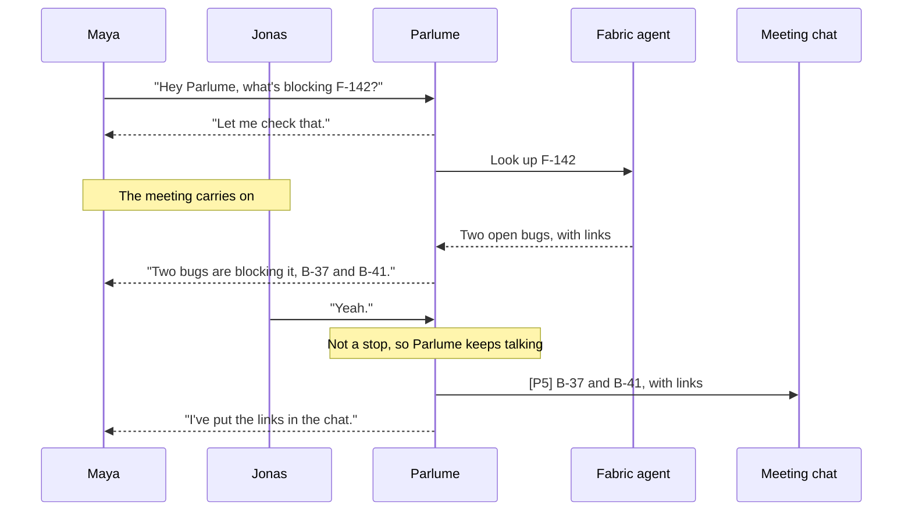

Parlume brings a Fabric agent into a Microsoft Teams meeting. You paste the meeting's join link, or let Parlume join every meeting of a recurring series, and it joins as a guest called **Fabric Parlume**. Anyone in the meeting can ask it about the project by voice or in the meeting chat. It answers from the project's knowledge, posts links and longer detail to the chat, and, if you allow it, proposes the changes people ask for. A project member confirms each change in Fabric before it is made.

Each organization project has a **Parlume** page, opened from the **Open Parlume** link on the project's **Meeting Digest** tab. Project administrators invite and remove Parlume there. Everyone who can read the project can review past sessions, every request, and what Parlume spent.

<Callout type="info">
Parlume is a preview that your Fabric operator turns on per organization. If your project's Meeting Digest tab has no **Open Parlume** link, and your organization settings have no **Meeting assistant** page, it is not enabled for your organization yet.
</Callout>

## How a meeting reaches Fabric

Parlume hears the meeting and reads its chat when access is available, but it only answers when someone addresses it. Speech and ordinary meeting chat pass through the meeting bot to Fabric's bridge. Channel meeting threads use a Microsoft connection the inviter or auto-join enabler is authorized to use. Its signed-in account needs access to the channel and permission to read and send channel messages. Channel replies appear as that Microsoft user, with a post tag and **Fabric Parlume** attribution, and look like Parlume's other meeting posts: line breaks, bold labels and named links. The bridge keeps the transcript and hands each request to one of two voices.



The agent is the one you chose when you invited Parlume, with its usual instructions, knowledge, tools and permission checks. Parlume adds the meeting around it: what was said recently, what was typed in the chat, and who has spoken.

## Set up Parlume for your organization

Parlume needs three things before it can join a meeting:

- a **meeting bot**: an [Attendee](https://app.attendee.dev) account that runs the bot in Teams, set in **Settings → Meeting assistant**;
- a **voice provider**: an AI provider key Parlume speaks through, set in **Settings → AI Providers**;
- the **media bridge**, which your Fabric operator configures for the whole Fabric environment.

Your Fabric operator turns Parlume on for your organization and runs the bridge. Everything else is in your organization's settings.

### Who can do what

| Task | Who |
|------|-----|
| Change the **Meeting assistant** settings and run its tests | Organization owners and admins. Other members see the page read-only. |
| Add the voice provider's key on the **Organization** tab of AI Providers | Organization owners and admins |
| Invite and remove Parlume, and turn on [auto-join](#join-a-recurring-meeting-automatically) | Project administrators: the project's owners and project admins. An organization owner or admin who has no role on the project has the same rights. |
| Open the Parlume page and review sessions, requests and spend | Everyone who can read the project |
| [Stop Parlume's answer, and pause or resume its listening](#stop-pause-and-resume) on the Parlume page | Everyone who can read the project |
| Read a meeting's notes | Everyone who can read the project |
| [Regenerate a meeting's notes](#meeting-notes) | The person who invited Parlume, or turned on the auto-join that started the session, and project administrators |
| [Propose a meeting's action item as a ticket](#propose-an-action-item-as-a-ticket) | Project members who can create work items and can [read the meeting's transcript](#who-can-read-a-transcript). Not for a confidential meeting. |
| [Open and download a meeting's transcript](#who-can-read-a-transcript) | The person who invited Parlume, or turned on the auto-join that started the session, project administrators, and, for an automatic join, the project members the meeting invitation named |
| [Delete a session](#delete-a-session) | The person who invited Parlume, or turned on the auto-join that started the session, and project administrators |

### The meeting bot

Open **Settings → Meeting assistant** (under **AI** in your organization's settings). The **Meeting bot** card holds the Attendee account Parlume's bot runs on.

The line at the top of the card says which Attendee account invitations use now:

| The card says | What it means |
|---------------|---------------|
| Invitations use your organization's Attendee key. | Your organization's own key is saved. Bot time is charged to your Attendee account. |
| Invitations use the Attendee project the Fabric operator set up. Add a key to use your own. | You have no key of your own, and your Fabric operator provides a shared Attendee account for this Fabric environment. |
| No meeting bot is configured. Add an Attendee API key so Parlume can join meetings. | Neither exists. Parlume cannot join until you add a key. |

Save your Attendee project's webhook secret with your key too (see below), so Fabric can check that each event really comes from Attendee.

<Steps>
  <Step>
    ### Get an Attendee API key

    Create an API key in your Attendee account's dashboard. Credits and billing are managed in the Attendee account, not in Fabric: Attendee charges each bot's time to the account's credits, so make sure the account has credits before your first meeting.
  </Step>

  <Step>
    ### Enter the key

    Paste it into **Attendee API key**. Once saved, the field shows only the key's last four characters; leave it empty to keep the saved key.
  </Step>

  <Step>
    ### Enter the webhook secret

    Attendee signs every event it sends Fabric, such as the bot leaving the meeting or a chat message, with the webhook secret of your Attendee project. Copy it from **Settings → Webhooks** in the Attendee dashboard and paste it into **Attendee webhook secret**. Once the secret is saved, Fabric refuses any event whose signature does not match it. Without a secret, Parlume still joins meetings, and Fabric accepts events on the bot's own random link alone; the Parlume page shows a reminder to add the secret. Once saved, the field stays empty; leave it empty to keep the saved secret. Removing the saved key removes the secret too.
  </Step>

  <Step>
    ### Set the Attendee URL, if you host Attendee yourself

    **Attendee URL** is only for a self-hosted Attendee. Leave it empty to use Attendee's hosted service. The address must be `https`; an address on a private or internal network is refused. The saved key is only ever sent to the URL it was saved with, so changing the URL, including clearing it, asks you to enter the key again.
  </Step>

  <Step>
    ### Choose how the bot signs in to Teams

    **Teams sign-in** has three choices:

    - **Anonymous guest** (the default) joins without signing in. Some meetings keep anonymous guests out of the lobby or the chat.
    - **Sign in when the meeting requires it** joins as a guest, and signs in only where the meeting admits signed-in users alone.
    - **Always sign in** joins every meeting signed in to Teams.

    The two sign-in choices need a Microsoft 365 account for the bot, set up as the Teams bot login in the Attendee dashboard; Fabric cannot set it. Name the account **Fabric Parlume** so its voice and ordinary chat posts are recognized as the bot's own. Choose a sign-in mode only once that account exists. Channel thread access uses your connected Microsoft account separately; it does not require a dedicated bot account for chat.

    **Teams login group** appears when you choose a sign-in mode. When your Attendee project holds more than one Teams bot login, Attendee groups them by name; enter the group that holds your organization's account, exactly as the Attendee dashboard names it. Leave it empty to use the project's default login. Several organizations can share one Attendee project and key this way, each with its own group and account. The group applies only with your organization's own key: invitations that use the operator's shared Attendee account never take it.

    Set the bot's account up so Attendee can sign in to it without a person:

    - Use a password-only account. Attendee cannot answer a second sign-in step, so turn off multi-factor authentication for this account. If your Microsoft 365 tenant enforces it for everyone (security defaults), keep the bot's account in a separate tenant where security defaults are off.
    - Give the account a Teams license and keep it out of conditional access policies that require a managed device or multi-factor authentication.
    - Keep the account for Parlume alone, and add it to the Attendee login group you enter here.
  </Step>

  <Step>
    ### Test, then save

    **Test connection** asks Attendee for its list of bots with the key and URL in the form, using the saved key when the key field is empty. It creates no bot and costs nothing, and tells a rejected key ("Attendee rejected the key") apart from an Attendee that could not be reached. **Save** stores the key, the URL and the sign-in mode together.
  </Step>
</Steps>

The URL, the sign-in mode and the login group belong to your organization's own key. **Remove the saved key** removes them all, and invitations then use the operator's shared Attendee account, if there is one.

### Channel replies

A meeting held in a Teams channel gets Parlume's chat posts through a connected Microsoft account, not the bot. By default that is the Microsoft account of the person who invited Parlume, or who turned on the auto-join.

In **Channel replies**, an organization admin can choose a Microsoft connection that is shared with the whole organization instead. Parlume then posts in every channel meeting from that one account, whoever invited it, so the posts come from the same name each time. Only connections shared with the organization are listed, with who connected each. If none is listed, share a Microsoft connection with the organization under **Settings → Integrations** first.

The shared account must be a member of each channel Parlume posts in. If it is not, or the connection stops being shared or active, Parlume uses the inviter's own account. A meeting keeps the account it started with until it ends.

### Voice providers

Parlume speaks through your organization's AI providers. Only keys on the **Organization** tab of [AI Providers](/docs/features/ai-providers) count; personal keys are not used. Which voice a meeting gets depends on the providers you have:

| Provider in AI Providers | Voice |
|--------------------------|-------|
| **Azure AI Foundry**, with its endpoint and an API key | [Standard voice](#realtime-voice-and-standard-voice). The realtime voice too, once you name a realtime deployment on the **Voice** card |
| **OpenAI**, with an API key | Standard voice |
| **Vercel AI Gateway** only | Standard voice |
| None of these | Parlume cannot join. The readiness checklist names what is missing, and an invitation is refused. |

Every meeting uses the standard voice unless your organization names a realtime deployment. The realtime voice runs only on that deployment in your Azure AI Foundry resource; an OpenAI key is never used for meeting audio. A ChatGPT plan serves text only and gives Parlume no voice.

The **Voice** card on the Meeting assistant page sets the Azure side:

- **Azure realtime deployment** is the name of the deployment in your Azure resource that serves `gpt-realtime-2.1`. Leave it empty to keep the standard voice. Names may use lowercase letters, digits, dots and hyphens. The deployment must exist in Azure; Fabric cannot create it. If Azure refuses it, Parlume uses the standard voice.
- **Test realtime voice** checks the named deployment the way a meeting would, but opens no voice session and is not billed. It shows the result, such as "ready for realtime voice" or Azure's own reason for refusing. With no deployment named, it says that Parlume uses its standard voice. Save a changed deployment name before you test it.

### Who is in the meeting

Parlume answers only while it can confirm that everyone in the meeting can see the project in Fabric. It checks each person who joins through the Microsoft Teams connection of the person who invited it: someone signed in to your organization's Microsoft 365 must be a Fabric user with that verified email address who can read the project. The person who invited Parlume is recognized by the account of their own Teams connection. Inviting Parlume therefore needs a working Microsoft Teams connection in Settings → Integrations; without one, or when the connection no longer works, the invitation is refused and asks you to connect or reconnect it.

Parlume says nothing while it checks someone who just joined, and nothing at the start of the meeting until it has confirmed someone there. Answers, suggestions and the "Since last time" recap wait; a recap made before then is posted as soon as Parlume may answer. Before each answer, Parlume checks again that everyone it confirmed can still read the project.

When someone joins whom Parlume cannot confirm, such as an external or anonymous guest, a person from another organization, or a Fabric user without access to the project, or when someone loses access to the project during the meeting, Parlume stops speaking at once, says why in the chat, and leaves. It names the person by their display name only, without any link or email address:

```
[P4] I'm leaving: I could not confirm that Sam Lee can see this project in Fabric. I answer only when everyone in the meeting can.
```

The session ends as **Left for an unconfirmed attendee**. A meeting held in a Teams channel ends the same way at the first join, because everyone in the channel reads its chat and Parlume cannot check who they are: `I'm leaving: this meeting's chat belongs to a Teams channel, and I cannot check that everyone who reads it can see this project in Fabric.`

Every answer in a meeting is held to plain project read, which everyone present has, even when the person who invited Parlume is alone: Fabric's own tools for the meeting's project, with changes still only proposed. It leaves out what the inviter holds beyond that: organization-wide workflows, frames and pages, the agent's connected servers, integrations, Databricks knowledge and workspaces, web search and other tools that spend. External tools would show what other systems hold to people who may not have access to them, so a meeting never uses them. Raw meeting transcripts and the transcripts of a confidential series stay out of every answer.

The "Since last time" recap may tell the meeting what an earlier meeting decided. It is made from that meeting's notes and the project's changed work items, which everyone present can already open in Fabric, so it shows them nothing new.

### External guests

An external guest is someone from outside your organization: an invitee whose email address is on another domain than the calendar Parlume joins from, or someone who joins the meeting as a guest. The **External guests** card on the Meeting assistant page sets what Parlume does about a guest the invitation names:

- **Notes only**, the default. Parlume joins, posts its [notice](#parlumes-notice-in-the-meeting) and keeps notes. While the meeting counts as having a guest, it does not speak, answers nothing in the meeting chat, takes no command from a guest, and does not use the realtime voice. A member's request still gets an answer, on the Parlume page. Parlume posts once in the chat that it keeps notes only:

  ```
  [P2] Notes only · a guest is in this meeting
  I keep notes. I do not speak or answer in this chat while a guest is here.
  ```

- **Internal meetings only**. Auto-join does not join a meeting whose invitation names a guest, and the series says why.

A meeting whose invitation names a guest counts as having one for its whole length. A guest who actually joins is someone Parlume cannot confirm, so Parlume leaves, as [described above](#who-is-in-the-meeting).

### Speaker marks

Fabric marks each person who speaks or writes in the meeting by the check it makes when they join:

| Mark | Who | What Parlume does |
|------|-----|-------------------|
| **Member** | Someone Fabric confirmed through their Teams sign-in: a Fabric user with that verified email address who can read the project. | Takes their requests. |
| **Unverified speaker** | A guest: someone who joined without signing in, whom Teams labels a guest or external, or whom Fabric could not match to a Fabric user who can read the project, such as someone signed in with another organization's account. Everyone in a Teams channel meeting is marked this way, because Parlume cannot check them. | Keeps their words in the transcript and may quote them in the notes, but takes no request from them, spoken or typed. Only a pause is accepted. |
| No mark | Someone Fabric has not checked yet, or a line Teams has not given a speaker. Teams sends speaker labels a moment after the audio. | Shows the name Teams gives, if any. |

The saved transcript shows a guest's lines as `Sam Lee (unverified speaker): …`, and the **Requests** list and the live card show an **Unverified speaker** badge next to the name. A guest cannot give Parlume commands because a display name proves nothing: anyone can join as "Dana Member", and a request runs with the access of the person who asked. The same check decides both the mark and whether Parlume takes a request, so the two always agree. Parlume's tagged chat posts, such as its join notice and its answers, show in the transcript under its name, without the mark. Some Parlume lines can still show the mark: a line without a tag, such as the notice it posts when it leaves, and a post that reached the chat after Parlume could not confirm that it was sent.

Fabric keeps only the mark and the participant's Teams id, never an email address, and deletes both with the meeting's transcript. The mark does not change [who can read the transcript](#who-can-read-a-transcript). Transcripts saved before marks were added have none, and the requests of those meetings show the badge only for people Teams itself labels as guests.

### The readiness checklist

When something is missing, the **Invite Parlume to a meeting** card on the Parlume page shows **Parlume is not ready to join meetings yet.** with one line per missing item, and **Invite Parlume** stays disabled ("Finish Parlume's setup first"):

| Item | Where it is fixed |
|------|-------------------|
| No meeting bot is set up for your organization. | **Set up the meeting bot** opens Settings → Meeting assistant. |
| No AI provider can give Parlume a voice. | **Add an AI provider** opens Settings → AI Providers. |
| Parlume's media bridge is not configured in this environment. | Your Fabric operator; it is not an organization setting. |

Each link opens the settings page with a **Return to project** link back to the Parlume page. If you cannot change organization settings, the item says that an organization owner or admin can set it up instead of showing a link.

When the meeting bot is set up but Fabric has no Attendee webhook secret for it, the card also shows **Fabric does not check the meeting bot's events against an Attendee webhook secret.** This is a reminder, not a blocker: invitations still work. With your organization's own key, **Add the webhook secret** opens Settings → Meeting assistant; with the operator's shared Attendee account, your Fabric operator sets the secret.

## Invite Parlume

![The Parlume page for a project: the label "Voice agent · Microsoft Teams" above the title Fabric Parlume, then the "Invite Parlume to a meeting" card. It holds a Teams meeting link field filled with a meet link that keeps its ?p= passcode, a green "Teams meeting link" check under it and an Invite Parlume button; an Agent menu set to "Fabric Agent — this project" with a Built-in tag; a "What Parlume can do" choice between Read-only, which is selected, and Actions; a Chat suggestions switch turned on; and a footer reminding you that Parlume records and transcribes the meeting and that participants should be told first](/images/docs/parlume/parlume-invite.png)

<Steps>
  <Step>
    ### Paste the meeting link

    Copy the join link from the meeting invite in Teams or Outlook. Both common formats work: a `teams.microsoft.com/l/meetup-join/…` link as copied, and a `teams.microsoft.com/meet/…` link as long as it keeps its `?p=` passcode, which Parlume needs to join. The page checks the link before you can invite. Fabric passes the full link, including its passcode, to the meeting provider. It stores a meeting identity URL without the query or fragment.

    For a numeric short link, Fabric asks Microsoft to resolve its meeting ID through your connected account before selecting the channel thread. If Microsoft cannot resolve it uniquely, the live card warns that channel chat is unavailable; the meeting bot may still provide ordinary chat. Use the full join link from the calendar invitation to identify a channel thread directly. If Microsoft access or consent is missing, reconnect the account with the required channel permissions.
  </Step>

  <Step>
    ### Choose the agent

    The default is **Fabric Agent — this project**, which answers from the project's current knowledge. You can pick one of your own custom agents instead if it is bound to this project. Each request loads the agent's current version, so a change you make to the agent applies to the next question.
  </Step>

  <Step>
    ### Choose what Parlume can do

    **Read-only** answers questions and looks things up, and refuses every change. **Actions** also proposes the changes people ask for. A proposed change is not made until a signed-in project member who can edit the project confirms it in Fabric. See [Actions mode](#actions-mode) before you choose it.
  </Step>

  <Step>
    ### Decide on suggestions and who sees them

    **Suggestions and recap** is on by default. With it on, Parlume may now and then offer a short [suggestion](#suggestions), such as the answer to a question someone just asked or a question the meeting may have missed. In a meeting of a linked series it also opens with a [recap of the last meeting](#since-last-time). Turn it off for this invitation if you only want Parlume to answer when asked.

    While it is on, choose [who sees suggestions](#who-sees-suggestions):

    - **Only your team (Parlume page)**, the default, posts nothing in the chat. Suggestions and the recap appear on the project's Parlume page, for people who can read the project.
    - **Everyone in the meeting (chat)** posts suggestions and the recap in the meeting chat. Every participant reads them, external guests included.
  </Step>

  <Step>
    ### Tell participants, then invite

    The card reminds you that Parlume records and transcribes the meeting. This is a notice. There is nothing to tick, and Fabric keeps no consent record, so tell the people in the meeting before you press **Invite Parlume**.
  </Step>
</Steps>

Parlume joins as an anonymous external guest, unless your organization has chosen a [Teams sign-in](#the-meeting-bot). By default Teams holds a bot it detects in the lobby, so someone usually has to admit it: the organizer, or a presenter where the meeting allows it. While it waits, the page shows the invite's progress and asks you to admit **Fabric Parlume** from the Teams lobby if you are the organizer or a presenter, or to ask the organizer, with the time it stops waiting. If nobody admits it within five minutes, it gives up, and the session ends as **Not admitted from the lobby**. The wait is short because lobby time is billed; see [Cost](#cost).

### Notifications while Parlume gets in

You don't have to watch the Parlume page while Parlume waits. You get a notification in Fabric and an email:

- when Parlume is still not in the meeting about 90 seconds after the invite, which usually means it waits in the lobby: "Parlume is waiting to join: admit Fabric Parlume from the lobby by 14:10". The time is five minutes after the invite, when Parlume stops waiting. It is in your account's time zone when Fabric has one, otherwise in UTC, and it names the zone.
- when Parlume could not get in: nobody admitted it, the organizer declined it, or Teams refused it. The notification gives the same reason as the session's row in the Sessions list.

If Attendee refuses the invitation while you invite, the invite card shows the reason at once, and no notification is sent. The email goes to your Fabric account's address. If you have turned on email delivery for your notifications, you get that email instead, not a second one. For an [automatic join](#join-a-recurring-meeting-automatically), the person who turned auto-join on gets these notifications.

### Invite Parlume to a meeting it is already in

Parlume joins each meeting only once. If Parlume is already in the meeting for this project, or on its way in, a second invitation sends no second bot. It opens the session that is already there, with the agent and settings of the first invitation. This works whoever invited Parlume first and whichever link to the meeting you paste. An invitation is refused with "Parlume is already in this meeting." in two cases:

- the session in the meeting is leaving. Invite Parlume again once it has left.
- Parlume joined the meeting for another project of your organization.

### Parlume's notice in the meeting

Once it is admitted and can hear the meeting, Parlume posts one notice in the meeting chat. The meeting audio can reach it with gaps for its first seconds, so it waits for the audio to come through whole, at most 15 seconds:

```
[P1] Fabric Parlume (AI assistant) is in this meeting
I transcribe the meeting and write notes. I keep transcripts for 90 days, and notes until someone deletes them.
To pause me, say or type "Parlume, pause". Parlume page
```

**Parlume page** links to the project's Parlume page. The notice is posted once per session, also when the meeting connection drops and comes back. If the meeting chat turns out to be out of Parlume's reach, Parlume says the notice aloud in one sentence instead, also while a guest is in the meeting, but not after the four-hour limit. Fabric records when the meeting got the notice, and how.

If the invitation is refused, the card says why: a setting that is missing, or the meeting provider's own reason, such as "Attendee refused the invitation" followed by Attendee's explanation.

Once it is in, the page shows a live card: how long Parlume has been in the meeting, the agent and mode, the spend so far, and the latest requests. **Remove from meeting** asks you to confirm, then Parlume leaves and saves the transcript.

Channel thread reads, replies and request handling stop when the session ends, reaches its time limit or loses access. Fabric also requests removal of the Microsoft notification subscription. If revoked access prevents removal, notification metadata may continue until its lease expires; Fabric rejects it without reading or relaying channel content. Microsoft subscriptions have a minimum 45-minute lease.

## Join a recurring meeting automatically

Parlume can join every meeting of a recurring Teams series that is linked to the project, so nobody has to paste the link each time. It is set per series; there is no switch that joins every meeting.

Before you start, check that:

- Parlume is ready: the [readiness checklist](#the-readiness-checklist) on the Parlume page names nothing missing (a webhook-secret reminder does not stop auto-join);
- your Microsoft account is connected in **Settings → Integrations** (the [Teams](/docs/integrations/teams) card), because Parlume reads your Teams calendar;
- the series is on your own Teams calendar;
- you are a project administrator.

The switch also needs the Meeting Digest's upcoming meetings, which your Fabric operator turns on for the organization. Without them, **Configure meetings** shows no Parlume switch.

<Steps>
  <Step>
    ### Link the series

    On the project's **Meeting Digest** tab, choose **Add meeting**. The list shows the meetings on your Teams calendar for the next 14 days and for a past range you choose (the last 7 to 90 days, 30 by default), so you can link a series, and turn on auto-join, before it first meets.
  </Step>

  <Step>
    ### Turn on auto-join

    Choose **Configure meetings**, find the series and switch on **Parlume joins automatically**. If something is missing, the switch stays off and a message, "Parlume auto-join was not changed", says what to fix and where.
  </Step>

  <Step>
    ### Choose the mode and suggestions

    The switch reveals the same choices as the invite card: **Read-only** or **Actions**, **Suggestions and recap**, and, while that is on, who sees them. A change saves straight away and applies from the next meeting Parlume joins; a meeting already in progress keeps the choices it started with. Automatic joins always use **Fabric Agent — this project**.
  </Step>

  <Step>
    ### Tell the series' attendees

    Parlume will record and transcribe every meeting of the series without anyone inviting it again, so tell its regular attendees before the next one. The switch shows the [notice](#parlumes-notice-in-the-meeting) Parlume posts in each meeting, and who turned auto-join on and when.
  </Step>
</Steps>

### Whose calendar and permissions

The person who turns the switch on becomes the series' enabler, and the series shows "Turned on by" their name. Fabric reads the enabler's Teams calendar to find each meeting, and every join runs as them, with their project permissions and the organization's voice provider. A meeting of the series that is not on their calendar is not found and not joined. Anyone who later changes the mode or chat suggestions becomes the enabler instead.

If the enabler stops being a project administrator, joins stop, and the series says that a project admin needs to turn auto-join on again. If their Microsoft connection stops working, the series asks for Microsoft to be reconnected in Settings → Integrations. If their account is deleted, the series asks for the switch to be turned off and on again.

### When Parlume joins

Every five minutes, Fabric reads each enabler's calendar for the series' meetings that start within the next 15 minutes. Parlume asks to join about a minute before each meeting starts, so it can wait in the lobby. If a meeting is found late, Parlume still joins up to ten minutes after its start, and leaves alone a meeting that began longer ago. Just before joining, Fabric checks the calendar again: a cancelled meeting is skipped, and a moved one is joined at its new time. Fabric also checks the time again right before Parlume joins. If the join was delayed to more than ten minutes after the meeting started, for example by an outage, Parlume does not join, and the series says why.

The organizer may have to admit Parlume from the lobby, as for an invitation, and it gives up after five minutes. Parlume asks to join about a minute before the start, so an organizer who arrives up to four minutes late can still admit it. The person who turned auto-join on gets the same [notifications](#notifications-while-parlume-gets-in) as an inviter. Parlume joins a meeting only once: if it is already there, for example because someone invited it with the series' link, auto-join sends no second bot, and a second invitation from the project opens the session that is already there.

Auto-join does not join while the project is in Read-only mode. It also cannot be turned on for a series whose syncing is stopped; resume syncing in the project's **Settings → Meeting Transcript Sync** first. A switch that was already on stays on but does nothing until syncing resumes, and the series says so.

### Seeing what happened

Sessions that auto-join started appear in the Parlume page's Sessions list marked with the series' name, for example **Auto-joined · Weekly planning**.

When a join could not happen, the series in **Configure meetings** shows why, with a link to the settings page that fixes it where there is one: a Microsoft connection to reconnect, a calendar that could not be read (Parlume tries again in a few minutes), Read-only mode, a missing meeting bot or voice provider, the enabler's lost permission, a join that came more than ten minutes after the meeting started, or the meeting provider's own reason for refusing the bot. A cancelled or moved meeting, or one Parlume is already in, is skipped without a notice. When Parlume was sent but could not get in, the enabler also gets a [notification](#notifications-while-parlume-gets-in) with the reason. The notice clears after the next successful join or when someone sets the switch again; a calendar notice also clears as soon as the calendar can be read.

### Turn it off

Switch off **Parlume joins automatically** for the series. A join that was already scheduled checks the switch first and does not happen. To make Parlume leave a meeting it has already joined, use **Remove from meeting** on the Parlume page.

## Talk to Parlume

Start with one of the wake phrases: **"Hey Fabric"**, **"Hey Parlume"** or **"Hey Fabric Parlume"**. You can ask in the same breath ("Hey Fabric, what is the status of F-142?") or say the wake phrase, pause, and then ask; Parlume waits until you have finished speaking. Starting with just the name also works ("Parlume, what changed today?"), even when the transcript drops the comma; a sentence about Parlume, such as "Parlume is slow today", does not wake it. Wake phrases are matched by sound, so the usual ways a transcript misspells "Fabric" or "Parlume" still work, while words like "fabrication" or "parliament" do not wake it.

"Parlume, …" also works partway through a turn. When you start speaking before someone else has finished, the transcript can run your question into the end of their sentence, as in "…before we call it done. Parlume, what is the status of F-12?". Parlume still hears the question, and the request is yours. This works only with "Parlume" opening a sentence, not with "Fabric", which is an ordinary word.

Spoken answers are short: one or two sentences. When there is more to say, such as a list, a link or a longer explanation, Parlume speaks the headline and posts the rest to the meeting chat as one tagged post. No answer is spoken for longer than about 45 seconds; see [Long answers and long posts](#long-answers-and-long-posts).

### Requests that wait their turn

Parlume answers one request at a time. A request made while Parlume speaks, or while it is still working on an answer, waits for that answer to end, and never cuts it short. This is the same for a spoken request, a typed one, and a post you ask Parlume to read with `say` or `go`. Waiting requests are answered in the order they came, and each answer that waited opens with the asker's name, such as "Sam, …", so the meeting hears whose turn it is.

- Each person can have one request waiting. A second one from the same person is not queued, and the chat shows one line: `**Not queued** · Sam, you already have a request waiting. Ask me again after the current answer.`
- At most five requests wait. A sixth is not queued either: `**Not queued** · Sam, 5 requests are already waiting. Ask me again after the current answer.`
- A request waits for at most two minutes. One that waited longer is not answered, and its asker gets one line once Parlume has finished speaking: `**Not answered** · Sam, your request waited more than two minutes. Ask me again.`
- When its turn comes, a request waits up to 1.5 seconds for a pause in the conversation, so Parlume does not start in the middle of someone's sentence.
- A [stop](#stop-pause-and-resume) ends only the answer being given. The requests that wait stay, and the next one starts once nobody has spoken for two seconds. A pause drops every request that waits, and so does someone joining whom Parlume [cannot confirm](#who-is-in-the-meeting).

Waiting requests are kept if Parlume's media bridge restarts during the meeting.

In the realtime voice, a Fabric result that arrives while someone is talking waits for a pause. If the meeting does not pause for a minute, Parlume posts the result to the chat instead of saying it.

### Long answers and long posts

Parlume speaks for at most about 45 seconds at a time. The standard voice speaks an answer's headline and posts the rest; even when the meeting chat is not available, it speaks no more than about 45 seconds of the answer. The realtime voice stops an answer that reaches the limit, and the chat says so: `**Cut short** · That answer reached the 45-second limit. Ask a narrower question, or ask me to put the answer in the chat.`

A long post read aloud with `say` or `go` is read in chapters of up to about 45 seconds, each ending where a sentence ends. After a chapter with more to come, Parlume says "There is more. Ask me to continue, or type continue in the chat." To hear the next chapter:

- say **"Parlume, continue"**,
- type `continue` in the chat, or
- press **Continue reading** on the Parlume page.

The next chapter can be asked for until five minutes after the last one was read; after that, `say` reads the post again from its beginning. Reading another post starts that post's chapters, and the rest of the earlier post is no longer offered. A stop ends the chapter being read, and the next one can still be asked for. Everyone who can read the project can press **Continue reading**, and the organization's audit log records who did.

### Voice and chat

Parlume answers in the way it was asked. A spoken request gets a spoken answer, with any detail in the chat alongside it. A typed request gets its answer in the chat, unless it asks to be said aloud. When Parlume is only listening, it never speaks up on its own: something useful it notices goes to the chat as a short [suggestion](#suggestions), and you decide whether to hear it. Every post carries a tag such as `[P3]`, and you can refer to it by voice ("Parlume, tell me more about P3") or in the chat (`more P3`). A post Parlume makes while it speaks appears once the speech before it has played, at most 30 seconds later.



### Ask on the Parlume page

While Parlume is in the meeting, project members can type a question into **Ask Parlume here** on the Parlume page. Parlume answers it on the page only: nothing is said in the meeting or posted in its chat, so guests never see it. This gives your team a quiet channel during a meeting with guests. Page questions and their answers are not part of the meeting: they stay out of its saved transcript, its notes and the "Since last time" recap of the next meeting.

A page question is answered like a request in the meeting: by the same agent, from the meeting so far and the project, with your own project access. In an Actions meeting, a change it proposes waits on the page for a member to confirm, and is not posted in the chat. The question and its answer appear under the box, and in the Requests list marked as asked on the page.

Parlume takes one page question at a time from each member. A page question never holds up the meeting: Parlume can answer a spoken request at the same time, and **Stop speaking** does not end a page answer. Project viewers do not see the box. In a confidential meeting, only the people who were in it and the project's administrators can ask. To start or end the meeting's confidential part, use **Confidential from now** or **End confidential part** on the page: a confidential command typed in the box is refused.

### Follow the live transcript

The **Live transcript** card on the Parlume page shows what the meeting has said so far, newest at the bottom, and refreshes every 10 seconds. Chat messages are marked **Chat**, and the moments Parlume's listening paused or resumed are shown in italics. It shows the last 200 lines; the whole transcript is in the project's Context after the meeting. Only the people who [can read the meeting's transcript](#who-can-read-a-transcript) see the card.

### Realtime voice and standard voice

Parlume has two ways of speaking, and picks one automatically for each meeting.

The **realtime voice** is used only when your organization names a realtime deployment in its Azure AI Foundry resource (see [Voice providers](#voice-providers)), and never while an [external guest](#external-guests) is in the meeting. It is a speech-to-speech session that answers in the same session, so you can go back and forth with it the way you would with a colleague. It hears the meeting only from when someone addresses Parlume, with the few seconds before, until it has answered; the rest of the meeting never reaches it. It speaks only when someone addresses it. When a question needs the project's data or a change, it hands the request to the Fabric agent, says a short holding line such as "Let me check that", and the meeting carries on while Fabric works. When the result arrives, Parlume says it. One lookup runs at a time; if you ask for another meanwhile, Parlume tells you it is still on the first. An answer longer than a few sentences is also posted to the chat in full. A chat post read aloud with `say P7` or `go P7` is read word for word in the standard voice, even in a meeting that uses the realtime voice, which waits until the post has been read.

The **standard voice** is the default, and is used whenever the realtime voice cannot start. It transcribes what was said, runs the agent, and speaks the answer a sentence at a time as the agent writes it. The first sentence plays as soon as it is written, so a short line such as "Let me check the roadmap" covers the time the agent spends looking things up.

A realtime session lasts up to an hour, so Parlume renews it at a quiet moment before then and carries the conversation over. While the connection is being restored, the standard voice answers, so a question asked in that moment is not lost. If the connection cannot be restored after a few attempts, Parlume switches to the standard voice for the rest of the meeting.

If the meeting connection drops briefly while Parlume is speaking, Parlume picks up where the meeting stopped hearing it, with either voice. If it cannot continue within about 15 seconds, it posts the part of the answer the meeting did not hear to the meeting chat instead.



### Interrupting Parlume

You can talk over Parlume. Talk does not stop it, whoever speaks, the person it is answering included: side talk, acknowledgements such as "yeah" or "got it, thanks", and a remark to the room all leave its answer playing. Only a stop ends the answer. A new request to Parlume waits for the answer to end; see [Requests that wait their turn](#requests-that-wait-their-turn). There are four ways to stop Parlume, in either voice:

- Say **"Parlume, stop"**, or another stop phrase after Parlume's name: "Parlume, wait", "Parlume, hold on", "Parlume, never mind", "Parlume, cancel", "Parlume, not that", "Parlume, that's enough" or "Parlume, be quiet". A wake phrase works as well as the name ("Hey Fabric, stop"). Parlume holds its speech as soon as it hears the words, and the answer ends when you finish the sentence. If the sentence turns out not to be a stop, such as "Parlume, wait for the numbers", Parlume goes on from where it was.
- Say **"stop"** on its own, as the whole sentence: "stop", "stop talking", "stop speaking", "please stop" or "okay stop". Without Parlume's name, other words such as "wait" or "hold on" do not stop it, because in a meeting they are usually said to people, and neither does a longer sentence such as "stop the deploy". Parlume acts on a bare stop once the sentence is finished, so it may say a few more words first.
- Type a stop in the meeting chat.
- Press **Stop speaking** on the Parlume page.

Anyone in the meeting can stop Parlume, not only the person who asked. Every way of stopping does the same thing; see [Stop, pause and resume](#stop-pause-and-resume). To stop and ask something new in one go, say both: "Parlume, stop. What is next?"

Muting Parlume in Teams does not stop it. Parlume cannot see a Teams mute, so its answer goes on: use one of the four ways above.

Parlume tells its own voice apart from other speakers using the speaker labels Teams provides, and does not take its own words, heard back, for a stop. Those labels arrive slightly after the audio, so the chat can name the person who stopped Parlume as "Someone".

Stopping Parlume never makes or cancels a change: Parlume only proposes changes, and a proposal stays open on its action page until a member confirms or dismisses it there, or it expires.

### When Parlume stops speaking on its own

Parlume stops speaking at once, in either voice, when someone joins whom it [cannot confirm](#who-is-in-the-meeting). Nothing it had queued is said. The answer it was giving is kept on the Parlume page; the person who joined can still hear the first moment of speech, because Teams reports a join a moment after it happens, and Fabric then looks the person up. The one exception is the notice that Parlume is in the meeting: when Parlume has to say it aloud, it says it even with a guest in.

### Before the four-hour limit

Parlume leaves a meeting four hours after it was invited, and tells the meeting first:

- **10 minutes before**, it posts `**Leaving in 10 minutes**` in the chat and says the same in one sentence, once nobody is speaking.
- **2 minutes before**, it posts and says a second warning. From then on it starts no spoken answer: every request, spoken or typed, and every request still waiting for its turn, is answered in the chat. When Parlume cannot answer someone in the chat, it posts a line once asking them to type the request there. This happens when it could not catch what they asked, when Fabric is still working on another request, or when its tools gave no answer.
- **At the limit**, an answer Parlume is saying ends at the end of its sentence, within five seconds, and then Parlume leaves.

Each warning is given once, also when the meeting connection drops and comes back. The chat shows the warnings while a guest is in the meeting; Parlume says them aloud only when it may speak, so not while it is paused or a guest is in.

### Stop, pause and resume

**Stop** ends the answer Parlume is giving. It works while Parlume speaks, while it still plays audio it already prepared, and while it is still working on the answer. Parlume goes quiet at once, the work behind the answer ends, and nothing more from that answer reaches the chat. A stop ends only the current answer: the requests still waiting for their turn, spoken or typed, are kept, and the next one is answered once nobody has spoken for two seconds. A change a member already confirmed is not undone.

To stop Parlume:

- say "Parlume, stop", or a bare "stop", as [Interrupting Parlume](#interrupting-parlume) describes,
- type `stop`, `stop talking` or `stop speaking` as a whole chat message,
- address Parlume with a stop phrase as the whole message: "Parlume, wait", "Parlume, cancel", "Parlume, hold on", "Parlume, never mind", "Parlume, not that", "Parlume, that's enough" or "Parlume, be quiet". An @mention or a private message to the bot works too. Without Parlume's name these words do not stop it, because in a meeting chat they are usually said to people. A longer message, such as "stop the deploy", does not stop Parlume either. Or
- press **Stop speaking** on the Parlume page.

The chat then shows one line, such as `[P7] **Stopped** · Dana stopped the answer for Sam`. In the Requests list on the Parlume page, the request shows who stopped it and how: **stopped by voice**, **stopped in the chat**, **stopped on the Parlume page** or **stopped by a pause**, followed by the person's name as the meeting showed it, for example **stopped by voice (Dana Member)**. When Teams had not named the speaker yet, the row shows how the answer was stopped without a name. Everyone who can read the requests sees the name, as they see who asked.

**Pause** makes Parlume stop listening. While it is paused, Parlume hears nothing: the meeting's audio is not transcribed, nothing is saved, and Parlume answers no request, spoken or typed. A pause first stops any answer in progress, and drops every request that is still waiting to be answered. To pause Parlume:

- say **"Parlume, pause"** or **"Parlume, stop listening"**,
- type `Parlume, pause` or `Parlume, stop listening` in the chat, or
- press **Pause listening** on the Parlume page.

Anyone in the meeting can pause Parlume, external guests included, because a pause only makes Parlume take in less. The chat shows `**Listening paused** by Dana`, and the live card on the Parlume page says who paused it.

**Resume** is only on the Parlume page: press **Resume listening**. Parlume cannot hear a spoken resume while it is paused. The chat shows `**Listening again** · resumed by Dana`.

Everyone who can read the project can use these buttons on the Parlume page. The transcript marks where each pause and resume happened, and the organization's audit log records who pressed each button. A paused Parlume does not leave the meeting for silence. It still leaves at the four-hour limit and when the meeting ends.

### Parlume's video tile

Parlume's tile in the call shows what it is doing, so everyone in the meeting can see it without asking: a green dot while it listens, an amber pause sign while it is paused, and a rose sound wave while it answers. The tile changes within about a second of the change, and shows no text.

## The meeting chat

Every message Parlume posts starts with a tag, `[P1]`, `[P2]` and so on, numbered per meeting. Notices carry a tag too, such as the note that a post is no longer available. The tag is how you refer back to a post in typed and spoken commands.

![A meeting chat panel. Fabric Parlume posts its join notice "[P1] Fabric Parlume (AI assistant) is in this meeting", which says it transcribes the meeting and writes notes, keeps transcripts for 90 days and notes until someone deletes them, and pauses when you say or type "Parlume, pause", with a link to the Parlume page. Jonas writes "@Fabric Parlume put the link to F-142 in the chat", and Parlume replies "[P2] F-142 · Usage-based invoice line items" as a link. Maya writes "@Fabric Parlume create a feature for exporting invoices to CSV", and Parlume posts "[P3] Proposed change · not made yet: Create feature "Export invoices to CSV" in Atlas Billing", asked by Maya, of kind Feature, with Confirm in Fabric and Dismiss links and the line "Only a signed-in project member can confirm. Open for 24 hours." Later Parlume posts "[P4] Suggestion on billing cycles, re Jonas: "invoices that span two billing cycles". F-142 has no acceptance criterion for them. (reply "go P4" and I'll say it)", and Priya replies "go P4"](/images/docs/parlume/parlume-meeting-chat.png)

### Ask Parlume to post something

Ask out loud for something to go in the chat: "put the link to F-123 in the chat" or "post that summary". This works in Read-only meetings too, because it changes nothing in Fabric. Parlume sends at most three messages per answer. Links to work items, documents, Context sources and the project's tabs are built from the meeting's own project after an access check; a reference to another project is refused. Parlume says it has sent the message, and confirms it when the message appears in the chat, usually within a few seconds. A post that has not appeared within 15 seconds is noted on its request in the Requests list; if it shows up later, the note says when.

Each post keeps its lines, bold labels and named links, such as **Confirm in Fabric**, in ordinary meeting chat and in channel threads. List items show as bullets, one per line. Suggestions and the recap are the exception: each is posted as one plain paragraph.

### How a post reads

A post for a request opens with two lines that Parlume writes itself from the request, not from the model's answer: the tag and a bold label that says what the post is and who asked, then the request in italics, cut at 120 characters. The answer follows in at most about eight short lines. A list you ask for, such as "12 tips", comes whole: the post shows its first lines, and `more` gives the rest. Each link is on its own line as its title, a dash and the address, shown as the linked title:

```
[P7] **Answer** for Sam
*“Which features are open for the export?”*
Two features are open.
F-12 Export to CSV — https://…
F-13 Export to PDF — https://…
```

The labels are **Answer** for a typed request or the realtime voice's answer, **Detail** for what a spoken answer left for the chat, **Rest of P7** for the part of a shortened post that `more P7` posts, and **Could not answer** when Parlume has no answer. A post shows at most eight lines under its header and 600 characters in all. A longer post is shortened and ends with one line that says how to get the rest: `Shortened for the chat. Reply "more P7" for the rest.` A proposed change is always posted whole, with its **Confirm in Fabric** and **Dismiss** links. Notices, such as `**Notes only** · a guest is in this meeting`, open with their own bold label.

### When Parlume cannot answer

When a request fails or takes too long, the chat gets one post that says so in plain words, with a link to the Parlume page, where the request shows what went wrong. It never shows the internal error:

```
[P9] **Could not answer** Sam
*“What changed since Monday?”*
I could not finish the answer. Ask again in a minute.
Parlume page
```

A request someone stopped posts nothing more: an answer, a proposal or a detail that was being prepared for it is dropped, and the Requests list shows the request as stopped, with who stopped it and how. A request the realtime voice handed to Fabric gets no error line; the voice says that it failed. A request that ended because a newer request replaced it, or because the meeting connection closed, gets none either: its row says why.

### Type to Parlume

A chat message addressed to Parlume becomes a request, just like a spoken one. Address it by:

- mentioning the bot (`@Fabric Parlume …`),
- starting the message with "Fabric Parlume", "Fabric," or "Parlume,",
- starting with a wake phrase ("Hey Fabric …").

A typed request never cuts what Parlume is saying or answering: it waits for that answer to end, and its answer goes back to the chat without being spoken. If the message asks for a spoken answer ("say …", "tell everyone …", "announce …", "… out loud"), Parlume answers by voice, after what it is saying.

These short commands work whether or not you address Parlume, except the last two, which need its name:

| Command | What it does |
|---------|--------------|
| `say P3` or `read P3` | Reads post P3 aloud. A link is read by its title, and an address without one as "the link". |
| `more P3`, `more on P3` or `tell me more about P3` | Asks for more on post P3, with the answer in the chat. A shortened post gets its rest. On a proposed change, posts its **Confirm in Fabric** link. |
| `go P4` or `go ahead with P4` | Speaks suggestion P4, or reads any other post aloud. On a proposed change, posts its **Confirm in Fabric** link. It never makes the change. |
| `continue` | Reads the next chapter of a long post Parlume is reading aloud. It does nothing when no chapter waits. See [Long answers and long posts](#long-answers-and-long-posts). |
| `stop` | Cancels what Parlume is answering, like a spoken "stop". See [Stop, pause and resume](#stop-pause-and-resume). |
| `Parlume, help` | Posts a short list of what you can type. |
| `Parlume, pause` | Stops Parlume listening until a member resumes it on the Parlume page. |

A post command is the same whether you type it or say it: a closing question mark ("more on P3?"), the post's brackets ("go [P4]") and a tag written out ("say P seven") all work. A command always starts with its verb; a message that starts with a tag, as Parlume's own posts do, is never a command.

No typed or spoken command confirms a change. Only the **Confirm** button on the change's action page in Fabric does.

`say` and `go` never cut what Parlume is saying: the post is read once Parlume finishes, and several reads play in the order they were typed, as [Requests that wait their turn](#requests-that-wait-their-turn) describes. An answer Parlume is still working on carries on, and is spoken in its turn. A long post is read in [chapters](#long-answers-and-long-posts). Parlume keeps every post for as long as it is in the meeting, so `go` plays an early post as readily as the latest one. A command on a tag no post in the meeting carried gets a tagged note such as `[P12] P20: There is no P20 in this meeting's chat. Check the tag on the post you mean.`, and one on a post Parlume no longer has gets `This prepared answer is no longer available. Ask me again.` When Parlume leaves the meeting while it is still in it (someone stopped it, the meeting went quiet, it reached its time limit, or someone joined whom it could not confirm, after it says why), it posts once, for example, `[P13] Unavailable: P1 to P10, P12. This meeting has ended for Parlume, so these posts can no longer be played. The proposed change P11 stays on its page in Fabric.` A proposed change can still be confirmed or dismissed on its page until it expires. Once Parlume has left, nothing answers a command in the chat. Teams cannot disable or change a message Parlume already posted, so the older posts themselves do not change. If Parlume was removed from the meeting and invited back with the same link, its new posts carry on from the last tag, so a tag always names one post; a command on a post from the earlier visit gets `This meeting has ended for the Parlume session that posted it, so it can no longer be played.`

You can say the same commands after a wake phrase: "Parlume, read P3", "Parlume, go P4", "Parlume, tell me more about P3" or, while a chapter of a long post waits, "Parlume, continue". A spoken command is answered aloud, in either voice. Saying "Parlume, go P6" on a proposed change posts its Confirm link in the chat, and Parlume says one sentence that points to it; nothing is changed. Speech recognition may write the tag as "P3", "P 3", "P three" or, for a higher tag, "P thirty one", and may drop the pause after "Parlume"; all of them work, up to P99 in words.

### Parlume reads the chat

Parlume stores every message in the meeting chat with the meeting's transcript, on the same timeline as the speech around it. Each request, spoken or typed, gets the most recent chat messages as context, so "Parlume, what did they write in the chat?" works.

A private message to the bot is not part of the meeting chat. Parlume keeps it out of the transcript and out of the chat context of other requests. Parlume can post only to the whole meeting chat, so it does not answer a private request: it asks, in the chat, for the request to be typed there. The note does not repeat the private message. A private `stop` or `Parlume, pause` still works.

### Suggestions

With **Suggestions and recap** on, Parlume looks at the conversation soon after new remarks come in, at most every 45 seconds, while it is neither speaking nor answering. It reads the last few minutes of the meeting, the earlier part of the meeting, the recent chat, the project's open work items and its knowledge. In a meeting of a linked series it also reads that meeting's agenda, when one is ready, and the questions the series' previous meeting left open. It offers one of two kinds of suggestion, each naming the remark it is about:

- **An answer**, when the project's work items or knowledge answer a question someone just asked, or correct or complete something just said:

  ```
  [P8] Suggestion on export owner, re Jonas: "who owns the export". … (reply "go P8" and I'll say it)
  ```

- **A possibly missed question**, when the topic under discussion leaves a question nobody has asked yet: an agenda item or an open question from the last meeting that has not come up, or something a newcomer or a client would need answered. A question already asked earlier in the meeting does not count:

  ```
  [P9] Possibly missed question on data migration, re Jonas: "we move the data in March". Who signs off the migrated data? (reply "go P9" and I'll ask it)
  ```

It offers at most one suggestion every two minutes and ten an hour, and skips one that answers a remark it already answered, or repeats a suggestion, from the last hour. In the chat, it speaks a suggestion only when someone replies `go P8` or says "Parlume, go P8": an answer is read as the suggestion alone, and a missed question is asked as a question ("A question we may not have covered on data migration: …"). To ask about it instead, type `more P8` or say "Parlume, tell me more about P8". A suggestion is written by a model from what was said, so it can be wrong, and something said in the meeting can steer it. It can only be shown, posted or read aloud; it cannot call tools or change anything.

If your organization has edited the **Parlume Meeting Suggestions** prompt, it keeps your wording, and Parlume offers missed questions only when your wording asks for them.

### Who sees suggestions

The invitation, or the series' auto-join settings, decides where suggestions and the recap go:

| Choice | Where they appear | Who can see them |
|--------|-------------------|------------------|
| **Only your team (Parlume page)** (default) | The Parlume page only | People who can read the project |
| **Everyone in the meeting (chat)** | The meeting chat, and the Parlume page | Everyone in the meeting, external guests included, and people who can read the project |

With **Only your team**, nothing is posted in the chat and nothing is spoken: `go` and `say` work only on chat posts. The **Suggestions** list on the Parlume page shows each suggestion and recap of the live meeting as it arrives, and of a finished meeting in its session details. Each item shows its kind (suggestion, possibly missed question or recap), the remark it is about, the text, the time, and where it went: "Posted as P8" once the meeting chat showed the post, "Not shown in the chat (P8)" when it did not within 15 seconds, "Sent to the chat as P8" while that is not yet known, "Team only", or that the chat did not take it.

The **Requests** list shows the same for each request's own posts, such as "Posted as P7" or "Not shown in the chat: P9", and each proposed change shows its tag the same way, such as "Action · Posted as P8". The meeting bot only queues a post, so only the chat showing the post back counts as delivered.

While Parlume is in the meeting, project members see two buttons on each suggestion and possibly missed question in that list:

- **Say in meeting** has Parlume say it aloud, as `go P8` does, also for a suggestion that stayed with your team. The button is off while a guest is in the meeting, or was invited: what the team keeps to itself is never said in front of a guest. Parlume also says nothing while it is paused.
- **Dismiss** takes the suggestion off the list for everyone.

A suggestion posted in the meeting chat has a **Say it** link that opens the Parlume page on that suggestion, where a member can use the buttons. The organization's audit log records who used each button. Project viewers see the suggestions without the buttons.

### Since last time

When Parlume joins a meeting of a series linked to the project, either through [auto-join](#join-a-recurring-meeting-automatically) or because someone invited it with the series' own join link, it posts one short recap in the chat before anyone asks. It starts with "Since last time" and holds at most five short points: what the previous meeting decided, what it left open, and the most important work item changes since. Like a suggestion, it is posted as one plain paragraph.

The recap is built from:

- the notes of the series' previous Parlume meeting in this project, or, if no earlier Parlume meeting of the series has notes, the series' latest synced transcript with its summary, decisions, open questions and open action items, as long as that meeting was in the last 90 days;
- the project's work items created or edited since that meeting, up to 15, with their current status.

**Suggestions and recap** controls the recap too: with it off on the invite card, or in the series' auto-join settings, Parlume makes no recap. The recap goes where suggestions go: to the meeting chat, or, with **Only your team**, only to the Parlume page's **Suggestions** list. It is never spoken unprompted; in the chat, `say P1` reads it aloud like any other post. A session gets at most one recap. Nothing is posted when there is no earlier meeting to recap or nothing worth saying. Like a suggestion, the recap is written by a model and can be wrong.

Organization administrators can edit the instructions behind suggestions, the recap, the realtime voice and the meeting notes in the [Prompt Library](/docs/features/prompts), as **Parlume Meeting Suggestions**, **Parlume Series Recap**, **Parlume Realtime Voice** and **Parlume Meeting Notes** under Meetings & Intake.

## When Parlume can't write in the chat

For ordinary meeting chat, a policy that excludes anonymous guests can leave the meeting bot without a chat box. Teams can drop those messages without an error, so Parlume watches for its posts to appear. If it has seen no chat message at all since it joined, it treats the chat as unavailable and says once, aloud: "I can't write in this meeting's chat. Guests may not have chat here."

From then on Parlume speaks instead of posting: an answer it would have split includes its detail aloud, up to a limit, and ends with "There's more; ask me to continue." For ordinary meeting chat, a received message makes the chat available again. In a meeting where nobody has typed yet, this means Parlume may treat the chat as unavailable after its first post, until someone writes in it. While the chat is unavailable, Parlume posts no suggestions; with **Only your team** it keeps adding them to the Parlume page, which needs no chat.

Channel threads use the connected Microsoft account instead. The live card shows when Fabric is resolving the thread or cannot access it. A known channel thread does not fall back to the meeting bot's chat queue: a reply counts as delivered only after Fabric reads back the created channel reply. Check the connected account's channel membership and consent, or reconnect it if access was revoked.

An anonymous guest also cannot join a meeting that only admits signed-in or same-organization users. For those meetings, set up a Microsoft 365 account for the bot and choose a sign-in mode under [Teams sign-in](#the-meeting-bot). That setting comes with your organization's own Attendee key; if invitations use the operator's shared Attendee account, ask your Fabric operator.

## Actions mode

In an **Actions** meeting, Parlume proposes the changes people ask for and makes none of them on its own. While it answers, it can only look things up, with the inviter's read access in the project. Each change it proposes waits for a signed-in project member to confirm it in Fabric.

### Proposed changes

When someone asks for a change, Parlume posts a proposal to the meeting chat and says one sentence that names its tag:

```
[P6] Proposed change · not made yet
Create feature “Export invoices to CSV” in Billing
Asked by Maya: “create a feature for exporting invoices to CSV”
Priority: High
Confirm in Fabric · Dismiss
Only a signed-in project member can confirm. Open for 24 hours.
```

**Confirm in Fabric** and **Dismiss** are links. Opening either one changes nothing: it opens the change's action page in Fabric, after sign-in if needed. The page shows the change, every value it sets, who asked for it and in which meeting, and its state. **Dismiss** opens the same page with the **Dismiss** button ready.

If the meeting chat is not available, Parlume says that the change waits on the Parlume page. Every proposal is also listed under **Requests** on the Parlume page, with a **Confirm or dismiss** link.

### Who can confirm

Any signed-in member who can edit the project can confirm or dismiss a proposal. Other project members can open the page and see the change, with a note that they cannot decide it. A confirmed change runs once, as the member who confirmed it, with that member's access in the project. If the member cannot make that change, it is not made.

A proposal stays open for 24 hours. After that, or once someone has confirmed or dismissed it, the page shows what happened and no buttons. A typed or spoken command never confirms a change: `go P6` only posts the Confirm link again.

### After a change is confirmed

While Parlume is still in the meeting, it posts the result to the chat and names the member who confirmed it:

```
[P9] Done · Maya confirmed P6
Created feature F-231 “Export invoices to CSV”
Only this change was made. Anything else the request asked for, such as syncing it to a PM tool or assigning it, is not done.
Open F-231
```

A request can ask for more than one change, such as "create the bug, then sync it and assign it". Each change Parlume can make is its own proposal. When Parlume's reply says a part of the request is not included, the reply is posted in the chat after the proposal. A change that could not be made gets a **Change not made** post with the reason and a link to its page. A dismissed or expired proposal gets no post. Parlume does not speak results.

### Limits

Some limits apply in every meeting:

- A change that names another project is refused. Parlume works in the meeting's project only.
- Parlume proposes only changes to Fabric itself. A change through another connection is refused, because a member could not confirm it in Fabric; ask for it in the agent chat instead.
- Each proposal is recorded with the requester's label, the tool and its exact arguments, and later its outcome. The organization's audit log records "Parlume change confirmed" or "Parlume change dismissed" with the member who decided it. The change itself is recorded with **Fabric Parlume** as the agent that acted and the confirming member as the user it acted for. When the change has run, the log also records "Parlume confirmed change ran", with whether the change was made. Each request Parlume answers is recorded as "Parlume answered a meeting request", with the participant who asked as the user it acted for, whether the answer finished and the tools it used, never the question or the answer. The details of both "Parlume confirmed change ran" and "Parlume answered a meeting request" also name the member who invited Parlume. The audit log shows Fabric Parlume as an AI agent, with the email of the person it acted for under its name.
- The same change asked twice in one answer is proposed once, and two confirmations run it once.
- An outcome Fabric cannot confirm, such as a timeout, is recorded as unknown and is not retried. Check the destination before asking again.

A new feature or bug is created within a few seconds from what was said, and its description is drafted afterwards in the background.

Speaker names come from Teams, and Fabric does not check a name against anyone's Fabric account; it marks the speaker by the check it made when they joined (see [Speaker marks](#speaker-marks)). People sharing a microphone may share a label, and a change asked for by a speaker Teams did not label is recorded as unattributed.

## What Parlume saves

| What | Where |
|------|-------|
| Transcript of the meeting, including chat lines marked `[chat]` and pauses and resumes marked `[Parlume]` (private messages to the bot are left out, and so is everything said while Parlume was paused) | Project Context, after the meeting, for 90 days. Only [some people](#who-can-read-a-transcript) can read it. |
| [Meeting notes](#meeting-notes), generated from the transcript, each linked to the transcript line it comes from | Project Context, after the meeting |
| Each request: who asked, when, the answer, and for changes the exact action details, status and outcome | The **Requests** tab on the Parlume page |
| Each suggestion and recap: its kind, the remark it is about, the text and where it went | The **Suggestions** list on the Parlume page |
| Spend per session | The Parlume page |

Parlume does not create a profile of the people in the meeting. The meeting provider does not transcribe the meeting: Parlume asks it for no captions or transcript of its own. After the session ends, Fabric asks the meeting provider to delete its copy of the bot's data.

When the notes are ready, Fabric tells the people from your organization who can read the meeting's transcript: the person who invited Parlume and the project members the meeting invitation named. Each gets one in-app notification and one email with a link to the Parlume page. Someone who turned off project notifications gets neither. Neither contains the notes. External guests get nothing. For a confidential meeting, only those of them who were in it are told. Each meeting is announced once. If no one was told about a meeting's notes, because the first notes failed or because they were written before Fabric sent this notice, the first **Regenerate notes** that succeeds tells them. After that, notes written again send nothing more.

Parlume leaves, and saves the transcript, when:

- an administrator removes it from the Parlume page,
- the meeting host removes it, or the meeting ends,
- for three minutes nobody has spoken or written in the meeting chat while Parlume was silent and not paused,
- it has been the only participant for three minutes,
- the person who invited it, or the series' enabler, loses access to the project,
- someone joins whom Parlume cannot confirm can see the project, or the meeting is held in a Teams channel (see [Who is in the meeting](#who-is-in-the-meeting)), or
- it has been in the meeting for four hours.

The Sessions list shows why each session ended, and the error for a session that failed, such as a provider's reason.

### Meeting notes

A few minutes after the meeting, open the session in the Sessions list to read its notes, in four parts: **Discussion**, **Decisions**, **Action items** and **Open questions**. An action item names its owner and due date only when the line it comes from says them.

Each note comes from one line of the transcript. Parlume keeps a note only when the words it quotes are in that line, so a note that cannot be traced to what someone said or wrote in the meeting is left out. For the same reason, a note never reports a Fabric change as made: Parlume's own chat posts, Fabric's answers and change receipts are not lines a note can come from. If you can [read the transcript](#who-can-read-a-transcript), each note has a **Line** link that opens the transcript at that line. Notes written before Parlume linked them show as they were written, without links.

Long meetings are covered from start to end. Parlume writes notes for each part of a long meeting, about 40 minutes of speech at a time, and then puts them together.

If writing the notes fails, Parlume tries again on its own, up to three times. When the notes are unavailable, or you want them written again, the person who invited Parlume, or turned on the auto-join that started the session, and project administrators can choose **Regenerate notes**. The new notes replace the old ones for everyone. If regenerating fails, the earlier notes stay. You cannot regenerate notes once the transcript is deleted. The organization's audit log records "Parlume notes regenerated" with the member who asked.

The Sessions list updates by itself while the notes are written, for up to 30 minutes after the meeting ends or after **Regenerate notes**. If the notes still read "Preparing meeting notes…" after that, reload the page.

#### Propose an action item as a ticket

Next to each action item, **Propose** files it as a ticket proposal in the project's [Proposal Inbox](/docs/features/channel-context#review-proposals-in-the-proposal-inbox), where someone approves it before a work item is made. The proposal holds the action item, its owner and due date when the notes name them, and a link to its line in the transcript. It holds no copy of the transcript or a quote from it: everyone who can read the project sees the Proposal Inbox, and a transcript stays with the people who may read it. A reader of the inbox who may not read the transcript cannot open the link. For the same reason, Parlume action items are not added to the Meeting Digest, and a confidential meeting's action items cannot be proposed.

You see **Propose** when you can create work items in the project and can read the meeting's transcript. An action item that is already waiting in the inbox is not filed twice. The organization's audit log records "Parlume action item proposed" with the member who proposed it.

Organization administrators can edit the instructions behind the notes in the [Prompt Library](/docs/features/prompts), as **Parlume Meeting Notes** under Meetings & Intake. Like any notes written by a model, they can be wrong.

### Who can read a transcript

A transcript holds everything said in the meeting, and what a meeting said is for the people who were in it. Only these people can open it or download it:

- the person who invited Parlume, or who turned on the auto-join that started the session,
- the project's administrators: its owners and project admins, and organization owners and admins, and
- for a meeting Parlume joined [on its own](#join-a-recurring-meeting-automatically), the project members the meeting invitation named, by the email address of their Fabric account. Parlume reads the invitation from the calendar of the person who turned auto-join on and keeps the addresses of the invitees from your organization only, never those of external guests.

While Parlume is in the meeting, the same people see its [live transcript](#follow-the-live-transcript) on the Parlume page.

A meeting you invited Parlume to by link has no invitation list, so only you and the project's administrators can read its transcript. Only you and the project's administrators can [delete the session](#delete-a-session); an invited member can read the transcript but not delete it for everyone.

Everyone else who can read the project sees the session, why it ended, and its notes. If they open the transcript from the Context tab, Fabric tells them who can read it. A project download of all contexts leaves out the transcripts they cannot read, and a transcript they cannot read cannot be used as the source of a discovery run or a scope extraction. On the Parlume page they see each suggestion without the words it quotes from the meeting.

### Search and answers leave transcripts out

Fabric's search, the project's knowledge answers and its agents do not read Parlume transcripts. The meeting notes stay on the Parlume page for everyone who can read the project, and the next meeting's [Since last time](#since-last-time) recap uses them. Parlume itself still reads the current meeting's transcript to answer while it is in that meeting.

### Delete a session

Open a finished session in the Sessions list and choose **Delete session**, then **Delete now**. Fabric deletes the session's transcript, its requests with their proposed changes, and its suggestions. This cannot be undone. The session stays in the list with its notes. To delete the notes too, delete the meeting's transcript on the project's Context tab.

You cannot delete a session while Parlume is still in the meeting or saving it, or while it is still writing the notes. Remove Parlume from the meeting, wait until the session shows how it ended and its notes are ready, then delete it. The organization's audit log records who deleted the session.

### How long Parlume keeps a meeting

Fabric deletes a meeting's transcript 90 days after the meeting. The requests and suggestions stay, without the words quoted from the meeting. The session and its notes stay until someone deletes them. The bridge that carried the meeting deletes its own copy as soon as Fabric has saved the transcript, and again when someone deletes the session. If it cannot yet, for example because the meeting's connection is still open, it deletes its copy once the meeting's four-hour limit has passed and Fabric has everything from it.

## Cost

Parlume's spend is recorded in the project's AI usage and shown on the Parlume page, per session and in total, in cents (`< $0.01` for less than a cent). It covers the agent's answers, speech, the meeting notes, suggestions and the recap, the realtime voice's usage on your organization's Azure AI Foundry resource, the meeting bot's time and live transcription. The live card's figure leaves out the bot's time and the live transcription; both are added when the session ends.

The meeting bot's time appears in AI usage as **Attendee · Teams meeting bot**. Fabric records it at Attendee's entry rate of one credit, $0.50, per bot-hour, so spend is never understated; Attendee may charge less at volume. It runs from the invitation until the bot leaves, so time spent waiting in a lobby is billed too: an invitation nobody admits within five minutes costs about $0.04. Attendee charges it to the credits of the account whose key the invitation used, your organization's own or the operator's shared one.

Parlume costs money only while it is in a meeting or waiting in a lobby. Prices depend on your providers and models, so check the Parlume page for what a session actually cost.

The meeting notes, suggestions and the recap use the model your organization picks for simple tasks. In Fabric's evaluation on ten synthetic meetings, Claude Haiku 5.5 traced 98% of its note quotes back to the transcript, invented no decisions and got owners and due dates right as often as Claude Sonnet 5.5 (97%), at about a fourteenth of Sonnet's cost. If your organization uses Anthropic, Haiku 5.5 is a good fit for this role.

## Troubleshooting

| What you see | What to check |
|--------------|---------------|
| No **Open Parlume** link on Meeting Digest, or no **Meeting assistant** in Settings | Parlume is not enabled for your organization, or the project is a personal one. Ask your Fabric operator to turn it on. |
| "Parlume is not ready to join meetings yet." on the invite card | Follow the [readiness checklist](#the-readiness-checklist): each line names what is missing and where it is fixed. |
| The invite says Attendee rejected the meeting bot's API key | The key is wrong or revoked. Enter a working key in Settings → Meeting assistant and use **Test connection**. |
| "Attendee refused the invitation", for example because the account has run out of credits, or a session that ended with "The Attendee account has run out of credits." | Read Attendee's reason in the message. Add credits in the Attendee account, or save another Attendee key in Settings → Meeting assistant. If invitations use the operator's shared account, ask your Fabric operator. |
| Parlume never joins | Check that a `/meet/…` link still has its `?p=` passcode, and that someone admitted Parlume from the lobby within five minutes. The session's row in the Sessions list, and the notification you got, say why it ended. A meeting that only admits signed-in or same-organization users refuses an anonymous guest; see [Teams sign-in](#the-meeting-bot). |
| Parlume doesn't answer | Start with "Hey Fabric" or "Hey Parlume". Check that the session is still live on the Parlume page; after three minutes without speech or chat messages it leaves. If the live card says **Listening paused**, Parlume hears nothing until someone presses **Resume listening**. |
| An answer stopped partway | Someone [stopped the answer](#stop-pause-and-resume): the chat shows a **Stopped** line that says who. Ask again to hear it. A request made meanwhile waits its turn and does not stop the answer, and neither does talk over Parlume. In the realtime voice, a **Cut short** line means the answer reached the [45-second limit](#long-answers-and-long-posts). |
| A request got a **Not queued** or **Not answered** line | Each person can have one request waiting, at most five wait, and none waits longer than two minutes. Ask again once Parlume has finished the current answer. See [Requests that wait their turn](#requests-that-wait-their-turn). |
| A long post stopped with "There is more." | Parlume reads a long post in chapters. Say "Parlume, continue", type `continue`, or press **Continue reading** on the Parlume page within five minutes. |
| Parlume keeps talking after you mute it in Teams | Parlume cannot see a Teams mute. Say "Parlume, stop", type `stop` in the chat, or press **Stop speaking** on the Parlume page. |
| Parlume says the start of a sentence twice | Its voice had a short hiccup. Parlume says that sentence again from its start rather than skip words. If the voice fails again, the rest of the answer comes through a backup voice. |
| A chat post appears only after Parlume has finished speaking | Parlume holds its own posts while it speaks, for at most 30 seconds, so the chat does not pull attention from the answer. |
| A **Not read aloud** line in the chat | Parlume's voice failed twice while it read a post aloud. The post is still in the chat: type `say P3` with its tag to try again. |
| Parlume says it can't write in the chat | For ordinary meeting chat, the meeting may give anonymous guests no chat; Parlume speaks its answers instead, and a received chat message restores that path. For a channel thread, check the live card warning, the connected Microsoft account's channel access and its read/send consent. |
| Nothing from Parlume appears in the chat | Check the request in the Requests tab for a note that its post never appeared. For a channel warning, reconnect the Microsoft account with channel permissions or use the full calendar join link when a numeric short link could not be resolved. |
| A change wasn't made | Read-only meetings refuse every change. In an Actions meeting, a change waits for a member to confirm it: open its **Confirm in Fabric** link, or **Confirm or dismiss** under **Requests** on the Parlume page. A proposal expires after 24 hours. Only a member who can edit the project can confirm it. |
| No suggestions appear | Suggestions and recap may be off for this invitation or series, the chat may be unavailable, or there has not been enough new conversation. Parlume offers at most one suggestion every two minutes and ten an hour, and only when it has something specific to add. |
| No suggestions in the chat, but the Parlume page lists them | The invitation or series uses **Only your team (Parlume page)**. Choose **Everyone in the meeting (chat)** for the next invitation, or change the series' setting for its next meeting. |
| "Meeting notes are unavailable." | Parlume could not write the notes after trying three times. The person who invited Parlume, or a project administrator, can choose **Regenerate notes**. See [Meeting notes](#meeting-notes). |
| "No notes could be tied to a line of this meeting's transcript." | Nothing the model wrote could be traced to a line of the transcript, so no note was kept. This is normal for a short meeting with little said. You can choose **Regenerate notes**. |
| No "Since last time" recap | The meeting must belong to a linked series: an automatic join, or an invitation with the series' own join link. Check that Suggestions and recap is on, and, for a team-only meeting, look in the Parlume page's **Suggestions** list, and that the series had a meeting in the last 90 days with Parlume's notes or a synced transcript. Parlume also stays quiet when it finds nothing worth recapping. |
| Parlume did not join a meeting of an auto-join series | Read the notice under the series in **Configure meetings**. The meeting must be on the enabler's Teams calendar, with the series' join link, and must not have started more than ten minutes before Parlume found it or before its join reached Fabric. Auto-join also skips a project in Read-only mode and a series whose syncing is stopped. |
| No **Parlume joins automatically** switch in Configure meetings | The Meeting Digest's upcoming meetings are not enabled for your organization. Ask your Fabric operator. |
| Parlume uses the standard voice | The standard voice is the default. The realtime voice needs an Azure AI Foundry resource on the Organization tab of AI Providers and a deployment named under **Azure realtime deployment**. It is also off while an external guest is in the meeting, and for the rest of a meeting a guest joined, and when the realtime session could not start or reconnect. **Test realtime voice** shows Azure's answer. |
| Parlume doesn't speak or answer in the chat | The meeting's invitation named an external guest, and your organization uses **Notes only**. Answers to members' requests are on the Parlume page. See [External guests](#external-guests). |
| Parlume left with "I'm leaving: I could not confirm…" | Someone in the meeting is not a Fabric user who can read the project, joined as a guest or anonymously, is from another organization, or lost access to the project during the meeting. Give them access to the project, or meet without Parlume. See [Who is in the meeting](#who-is-in-the-meeting). |
| The invitation is refused for a Microsoft Teams connection | Connect Microsoft Teams in Settings → Integrations, or reconnect it when the invitation says the connection no longer works: Parlume checks who is in the meeting through it. |
| Parlume says nothing at the start of a meeting | Parlume waits until it has confirmed someone in the meeting, and stays silent while it checks someone who just joined. See [Who is in the meeting](#who-is-in-the-meeting). |
| Parlume doesn't use the agent's connected tools | In a meeting, answers use plain project read only, even when you are alone with Parlume. Use the agent chat for anything else. See [Who is in the meeting](#who-is-in-the-meeting). |

## Next Steps

<Cards>
  <Card title="AI Providers" href="/docs/features/ai-providers">
    Add the Azure AI Foundry, OpenAI or Vercel AI Gateway key Parlume speaks through
  </Card>
  <Card title="Microsoft Teams" href="/docs/integrations/teams">
    Connect the Microsoft account auto-join reads your calendar through
  </Card>
  <Card title="Channels & Meetings as Context" href="/docs/features/channel-context">
    Sync Teams meeting transcripts into a project as context
  </Card>
  <Card title="Prompts" href="/docs/features/prompts">
    Edit the instructions behind suggestions, the recap and the realtime voice
  </Card>
  <Card title="Projects" href="/docs/features/projects">
    Where meeting transcripts and notes are kept
  </Card>
</Cards>
