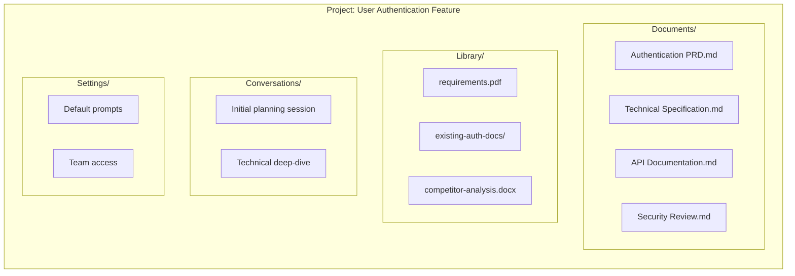

Projects are the primary way to organize your work in Fabric AI. They bring together documents, libraries, agents, and team collaboration in one place.

## What is a Project?

A project is a container for related work:

- **Documents** — PRDs, specs, architecture docs generated by agents
- **Libraries** — Uploaded files that provide context for AI agents
- **[Artifacts](/docs/features/project-artifacts)** — Pages Fabric Agent writes for this project
- **Conversations** — Chat history with agents about this project
- **Settings** — Project-specific configuration and templates

Use the project's [Coding Instructions](/docs/features/coding-instructions) tab
to share coding rules and connect Claude Code, Codex, or another coding tool.
The guide covers repository setup, folder uploads, and reviewing changes.

## Creating a Project

<Steps>
  <Step>
    ### Navigate to Projects

    Click **Projects** in the left sidebar.
  </Step>

  <Step>
    ### Create New Project

    Click **Create Project** and provide:

    - **Name** — Descriptive project name
    - **Description** — Brief summary of the project
    - **Template** (optional) — Start from a template
  </Step>

  <Step>
    ### Configure Settings

    Set project preferences:

    - **Default Document Type** — PRD, Spec, etc.
    - **Default Agent** — Which agent to use
    - **Visibility** — Personal or shared with organization
  </Step>

  <Step>
    ### Start Working

    Your project is ready! You can:
    - Upload documents to the library
    - Start a conversation with an agent
    - Generate your first document
  </Step>
</Steps>

## Project Structure



## Working with Documents

### Generating Documents

<Steps>
  <Step>
    ### Open Project

    Click on your project to open it.
  </Step>

  <Step>
    ### Start Agent Chat

    Click **New Document** or **Chat** to start a conversation with an agent.
  </Step>

  <Step>
    ### Describe What You Need

    Tell the agent what document you want:

    ```
    Create a PRD for implementing OAuth 2.0 authentication.
    Include user flows, API requirements, and security considerations.
    ```
  </Step>

  <Step>
    ### Review and Edit

    The agent generates a draft. You can:

    - **Edit directly** in the rich text editor
    - **Request changes** by chatting with the agent
    - **Accept/Reject** suggested modifications
  </Step>

  <Step>
    ### Save Document

    Click **Save** to add the document to your project.
  </Step>
</Steps>

### Document Types

Fabric supports various document types:

| Type | Description | Template Features |
|------|-------------|-------------------|
| PRD | Product Requirements Document | Goals, features, success metrics |
| Technical Spec | Technical implementation details | Architecture, APIs, data models |
| Architecture | System architecture documentation | Diagrams, components, flows |
| API Spec | API documentation | Endpoints, schemas, examples |
| Proposal | Project proposals | Problem, solution, timeline |

Features are no longer created as a document. Recommend, review, and manage Features in the project's **Roadmap** instead; Features documents created earlier stay readable.

### Document Editor

The built-in editor provides:

- **Rich formatting** — Headings, lists, code blocks
- **Markdown support** — Write in Markdown, render beautifully
- **AI assistance** — Inline AI suggestions and rewrites
- **Diff highlighting** — See changes clearly
- **Version history** — Track all changes
- **Export** — PDF, DOCX, Markdown

## Project Libraries

Each project has a dedicated library for RAG context.

### Uploading Documents

Drag and drop files or click to upload:

- **Supported formats** — PDF, DOCX, MD, TXT, code files
- **Size limits** — Up to 50MB per file
- **Bulk upload** — Multiple files at once

### Using Context

When you chat with an agent in a project, it automatically has access to:

1. All documents in the project library
2. Previously generated documents in the project
3. Any explicitly attached libraries

This means the agent understands your project context and can:
- Reference your existing documentation
- Maintain consistency across documents
- Build on previous work

### Managing the Library

- **Add files**: Upload new documents anytime
- **Remove files**: Delete outdated documents
- **Remove duplicates**: An item whose content matches another item's is marked *Duplicate of …*; **Remove duplicates** deletes the extra copies and keeps the original
- **Living Memory**: Files a connected agent pushes from a working tree appear under *Living Memory*, grouped by folder, with each file's full path under its name
- **Organize**: Create folders for organization
- **Search**: Find specific documents quickly

### Write Folders

When a project's Living Memory is synced from a repository, you can name **write folders**: folders in that repository where agents connected through the Fabric plugin save their files, such as specs and task notes. Fabric commits the files an agent writes there to the repository, and the next sync reads them back into Living Memory, where the next agent sees them.

To manage them, open the menu beside *Sync now* in the Living Memory section and choose **Write folders**.

- To add a folder, pick one in the tree, which shows only folders the sync selects, or type its path. Folders the sync leaves out, hidden folders such as `.github`, and the folder your coding instructions are read from can't be write folders. Folders can't contain one another, and a project can have up to ten.
- Each folder sets how its files land. **Pull request** (the default) opens a pull request against the synced branch, so someone reviews the files before they join it. **Push directly** commits straight to the branch with no review, and the next agent reads those files as they are. If another write lands on the branch first, Fabric retries the commit on the new branch tip; the write becomes a pull request only when the branch refuses the push (branch protection, a server hook, or missing write permission). Only project admins and owners can turn on **Push directly**, Fabric asks you to confirm, and the list shows who turned it on and when.
- Each folder also sets whether AI search uses its files. **Index for AI search** (the default) embeds the files, so project search and context summaries can use them. **Store only** keeps the files in Living Memory, readable in the Context tab, through the context tools and in the CLI mirror, but never embeds them, so AI search, keyword search and context summaries leave them out. In the Context tab each such file shows as Ready with a **Store only** label, and Context Readiness counts it as Ready, not as a source still processing. Use **Store only** for folders that will hold thousands of task or spec files, which would otherwise fill search and summaries with noise. A **Store only** badge marks such folders in the list. Changing the choice takes effect without a new sync: switching to **Store only** removes the folder's existing search data, and switching back embeds the files again (a large folder finishes over its next sync).
- You can change a folder's path, mode or search choice, or remove the folder. Removing a folder stops agents writing there, and its files are indexed again; files already written stay in the repository.

Members who can't add context can open the list but not change it.

## Team Collaboration

### Sharing Projects

Share projects with your organization:

1. Open project settings
2. Click **Sharing**
3. Choose visibility:
   - **Private** — Only you
   - **Organization** — All org members
   - **Specific members** — Selected individuals

### Member Roles

| Role | Permissions |
|------|-------------|
| Owner | Full control, can delete project |
| Editor | Can create and edit documents |
| Viewer | Can view documents only |

### Activity Feed

Track project activity:

- Document created by [User]
- Document edited by [User]
- Library document added
- Conversation started

## Project Templates

### Using Templates

Start from a template for faster setup:

1. Click **Create Project**
2. Select **Use Template**
3. Choose from available templates
4. Customize for your needs

### Available Templates

- **Feature Development** — PRD, spec, stories
- **API Project** — API spec, documentation
- **Research Project** — Analysis, findings, recommendations
- **Sprint Planning** — Stories, tasks, estimates

### Creating Templates

Create templates from existing projects:

1. Open a project
2. Click **Settings → Save as Template**
3. Choose what to include:
   - Document structure
   - Default prompts
   - Library organization
4. Save the template

## Project Settings

### General Settings

- **Name and description** — Update project details
- **Default agent** — Which agent to use by default
- **Default document type** — Starting document type

### Prompt Settings

Configure project-specific prompts:

- **Override organization prompts** — Use custom prompts
- **Variable defaults** — Pre-fill template variables
- **Output preferences** — Format, length, style

### Integration Settings

Connect external tools:

- **Jira** — Sync stories and tasks
- **GitHub** — Link to repository
- **Slack** — Send notifications

## Best Practices

### Project Organization

**One project per feature/initiative:**
```
✅ "User Authentication v2"
✅ "Q1 Mobile App Redesign"
✅ "API Rate Limiting Implementation"

❌ "All my PRDs"
❌ "Random documents"
```

**Clear naming:**
```
✅ "[Team] Feature Name - Phase"
   "[Platform] API Gateway - Phase 1"
   "[Mobile] Push Notifications - MVP"

❌ "New project"
❌ "test"
```

### Document Management

- Generate related documents in the same project
- Upload reference materials to the library
- Keep the library clean—remove outdated files
- Use consistent naming for documents

### Collaboration

- Set appropriate sharing levels
- Add descriptions for team understanding
- Use activity feed to track changes
- Archive completed projects

---

## Next Steps

<Cards>
  <Card title="Document Generation" href="/docs/tutorials/first-document">
    Create your first project document
  </Card>
  <Card title="Prompt Library" href="/docs/features/prompts">
    Configure project-specific prompts
  </Card>
</Cards>
