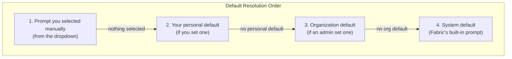

- **Audience**: Delivery teams and integration developers
- **Owner**: Fabric product engineering

The Prompt Library is a powerful feature that lets you create, manage, and version prompts for AI agents. It ensures consistency across your organization and allows you to optimize prompts over time.

## Browse and inspect

The library opens in a compact list with each prompt's name, purpose, access,
format, and last update. Switch to **Grid view** for compact cards. Search,
filters, and the selected view stay in the URL so you can return to the same
library view. Open a prompt to inspect its full instructions and metadata in a
preview drawer; choose **Edit** when you want to change it. The **Defaults**
menu groups your overrides, organization overrides, and proposed defaults.

In the editor, **Assistant** and **Try prompt** sit at the top of the right pane,
alongside the prompt title. Switch between them without losing your draft,
assistant conversation, preview inputs, or results. On smaller screens, use
**Assistant & Try** and **Edit prompt** to move between panes.

## Why Use a Prompt Library?

### Without a Library

- Each team member writes prompts differently
- No way to share effective prompts
- Can't track what worked and what didn't
- Prompts get lost in chat history

### With Fabric's Prompt Library

- **Consistency** — Everyone uses the same optimized prompts
- **Versioning** — Track changes and rollback if needed
- **Sharing** — Share effective prompts across teams
- **Analytics** — See which prompts perform best
- **Templates** — Use variables for dynamic content

## Prompt Types

### System Prompts (Read-Only)

Platform-provided prompts optimized for specific tasks:

- **PRD Generator** — Creates Product Requirement Documents
- **Technical Spec** — Generates technical specifications
- **Architecture Doc** — Designs system architecture documents
- **User Story** — Creates user stories with acceptance criteria
- **API Documentation** — Documents API endpoints

These prompts are:
- Tested and optimized by Fabric
- Can't be edited directly
- Can be forked to create custom versions

### User Prompts (Editable)

Custom prompts created by you or your organization:

- Full editing control
- Version history
- Organization scope with separate user preferences for defaults
- Can be based on system prompts

## Creating Prompts

<Steps>
  <Step>
    ### Navigate to Prompt Library

    Click **Prompts** in the sidebar.
  </Step>

  <Step>
    ### Create New Prompt

    Click **Create Prompt** and fill in:
    
    - **Name** — Descriptive name (e.g., "Engineering PRD Template")
    - **Description** — What the prompt is for
    - **Content** — The actual prompt text
  </Step>

  <Step>
    ### Add Template Variables

    Use Handlebars syntax for dynamic content:
    
    ```handlebars
    You are writing a PRD for {{projectName}}.
    
    The target audience is {{audience}}.
    
    Requirements:
    {{#each requirements}}
    - {{this}}
    {{/each}}
    
    {{#if includeTimeline}}
    Include a timeline section with milestones.
    {{/if}}
    ```
  </Step>

  <Step>
    ### Set Scope

    New prompts are created in the current organization and shared with its members.
    Platform system prompts remain managed by Fabric. A personal default is a
    user preference within an organization, not a separate personal workspace.

    See [Prompt Scopes](#prompt-scopes) for the distinction between content
    visibility and the defaults used by actions.
  </Step>

  <Step>
    ### Save

    Click **Save** to create the prompt. It's now available for use.
  </Step>
</Steps>

## Template Variables

Template variables make prompts dynamic and reusable.

### Syntax

```handlebars
{{variableName}}           — Simple variable
{{#if condition}}...{{/if}} — Conditional block
{{#each items}}...{{/each}} — Loop over array
{{#unless condition}}...{{/unless}} — Negative conditional
```

### Built-in Variables

Document-generation runtimes may provide context variables such as these.
Interactive **Try prompt** uses only the values you supply and injects none of them automatically:

| Variable | Description |
|----------|-------------|
| `{{projectName}}` | Current project name |
| `{{projectDescription}}` | Project description |
| `{{organizationName}}` | Organization name |
| `{{userName}}` | Current user's name |
| `{{currentDate}}` | Today's date |
| `{{documentType}}` | Type of document being generated |

### Custom Variables

Define your own variables when using prompts:

```handlebars
Create a {{documentType}} for {{featureName}}.

Target users: {{targetUsers}}
Priority: {{priority}}
```

When using this prompt, you'll be asked to provide values for each variable.

## Prompt Scopes

Every prompt belongs to one of three scopes that control who can see and use it.

### System

System prompts are provided by Fabric and available to all users. They serve as the platform defaults for each document type. System prompts cannot be edited, but you can **fork** one to create your own customized version.

### Organization

Organization prompts are visible to every member of their organization.
The library is always opened within an organization; a prompt in another
organization is not made visible by switching library filters.

### User preferences

The **My Prompts** filter can display retained user-owned prompt content.
New prompt creation is organization-only. **My Overrides** is a user preference
for action defaults within the current organization; it is not a personal
workspace or a second tenant context. User preference precedence is retained.

<Callout>
Prompt content visibility and binding scope are separate. Saving or copying an
organization prompt does not bind it to an action. A user's chosen default can
take precedence over organization and system defaults without changing shared
prompt content.
</Callout>

## Prompt Bindings and Defaults

A **binding** connects a prompt to a specific agent and document type, making it available in the prompt selector when generating that type of document. You can also mark a binding as the **default**, so it is automatically selected.

### Setting a default

You can set a prompt as the default from two places:

- **Prompts page** — Use the document type tabs to filter by type, then select **Set as Default** from the prompt's menu.
- **Document editor** — When generating a document, pick a prompt from the dropdown and click **Bind as Default**.

When setting a default, you choose a **binding scope**:

- **Personal** — This default applies only to you.
- **Organization** — This default applies to every member of the organization.

### How defaults are resolved

When you generate a document, Fabric looks for the best prompt to use by checking each level in order and stopping at the first match:



This means:
- A personal default always takes priority over the organization and system defaults.
- An organization default takes priority over the system default for all members who haven't set their own personal default.
- The system default is the final fallback.

### Example: team with mixed defaults

Suppose your organization has three team members generating PRDs:

| Team member | Personal default set? | Prompt used |
|-------------|----------------------|-------------|
| Alice | Yes — her custom prompt | Alice's personal default |
| Bob | No | Organization default |
| Carol | No | Organization default |

Alice's personal default does not affect Bob or Carol. If the organization admin later updates the organization default, Bob and Carol see the change immediately, while Alice continues using her own.

<Callout>
When you set a new organization default, your own personal default for that document type is cleared automatically so the new organization default takes effect for you right away.
</Callout>

## Versioning

Every prompt maintains a version history.

### Automatic Versioning

When you edit a prompt:
1. A new version is created automatically
2. Previous versions are preserved
3. You can view the diff between versions
4. Rollback is available anytime

### Version History

```
v3 (current) — Added timeline section
v2           — Improved formatting
v1           — Initial version
```

### Rollback

To rollback to a previous version:

1. Open the prompt
2. Click **Version History**
3. Select the version to restore
4. Click **Restore This Version**

A new version is created (rollbacks don't delete history).

## Organization Prompts

### Sharing a prompt with your team

To make a prompt available to your entire organization:

1. Create or edit a prompt
2. Set the scope to **Organization**
3. Save the prompt

All organization members can now view, use, and fork the prompt to create their own versions.

### Setting organization-wide defaults

Organization admins can set a prompt as the default for a document type across the entire organization:

1. Open the prompt in the Prompt Library
2. Select **Set as Default** from the menu
3. Choose the document type and agent
4. Set the binding scope to **Organization**

Members who haven't set their own personal default will automatically use this prompt when generating that document type.

## Best Practices

### Writing Effective Prompts

**Be Specific**
```
❌ "Write a document about the feature"
✅ "Write a PRD for {{featureName}} that includes:
    - Problem statement
    - Proposed solution
    - User stories
    - Success metrics"
```

**Use Context**
```
❌ "Create user stories"
✅ "Based on the PRD for {{projectName}}, create user stories
    that follow the format:
    As a [user type], I want [goal] so that [benefit]"
```

**Include Examples**
```
"Format the output like this example:

## User Story 1
**As a** customer
**I want** to reset my password
**So that** I can regain access to my account

### Acceptance Criteria
- [ ] User receives reset email within 1 minute
- [ ] Reset link expires after 24 hours"
```

### Prompt Organization

**Naming Convention**
```
[Type] - [Purpose] - [Version/Variant]

Examples:
"PRD - Feature Request - Technical"
"Story - Bug Fix Template"
"Spec - API Documentation - REST"
```

**Categories**
- Document generation prompts
- Code review prompts
- Analysis prompts
- Communication prompts

### Testing Prompts

Before making a prompt organization-wide:

1. Test with various inputs
2. Check output quality
3. Verify variable handling
4. Get feedback from team members
5. Iterate based on results

## Inspect usage and results

The library shows recorded usage counts and last-used information when available.
The details page keeps saved versions, comparisons and action bindings together.
Use **Try prompt** to inspect a live output and its exact rendered input; this
interactive preview does not assign a satisfaction score or create a saved
evaluation. Where AI adoption reporting is enabled, assistance and previews
have separate feature labels.

---

## Next Steps

<Cards>
  <Card title="Agents" href="/docs/agents/overview">
    Learn about the agents that use prompts
  </Card>
  <Card title="Document Generation" href="/docs/tutorials/first-document">
    Generate your first document with custom prompts
  </Card>
</Cards>


## Create, inspect and try a prompt

Use **Create prompt** to start **From conversation**, **From scratch**, or
**From existing**. Existing prompts are copied only after their authorized
content loads. Review the text and metadata before creating a separate prompt;
its action bindings and defaults are not copied. Organization owners and administrators can create new prompts. New prompts belong to the
current organization and are available to its members. They are not private
skill drafts. Creating one does not replace an action default.

Selecting a prompt opens its inspection drawer. **Edit** opens the focused
editor; **X** and **Cancel** ask before discarding changed text. Library search,
view, scope, sort and page are retained when returning from the editor.
Existing versions, comparisons, restoration and action bindings remain on the
full details page.

The editor's **Assistant** begins with a question and sends nothing until you
request help. It proposes text for review. **Apply proposal to draft** changes
only the open draft; saving is a separate action. If the draft changes during
or after a request, ask for a fresh proposal before applying it.

**Try prompt** calls your configured AI provider with the current draft and
supplied text inputs. Use it to check the response before saving your prompt.
Results open in **Formatted** view, with Markdown headings, lists, tables and
code blocks rendered for reading. **Raw text** shows the exact response, and
**Copy result** copies that response. **Rendered input** shows the text sent to
the model after substituting preview inputs.
Plain text and Markdown are sent verbatim. Template formats support simple text
placeholders such as `{{topic}}`; missing values are rejected. Interactive Try
does not execute template programs, filters, includes, nested expressions,
document retrieval or tools. Advanced template logic belongs in the existing
workflow runtime. Changing the draft or inputs marks earlier output as stale.
A preview is a single model response, not a saved evaluation, agent/workflow run,
publication or action binding.

Prompt text format and expected response format are separate concerns. Markdown
and plain text describe the instructions; template formats describe input
substitution. **Use named inputs** exposes input fields without asking you to
choose a template engine. Existing template engines remain under **Details**.

Choose **Expected response** in **Try prompt**:

- **Let the prompt decide** keeps existing behavior.
- **Plain text** and **Markdown** request that presentation without a quality score.
- **JSON with expected fields** offers a field builder and an advanced JSON schema.
  Preview requests JSON from the provider, then independently checks the actual
  response against your schema. It never changes types, removes fields, inserts
  defaults, or retries a failed check. Failed output remains available to inspect
  and copy. Schemas support bounded object fields, arrays, primitive types,
  required fields, enums and numeric/length bounds; references and regexes are
  refused before calling the provider.
- **XML (advanced)** checks exactly one well-formed XML document. DTDs and entity
  declarations are refused. This is syntax validation, not XSD validation.

Saving snapshots expectations with the prompt version. Metadata-only saves do not
create a version; response-only saves preserve the latest instructions. Duplicate
and restore retain the corresponding version's expectations. Changing a response
setting marks prior preview results as stale. These checks apply to **Try prompt**;
existing agent and Temporal workflow output policies remain in control of their
own execution. A passing structure check does not establish factual accuracy.

On a small screen, use **Assistant & Try** and **Edit prompt** to switch panes.
The assistant input stays within its pane instead of following the full form.

### API, CLI and MCP

| Operation | REST | SDK | CLI | MCP |
| --- | --- | --- | --- | --- |
| Reviewed assistance | `POST /api/v1/prompt-assistance` | `client.prompts.assist(input)` | `fabric prompts assist request.json --org example-org` | `fabric_assist_prompt` |
| Live preview | `POST /api/v1/prompt-previews` | `client.prompts.preview(input)` | `fabric prompts preview request.json --org example-org` | `fabric_preview_prompt` |
| Read saved expectations | `POST /api/v1/prompt-responses/read` | `client.prompts.getResponseContract(promptId)` | `fabric prompts response <id> --org example-org` | `fabric_get_prompt_response` |
| Save expectations as a version | `POST /api/v1/prompt-responses` | `client.prompts.setResponseContract(promptId, contract)` | `fabric prompts response <id> --file contract.json --org example-org` | `fabric_update_prompt_response` |

Requests carry a `draft` with `name`, `description`, `format` and `content`.
Assistance adds `message` and optional bounded `history`. Preview adds
`variables`, an object of text values. Requests are bounded to 512 KiB.
Assistance requires `prompts:write`; preview requires `prompts:read`.
Both also check the actor's current organization permissions and AI access,
including wildcard keys. Project-bound and service credentials cannot use the
organization authoring tools. Neither operation saves or publishes anything,
and SDK calls do not automatically retry model spending.

Preview drafts optionally carry `responseContract`, for example:

```json
{
  "format": "JSON",
  "schema": {
    "type": "object",
    "properties": { "summary": { "type": "string" } },
    "required": ["summary"],
    "additionalProperties": false
  }
}
```

Preview returns the original `output`, `responseFormat`, and `validation` with
`status` (`not_requested`, `passed`, or `failed`) and bounded issues. The CLI exits
nonzero when a response fails its checks. Saved-expectation requests carry
`promptId`; writes also carry `responseContract`. Reads require `prompts:read`,
writes require `prompts:write`, and neither saved-settings operation requires AI
access or calls a model. Organization writes require a current owner or admin;
system writes require platform administration. MCP writes require confirmation.
Changes are audited as `prompt.response_contract_changed` with only version id
and response format, never prompt content or schemas. Older content-only clients
inherit the prior expectations; explicitly save `{ "format": "AUTO" }` to clear
them. Requests remain organization-bound and reject project/service credentials.
