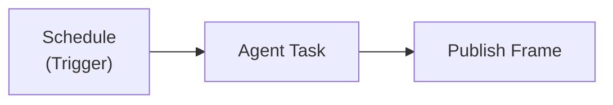

Ein geplanter Agent-Workflow erledigt eine Aufgabe nach Zeitplan, ohne dass jemand zusieht: Jeden Montagmorgen liest ein Agent die Arbeitselemente Ihres Projekts, schreibt eine Statusseite und veröffentlicht sie dort, wo das Team sie findet. Sie beschreiben die Aufgabe gegenüber Fabric Agent, prüfen den Entwurf, und Fabric führt sie von da an aus.

Er besteht aus drei Knoten auf der Oberfläche des [Workflow Builders](/docs/features/workflow-builder):

## Einen einrichten

Fragen Sie Fabric Agent in einem beliebigen Chat: „Schreibe jeden Montag um 9 eine Statusseite der offenen Arbeit dieses Projekts und veröffentliche sie auf seinem Artifacts-Tab." Der Agent entwirft den Workflow und zeigt Ihnen eine Karte, bevor etwas gespeichert wird: den Zeitplan in Worten und in Ihrer Zeitzone, den Prompt, den der Agent ausführt, die verbundenen Server und eingebauten Tools, die er nutzen darf, Titel und Format der Seite sowie alles, was den Workflow am Livegang hindern würde. Nichts wird erstellt, bevor Sie zustimmen.

Fabric Agent fragt auf dieselbe Weise, bevor er einen Workflow ändert, veröffentlicht, zurückzieht, pausiert, fortsetzt oder ausführt. Die Karte zeigt die genauen Werte, die die Aktion verwenden würde.

Den gespeicherten Workflow können Sie jederzeit im Workflow Builder öffnen und seine Knoten von Hand bearbeiten.

## Die Knoten

### Schedule

Der **Trigger Type** des Trigger-Knotens ist **Schedule**, mit einem Cron-Ausdruck und einer Zeitzone.

- **Zeitzone.** Der Cron wird in der von Ihnen gesetzten Zeitzone gelesen, als IANA-Name wie `Europe/Berlin` oder `America/New_York`. Ohne Angabe wird er in `UTC` gelesen, was selten dort ist, wo Sie sind – geben Sie also eine an. Ein Name, der keine Zeitzone ist, wird beim Veröffentlichen des Workflows abgelehnt.
- **Höchstens alle 15 Minuten.** Ein Zeitplan, der einen Agent Task ausführt, darf nicht häufiger als alle 15 Minuten auslösen. Ein schnellerer Zeitplan oder einer, dessen Intervall sich nicht bestimmen lässt, wird beim Veröffentlichen des Workflows abgelehnt.

### Agent Task

Führt einen KI-Agenten mit einem von Ihnen geschriebenen Prompt aus. Seine Einstellungen:

| Einstellung | Was sie bewirkt |
|-------------|-----------------|
| **Prompt** | Die Aufgabe, bis zu 20.000 Zeichen |
| **System prompt** | Optionale Dauer-Anweisungen |
| **Model** | Optional; bei leerem Feld das Standardmodell |
| **MCP servers** | Verbundene Server des Workflow-Eigentümers, die der Agent aufrufen darf, bis zu 10 |
| **Built-in tools** | Fabrics eigene Fähigkeiten, etwa Projektkontext, bis zu 30 |
| **Max iterations** | Wie viele Runden mit Tool-Aufrufen er machen darf, 1 bis 10 |
| **Output format** | `html` oder `markdown` |

Sein Ergebnis steht späteren Knoten als `{{Agent Task.html}}` oder `{{Agent Task.markdown}}` zur Verfügung.

### Publish Frame

Speichert das Ergebnis des Agenten als Seite, damit die Menschen, die es brauchen, sie öffnen können. Seine Einstellungen:

| Einstellung | Was sie bewirkt |
|-------------|-----------------|
| **Title** und **Description** | Wie die Seite heißt und was sie zeigt |
| **Content** | Was auf die Seite kommt, meist `{{Agent Task.html}}` |
| **Surface** | `artifact` (der Artifacts-Tab eines Projekts, Standard) oder `workspace` (ein [Workspace](/docs/features/workspace-pages) der Organisation) |
| **Project** | Standardmäßig das Projekt des Workflows; für ein Artifact erforderlich |
| **Mode** | `new-version` behält eine Seite und fügt bei jedem Lauf eine Version hinzu (Standard); `new-frame` erzeugt bei jedem Lauf eine neue Seite |

Jeder Lauf im Modus `new-version` lässt den früheren Text im Versionsverlauf der Seite, sodass Sie sehen, was der Bericht letzte Woche sagte.

## Regeln für einen Lauf ohne Aufsicht

Ein Agent, der von selbst läuft, liest private Daten und handelt für die Person, der der Workflow gehört. Diese Regeln gelten für jeden Agent Task, wenn der Workflow veröffentlicht wird und bei jedem Lauf erneut:

- **Er handelt als sein Eigentümer, nur mit dessen eigenen Verbindungen.** Die MCP-Server, die er aufrufen darf, hat der Eigentümer verbunden; das wird bei jedem Lauf geprüft. Die Verbindung eines anderen kann nicht benannt werden.
- **Er hat keine Web- oder Code-Tools.** Websuche, Web-Browsing und der Code-Interpreter werden abgelehnt, denn ein Agent, der private Daten liest und jede Adresse abrufen kann, kann diese Daten nach außen senden. Er kann auch keine Frames selbst erstellen oder teilen (dafür ist der Publish-Frame-Knoten da) und keine Arbeit an andere Agenten übergeben.
- **Er kann verbundene Systeme nicht von sich aus ändern.** Ein Tool, das in einem verbundenen Server etwas ändern würde, braucht eine Freigabe; wenn niemand da ist, sie zu geben, wird der Aufruf abgelehnt. Ein geplanter Agent liest und berichtet.
- **Seine Seite hat keine Skripte.** Eine von einem geplanten Lauf geschriebene Seite wird als statischer Bericht angezeigt; Schaltflächen und Skripte gibt es nur auf Seiten, die in einem Chat geschrieben wurden.
- **Er hält an, wenn sein Eigentümer den Zugriff verliert.** Verlässt der Eigentümer die Organisation oder darf er keine Workflows mehr ausführen, pausiert der nächste geplante Lauf den Workflow, statt ihn auszuführen.

## Wenn ein Lauf fehlschlägt

Ein geplanter Lauf, der fehlschlägt, wird gezählt. **Nach drei fehlgeschlagenen Läufen in Folge pausiert sich der Workflow selbst** und sein Zeitplan wird entfernt, damit eine Aufgabe, die niemand beobachtet, nicht ständig weiter fehlschlägt oder Kosten verursacht. Ein erfolgreicher Lauf setzt die Zählung auf null zurück.

Das gilt für **jeden** geplanten Workflow, nicht nur für Agent-Workflows.

Sobald Sie das Problem behoben haben, setzen Sie den Workflow fort (bitten Sie Fabric Agent darum, oder setzen Sie ihn im Workflow Builder fort); der Zeitplan kommt zurück und die Zählung beginnt neu.

## Benachrichtigungen

Der Eigentümer des Workflows wird in den Benachrichtigungen von Fabric informiert:

- beim **ersten erfolgreichen Lauf** eines geplanten Workflows, mit einem Link zur veröffentlichten Seite, sofern es eine gibt;
- bei **jedem Lauf, der fehlschlägt**;
- wenn der Workflow nach drei Fehlschlägen in Folge **pausiert** wird.

Die Benachrichtigungen sagen, was passiert ist, nie den rohen Fehler, weil die Benachrichtigungsliste in der Oberfläche sichtbar ist. Im Laufverlauf des Workflows sehen Sie, was schiefging.

## Verwandte Themen

- [Workflow Builder](/docs/features/workflow-builder), Trigger, Knoten, Veröffentlichen und Laufverlauf
- [Projekt-Artifacts](/docs/features/project-artifacts) und [Workspaces](/docs/features/workspace-pages), wo die Seiten erscheinen
- [Fabric MCP Gateway](/docs/integrations/mcp-gateway), die Tools, mit denen Fabric Agent einen Workflow einrichtet
