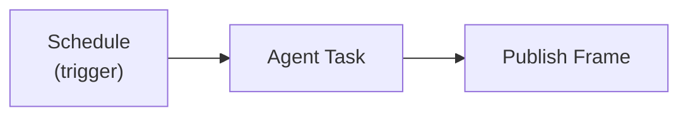
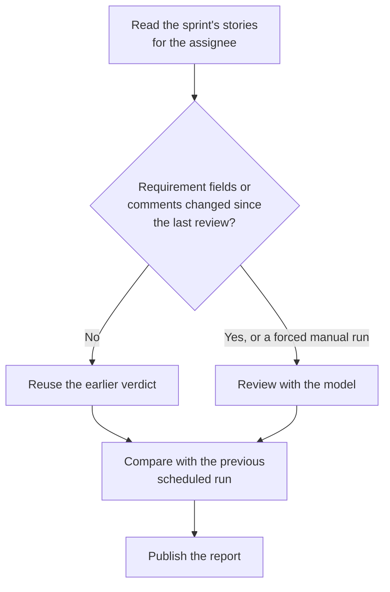

A scheduled agent workflow does a job on a timetable with nobody watching: every Monday morning an agent reads your project's work items, writes a status page, and publishes it where the team will find it. You describe the job to Fabric Agent, check the draft, and Fabric runs it from then on.

It is built from three nodes on the [Workflow Builder](/docs/features/workflow-builder) canvas:

## Set one up

Ask Fabric Agent in any chat: "Every Monday at 9 write a status page of this project's open work and publish it on its Artifacts tab." The agent drafts the workflow and shows you a card before anything is saved: the schedule in words and in your time zone, the prompt the agent will run, the connected servers and built-in tools it may use, the title and format of the page, and any problems that would stop the workflow going live. Nothing is created until you approve.

Fabric Agent asks the same way before it changes, publishes, unpublishes, pauses, resumes or runs a workflow. The card shows the exact values the action would use.

The card lists every step of the workflow with its type and settings, one level down included, so a change to a setting such as `sprintContext.iterationPaths` is visible before you approve it. A setting whose name marks it as a credential (an authorization header, cookie, token, secret, password or API key) shows as `(hidden)`.

Ask the agent to attach the workflow to your project. Its runs then follow that project's rules: in a project in read-only mode, a step that would write to a connected service is refused.

You can open the saved workflow in the Workflow Builder at any time and edit its nodes by hand.

## The nodes

### Schedule

The trigger node's **Trigger Type** is **Schedule**, with a cron expression and a time zone.

- **A cron is required.** A Schedule trigger without one is listed as a problem on the card, and publishing is refused.
- **Time zone.** The cron is read in the time zone you set, as an IANA name such as `Europe/Berlin` or `America/New_York`. Without one it is read in `UTC`, which is rarely where you are, so give one. A name that is not a time zone is refused when the workflow is published.
- **At most every 15 minutes.** A schedule that runs an Agent Task may not fire more often than every 15 minutes. A faster schedule, or one whose interval cannot be worked out, is refused when the workflow is published.

### Agent Task

Runs an AI agent with a prompt you write. Its settings:

| Setting | What it does |
|---------|--------------|
| **Prompt** | The job, up to 20,000 characters |
| **System prompt** | Optional standing instructions |
| **Model** | Optional; the default model when empty |
| **MCP servers** | Connected servers of the workflow's owner the agent may call, up to 10 |
| **Built-in tools** | Fabric's own capabilities, such as project context, up to 30 |
| **Max iterations** | How many tool-calling rounds it may take, 1 to 10 |
| **Output format** | `html` or `markdown` |

Its result is available to later nodes as `{{Agent Task.html}}` or `{{Agent Task.markdown}}`.

### Review ADO Stories

Use this node in place of the Agent Task to review the Azure DevOps stories in a sprint against your own definition of ready. It needs the project's Azure DevOps connection described in [Workspaces](/docs/features/workspace-pages#azure-devops-work-item-summaries). Ask Fabric Agent, for example:

> Every weekday at 08:00, review the user stories assigned to me in the current sprint against our definition of ready and publish the result on this project's Artifacts tab.

Its settings:

| Setting | What it does |
|---------|--------------|
| **Assignee** | Whose stories to review: the person signed in to the Azure DevOps connection the workflow uses, or a named person |
| **Sprint** | One or two iteration paths, and the one or two fields that say who an item belongs to: `System.AssignedTo` or a person field of your own process, such as `Custom.Engineer` |
| **Work item types** | Which types count as stories; `User Story` when empty |
| **Requirement fields** | The fields a review reads; title, description and acceptance criteria when empty |
| **Rubric** | What a ready story looks like, up to 16,000 characters |
| **Model** | Optional; the default model when empty |
| **Max stories** | How many stories one run reviews, 20 by default and at most 50 |

Each story gets a verdict of ready, needs work or blocked, with a summary and up to eight issues. The report links every story and names the person it was picked for, also when a custom person field picked it.

A run reviews a story again only when its requirement fields or comments changed since its last review. Other stories reuse their earlier verdict without calling the model. Changing the rubric or the model reviews every story again, and a manual run can ask for a fresh review of all of them.

A scheduled run also compares the sprint with the previous scheduled run and counts the stories reviewed, reused and removed. The first scheduled run has nothing to compare with and says so. When nothing changed, the report says "No changes since the last capture."

### Publish Frame

Saves the agent's result as a page, so the people who need it can open it. Its settings:

| Setting | What it does |
|---------|--------------|
| **Title** and **Description** | What the page is called and what it shows |
| **Content** | What goes on the page, usually `{{Agent Task.html}}` |
| **Surface** | `artifact` (a project's Artifacts tab, the default) or `workspace` (an organization [Workspace](/docs/features/workspace-pages)) |
| **Project** | Defaults to the workflow's project; required for an artifact |
| **Mode** | `new-version` keeps one page and adds a version on each run (default); `new-frame` makes a new page every run |

Every run in `new-version` mode leaves the earlier text in the page's version history, so you can see what the report said last week.

## Rules for a run nobody is watching

An agent that runs on its own reads private data and acts for the person who owns the workflow. These rules apply to every Agent Task, when the workflow is published and again every time it runs:

- **It acts as its owner, with the owner's own connections only.** The MCP servers it may call are ones the owner connected, checked each run. Someone else's connection cannot be named.
- **It has no web or code tools.** Web search, web browsing and the code interpreter are refused, because an agent that reads private data and can fetch any address can send that data out. It also cannot create or share frames itself (that is what the Publish Frame node is for) or hand work to other agents.
- **It cannot change connected systems on its own.** A tool that would change something in a connected server needs an approval, and with nobody there to give one the call is refused. A scheduled agent reads and reports.
- **Its page has no scripts.** A page written by a scheduled run is shown as a static report; buttons and scripts only exist on pages written in a chat.
- **It stops when its owner loses access.** If the owner leaves the organization or may no longer run workflows, the next scheduled run pauses the workflow instead of running it.

## When a run fails

A scheduled run that fails is counted. **After three failed runs in a row the workflow pauses itself** and its schedule is removed, so a job that nobody is watching cannot keep failing or spending. A run that succeeds starts the count again from zero.

This applies to **every** scheduled workflow, not only agent workflows.

Once you have fixed the problem, resume the workflow (ask Fabric Agent to resume it, or resume it from the Workflow Builder); the schedule comes back and the count starts fresh.

## Notifications

The workflow's owner is notified, in Fabric's notifications:

- the **first time** a scheduled workflow runs successfully, with a link to the page it published when there is one;
- **every run that fails**;
- when the workflow is **paused** after three failures in a row.

Notifications say what happened, never the raw error, because the notification list is visible in the interface. Open the workflow's run history to see what went wrong.

## Related

- [Workflow Builder](/docs/features/workflow-builder), triggers, nodes, publishing and run history
- [Project Artifacts](/docs/features/project-artifacts) and [Workspaces](/docs/features/workspace-pages), where the pages appear
- [Fabric MCP Gateway](/docs/integrations/mcp-gateway), the tools Fabric Agent uses to set a workflow up
