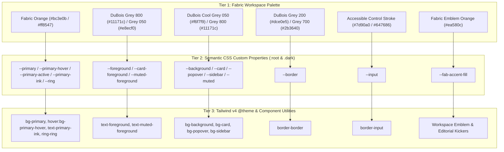
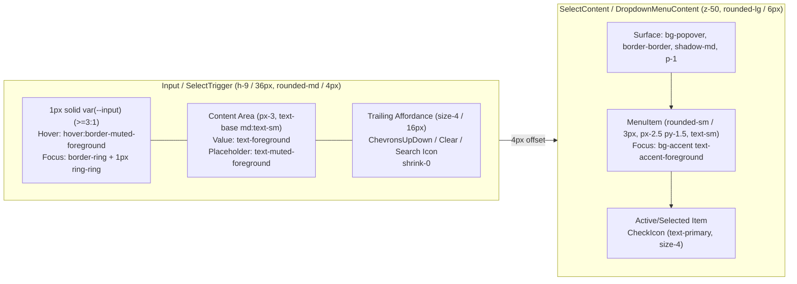
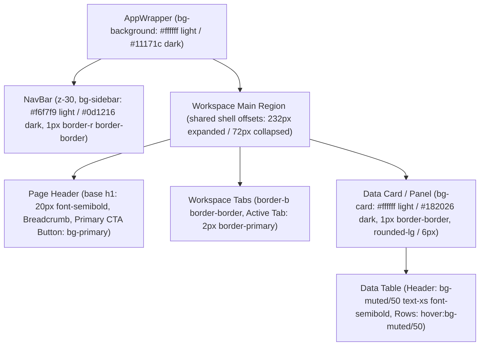

# Fabric Workspace Design System (Databricks DuBois Aesthetics)

- **Audience**: Engineers and AI agents
- **Owner**: Frontend platform maintainers

> **Canonical Reference**: This document defines the visual language, token architecture, component anatomy, and interaction model applied to `fabric-oss`, drawing on the Databricks DuBois workspace aesthetic. For strict implementation rules and layering conventions, see [UI Style Guide](docs/ui-style-guide.md).

---

## Visual Theme & Atmosphere

Fabric adopts the **Databricks Workspace (DuBois Design System)** aesthetic—a high-density, precision-engineered enterprise workspace built for data scientists, software engineers, and product builders who spend hours navigating technical artifacts, SQL/code blocks, agent workflows, and living specifications.

### Design Philosophy & Mood

1. **Precision Over Ornamentation**: Surfaces are crisp, flat, and structured by `1px` cool-slate hairline borders (`#dce0e5` light / `#2b3640` dark) rather than heavy drop shadows, blurred glassmorphism, or decorative gradients.
2. **Cool Slate Canvas Hierarchy**:
   - **Light Mode**: Uses a crisp pure-white workspace canvas and cards (`#ffffff`), anchored by a recessed cool-grey navigation rail (`#f6f7f9`, `grey050`) and deep navy-charcoal ink (`#11171c`, `grey800`).
   - **Dark Mode**: Uses a deep carbon-navy canvas (`#11171c`, `grey800`) with elevated slate panels (`#182026`), elevated popovers (`#1f272d`), recessed dark rail (`#0d1216`), and high-legibility cool off-white ink (`#e8ecf0`, `grey050`).
3. **Fabric Orange Accents**:
   - Interactive primary actions, focus rings, active tab indicators, and selected states use **Fabric orange** (`#bc3e0b` in light mode, `#ff8547` in dark mode), with solid hover (`#a33307` / `#ff9863`) and active (`#8a2a05` / `#ffaa7d`) tokens. These are Fabric adaptations of the workspace aesthetic, rather than official Databricks palette values.
   - Brand identity markers—the sidebar workspace emblem and editorial accents (`--fab-accent-fill`)—use `#ea580c` in both themes; the brand ink accent (`--fab-accent`) uses `#d94e14` / `#ff8547`.
4. **Compact, Predictable Geometry**:
   - Interactive controls (buttons, textboxes, selects, checkboxes, radio items) use a sharp **`4px` (`0.25rem`) corner radius** (`--radius: 0.25rem`, `rounded-md`) or **`3px` (`calc(var(--radius) - 1px)`)** (`rounded-sm`).
   - Cards, dialogs, alert dialogs, popovers, hover cards, and dropdown menus use a **`6px` (`calc(var(--radius) + 2px)`) corner radius** (`rounded-lg`).
   - Control heights standardize on `36px` (`h-9`) for primary form controls, `32px` (`h-8`) for dense workspace toolbars, and `28px` (`h-7`) for inline utility actions. Fabric uses `13px` body text with a `20px` line height, while form inputs use `16px` text below `md` to prevent mobile focus zoom.
5. **Zero-Bounce Micro-Interactions**:
   - Controls respond with immediate `150ms` color and border transitions (`transition-colors duration-150`). Scale transforms (`active:scale-*`) and spring physics on buttons or inputs are prohibited.

---

## Design Token Overview

Fabric uses a **three-tier token hierarchy** defined in [`tooling/tailwind/theme.css`](tooling/tailwind/theme.css) and bridged into Tailwind CSS v4 via `@theme`.

### Token Naming & Scoping Rules

- **Semantic CSS variables (`--background`, `--primary`, `--input`, etc.)** live in `@layer base` under `:root` (light mode) and `.dark` (dark mode) in [`tooling/tailwind/theme.css`](tooling/tailwind/theme.css).
- **Tailwind `@theme` mappings (`--color-*`, `--radius-*`)** expose every semantic variable to Tailwind utility classes (`bg-card`, `border-input`, `text-primary-ink`, `rounded-md`).
- **Organization Brand Overrides**: [`OrganizationThemeProvider.tsx`](apps/web/modules/saas/organizations/components/OrganizationThemeProvider.tsx) checks `findBrandColor(brandColor)`. When an organization configures a recognized `brandColor` other than `red`, it overrides `--ring`, `--fab-accent-fill`, `--fab-accent`, `--primary-ink-light`, and `--primary-ink-dark`. With no recognized non-red brand, it calls `removeProperty` on those inline variables so `:root` and `.dark` in `theme.css` remain live across theme toggles, while `--org-accent*` uses the explicit brand or the orange fallback. The primary button fill remains on the shared theme tokens.

---

## Color Palette & Roles

The tables show the default CSS theme; organization brand overrides can change accent and focus colors. Contrast ratios are rounded to two decimal places.

The base theme token pairs and control borders are covered by automated checks for **WCAG 2.1 AA** (`>= 4.5:1` for normal text, `>= 3.0:1` for non-text UI components and adjacent chart segments) via [`theme-token-contrast.test.ts`](apps/web/__tests__/theme-token-contrast.test.ts), [`health-status-badge-contrast.test.ts`](apps/web/__tests__/modules/saas/system-health/health-status-badge-contrast.test.ts), and [`ProjectUsage.test.tsx`](apps/web/modules/saas/projects/components/usage/__tests__/ProjectUsage.test.tsx).

### Core Surface & Ink Tokens

| Semantic Token | Light Mode (`:root`) | Dark Mode (`.dark`) | DuBois Role & Usage | WCAG Contrast (Light / Dark) |
| --- | --- | --- | --- | --- |
| `--background` | `#ffffff` | `#11171c` | Workspace page canvas (`#ffffff` / `grey800`) | — |
| `--foreground` | `#11171c` | `#e8ecf0` | Primary body & heading ink (`grey800` / `grey050`) | `18.05:1` / `15.21:1` on `background` |
| `--card` | `#ffffff` | `#182026` | Elevated panels, notebooks, data cards, table containers | — |
| `--card-foreground` | `#11171c` | `#e8ecf0` | Primary ink inside cards | `18.05:1` / `13.89:1` on `card` |
| `--popover` | `#ffffff` | `#1f272d` | Dropdown menus, select popovers, command palettes, dialogs | — |
| `--popover-foreground` | `#11171c` | `#e8ecf0` | Ink inside floating overlays | `18.05:1` / `12.76:1` on `popover` |
| `--sidebar` | `#f6f7f9` | `#0d1216` | Left workspace navigation rail (`grey050` / dark rail) | — |
| `--muted` | `#f1f3f6` | `#1e262d` | Subtle container fills, table header bands, secondary pills | — |
| `--muted-foreground` | `#4f6170` | `#94a3b3` | Secondary labels, placeholders, timestamps, column headers | `5.77:1` / `5.95:1` on `muted` |
| `--accent` | `#e8edf2` | `#26323d` | Hover wash on menu items, ghost buttons, and list rows | — |
| `--accent-foreground` | `#11171c` | `#e8ecf0` | Ink on hovered/active menu items and rows | `15.33:1` / `11.01:1` on `accent` |

### Interactive, Semantic & Border Tokens

| Semantic Token | Light Mode (`:root`) | Dark Mode (`.dark`) | DuBois Role & Usage | WCAG Contrast (Light / Dark) |
| --- | --- | --- | --- | --- |
| `--primary` | `#bc3e0b` | `#ff8547` | Primary CTA buttons, active tab border, checkboxes, switches | `5.48:1` / `7.48:1` with `primary-foreground` |
| `--primary-foreground` | `#ffffff` | `#11171c` | Text and icons on filled `--primary` controls | `5.48:1` / `7.48:1` |
| `--primary-hover` | `#a33307` | `#ff9863` | Solid Fabric orange hover state for primary buttons | `6.92:1` / `8.53:1` with `primary-foreground` |
| `--primary-active` | `#8a2a05` | `#ffaa7d` | Solid Fabric orange pressed/active state for primary buttons | `8.70:1` / `9.71:1` with `primary-foreground` |
| `--primary-ink` | `#bc3e0b` | `#ff8547` | Brand-aware inline text/link ink (`text-primary-ink`) | `5.48:1` / `6.83:1` on `card` |
| `--secondary` | `#f1f3f6` | `#222c34` | Secondary buttons, operational badges, neutral chips | `16.24:1` / `11.97:1` with `secondary-foreground` |
| `--secondary-foreground` | `#11171c` | `#e8ecf0` | Text on `--secondary` surfaces | `16.24:1` / `11.97:1` |
| `--destructive` | `#b8223b` | `#ff8a93` | Danger actions, error states, major outage badges | `6.31:1` / `8.00:1` with `destructive-foreground` |
| `--destructive-foreground` | `#ffffff` | `#11171c` | Text on filled `--destructive` surfaces | `6.31:1` / `8.00:1` |
| `--destructive-hover` | `#9e102c` | `#ff9ca4` | Solid DuBois hover state for destructive buttons | `8.19:1` / `9.06:1` with `destructive-foreground` |
| `--destructive-active` | `#630316` | `#ffafb5` | Solid DuBois pressed/active state for destructive buttons | `13.50:1` / `10.36:1` with `destructive-foreground` |
| `--success` | `#277c43` | `#4cc36e` | Healthy cluster/job states, applied outcomes, confirmations | `5.18:1` / `8.03:1` with `success-foreground` |
| `--success-foreground` | `#ffffff` | `#11171c` | Text on filled `--success` surfaces | `5.18:1` / `8.03:1` |
| `--highlight` | `#8a5a00` | `#f5b027` | Warning states, degraded service badges, attention callouts | `5.93:1` / `9.56:1` with `highlight-foreground` |
| `--highlight-foreground` | `#ffffff` | `#11171c` | Text on filled `--highlight` surfaces | `5.93:1` / `9.56:1` |
| `--highlight-ink` | `#8a5a00` | `#f5b027` | Warning text/icons rendered directly on `--card` or `--background` | `5.93:1` / `8.73:1` on `card` |
| `--border` | `#dce0e5` | `#2b3640` | Structural card, table, and section dividers (`1px solid`) | — |
| `--input` | `#7d90a0` | `#647686` | Form control borders (`Input`, `Textarea`, `SelectTrigger`, `Checkbox`, `RadioGroupItem`, `Switch` track) | `3.30:1` / `3.85:1` on `background` (`>= 3:1` SC 1.4.11) |
| `--ring` | `#bc3e0b` | `#ff8547` | Keyboard focus ring and active input border | `5.48:1` / `7.48:1` on `background` |
| `--fab-accent` | `#d94e14` | `#ff8547` | Decorative brand accent; use `primary-ink` for normal-size text | `4.16:1` / `6.83:1` on `card` |
| `--fab-accent-fill` | `#ea580c` | `#ea580c` | Fabric orange fill for workspace emblem & editorial accents | — |

---

## Typography Rules

Fabric prioritizes high scannability across dense tables, notebooks, and forms using a clean grotesque sans-serif (`Inter` / `-apple-system` / `BlinkMacSystemFont`) paired with `IBM Plex Mono` for code, SQL, cluster identifiers, and metadata labels. Element defaults (`body`, `h1`–`h6`, `b`, `strong`, `pre`, `code`, `kbd`, `samp`) are declared inside `@layer base` in [`apps/web/app/globals.css`](apps/web/app/globals.css) so Tailwind typography utilities on individual components always win in the cascade.

### Font Stacks

- **Sans-Serif (`--font-sans` / `--font-display`)**: `var(--font-inter), -apple-system, BlinkMacSystemFont, "Segoe UI", Roboto, "Helvetica Neue", Helvetica, Arial, sans-serif`
- **Monospace (`--font-mono`)**: `IBM Plex Mono`, loaded by `next/font/google` into `--font-mono` in [`Document.tsx`](apps/web/modules/shared/components/Document.tsx)

### Type Scale & Hierarchy

| Element / Role | Size (`rem` / `px`) | Line Height | Font Weight | Letter Spacing | CSS / Tailwind Usage |
| --- | --- | --- | --- | --- | --- |
| **Base `h1` (`@layer base` / `--text-xl`)** | `1.25rem` (`20px`) | `1.75rem` (`28px`) | `600` (Semi-bold) | `-0.015em` | `h1` default / `text-xl` (`20px`) or `text-2xl` (`24px`) utilities |
| **Base `h2` (`@layer base` / `1rem`)** | `1rem` (`16px`) | `1.5rem` (`24px`) | `600` (Semi-bold) | `-0.015em` | `h2` default / `text-base font-semibold tracking-tight` |
| **Base `h3` (`@layer base` / `0.875rem`)** | `0.875rem` (`14px`) | `1.25rem` (`20px`) | `600` (Semi-bold) | `-0.01em` | `h3` default (`CardTitle` uses `font-semibold text-[15px] leading-snug tracking-tight`) |
| **Sub-section Heading (`h4`–`h6`)** | `0.8125rem` (`13px`) | `1.25rem` (`20px`) | `600` (Semi-bold) | `-0.01em` | `text-sm font-semibold` |
| **Primary Body (`body` / `--text-sm`)** | `0.8125rem` (`13px`) | `1.25rem` (`20px`) | `400` (Regular) | `0` | `text-sm text-foreground` |
| **Form Controls (`Input`, `Textarea`, `SelectTrigger`)** | `1rem` (`16px`) mobile / `0.8125rem` (`13px`) desktop | `1.5rem` / `1.25rem` | `400` (Regular) | `0` | `text-base md:text-sm` (prevents iOS Safari zoom on mobile) |
| **Table Column Header (`TableHead`)** | `0.75rem` (`12px`) | `1rem` (`16px`) | `600` (Semi-bold) | `0` | `text-xs font-semibold text-muted-foreground` |
| **Secondary / Helper Caption (`--text-xs`)** | `0.75rem` (`12px`) | `1rem` (`16px`) | `400` (Regular) | `0` | `text-xs text-muted-foreground` |
| **Workspace Section Label (`.fab-label`)** | `0.75rem` (`12px`) | `1rem` (`16px`) | `600` (Semi-bold) | `0.01em` | `.fab-label` (`font-sans text-xs font-semibold tracking-[0.01em] text-muted-foreground`) |

---

## Component Styling

All UI primitives live in [`apps/web/modules/ui/components/`](apps/web/modules/ui/components/) and are imported via `@ui/components/*`.

### 1. Buttons ([`button.tsx`](apps/web/modules/ui/components/button.tsx))

Databricks Workspace buttons are compact, rectangular (`rounded-md` = `4px`), flat (no drop shadow), and communicate hierarchy through solid fills and crisp borders without scale-bounce animations.

- **Base Geometry & Behavior**:
  - Corner radius: `rounded-md` (`4px`)
  - Font: `text-sm font-medium` (`13px`, weight `500`)
  - Transition: `transition-colors duration-150`
  - Focus: `ring-offset-background focus-visible:outline-hidden focus-visible:ring-2 focus-visible:ring-ring focus-visible:ring-offset-2`
  - Invalid: `aria-invalid:border-destructive focus-visible:aria-invalid:ring-destructive`
  - Disabled: `disabled:pointer-events-none disabled:opacity-50`
- **Variants**:
  - `default` / `primary`: Solid Fabric orange (`bg-primary text-primary-foreground hover:bg-primary-hover active:bg-primary-active`).
  - `outline`: Crisp control border on surface background (`border border-input bg-background text-foreground hover:bg-muted hover:border-muted-foreground active:bg-accent dark:bg-card dark:hover:bg-accent dark:active:bg-accent/80`).
  - `secondary`: Subtle slate surface button with border (`border border-border bg-secondary text-secondary-foreground hover:bg-accent active:bg-accent/80`).
  - `ghost`: Borderless toolbar/row action (`hover:bg-muted hover:text-foreground active:bg-accent dark:hover:bg-accent/50 dark:active:bg-accent/80`).
  - `destructive` / `error`: Solid DuBois Red fill (`bg-destructive text-destructive-foreground hover:bg-destructive-hover active:bg-destructive-active focus-visible:ring-destructive`).
  - `link`: Inline action link (`text-primary underline-offset-4 hover:underline`).
  - `light`: Subtle bordered surface button (`bg-background border border-border hover:bg-muted hover:border-primary/20 dark:bg-card dark:border-input dark:hover:bg-accent`).
  - `editorial` / `editorial-ghost`: Marketing CTA variants (`rounded-none h-auto px-8 py-3 text-[11px] uppercase tracking-[0.2em]`; note that `html .uppercase` in `globals.css` normalizes `uppercase` to sentence case with `0.02em` tracking).
- **Sizes**:
  - `xs`: `h-7 rounded-md gap-1 px-2.5 text-xs has-[>svg]:px-2` (`28px` — inline code/table utility actions)
  - `sm`: `h-8 rounded-md gap-1.5 px-3 has-[>svg]:px-2.5` (`32px` — workspace header & filter bars)
  - `default`: `h-9 px-3.5 py-2 has-[>svg]:px-3` (`36px` — standard dialog and form actions)
  - `lg`: `h-10 rounded-md px-5 has-[>svg]:px-4` (`40px` — primary onboarding/hero CTAs)
  - `icon`: `size-9` (`36px × 36px`); `icon-sm`: `size-8` (`32px × 32px`); `icon-lg`: `size-10` (`40px × 40px`)

### 2. Textboxes & Textareas ([`input.tsx`](apps/web/modules/ui/components/input.tsx), [`textarea.tsx`](apps/web/modules/ui/components/textarea.tsx), [`search-input.tsx`](apps/web/modules/ui/components/search-input.tsx))

- **Geometry**: `h-9` (`36px`) for single-line inputs, `px-3 py-1.5`, `rounded-md` (`4px`).
- **Resting State**: `border border-input bg-background text-base md:text-sm text-foreground transition-colors duration-150`.
- **Placeholder**: Opaque `placeholder:text-muted-foreground` (clears WCAG AA `>= 4.5:1` in both themes).
- **Hover State**: `hover:border-muted-foreground disabled:border-input` (strengthens border contrast on hover to `6.41:1` light / `7.01:1` dark while keeping `(0,2,0)` specificity so `focus-visible:`, `aria-invalid:`, and `disabled:` states win).
- **Focus State**: `focus-visible:outline-hidden focus-visible:border-ring focus-visible:ring-1 focus-visible:ring-ring` — produces a solid `2px` Fabric orange border.
- **Invalid / Error State**: `aria-invalid:border-destructive focus-visible:aria-invalid:border-destructive focus-visible:aria-invalid:ring-destructive`.

### 3. Dropdowns, Selects, Context Menus & Comboboxes ([`select.tsx`](apps/web/modules/ui/components/select.tsx), [`dropdown-menu.tsx`](apps/web/modules/ui/components/dropdown-menu.tsx), [`context-menu.tsx`](apps/web/modules/ui/components/context-menu.tsx), [`popover.tsx`](apps/web/modules/ui/components/popover.tsx), [`hover-card.tsx`](apps/web/modules/ui/components/hover-card.tsx), [`command.tsx`](apps/web/modules/ui/components/command.tsx))

- **Select Trigger**:
  - Matches `Input` geometry (`h-9 rounded-md border border-input bg-background px-3 py-2 text-base md:text-sm text-foreground transition-colors duration-150`).
  - Placeholder: `data-[placeholder]:text-muted-foreground`.
  - Hover, Focus & Invalid: `hover:border-muted-foreground focus:outline-hidden focus:border-ring focus:ring-1 focus:ring-ring data-[state=open]:border-ring data-[state=open]:ring-1 data-[state=open]:ring-ring aria-invalid:border-destructive focus:aria-invalid:border-destructive focus:aria-invalid:ring-destructive data-[state=open]:aria-invalid:border-destructive data-[state=open]:aria-invalid:ring-destructive disabled:border-input`.
  - Truncation safety: `[&>span]:line-clamp-1 [&>span]:min-w-0` with a non-shrinking `ChevronsUpDownIcon` (`size-4 shrink-0 opacity-50`).
- **Menu / Popover Surface**:
  - `rounded-lg` (`6px`), `border border-border bg-popover text-popover-foreground shadow-md`, `p-1` (menus) or `p-4` (`PopoverContent`, `HoverCardContent`).
- **Menu Items (`SelectItem`, `DropdownMenuItem`, `ContextMenuItem`, `CommandItem`)**:
  - Compact `rounded-sm` (`3px`), `py-1.5 px-2.5 text-sm transition-colors duration-150`.
  - Highlight & Forced-Colors Focus: `focus:outline-hidden focus:bg-accent focus:text-accent-foreground` (or `data-[selected=true]:outline-hidden data-[selected='true']:bg-accent data-[selected=true]:text-accent-foreground` on `CommandItem`).
  - Selected Indicator: Fabric orange check icon (`text-primary`).

### 4. Tabs ([`tabs.tsx`](apps/web/modules/ui/components/tabs.tsx))

- **Workspace Underline Tabs**:
  - `TabsList`: Horizontal border-bottom strip (`inline-flex h-auto items-end gap-0 border-b border-border bg-transparent p-0 text-muted-foreground`).
  - `TabsTrigger`: `rounded-none border-b-2 border-transparent px-3.5 py-2 -mb-px text-sm font-medium text-muted-foreground transition-colors duration-150 ring-offset-background focus-visible:outline-hidden focus-visible:ring-2 focus-visible:ring-ring focus-visible:ring-offset-2 hover:text-foreground hover:border-border data-[state=active]:border-primary data-[state=active]:text-foreground`.
  - Font weight remains `font-medium` across inactive and active states so switching tabs never shifts layout width.

### 5. Data Tables ([`table.tsx`](apps/web/modules/ui/components/table.tsx))

- **Table Header (`TableHeader` / `TableHead`)**:
  - Header band uses a subtle cool-grey tint (`bg-muted/50 [&_tr]:border-b [&_tr]:border-border [&_tr]:hover:bg-transparent`).
  - Column headers (`TableHead`) use `h-9 px-3 text-left align-middle text-xs font-semibold text-muted-foreground`.
- **Table Rows & Cells (`TableRow` / `TableCell`)**:
  - Rows use `border-b border-border transition-colors duration-150 hover:bg-muted/50 data-[state=selected]:bg-primary/8`.
  - Cells (`TableCell`) use compact `px-3 py-2.5 align-middle text-sm`.

### 6. Cards, Dialogs, Sheets & Badges ([`card.tsx`](apps/web/modules/ui/components/card.tsx), [`dialog.tsx`](apps/web/modules/ui/components/dialog.tsx), [`alert-dialog.tsx`](apps/web/modules/ui/components/alert-dialog.tsx), [`sheet.tsx`](apps/web/modules/ui/components/sheet.tsx), [`badge.tsx`](apps/web/modules/ui/components/badge.tsx))

- **Cards**: `rounded-lg border border-border bg-card text-card-foreground` with zero default shadow (`shadow-none`) and `1px` structural borders. `CardTitle` uses `font-semibold text-[15px] leading-snug tracking-tight`.
- **Dialogs, AlertDialogs & Sheets**: `DialogContent` and `AlertDialogContent` use `rounded-lg border border-border bg-popover text-popover-foreground p-6 shadow-elevated duration-150`; edge-anchored `SheetContent` uses `border-border bg-popover p-6 text-popover-foreground shadow-elevated` with a side border (`border-l`, `border-r`, `border-t`, or `border-b`), all over a `bg-black/50` backdrop (no backdrop blur).
- **Badges**: Compact `rounded-sm` (`3px`) technical status pills (`px-2 py-0.5 font-mono text-[10.5px] font-normal`), with `default` using `bg-primary/[0.08] text-primary dark:bg-primary/15 [a&]:hover:bg-primary/15 dark:[a&]:hover:bg-primary/20` and `destructive`/`error` using `bg-destructive/[0.08] text-destructive dark:bg-destructive/[0.12] [a&]:hover:bg-destructive/15 dark:[a&]:hover:bg-destructive/15` (clearing WCAG AA on `--card`, `--popover`, and `--background` at rest and on hover) alongside `secondary`, `outline`, `info`, `success`, and `warning` variants.

### 7. Form Toggles ([`checkbox.tsx`](apps/web/modules/ui/components/checkbox.tsx), [`switch.tsx`](apps/web/modules/ui/components/switch.tsx), [`radio-group.tsx`](apps/web/modules/ui/components/radio-group.tsx))

- **Checkbox**: `h-4 w-4 rounded-sm border border-input bg-background hover:border-muted-foreground focus-visible:outline-hidden focus-visible:ring-2 focus-visible:ring-ring focus-visible:ring-offset-2 aria-invalid:border-destructive focus-visible:aria-invalid:ring-destructive data-[state=checked]:border-primary data-[state=checked]:bg-primary data-[state=checked]:text-primary-foreground data-[state=checked]:aria-invalid:border-destructive data-[state=indeterminate]:aria-invalid:border-destructive disabled:border-input data-[state=checked]:disabled:border-input data-[state=indeterminate]:disabled:border-input`.
- **Switch**: Compact `h-5 w-9` (`36px × 20px`) track with `h-4 w-4` thumb (`data-[state=checked]:translate-x-4`), `data-[state=checked]:bg-primary data-[state=unchecked]:bg-input`.
- **RadioGroupItem**: `h-4 w-4 rounded-full border border-input bg-background text-primary hover:border-muted-foreground focus-visible:outline-hidden focus-visible:ring-2 focus-visible:ring-ring focus-visible:ring-offset-2 aria-invalid:border-destructive focus-visible:aria-invalid:ring-destructive data-[state=checked]:border-primary data-[state=checked]:aria-invalid:border-destructive disabled:border-input data-[state=checked]:disabled:border-input`.

---

## Layout Principles

1. **Workspace Shell Architecture**:
   - **Left Navigation Rail (`NavBar`)**: Fixed `232px` expanded width or `72px` collapsed icon rail on `--sidebar` (`#f6f7f9` light / `#0d1216` dark), separated from the workspace canvas by a `1px` `--border` hairline.
   - **Main Content Canvas**: Uses `--background` (`#ffffff` light / `#11171c` dark) with `1px` `--border` card containers (`#ffffff` / `#182026`).
2. **Spacing Grid**:
   - Base unit: `4px` (`0.25rem`).
   - Toolbar / inline control gap: `8px` (`gap-2`).
   - Form field vertical stack: `16px` (`space-y-4`).
   - Section / card grid gap: `16px` (`gap-4`) for dense workspace views, `24px` (`gap-6`) for top-level overview dashboards.
   - Card internal padding: `p-6` with `pb-4` header separation.

---

## Depth & Elevation

Databricks Workspace relies on **luminance stepping** and **`1px` structural borders** for in-flow hierarchy, reserving drop shadows strictly for floating overlays (`z-50`) and switch thumbs.

| Elevation Level | Surface Token | Shadow Utility | Z-Index Rung | Typical Components |
| --- | --- | --- | --- | --- |
| **Level 0: Recessed Rail** | `bg-sidebar` | `shadow-none` | `z-30` (fixed rail) | `NavBar`, workspace switcher rail |
| **Level 1: Workspace Canvas** | `bg-background` | `shadow-none` | `auto` (in-flow) | Page background, full-bleed editors |
| **Level 2: Primary Surface** | `bg-card` + `border-border` | `shadow-none` | `auto` (in-flow) | `Card`, `Table` wrapper, notebook cells, panels |
| **Level 3: Interactive Control** | `bg-background` + `border-input` | `shadow-none` | `auto` (in-flow) | `Button`, `Input`, `Textarea`, `SelectTrigger` |
| **Level 4: Floating Overlay** | `bg-popover` + `border-border` | `shadow-md` / `shadow-elevated` | `z-50` | `SelectContent`, `DropdownMenuContent`, `ContextMenuContent`, `PopoverContent`, `HoverCardContent`, `DialogContent`, `AlertDialogContent`, `SheetContent` |

> [!IMPORTANT]
> Never invent arbitrary `z-*` classes to resolve stacking bugs. Follow the canonical layering ladder in [UI Style Guide §3](docs/ui-style-guide.md#layering): Shell notice (in-flow) → Backstop banner (`z-10`) → Sidebar (`z-30`) → Advisory dock (`z-40`) → Overlays (`z-50`) → Consent banner (`z-[100]`) → Guided tour (`200`).

---

## Accessibility & Inclusive Design

1. **WCAG 2.1 AA Contrast Enforcement**:
   - Every `--<role>` / `--<role>-foreground` pair, button hover/active state (`--primary-hover`, `--primary-active`, `--destructive-hover`, `--destructive-active`), and ink token (`--primary`, `--primary-ink`, `--highlight-ink`) in [`tooling/tailwind/theme.css`](tooling/tailwind/theme.css) is verified in [`theme-token-contrast.test.ts`](apps/web/__tests__/theme-token-contrast.test.ts) to exceed `4.5:1` contrast in both light and dark modes.
   - Non-text UI states (`--input`, `--ring`, slider tracks, and adjacent stacked bar segments) are verified in [`theme-token-contrast.test.ts`](apps/web/__tests__/theme-token-contrast.test.ts) and [`ProjectUsage.test.tsx`](apps/web/modules/saas/projects/components/usage/__tests__/ProjectUsage.test.tsx) to exceed `3.0:1` contrast (WCAG 2.1 SC 1.4.11).
2. **Keyboard Focus & Forced-Colors Visibility**:
   - All interactive controls use `focus-visible:outline-hidden` (or `focus:outline-hidden` on `SelectTrigger` and menu items), which emits a `2px` transparent outline that remains visible in `forced-colors: active` / Windows High Contrast mode, paired with a solid Fabric orange focus ring (`focus-visible:ring-2 focus-visible:ring-ring focus-visible:ring-offset-2 ring-offset-background` on buttons/toggles/tabs, `focus-visible:border-ring focus-visible:ring-1 focus-visible:ring-ring` on text inputs, and `focus:border-ring focus:ring-1 focus:ring-ring` on `SelectTrigger`).
3. **Reduced Motion**:
   - `prefers-reduced-motion: reduce` collapses all animation and transition durations to `0.01ms` in [`apps/web/app/globals.css`](apps/web/app/globals.css) and forces scroll-reveal elements to `opacity: 1`.
4. **Screen Reader & Semantic Parity**:
   - Icon-only buttons (`size="icon"`, `size="icon-sm"`, `size="icon-lg"`) require an explicit `aria-label` and `title`.
   - Multiple pagination instances on a single screen require distinct `navigationLabel`, `goToPageLabel`, `previousLabel`, and `nextLabel` props.

---

## Do’s and Don’ts

| Do (Databricks DuBois Pattern) | Don’t (Anti-Pattern) |
| --- | --- |
| Use semantic tokens (`bg-primary`, `border-input`, `text-muted-foreground`, `bg-card`). | Hardcode hex values (`bg-[#2272b4]`) or inline `style={{ ... }}` colors in React components. |
| Use `rounded-md` (`4px`) for buttons, inputs, and select triggers, and `rounded-lg` (`6px`) for cards, dialogs, and popovers. | Use pill-shaped (`rounded-full`) or oversized (`rounded-2xl`) radii on standard workspace controls. |
| Separate `--border` (structural card/table dividers) from `--input` (`>= 3:1` contrast form control borders). | Use faint structural borders on textboxes, checkboxes, or select triggers that fail WCAG 1.4.11 `3:1` contrast. |
| Use `font-semibold` (`600`) for headings, dialog titles, and table column headers inside `@layer base`. | Put unlayered element rules in `globals.css` that override Tailwind utility classes. |
| Use crisp `150ms` color/border transitions (`transition-colors duration-150`) and solid hover/active tokens. | Add bouncy scale animations (`active:scale-95`) or translucent opacity hovers (`hover:bg-primary/80`) that drop below AA contrast. |
| Reuse primitives from `@ui/components/*` (`Button`, `Input`, `Select`, `DropdownMenu`, `Dialog`, `Table`, `Tabs`). | Build ad-hoc `<button>`, `<input>`, or custom modal overlays inside feature modules. |

---

## Responsive Behavior

| Breakpoint | Viewport Range | Workspace Shell & Grid Behavior |
| --- | --- | --- |
| **Mobile (`< 640px`)** | `320px – 639px` | Left navigation rail collapses into a wrapping top header with a slide-over `Sheet` drawer; inputs/selects use `text-base` (`16px`) to prevent iOS Safari zoom on focus; tables scroll horizontally inside `overflow-x-auto` containers. |
| **Tablet (`sm` / `md`: `640px – 1023px`)** | `640px – 1023px` | Inputs/selects step down at `md` (`768px`) to `md:text-sm` (`13px`); filter bars wrap cleanly with `flex-wrap gap-2`; 2-column summary grids (`sm:grid-cols-2`); the desktop rail appears from `md` (`768px`). |
| **Desktop Workspace (`lg`: `1024px – 1439px`)** | `1024px – 1439px` | Persistent `232px` expanded / `72px` collapsed left `NavBar` (present from `md`, `768px`); 3- to 4-column metric grids (`lg:grid-cols-4`); side-by-side split panes for editors and live previews. |
| **Wide Engineering Display (`xl` / `2xl`: `>= 1440px`)** | `1440px+` | Centered container (`max-width: var(--container-7xl)`) for reading/settings views; full-bleed canvas (`isFullBleedRoute`) for Kanban boards, architecture graphs, and side-by-side diff viewers. |

---

## Component Anatomy Visuals

### Form Control & Dropdown Anatomy (`36px` Standard)

### Workspace Page & Surface Hierarchy

---

## Implementation Notes

1. **Tailwind CSS v4 & Token Pipeline**:
   - All color and radius tokens are declared in [`tooling/tailwind/theme.css`](tooling/tailwind/theme.css).
   - Every solid color token in `:root` and `.dark` uses lowercase 6-digit hex notation (`#rrggbb`) so automated WCAG contrast suites ([`theme-token-contrast.test.ts`](apps/web/__tests__/theme-token-contrast.test.ts) and [`ProjectUsage.test.tsx`](apps/web/modules/saas/projects/components/usage/__tests__/ProjectUsage.test.tsx)) can parse and verify every token deterministically. (`--primary-ink` uses `var(--primary-ink-light, #bc3e0b)` / `var(--primary-ink-dark, #ff8547)` which `theme-token-contrast.test.ts` unwraps; `--fab-accent-wash` and `--fab-composer-shadow` are composite CSS values).
2. **Scrollbar Gutter Stability**:
   - [`apps/web/app/globals.css`](apps/web/app/globals.css) pins `scrollbar-gutter: stable` and `overflow-y: scroll` on `html` while neutralizing `react-remove-scroll`'s inline `padding-right` and `margin-right` injection so opening a `Select`, `DropdownMenu`, or `Dialog` never shifts the workspace layout horizontally.
3. **Organization Theme Isolation**:
   - [`OrganizationThemeProvider.tsx`](apps/web/modules/saas/organizations/components/OrganizationThemeProvider.tsx) checks `findBrandColor(brandColor)`. When an organization has not configured a custom brand color (`brandColor` is `null` or `undefined`), inline overrides on `--ring`, `--primary-ink-light`, `--primary-ink-dark`, `--fab-accent-fill`, and `--fab-accent` are removed via `removeProperty` so `:root` and `.dark` in `theme.css` remain active across light/dark theme switches.

---

## Agent Prompt Guide

When generating, refactoring, or reviewing UI code in `fabric-oss`, follow this checklist:

1. **Imports**: Always import controls from `@ui/components/*` (`button`, `input`, `textarea`, `select`, `dropdown-menu`, `context-menu`, `card`, `dialog`, `alert-dialog`, `sheet`, `tabs`, `table`, `badge`, `checkbox`, `switch`, `radio-group`, `tooltip`, `popover`, `hover-card`, `command`).
2. **Colors**: Use only semantic Tailwind classes (`bg-background`, `bg-card`, `bg-muted`, `bg-primary`, `text-foreground`, `text-muted-foreground`, `text-primary-ink`, `border-border`, `border-input`). Never emit raw `slate-*`, `gray-*`, `zinc-*`, `blue-*`, or `#hex` classes in product components.
3. **Control Sizing**: Default form controls and buttons to `h-9` (`36px`) in forms and dialogs, `size="sm"` (`h-8` / `32px`) in dense workspace filter bars, and `size="xs"` (`h-7` / `28px`) in inline table/code toolbars.
4. **Radius Consistency**: Use `rounded-md` (`4px`) for buttons, inputs, and select triggers, `rounded-sm` (`3px`) for menu items, badges, and checkboxes, and `rounded-lg` (`6px`) for cards, modals, and popovers.
5. **Verification**: Run `pnpm --filter @repo/web exec vitest run __tests__/theme-token-contrast.test.ts __tests__/org-brand-palette-contrast.test.ts __tests__/modules/saas/system-health/health-status-badge-contrast.test.ts modules/saas/projects/components/usage/__tests__/ProjectUsage.test.tsx` after any token or primitive change.

---

## Design Gaps

1. **Legacy Marketing Surfaces**: Public marketing routes under `apps/web/modules/marketing/` use bespoke editorial CSS variables (`--mkt-*` in [`apps/web/app/globals.css`](apps/web/app/globals.css)) that intentionally remain separate from the authenticated Databricks Workspace (`@saas/*`) token set.
2. **Third-Party Embedded Canvases**: Embedded Excalidraw and ReactFlow canvases map to `--background`, `--card`, and `--atlas-cat-*` variables; their internal canvas toolbars are styled via library theme props rather than `@ui/components`.

---

## Open Questions

1. **Toolbar Compact Density Prop**: Should `Input` and `SelectTrigger` expose an explicit `size="sm"` (`h-8` / `32px`) variant prop to match `Button size="sm"` in dense workspace filter toolbars without requiring `className="h-8"`?
2. **Custom Organization Brand Blue**: Should `brandColorValues.blue` in [`packages/utils/lib/brand-colors.ts`](packages/utils/lib/brand-colors.ts) be made the default explicit choice for newly created organizations, or remain opt-in via Organization Settings?

---

## Assets / Source References

- **Theme Token Definitions**: [`tooling/tailwind/theme.css`](tooling/tailwind/theme.css)
- **Global Typography & Scrollbar Rules**: [`apps/web/app/globals.css`](apps/web/app/globals.css)
- **UI Primitive Library**: [`apps/web/modules/ui/components/`](apps/web/modules/ui/components/)
- **Workspace Shell & Navigation**: [`apps/web/modules/saas/shared/components/NavBar.tsx`](apps/web/modules/saas/shared/components/NavBar.tsx), [`apps/web/modules/saas/shared/components/AppWrapper.tsx`](apps/web/modules/saas/shared/components/AppWrapper.tsx)
- **Organization Brand Theming**: [`apps/web/modules/saas/organizations/components/OrganizationThemeProvider.tsx`](apps/web/modules/saas/organizations/components/OrganizationThemeProvider.tsx), [`packages/utils/lib/brand-colors.ts`](packages/utils/lib/brand-colors.ts)
- **WCAG Contrast & Token Test Suites**:
  - [`apps/web/__tests__/theme-token-contrast.test.ts`](apps/web/__tests__/theme-token-contrast.test.ts)
  - [`apps/web/__tests__/org-brand-palette-contrast.test.ts`](apps/web/__tests__/org-brand-palette-contrast.test.ts)
  - [`apps/web/__tests__/modules/saas/system-health/health-status-badge-contrast.test.ts`](apps/web/__tests__/modules/saas/system-health/health-status-badge-contrast.test.ts)
  - [`apps/web/modules/saas/projects/components/usage/__tests__/ProjectUsage.test.tsx`](apps/web/modules/saas/projects/components/usage/__tests__/ProjectUsage.test.tsx)
- **External Reference**: Databricks DuBois Design System (`@databricks/design-system@2.0.15`)
