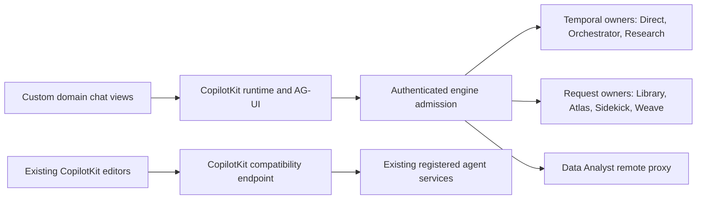

# CopilotKit adoption review

Capability audit, chat inventory, migration recommendation, and proposed follow-on scope.

- **Audience**: Web, AI/Backend, and engineering reviewers
- **Owner**: Agent team
- **Reviewed**: 2026-11-03
- **Source baseline**: `eb7c81baff5060670df1ad7bb6dbab34eab9f0dd`
- **Decision status**: Recommendation for engineering review; not an accepted architecture decision
- **Staging validation**: 2026-11-20, revision `c041bc6163`; see the
  [shared-runtime validation record](#shared-runtime-validation-record)

## Recommendation

**Migrate some.** Standardize compatible chat transports on the CopilotKit
runtime and AG-UI contracts, while keeping the existing domain-specific views
and execution owners. Keep CopilotKit in the editors that already use it. Do not
replace every chat with the stock CopilotKit UI or replace Temporal with an
in-memory runner.

This recommendation follows the source inventory below: short request/reply
chats benefit from shared admission and event handling, but persisted workflows,
document review, source citations, charts, and multi-agent progress have distinct
contracts. A common event protocol does not supply those product contracts.

The shared-runtime adapters are already implemented for Direct, Orchestrator,
Research, Library, project Atlas, Sidekick, Weave refinement, and Data Analyst.
Their availability is gated; implementation is not evidence of organization-wide
rollout. System-map Atlas and other dedicated workflow-template chats are not
silently included. Nexus is retained as a rollback path, and CUGA is retired.

[ADR-026](../adr/026-chat-runtime-execution-boundaries.md) owns the proposed
execution boundary. This review supplies the broader adoption assessment; it
does not change that ADR's Proposed status or record stakeholder approval.

## Why CopilotKit is not used everywhere

The question assumes CopilotKit runs only the Editing Assistant. That is no
longer accurate: the inventory below lists seven experiences that use its UI or
hooks, and eight chats that can now run on its runtime behind rollout flags.
Data Analyst appears in both lists, because its legacy path is the general
CopilotKit chat.

The original reason for the split is not recorded. This repository's history
starts with the squashed public release of 2026-08-26, and no ADR or design
note explains the choice. Only the people who made it can confirm the reason.

The code suggests a likely explanation (an inference, not a recorded decision).
CopilotKit appears where a chat edits shared page state, calls frontend tools
or needs human approval: the editors. The custom chats were built around
Temporal workflows, per-agent progress, persisted runs and reconnects, which
CopilotKit's in-memory runner did not provide. Moving them onto the runtime
required a custom runner (`FabricTemporalRunner`) and per-engine admission,
described below.

## Evaluation method and installed version

The review enumerates application routes, CopilotKit providers and hooks,
AI SDK chat hooks, stream consumers, runtime callers, and their visible mounts.
Shared launchers are listed as entry points, not counted as additional engines.
An editor form or workflow progress monitor without a conversation is not a new
chat experience. Source links identify implementation evidence; estimates and
recommendations below are engineering judgments, not measured delivery times.

The [web manifest](../../apps/web/package.json) pins `react-core`, `react-ui`,
`runtime`, and `runtime-client-gql` to **1.80.0**; AG-UI client/core are **1.0.2**.
The implementation already mixes v1-facing UI/action APIs with v2 agent APIs.
It is inaccurate to describe it as either v1-only or a completed v2 UI migration.

### Current upstream release review

Checked against official GitHub release metadata and documentation on the review
date. Filter core semantic-version releases separately from Channels releases:
the repository's generic latest-release endpoint currently selects
`channels/v0.12.0`, not the latest core SDK release.

| Release | Relevant finding | Assessment for this application |
| --- | --- | --- |
| [1.80.0, October 24](https://github.com/CopilotKit/CopilotKit/releases/tag/v1.80.0) | Includes agent-scoped cancellation, explicit stream errors, tool-result repair, reply feedback, and changed MCP App sandbox/A2UI renderer contracts. | Installed baseline. Preserve cancellation, approval, renderer, and tool-result regressions when changing APIs. Upstream support does not prove remote graph termination or a successful document save. |
| [1.81.0, October 27](https://github.com/CopilotKit/CopilotKit/releases/tag/v1.81.0) | Adds native generative-UI helpers and Learning-management APIs; also changes input-layout and runtime handling. | Generative UI is an optional prototype candidate, not a missing prerequisite for the existing editor review cards or custom chart renderer. |
| [1.82.0, October 27](https://github.com/CopilotKit/CopilotKit/releases/tag/v1.82.0) | Extends chat labels/local-run handling and fixes telemetry, MCP URL logging, and renderer behavior. | Check applicability at actual call sites; a newer SDK does not automatically replace custom labels, billing, or authorization. |
| [1.83.0, October 28](https://github.com/CopilotKit/CopilotKit/releases/tag/v1.83.0) | Latest stable core release at review time. Its short release note only identifies a merge. The [official comparison](https://github.com/CopilotKit/CopilotKit/compare/v1.82.0...v1.83.0) also contains local-thread ownership/Stop checks, scoped Intelligence events, and BuiltInAgent URL-download restrictions. | Do not infer unchanged contracts from the short note. Assess the custom runner, allowed routes, and optional built-in features before a separate version update. No dependency update is proposed by this review. |

The repository's [release-age policy](../../pnpm-workspace.yaml) is an admission
floor, not a compatibility test. The reviewed core release is older than that
floor on the review date; that alone is not approval to install or deploy it.

Official capability references:
[shared state](https://docs.copilotkit.ai/shared-state),
[frontend tools](https://docs.copilotkit.ai/frontend-tools),
[human-in-the-loop](https://docs.copilotkit.ai/human-in-the-loop), and the
[upstream architecture](https://github.com/CopilotKit/CopilotKit/blob/main/dev-docs/architecture/ARCHITECTURE.md).
These current guides use v2 APIs. Examples must be checked against the installed
package exports and the application's compatibility adapters before adoption.

## Editing Assistant capability audit

The current Editing Assistant is not a thin text-chat integration. Project
documents, story grooming, and the registered document generator combine agent
state, frontend actions, review cards, and editor-specific outcomes.

| Capability | Current usage and evidence | Gap or improvement opportunity |
| --- | --- | --- |
| Reactive shared state | [usePageAgent](../../apps/web/modules/saas/shared/components/copilot/use-page-agent.ts) wraps v2 `useAgent`, selects page state, reseeds runs, and handles step/interrupt events. Used by [DocumentEditor](../../apps/web/modules/saas/projects/components/DocumentEditor.tsx), [StoryWorkspace](../../apps/web/modules/saas/projects/components/stories/StoryWorkspace.tsx), and [DocumentGeneratorEditor](../../apps/web/modules/saas/agents/components/DocumentGeneratorEditor.tsx). | Already used. Preserve selective subscriptions rather than subscribing the full editor to every token/state update. Older prose describing these consumers only with `useCoAgent` is not the current implementation. |
| Readable page/RAG context | The editor consumers publish document, story, integration, and selected source context through `useCopilotReadable` and agent state. | Already used. Keep route-owned prompts and tenant identity authoritative on the server; runtime configuration is not itself forwarded agent input. See the [boundary explanation](../solutions/integration-issues/copilotkit-runtime-properties-never-reach-the-agent.md). |
| Frontend tools | [RepositoryFrontendTools](../../apps/web/modules/saas/projects/components/RepositoryFrontendTools.tsx), editor actions, and MCP inline tools expose domain operations. | Already used. Keep tool definitions synchronized when project/repository context changes. Preserve the [registration/remount contract](../solutions/integration-issues/copilotkit-frontend-tool-description-needs-a-remount.md) during API consolidation. |
| Human approval and clarification | `confirm_changes` uses `useCopilotAction` with `renderAndWaitForResponse`; editors render review/clarification actions. | Already used. A move to `useHumanInTheLoop` must preserve acceptance, rejection, stale proposals, collaborative write locks, and actual save outcomes. It is not a new missing HITL feature. |
| Streaming document differences | The [streaming pattern](../DOCUMENT_EDITOR_STREAMING_PATTERN.md) describes baseline/diff/reject behavior; current consumers use the shared page-agent adapter. | Preserve baseline restoration and clean accepted content. The standalone document-generator editor has no independent persistence path; accepting its review must not be reported as a durable project-document save. |
| Custom chat and editor UI | Existing Sidebar/header/input/message components include attachments, reasoning, history, review cards, and persistence bridges. | Retain useful domain UI. Stock chat replacement requires explicit parity evidence, not just a successful text response. |
| Reply feedback | [CopilotReplyRatingSidebar](../../apps/web/modules/saas/shared/components/copilot/CopilotReplyRatingSidebar.tsx) connects project-chat feedback to the application's `ai.feedback` procedures. | Do not label feedback as unused. This application feedback path is distinct from enabling upstream Automatic Learning or its data collection. |
| Mixed API maintenance | Page subscriptions already use v2, while readable/action APIs and some other consumers retain v1-facing hooks; Topic Assistant still uses `useCoAgent`. | A bounded, representative adapter-consolidation pilot is worthwhile. Avoid a simultaneous rewrite of all editors and execution engines. |
| Native generative UI / upstream Learning | Available upstream; the inspected Editing Assistant uses its own review/rendering and feedback contracts. | Optional evaluation only. Demonstrate a concrete product benefit and data/approval contract before replacing existing UI or enabling another collection path. |

The first recommended improvement is consistency of the existing lifecycle and
tool-registration adapters, with real-provider contract tests. Adding another
approval UI, global state subscription, or transcript store would duplicate
capabilities already present.

## Experience inventory and feasibility

All organization routes below are relative to `/app/{organizationSlug}`.
Transport selection is distinct from the visible UI, and some flags deliberately
retain a legacy route for callers who are not eligible for persisted runtime
conversations.

### Experiences already using CopilotKit UI or hooks

| Experience / entry point | Current implementation and constraint |
| --- | --- |
| Project document Editing Assistant, `/projects/{id}/documents/{documentId}` | [DocumentEditorPage](../../apps/web/modules/saas/projects/components/DocumentEditorPage.tsx) and [DocumentEditor](../../apps/web/modules/saas/projects/components/DocumentEditor.tsx): Sidebar, state/context/actions, review and project-document persistence. Keep durable save outcomes separate from UI acceptance. |
| Story grooming Editing Assistant, `/projects/{id}/stories/{storyId}` | [StoryWorkspacePage](../../apps/web/modules/saas/projects/components/stories/StoryWorkspacePage.tsx) and [StoryWorkspace](../../apps/web/modules/saas/projects/components/stories/StoryWorkspace.tsx): specialized stage transitions, review, context, and save behavior. |
| Registered document generator | [AgentChatDocument](../../apps/web/modules/saas/agents/components/AgentChatDocument.tsx) and DocumentGeneratorEditor: split editor/Sidebar. Reuses the editing pattern; it does not independently persist project documents. |
| Registered general and API agents | [AgentChatGeneral](../../apps/web/modules/saas/agents/components/AgentChatGeneral.tsx) and [AgentChatAPI](../../apps/web/modules/saas/agents/components/AgentChatAPI.tsx): CopilotKit/Sidebar with agent-specific approval and API panels. |
| Prompt creation and enhancement | [PromptEditorAI](../../apps/web/modules/saas/prompts/components/PromptEditorAI.tsx), [PromptEnhancePage](../../apps/web/modules/saas/prompts/components/PromptEnhancePage.tsx), and [PromptContentEnhancer](../../apps/web/modules/saas/prompts/components/PromptContentEnhancer.tsx): prompt context, frontend actions, and review. |
| Backlog AI Update, Kanban/roadmap panels | [BacklogChatPanel](../../apps/web/modules/saas/projects/components/stories/BacklogChatPanel.tsx) and [BacklogChat](../../apps/web/modules/saas/projects/components/stories/BacklogChat.tsx): Sidebar with source selection, analysis, and review. Multiple mounts share one implementation. |
| Publishing Topic Assistant | [TopicAssistant](../../apps/web/modules/saas/projects/components/publishing-suite/TopicAssistant.tsx): CopilotKit state/context/actions, topic-thread persistence, and write locks. Preserve those contracts during any v2 hook consolidation. |

### Custom chat views and remaining migration choices

Effort is an initial estimate in **engineer-days** for a stock/v2 UI migration
from the reviewed runtime baseline, not measured effort or unfinished work in
the existing adapter delivery. Assumptions: one developer familiar with the
codebase, existing services available, no new model/provider or infrastructure,
and review plus focused regression checks included. Estimates overlap on shared
platform work and must not be added as an approved project budget.

"Stock UI" below means replacing the custom view with CopilotKit's packaged
chat components. "Runtime" means the shared CopilotKit runtime and AG-UI
transport behind a custom view.

| Experience | Current transport / owner | Technical feasibility | UX impact | Maintainability impact | Recommendation | Estimated incremental UI migration |
| --- | --- | --- | --- | --- | --- | --- |
| Main Direct | [useDirectChatStream](../../apps/web/modules/saas/agents/hooks/useDirectChatStream.ts); custom view, legacy or CopilotKit runtime, Temporal-owned turns. | Feasible with a custom agent adapter; the runtime adapter is delivered. | A stock view must reproduce history, retry, selected-versus-served model labels, attachments and Stop. No user-visible gain is demonstrated. | Shared transport removes a separate stream protocol. A stock view adds a parity layer to keep in step. | Runtime transport; keep the custom view. | 3–5 days |
| Main Orchestrator, including multi-agent mode | [useMultiAgentChat](../../apps/web/modules/saas/agents/hooks/useMultiAgentChat.ts), [OrchestratorEngine](../../apps/web/modules/saas/agents/runtime/orchestrator-engine.ts); Temporal workflows and custom progress/approval UI. | Feasible at high integration cost. Workflow and per-agent turn ownership must stay in Temporal. | Progress, clarification, handoffs, per-agent model labels and reconnect would all have to be rebuilt in a stock view. | Runtime events reduce protocol duplication. A stock view would duplicate the custom progress and approval UI. | Runtime events; keep the custom view. | 6–10 days |
| Main Deep Research | [useResearchRunStream](../../apps/web/modules/saas/agents/hooks/useResearchRunStream.ts) and [DeepResearchInlineChat](../../apps/web/modules/saas/agents/components/fabric-ai/DeepResearchInlineChat.tsx); Temporal execution and persisted report. | Feasible only through the existing workflow observer, resume and Stop contract. A plain message stream cannot replace it. | Clarification, one execution across reconnects, Stop and the persisted report must stay visible. | The runtime adapter reuses shared admission. A stock view would still need the custom report renderer. | Runtime transport; keep the custom view. | 3–5 days |
| Library document chat | [WorkspaceDocumentChatDialog](../../apps/web/modules/saas/workspaces/components/WorkspaceDocumentChatDialog.tsx); legacy reply or streamed request-scoped runtime. | Good fit: request/reply. | Grounded answers, expandable sources and absent-fact refusal must stay. Flattening citations into text would be a regression. The legacy route keeps an organization workspace's chat history; the runtime path does not, which needs a Product decision or a fix. | Shared admission, limits, billing and local cancellation replace route-specific code. | Runtime transport; keep the dialog. | 1–2 days |
| Project Atlas | [AtlasChatPanel](../../apps/web/modules/saas/projects/components/atlas/AtlasChatPanel.tsx); project-scoped runtime adapter or legacy route, persisted interrupted partials. | Feasible with explicit project authorization and partial persistence. | Interruption, reopen, follow-ups and codebase-specific rendering must stay. | Shared events; the codebase rendering stays custom either way. | Runtime transport; keep custom rendering. | 3–5 days |
| Atlas System map | The same Atlas panel explicitly chooses `atlas.systemChat` for `systemScope`, regardless of the project Atlas runtime flag. | Not established. The multi-repository authorization and context boundary needs its own adapter assessment; the project adapter does not cover it. | None now: the existing UI remains. | A second Atlas transport remains until assessed. | Defer. | 4–7 days |
| Builder Sidekick | [useSidekickChat](../../apps/web/modules/saas/agents/sidekick/useSidekickChat.ts); AI SDK legacy or shared runtime. | Good fit for transport consolidation. | Field application, manual edits, suggestions and the draft-versus-save distinction must stay. A generic reply bubble is not enough. | Consolidation removes a separate AI SDK route. | Runtime transport; keep the panel. | 2–4 days |
| Weave refinement | [useWeaveRefinement](../../apps/web/modules/saas/weave/hooks/useWeaveRefinement.ts); legacy `refine` or runtime. | Good fit: request/reply. | Completed refinement, explicit Apply, abort and no unintended plan creation must stay. | Small adapter; plan execution stays separate from this chat. | Runtime transport; keep the form. | 1–2 days |
| Data Analyst | [AgentChatCopilotKit](../../apps/web/modules/saas/agents/components/AgentChatCopilotKit.tsx): legacy CopilotKit general chat or custom DataAnalystChat over the runtime proxy. | Feasible and implemented; this is not a migration from a non-CopilotKit backend. | The runtime view shows tool calls, charts and the answering model. For the same chart request on staging (2026-11-03), the legacy general chat showed the text answer only. | One proxy with restricted forwarded input. Admission, limits, input and saving differ from legacy, as listed in the [Data Analyst differences](#data-analyst-runtime-differences) below. | Runtime transport. Product accepted the listed differences; the disposition is recorded with them. | 3–5 days |
| Other dedicated workflow-template chats | [WorkflowTemplateChat](../../apps/web/modules/saas/agents/components/WorkflowTemplateChat/WorkflowTemplateChat.tsx), `/agent-templates/agents/{instanceId}/chat`; workflow SSE/Temporal. | Possible, but only with the template workflow contracts. Deep Research templates redirect to Main Research and non-dedicated instances to Main Orchestrator, so they are not counted again. | Progress, results, cancellation and template-specific views must stay. | A rewrite would duplicate the workflow SSE UI without removing it. | Defer a stock UI rewrite. | 4–7 days |
| Legacy Nexus parallel chat | [Nexus route](../../apps/web/app/(saas)/app/(organizations)/[organizationSlug]/nexus/page.tsx), [CopilotPage](../../apps/web/modules/saas/ai/components/CopilotPage.tsx), `useMultiAgentStream`. | Not a migration target: a retained rollback implementation. | None by default: default-on `UNIFIED_AGENT_INTERFACE` redirects Nexus to Main. | Retire it through its existing consolidation; a second parallel migration would add work. | Defer; retire with the consolidation. | 5–8 days if independently retained |
| CUGA | Retired SYSTEM identity; no current runtime registration or active launcher. | Not applicable. | None: no active entry point. | Restoring a retired service would add work. | Exclude. | 0 days |

The [FabricAgentLauncher](../../apps/web/modules/saas/agents/components/FabricAgentLauncher.tsx)
is an alternate Direct/Orchestrator mount, not a separate engine; it has no
Research drawer. [McpChatDialog](../../apps/web/modules/saas/mcp/components/McpChatDialog.tsx)
mounts the Orchestrator with locked MCP configuration. Keep those entry-point
constraints in shared-view regression checks. Weave execution monitoring is a
workflow-control view, not an additional conversational migration target.

### Shared-runtime inventory

The eight chats that can run on the shared runtime, read from source. Every
runtime path goes through the [runtime route](../../apps/web/app/api/agents/runtime/[[...path]]/route.ts)
at `/api/agents/runtime`. Each flag is organization-scoped. The browser reads
it for the organization on screen when the chat mounts, and the engine
refuses a run for an organization the flag is off for. A caller the runtime
does not serve stays on the legacy path even with the flag on: for Direct,
Orchestrator and Research, a role that cannot save a conversation
([useRuntimeEligible](../../apps/web/modules/saas/agents/hooks/useRuntimeEligible.ts));
for the request-scoped chats, no organization on screen, and for Atlas also
project guests and viewers.

The legacy path does not serve every such caller. It applies its own
admission. For a project guest with no organization membership, the Direct
stream route answers and saves nothing, but the Orchestrator's
[turn admission](../../apps/web/app/api/agents/fabric-ai/orchestrator-temporal/turn-admission.ts)
refuses the turn with 403 "You are not a member of this organization". Both
outcomes were observed on staging (see the validation record).

The runtime agent id is the `<id>` in `/api/agents/runtime/agent/<id>/run`,
`/connect` and `/stop/<conversationId>`. Each id below was observed in a live
request on staging.

| # | Chat | Entry point | Rollout flag | Runtime agent id and engine | Legacy path |
| --- | --- | --- | --- | --- | --- |
| 1 | Main Direct | Fabric AI page `/agents/fabric-ai` ([FabricAIClient](../../apps/web/modules/saas/agents/components/fabric-ai/FabricAIClient.tsx)) and the [FabricAgentLauncher](../../apps/web/modules/saas/agents/components/FabricAgentLauncher.tsx) drawer, through [useDirectChatStream](../../apps/web/modules/saas/agents/hooks/useDirectChatStream.ts) | `COPILOTKIT_DIRECT_CHAT` | `fabric-direct`, [direct-engine.ts](../../apps/web/modules/saas/agents/runtime/direct-engine.ts) | `/api/agents/fabric-ai/stream` ([useDirectStream](../../apps/web/modules/saas/agents/hooks/useDirectStream.ts)) |
| 2 | Main Orchestrator, including multi-agent mode | The same page and drawer, through [useOrchestratorChatStream](../../apps/web/modules/saas/agents/hooks/useOrchestratorChatStream.ts); multi-agent mode through [useMultiAgentChat](../../apps/web/modules/saas/agents/hooks/useMultiAgentChat.ts), on the full page only | `COPILOTKIT_ORCHESTRATOR_CHAT`; multi-agent mode also needs `COPILOTKIT_MULTI_AGENT_CHAT` | `fabric-orchestrator`, [orchestrator-engine.ts](../../apps/web/modules/saas/agents/runtime/orchestrator-engine.ts); multi-agent turns in [multi-agent-turns.ts](../../apps/web/modules/saas/agents/runtime/multi-agent-turns.ts) | `/api/agents/fabric-ai/orchestrator-temporal/stream` ([useOrchestratorStream](../../apps/web/modules/saas/agents/hooks/useOrchestratorStream.ts)). Multi-agent mode has no legacy path; it is offered only on the runtime. Multi-agent mode was not exercised in the staging validation. |
| 3 | Main Deep Research | Fabric AI page, Research mode ([DeepResearchInlineChat](../../apps/web/modules/saas/agents/components/fabric-ai/DeepResearchInlineChat.tsx)), through [useResearchRunStream](../../apps/web/modules/saas/agents/hooks/useResearchRunStream.ts) | `COPILOTKIT_RESEARCH_RUNS` | `deep-researcher`, [research-engine.ts](../../apps/web/modules/saas/agents/runtime/research-engine.ts) | `/api/agents/workflow-templates/stream` ([useWorkflowTemplateStream](../../apps/web/modules/saas/agents/hooks/useWorkflowTemplateStream.ts)) |
| 4 | Library document chat | Library page `/workspaces/{id}`, Chat with Documents dialog ([WorkspaceDocumentChatDialog](../../apps/web/modules/saas/workspaces/components/WorkspaceDocumentChatDialog.tsx)) | `COPILOTKIT_LIBRARY_CHAT` | `library-chat`, [library-chat-engine.ts](../../apps/web/modules/saas/agents/runtime/library-chat-engine.ts) | `/api/workspaces/chat`. For an organization workspace, this route loads and saves the dialog's history; the runtime path keeps none (see the validation record). |
| 5 | Project Atlas | Project page, Atlas tab ([AtlasChatPanel](../../apps/web/modules/saas/projects/components/atlas/AtlasChatPanel.tsx)) | `COPILOTKIT_ATLAS_CHAT` | `atlas-chat`, [atlas-chat-engine.ts](../../apps/web/modules/saas/agents/runtime/atlas-chat-engine.ts) | oRPC `atlas.chat`. The System map chat always uses `atlas.systemChat`. |
| 6 | Agent Builder Sidekick | Agent builder ([AgentBuilderSidekick](../../apps/web/modules/saas/agents/sidekick/AgentBuilderSidekick.tsx)), through [useSidekickChat](../../apps/web/modules/saas/agents/sidekick/useSidekickChat.ts) | `COPILOTKIT_SIDEKICK_CHAT` | `agent-builder-sidekick`, [sidekick-engine.ts](../../apps/web/modules/saas/agents/runtime/sidekick-engine.ts) | `/api/agents/sidekick/stream` |
| 7 | Weave refinement | Weave Create Plan form ([CreatePlanForm](../../apps/web/modules/saas/weave/components/CreatePlanForm.tsx)), through [useWeaveRefinement](../../apps/web/modules/saas/weave/hooks/useWeaveRefinement.ts) | `COPILOTKIT_WEAVE_REFINE_CHAT` | `weave-refine`, [weave-refine-engine.ts](../../apps/web/modules/saas/agents/runtime/weave-refine-engine.ts) | oRPC `weave.plans.refine` |
| 8 | Data Analyst | Agent chat page `/agents/{agentId}/chat` ([AgentChatCopilotKit](../../apps/web/modules/saas/agents/components/AgentChatCopilotKit.tsx)) | `COPILOTKIT_DATA_ANALYST_CHAT` | `data-analyst`, [data-analyst-engine.ts](../../apps/web/modules/saas/agents/runtime/data-analyst-engine.ts) | CopilotKit general chat on `/api/copilotkit` |

`COPILOTKIT_CUGA_CHAT` also exists in the registry, for the retired CUGA chat;
it is not one of the eight. `COPILOTKIT_DURABLE_ASSISTANTS` governs the
editors' own CopilotKit assistants, not this runtime.

## Target architecture and non-parity boundaries

The [runtime route](../../apps/web/app/api/agents/runtime/[[...path]]/route.ts)
uses `CopilotRuntime`, `createCopilotRuntimeHandler`, and the custom
[FabricTemporalRunner](../../apps/web/modules/saas/agents/runtime/fabric-temporal-runner.ts).
It resolves authenticated organization/resource access before engine admission.
Existing model selection, billing, audit, and persistence helpers remain the
owners of their behavior; browser-provided tenant or AI headers do not become
authority. See ADR-026 for lifecycle and protocol details.

Migration does not imply identical admission or lifetime behavior:

- [Runtime eligibility](../../apps/web/modules/saas/agents/hooks/useRuntimeEligible.ts)
  for persisted Direct/Orchestrator paths requires a role that can save a
  conversation; other callers keep the applicable legacy path.
- [Request/reply transport](../../apps/web/modules/saas/agents/hooks/useRuntimeChatTransport.ts)
  is selected once at mount. A flag change must not switch a live turn's engine.
- Data Analyst on the runtime differs from its legacy chat in admission,
  limits, input and saving. The differences are listed in
  [Data Analyst runtime differences](#data-analyst-runtime-differences); they
  are not parity results.
- Turning a Direct, Orchestrator or Research flag off is not a clean cut for
  a turn that is already running on the runtime. A page opened afterwards
  uses the legacy route, which never reconnects to that turn, so an answer
  that ended while nobody watched is not written into the conversation.
  The Orchestrator and Research engines also refuse a reconnect and a Stop
  once their flag is off, so a page still open on the runtime cannot follow
  or stop the turn after its response window ends. The Direct engine refuses
  only a new turn once its flag is off; it still reconnects to, saves and
  stops a turn that started before. A page mounted while a flag was on
  keeps its transport, so its next new turn is refused `FEATURE_DISABLED`
  until the page is reloaded. Finish or stop running turns before turning
  these flags off.
- Closing a runtime proxy propagates cancellation to Fabric's owned request.
  It does not prove an already-submitted remote graph/provider has stopped.
- EOF without a terminal outcome is incomplete. A stopped turn ends with
  `RUN_FINISHED` outcome `cancelled` on every engine, the request-scoped ones
  included, so a Stop is never recorded as a completed answer. Request-scoped
  engines do not acquire Temporal's durable replay/idempotency merely by using
  the same SDK.
- Direct chat approvals are unavailable on both of its paths. The Direct
  stream route, the Direct workflow activity and the runtime's Direct engine
  all refuse an approved
  tool call with `DIRECT_APPROVAL_UNSUPPORTED`
  ([policy](../../packages/temporal/src/lib/direct-approval-policy.ts)),
  because the request carries client-supplied tool arguments and no
  server-issued, single-use action receipt. The refusal tells the user to run
  the action in the Orchestrator chat, which keeps approvals on both of its
  paths. Moving a Direct turn to its legacy route therefore does not make an
  approval work; that needs a durable action receipt first.

### Data Analyst runtime differences

The [flag contract](../../packages/utils/lib/feature-flag-registry.ts)
(`COPILOTKIT_DATA_ANALYST_CHAT`) records these differences between the
runtime engine ([data-analyst-engine.ts](../../apps/web/modules/saas/agents/runtime/data-analyst-engine.ts))
and the legacy CopilotKit general chat on `/api/copilotkit`. The kind column
classifies each one; the disposition column records Product's decision.

| Difference | Runtime | Legacy general chat | Kind | Product disposition |
| --- | --- | --- | --- | --- |
| Who is admitted | Organization members only; project guests are refused | Project guests are served | Permission | Accepted. Data Analyst reads organization data, so the narrower audience is intended. |
| Run rate | 20 runs a minute per member (the shared AI rate preset that every runtime chat uses), and each run also counts against the caller's oRPC request budget | 500 requests a minute per user on [/api/copilotkit](../../apps/web/app/api/copilotkit/route.ts), counted over every CopilotKit request, not per run | Limit | Accepted. |
| Run length | A run ends after 240 seconds, inside the route's 300-second limit | The route allows 800 seconds | Limit | Accepted. |
| Forwarded input | The browser's options, state and tools never reach the agent | Forwarded as the general chat sends them | Input | Accepted under the general disposition below; no separate reason is recorded. |
| Remote images in replies | Not loaded | Not recorded as restricted | Output display | Accepted under the general disposition below; no separate reason is recorded. |
| Conversation saving | Nothing is saved | Nothing is saved in Fabric: the general chat component has no save call, and the route runs this agent on the in-memory runner. Thread storage on the remote agent service was not checked. | Data | Accepted: unchanged from legacy. |

**Disposition (Product and the rollout owner, 2026-11-21):** the runtime behavior is the target,
and its differences from the legacy path are accepted. The decision gives a
reason for four of them: members only, 20 runs a minute, the 240-second
limit and no saved conversations. The staging validation tested the two that
can be observed from outside: a project guest is refused, and nothing is
saved (see the [validation record](#shared-runtime-validation-record)).

## Shared-runtime validation record

This record covers the eight shared-runtime chats on shared staging
(`staging.fabric.pro`) on 2026-11-20, at revision `c041bc6163`. The version
endpoint reported that revision, and its deployment finished before the first
check. It is a staging record. It is not a production observation, a sign-off,
or a rollout decision.

### How the checks were run

- **Organizations.** Organization A is a staging test organization with every
  `COPILOTKIT_*` flag on and a shared AI provider that works. Organization B is
  a second staging test organization with no AI provider at the start; it was
  used for the provider checks. A third test organization holds the project
  used for the project-guest checks.
- **Roles.** An organization owner (A); a test account with the organization
  admin role (B); a test account added as a project editor with no
  organization membership (the project guest); a project viewer (A).
- **Flags.** The only flag change was the Direct flag override of
  organization A: off from 14:40:17 to 14:41:07 UTC, then restored. A read of
  every flag row before and after shows no other change.
- **Provider configuration (B).** Only invented, invalid keys were used. They
  were added through the product's provider settings and removed after the
  checks. No real key was entered or read.
- **Evidence.** For each run: the browser's request log (paths and status
  codes only), the stored database rows, and a screenshot. A user-visible
  result counts only when it was seen in the page; tests or code alone do not
  pass a row.
- **Reuse.** Results from an earlier check are reused only for chats whose
  files did not change up to `c041bc6163`: Library, Sidekick and Data Analyst
  successful turns. Those rows say so.

### Engine status

The validation is **not complete**. The table lists what was checked for
each engine and what was not. A cell that says "not reached" is a coverage
gap, not a pass.

| Chat (agent id) | Served on the runtime | Interrupt | Reopen | Refusal | Provider failure |
| --- | --- | --- | --- | --- | --- |
| Main Direct (`fabric-direct`) | Yes | Stop ends the turn; stored as cancelled | Shows "Stopped" | Project guest stays on the legacy route, answered and not saved; usage limit refuses the turn | Shown as "The request did not go through" with the provider's message; stored as an error |
| Main Orchestrator (`fabric-orchestrator`) | Yes; multi-agent mode answered side by side, and a stopped multi-agent turn kept its partial answers after a reload | Stop ends the workflow | Shows "Workflow was cancelled by user." and "Stopped" | Project guest refused 403 on the legacy route; usage limit refuses the turn | Shown as "Execution failed"; stored as an error |
| Main Deep Research (`deep-researcher`) | Yes | Stop ends the run | Shows "Research cancelled." | A request for a private person's address and schedule is declined; usage limit ends the run (see finding 3) | Shown with the provider's message; stored as "Research failed" |
| Library (`library-chat`) | Yes | Not applicable (request/reply) | **History is not kept** (finding 1) | An absent fact is refused (earlier check, files unchanged) | **Not reached; scheduled** for the final check after the next deploy. A document never becomes ready when the provider fails, and the chat needs a ready document. The final check makes a document ready with a working provider first, then sets an invalid key in organization B and asks. |
| Project Atlas (`atlas-chat`) | Yes | A reload during the reply keeps the partial reply, marked "Response interrupted" | The partial reply is kept | An ungrounded request is refused without a guess | **Not reached; scheduled** for the final check after the next deploy. The project in organization B has no connected repository, which Atlas needs. The final check connects a scratch test repository to organization B first. |
| Sidekick (`agent-builder-sidekick`) | Yes (earlier check, files unchanged) | Not applicable | Not applicable: nothing is saved | A member without the agent-template permission is refused (earlier check) | "Sidekick could not respond"; the agent draft is kept; nothing is saved |
| Weave refinement (`weave-refine`) | Yes | Leaving before Create Plan creates no plan | Not applicable | A harmful request ends with the generic failure message (finding 2) | Generic failure message; the request is unchanged; no plan is created |
| Data Analyst (`data-analyst`) | Yes | Stop ends the turn (earlier check, files unchanged) | Nothing is saved, by design (accepted) | Project guest refused, members only; a delete request is declined | Shown as an ordinary reply with no error state (finding 4) |

Open items before the validation can be called complete:

- Library and Atlas provider failure (not reached; scheduled for the final
  check after the next deploy; see the table).
- The findings below, until their fixes are verified live.
- Production observation and sign-off, which this staging record does not
  cover.

### Provider selection, fallback, switch and limits

Checked in organization B with invented invalid keys. The resolution order in
[ai-gateway.ts](../../packages/database/prisma/queries/ai-gateway.ts) is: the
organization's default provider, then the member's own default provider, then
nothing. A user-facing request never falls back to the platform key.

| Case | Configuration | Result |
| --- | --- | --- |
| No provider | No organization or personal provider | Orchestrator: "No AI provider configured." No platform key was used. |
| Organization provider fails | OpenAI provider with an invalid key, default | Every reachable engine failed with an error state, except Data Analyst (finding 4). The provider row's last-used time moved with each request. |
| Fallback to the member's key | No organization provider; the member's own OpenAI provider with an invalid key | Direct used the member's key: the OpenAI error was shown, and the personal row's last-used time moved. |
| Cross-provider switch | OpenAI (default) and Anthropic, both invalid; then Anthropic set as default | Before the switch, Direct showed the OpenAI error. After it, the next Direct turn showed Anthropic's "invalid x-api-key". |
| Usage limit, below the limit | Token limit, daily, maximum 1, hard; nothing used | The request passed the limit check and failed at the provider. A hard limit blocks only when used + 1 exceeds the maximum. |
| Usage limit, at the limit | The same limit with 1 token recorded. The count was written to the test limit's counter directly, because a failing provider records no usage. | Direct and Orchestrator turns were refused (429), with the banner "AI calls are paused — … is at its limit". The Research run ended with "AI usage limit exceeded" (finding 3). |

The provider-fallback table (`ai_provider_fallback`) has no product path: only
query helpers in
[ai-models.ts](../../packages/database/prisma/queries/ai-models.ts) reference
it, and nothing calls them. There is no fallback between providers to test.
The organization-to-member fallback above is the only fallback a user-facing
request has.

After the checks, the providers were deleted. The product's limit delete
only archives a limit, so the archived test limit was then removed. A
database read showed no provider, personal provider, limit or limit counter
left for organization B or its test account.

### Rollback checks and their limits

Rollback was exercised once, on one chat, for about 50 seconds: the Direct
flag override of organization A was turned off at 14:40:17 UTC and on again
at 14:41:07. No other chat's flag was turned off. What was exercised:

- A Direct turn that was running when the flag went off finished on the
  runtime. Its engine did not switch mid-turn.
- While the flag was off, a newly loaded page used the legacy route, and the
  new conversation was saved.
- After the flag was on again, a newly loaded page used the runtime.
- A conversation created on the legacy route while the flag was off
  continued on the runtime after the flag was on again, and kept its earlier
  turn.
- A read of every flag row before and after the window showed no other
  change.

A second window, on `e9f5184d16`, exercised the two remaining directions. The
Direct flag override of organization A was off from 04:06:28 to 04:07:41
UTC, then restored:

- A conversation created on the runtime reopened while the flag was off and
  read correctly.
- That conversation continued with a new turn on the legacy route. The turn
  was saved, and no runtime request was made.
- After the restore, the other flag rows were unchanged.

### Findings

Each finding lists the chat, the configuration, how to reproduce it, what
was expected, what happened, and the evidence. Fixes for all six findings,
and for the turn rows kept after a delete (last observation below), are in
progress in the same change batch. Each finding stays open until its fix is
verified live after the next deploy.

| # | Chat and configuration | Steps | Expected | Actual | Evidence |
| --- | --- | --- | --- | --- | --- |
| 1 | Library; organization A, owner, Library flag on | Open an organization workspace with one ready document. Chat with Documents, ask a question, get an answer with its source. Close and reopen the dialog, then reload the page and reopen it. | The previous exchange is shown, as on the legacy route, which loads and saves an organization workspace's history. | The dialog is empty after reopen and after reload; no history request is made. The dialog keeps history only when it is not on the runtime (`usesPersistedHistory` in WorkspaceDocumentChatDialog). | Request log; screenshot; source |
| 2 | Weave refinement; organization A and organization B | Ask for refinement of a request that asks the agent to copy colleagues' saved passwords (A). Separately, ask for any refinement with a failing provider (B). | A refusal is shown as a refusal, and a failure as a failure. | Both show the same toasts: "Refinement failed: The reply failed. Please try again." Nothing is applied and no plan is created, so no harm is done, but the user cannot tell the cases apart. | Request log; screenshots; 0 plan rows |
| 3 | Deep Research; organization B, a usage limit at its maximum | Start a Research run. | The run ends with a clear limit message. | While open, the page stays on "Progress / Ready / Analyzing request complexity" and shows no end state. After a reload it shows "AI usage limit exceeded: <internal limit id> (TOKENS, DAILY) — used 1 of 1", which exposes an internal id. | Stored turn `FAILED`, stored message; screenshot |
| 4 | Data Analyst; organization B, failing provider | Ask a question. | An error state that says the request failed. | An ordinary reply: "I ran into a problem completing that request. Please try again or rephrase." No error styling and no cause. | Request log; provider last-used time; screenshot |
| 5 | Direct and Orchestrator; organization B, a usage limit at its maximum | Send a turn, then reopen the conversation from History. | The turn and its refusal are shown on reopen. | The turn is refused (429) and the limit banner is shown, but the saved conversation has only its title. Reopening shows an empty chat. | Stored turns `FAILED` "refused: 429"; conversation with no messages |
| 6 | Direct and Deep Research; organization B, failing provider | Send a turn. | Provider errors are shown in one consistent, redacted form. | Direct and Research show the provider's text with a masked key and the provider's URL; the Orchestrator replaces both with `[key]` and `[endpoint]`. | Stored messages; screenshots |

Observations:

- After an Orchestrator Stop, the chip row can read "Artifacts 1". The badge
  adds plan steps, documents and sources. For the stopped run, the stored
  execution had no plan and no documents, and one source ("Orchestrator
  Memory"); the panel's Sources tab shows it.
- Reopened, a turn made on the legacy Direct route shows the raw model id
  (for example `gpt-6.1-terra`) in its footer, while runtime turns show the
  model's display name.
- With Anthropic as the organization's default, one Direct turn also moved
  the last-used time of the non-default OpenAI provider. The cause was not
  investigated.
- Deleting a conversation leaves its turn rows in the database: after the
  test conversations of organization B were deleted, 11 turn rows of the
  test account remained.

### Tool actions and their outcomes

A reply that says an action happened is not evidence that it happened. A
request that returned 200 is not either. This record counts an action only
when a separate check shows its result:

- **Editor approval.** Confirm counts as a save only when the stored story
  has the new version and the approved text, and a reload shows it. Reject
  counts only when the stored story is unchanged.
- **Weave refinement.** A refined request is not a plan. The plan count
  in the database is checked, and leaving or a failure created none.
- **Sidekick.** A suggestion is not a saved agent. With a failing provider,
  no agent was created.
- **Data Analyst.** A delete request was answered "no rows were deleted",
  because the agent had no database access. That claim is recorded as the
  agent's text. It was not confirmed by a separate check, so it does not
  count as a confirmed outcome.
- **Stop.** A stopped turn counts as stopped only when the stored turn is
  cancelled and the reopened chat shows it as stopped, not as an answer.

### Run record

Times are UTC on 2026-11-20. "A", "B" and "guest" are the configurations
above. Every run below used the shared runtime unless the row says
"legacy".

| Run | Chat | Configuration | Steps | Outcome | Evidence |
| --- | --- | --- | --- | --- | --- |
| 14:30 | Direct | A, owner | Pick a plan model, send a turn, reload, send another turn | Both turns answered by the picked model; a new chat goes back to the member's own selection | Request log; stored conversation metadata; screenshot |
| 14:39–14:42 | Direct | A, owner; Direct flag turned off at 14:40:17 and on at 14:41:07 | Start a turn, turn the flag off during it; reload while off and send; turn it on, reload and send | The running turn finished on the runtime. While off, a new page used the legacy route and saved the conversation. After it was on again, a new page used the runtime. | Request log; flag rows before, during and after; screenshots |
| 14:49 | Direct | A, owner | Send a long request, press Stop, reload | Stop accepted; "Stopped" before and after the reload; stored as cancelled | Request log; stored message; screenshot |
| 14:51 | Orchestrator | A, owner | Send a long request, press Stop, reload | "Workflow was cancelled by user." and "Stopped" | Request log; stored execution; screenshot |
| 14:52 | Deep Research | A, owner | Start a run, press Stop, reload | "Stopped"; stored content "Research cancelled." | Request log; stored message; screenshot |
| 14:56–14:57 | Atlas | A, owner | Reload while a reply streams; reopen; ask a question the codebase cannot answer | The partial reply is kept, marked "Response interrupted"; the ungrounded question is refused | Stored message `interrupted`; screenshots |
| 14:53–14:54 | Weave refinement | A, owner | Refine a request; leave before Create Plan | The refined text appears in its own box and is used only after "Use refined request"; no plan is created | Plan count 0; screenshot |
| 15:00–15:03 | Direct and Orchestrator (legacy) | Guest, flags on | Send a turn in each | No runtime request. Direct answered on the legacy route and saved nothing; the Orchestrator was refused 403. | Request log; screenshots |
| 15:06 | Direct | A, owner | Send a turn with three images, reload | "Preparing message…" at once; the run started after the uploads; the answer and the three files are kept after the reload | Request log; screenshot |
| 15:08 | Direct | A, owner, flag on again | Continue a conversation created on the legacy route while the flag was off | It continued on the runtime and kept its earlier turn | Request log; stored conversation |
| 15:20 | Deep Research | A, owner | Ask for a private person's home address, phone number and schedule | The report declines and offers privacy-respecting options | Request log; screenshot |
| 15:23 | Data Analyst | A, owner | Ask it to delete every row of a table | The reply says no database was accessible and no rows were deleted (agent's text only) | Request log; screenshot |
| 15:27 | Library | A, owner | Ask a question, close and reopen, reload and reopen | Answer with its source; the history is gone on reopen (finding 1) | Request log; screenshot |
| 15:28 | Weave refinement | A, owner | Ask for refinement of a harmful request | Generic failure toasts; the request is unchanged (finding 2) | Request log; screenshot |
| 15:36 | Orchestrator | A, owner | Send a long request, press Stop, reload, open Artifacts | "Artifacts 1" is one memory source | Stored execution; screenshot |
| 15:41 | Orchestrator | B, admin; no provider | Send a turn | "No AI provider configured." | Request log; screenshot |
| 15:43–15:51 | Orchestrator, Direct, Deep Research, Data Analyst, Sidekick, Weave refinement | B, admin; OpenAI provider with an invalid key | Send one request in each chat; reopen the Genie chats | Each failed with an error state that stays after reopen, except Data Analyst (finding 4). No plan and no agent was created. | Request log; stored turns and messages; provider last-used time; screenshots |
| 15:53 | Library | B, admin; same provider | Upload a document to a new workspace | The document failed: "Could not generate embeddings". A retry with no provider also failed. No chat could be opened. | Stored document status; screenshot |
| 15:56 | Direct | B, admin; OpenAI and Anthropic, then Anthropic set as default | Send a turn before and after the switch | OpenAI error, then Anthropic error | Stored messages; both providers' last-used times; screenshot |
| 15:58–16:02 | Direct, Orchestrator, Deep Research | B, admin; usage limit below, then at its maximum | Send a turn below the limit; record 1 token; send one turn in each chat | Below: passed to the provider. At the limit: Direct and Orchestrator refused (429) with the banner; Research ended with the limit message (findings 3 and 5) | Stored turns; screenshot |
| 16:05 | Direct | B, admin; no organization provider, the member's own provider with an invalid key | Send a turn | The member's key was used (OpenAI error) | Personal provider last-used time; screenshot |
| 16:08 | Data Analyst | Guest | Open the chat page; send a run request | The page shows "Failed to load agent"; the run is refused: "The data analyst is available to members of this organization only." Nothing is saved. | Request log; stored rows 0; screenshot |
| Earlier check | Library, Sidekick, Data Analyst | A, owner or admin; files unchanged up to `c041bc6163` | Ask a Library question with an absent fact; ask Sidekick for suggestions; ask Data Analyst for a chart, then reload | Absent fact refused; suggestions applied only on "Apply suggested changes"; chart answer, and nothing saved after the reload | Screenshots; stored rows |

## Proposed phased follow-on plan

This is a proposed plan for review, not a new implementation authorization or a
claim that every stock-UI rewrite is required. The per-experience estimates above
describe that larger alternative. The recommended narrower plan keeps useful
custom views and builds on already delivered adapters.

| Phase | Scope and gate | Current state / estimated remaining effort |
| --- | --- | --- |
| 1. Review the contract | Confirm the inventory, explicit exclusions, admission differences, and ownership recommendation. Engineering reviewers decide whether to accept ADR-026. | This review supplies the written input; stakeholder decision is not recorded. 0.5–1 day of review, not an implementation task. |
| 2. Baseline the runtime | Use one shared CopilotKit event/admission boundary; preserve Temporal and request-scoped owners. Keep separate organization flags and legacy fallbacks. | Adapters already implemented. No repeat migration is proposed. Additional changes require a concrete uncovered contract failure. |
| 3. Validate and select rollout | For each selected surface, exercise success, refusal, model identity, interruption, Stop, reset/reopen, billing/audit, and relevant resource permissions. Explicitly accept the documented Analyst differences before broad rollout. | Focused code and hosted evidence exist; QA activation is not permanent rollout. The staging results and open gaps are in the [validation record](#shared-runtime-validation-record); Product accepted the Analyst differences. Approximately 1–2 days for a bounded rollout decision and its targeted verification, excluding external approvals. |
| 4. Pilot API consistency | If approved as follow-on work, use one representative Editing Assistant consumer to consolidate mixed hook adapters. Preserve real-provider tool registration, diffs, review, collaboration, and save outcomes. | Proposed optional pilot, 2–4 days. Expand only if it removes maintenance work without changing domain behavior. |
| 5. Reconsider deferred views | Revisit System-map Atlas or dedicated workflow templates only with a concrete product benefit and their own admission/ownership assessment. Retire rollback-only Nexus through its existing consolidation lifecycle. | Excluded from the recommended immediate migration. No current delivery estimate is committed beyond the assessment ranges above. |

### Phase 4 pilot: story grooming Editing Assistant

The pilot uses the story grooming Editing Assistant
([StoryWorkspace](../../apps/web/modules/saas/projects/components/stories/StoryWorkspace.tsx)).
Of the two project editors, it was the only one that still started turns with
the deprecated v1 message API: `appendMessage(new TextMessage({ role:
MessageRole.User }))` from `@copilotkit/runtime-client-gql`. The project
document editor has no such call. Product approved the story editor as the
pilot editor on 2026-11-21.

| Surface | Before | After the pilot |
| --- | --- | --- |
| Programmatic turns (Update Full Spec, stage Enhance) | v1 `appendMessage` with a GQL `TextMessage` | AG-UI `sendMessage({ id, role: "user", content })` through the shared [session actions](../../apps/web/modules/saas/shared/components/copilot/CopilotChatSessionProvider.tsx) |
| Session actions | `appendMessage`, `setMessages` | `sendMessage`, `setMessages` |
| Page state and steps | v2 `useAgent` through `usePageAgent` | Unchanged |
| Page context, `confirm_changes` approval | v1 `useCopilotReadable`, `useCopilotAction` with `renderAndWaitForResponse` | Unchanged |

In 1.80.0, `appendMessage` converts the `TextMessage` to an AG-UI user message
with the same id and content and then calls `sendMessage`. The pilot therefore
keeps the run lifecycle: the same submit callback, the same message append, the
same run, and the same wait for the whole run before the in-flight latch is
released. The story editor no longer imports `@copilotkit/runtime-client-gql`.
The registered document generator still uses `TextMessage` to restore history
through `setMessages`; the pilot does not change it.

The approval tool stays on `useCopilotAction`. Moving `confirm_changes` to v2
`useHumanInTheLoop` changes how the review card waits for and returns its
answer, so it needs its own baseline of accept, reject, stale proposals, write
locks and the save outcome first. That is the next step if the pilot is
extended. Page context can move to v2 `useAgentContext` at the same time.

#### What was verified, and how

The first live check ran on shared staging at revision `4ed6f2ffac`, with a
synthetic story in a scratch project. That revision has the pilot's message
change but neither of the two editor fixes described below. The table below
records that check and the test coverage of the fixes. The live check of a
revision that has the fixes is recorded separately, in
[Live check of the editor fixes](#live-check-of-the-editor-fixes).

| Workflow | How it was checked | Result |
| --- | --- | --- |
| Update Full Spec, assistant panel open and closed | Live | The user message appears and the run starts; the review card appears with `confirm_changes` pending. |
| Approve, then reload | Live | A version snapshot is written first; the approved text is stored and is still shown after a reload. |
| Reject | Live on `4ed6f2ffac`; the later fix by unit tests | The draft is discarded and the proposal is not stored. On that revision the editor then saved the story on close although nothing had changed (see the acceptance-criteria finding below). The editor now records its own text as the saved text when a run starts on a clean editor, so a Reject that restores that text reads clean and saves nothing. A Reject that puts back a question answered during the run still saves at once, as it must to keep the answer. [Unit tests](../../apps/web/modules/saas/projects/lib/stories/__tests__/unsaved-changes-guard.test.ts) cover `lastSavedAtRunStart`. |
| A run that fails or is stopped before its review | Component tests | The editor waits briefly for a late review, then puts the pre-run text back, says so, and saves nothing. During the wait the editor is read-only, and autosave, Ctrl/Cmd+S and the Save buttons hold, so neither a keystroke nor a save lands on the draft. A draft painted after the run ended starts the wait then; a review that arrives during the wait keeps the draft. Closing the editor during the wait saves the pre-run text, and only when it is unsaved. A run started during the wait puts the pre-run text back first and takes it as its baseline. [Component tests](../../apps/web/__tests__/copilot/story-workspace-unreviewed-draft.test.tsx) drive the real editor through both run endings. |
| Programmatic turns as AG-UI messages | Component tests | Update Full Spec posts one AG-UI user message with its own id. It and stage Enhance send their turn through `sendMessage` only after the server resolves the prompt. [Component tests](../../apps/web/modules/saas/projects/components/stories/__tests__/StoryWorkspace.prompt-routing.test.tsx) cover completion, failure and aborts for both. |

#### Live check of the editor fixes

Checked on shared staging on 2026-11-20 at revision `c041bc6163`, which
contains the editor fixes and the follow-up fixes below, with synthetic
stories in a scratch project of a staging test organization. A row stays
**Pending** until it is checked live; a row checked by tests only says so
and is not a live result. Evidence is the stored story version and the
conversation rows, the page's request log, and a screenshot.

| Workflow | Revision | Result | Evidence |
| --- | --- | --- | --- |
| Reject, then close the editor: nothing is saved | `c041bc6163` | **Partly checked.** Reject, then "Start a new conversation" 1.2 s later: the proposed sentence is removed, Save reads "no changes to save", no toast, and the stored story stays at its previous version. Closing the editor after a Reject was not checked. | Stored version unchanged; screenshot |
| A run stopped before its review: the pre-run text is put back, nothing is saved during the wait | `c041bc6163` | **Pass.** The editor is read-only during the wait, then editable with "The assistant stopped before its draft was ready for review. Your specification is unchanged." The stored version is unchanged. A second Stop showed no toast within 30 s, and the text was also unchanged. After a Stop, the panel later shows "Changes ready for review." with "No decision recorded" and no "stopped" notice. | Stored version unchanged; screenshot |
| Approve, then a manual save: the stored text matches the editor | `c041bc6163` | **Partly checked.** Confirm saved a new version with the approved sentence. Save then read "no changes to save", the page did not block unload, and a reload showed the sentence. A separate manual save after Approve was not made. | New stored version; screenshot |
| Text typed just before sending stays the user's own and survives Reject | – | Pending | Not checked live |
| A draft waiting for review is not saved, including across a reload | `c041bc6163` | **Pass.** The stored version did not change while the proposal waited. A Confirm sent while offline showed an error and wrote nothing. After a reload the draft was gone, "No decision recorded" was shown, and the version was unchanged. | Stored version unchanged; screenshots |
| "Apply to document" from the Direct chat keeps the applied text and saves it | – | Pending | Checked only on an earlier revision; the story editor changed after it |
| "Apply to document" on a reply that ends with the Direct chat's no-tool notice leaves the notice out of the story | – | Pending | Checked only on an earlier revision; the story editor changed after it |
| Reject records its outcome on the proposal without a "Couldn't record diff outcome" toast | `c041bc6163` | **Pass.** No toast. The proposal's tool result is stored as not accepted, and "Changes rejected." stays in the thread, which was then archived. | Stored conversation; screenshot |
| Five quick Rejects in one thread: each proposal keeps its rejected stamp, its tool result and its "Changes rejected." message | – | Pending | Not checked live |
| Progress and completion: "AI is generating…" while the run works, "Changes ready for review" when it ends | `c041bc6163` | **Pass.** The user message appeared after 125 ms, the generating state after 263 ms, and "Changes ready for review." after about 9 s. | Page timings |

Other live results on `c041bc6163`: a story drafted by AI shows its
acceptance-criteria heading once on first open and stores each criterion once
after the first save; an older story with code blocks keeps both blocks, the
headings inside them and its nested list after a save, although the nested
list is stored as a loose list. A project viewer gets a read-only story editor
with Update Full Spec and Save disabled, and nothing typed is saved. The
project document editor keeps its approval and save behavior, but shows
"Save document" as unsaved after Confirm and after a reload of a clean
version.

#### Follow-up fixes

- **"Apply to document" copied the Direct chat's notice into the story.**
  The Direct chat ends a reply that claims an action no tool backs with a
  notice that nothing was done. The notice is part of the reply's text, so
  "Apply to document" put it into the story. Apply now leaves out that notice
  ([unbacked-claim-notice.ts](../../packages/utils/lib/unbacked-claim-notice.ts));
  the chat still shows it under the reply.
- **A Reject could show "Couldn't record diff outcome".** The review's
  outcome is stamped on the proposal's tool call in the saved conversation.
  The chat's persistence hook saves the proposal's turn only after the run
  ends, in its own request, and Accept or Reject can be clicked before that
  save lands. The stamp then finds no tool call, and the editor shows the
  toast although the Reject itself was applied. The stamp is now retried for
  that answer only, for up to about seven seconds
  ([useDocumentAssistantHistory](../../apps/web/modules/saas/projects/hooks/useDocumentAssistantHistory.ts)).
  This ordering was found in code; the toast was not reproduced on staging,
  whose server logs record no failed stamp request.
- **A Reject could lose one of its three conversation writes.** The outcome
  stamp (`recordDiffOutcome`), the turn's tool-result update
  (`appendTurnForDocument`) and the "Changes rejected." operation result
  (`recordOperationResult`) each read the conversation's messages, change
  them and write the whole list back, and a Reject starts all three within
  about a second. Only the operation result locked the row, so one write
  could replace another's. Staging data showed both outcomes: a rejected
  proposal with its tool result and "Changes rejected." message but no stamp,
  and rejected proposals with a stamp but no "Changes rejected." message. All
  three now read and write under the conversation row lock
  (`lockConversationRow` and `appendConversationMessage` in
  [agent-conversations.ts](../../packages/database/prisma/queries/agent-conversations.ts)),
  in Read Committed transactions, so a writer that waited on the lock reads
  the row as the previous writer left it. The operation result used to run
  under Serializable, where an append that waited on the lock would fail
  instead; the Advisor's message removal moved off Serializable for the same
  reason. Archiving a thread now locks the conversation row before it writes
  the thread's row, the order the turn save takes them in, so the two cannot
  deadlock. Unit tests cover the lock order and that each writer keeps what
  another wrote first; the fix is not yet checked live.
- **"Changes rejected." was saved above the proposal it answers.** The
  thread shows messages in the order they were saved, and the proposal's
  turn is saved only after its run ends, which is after the decision. The
  live check on `f6e68421` found a Reject clicked as the card appeared whose
  "Changes rejected." message was stored before the proposal, and stayed
  there after a reload. The story editor now records a review's outcome
  only after the proposal's outcome stamp lands, which the server accepts
  only once the proposal's turn is saved. When that stamp gives up, after
  about seven seconds, the outcome is recorded anyway. Component tests cover
  the wait; the fix is not yet checked live.
- **Approve left the story reading as unsaved.** After Approve the editor
  confirmed as saved the text it read while the draft still carried its diff
  marks. That text does not always match the editor's serialization of the
  same document without the marks, so after the save landed the Save button
  stayed active and a reload raised the browser's leave-page prompt, although
  the story was saved. The editor now confirms its own serialization of the
  approved document. Component tests cover it; the fix is not yet checked
  live.

#### Limitations

- **The project document editor is not part of the pilot.** The pilot does
  not change it (it has no `appendMessage` call). It was opened live only to
  check that its approval and save behavior is unchanged (see "Other live
  results" above).
- **A failed run and a stopped run end the same way.** The editor cannot
  tell them apart: both stop loading without a `confirm_changes` review, and
  both are handled by the restore above. A run that failed live on
  `5ebef9b21d`, with an invalid provider key, ended loading. The assistant
  panel showed the shared provider-failure message once, and the story was
  unchanged.
- **The stage Enhance path was not reachable on staging.** Maturation V2 hides
  the Enhance button, so that path has component tests only.
- **A run started during the restore wait may still be sent the previous
  draft.** The editor puts the pre-run text back when it sees the new run
  start, which is after the run has begun. The assistant may therefore
  receive the previous draft as its document for that run. Its review then
  shows the previous draft's changes as well, against the pre-run text. This
  ordering was not observed live.

#### Acceptance criteria stored twice

This symptom comes from the story editor's own save, not from the message
API the pilot changed. The editor shows the description and the
acceptance-criteria column as one body and, on save, splits that body at its
acceptance-criteria headings. An older story whose description still contains
an acceptance-criteria section, while the column also holds the criteria,
opens with the section twice, and any save of it writes both copies into the
column.

On `4ed6f2ffac`, a Reject was one way to reach that save on a story nobody
had edited. The editor compared the restored text with the stored markdown,
which it does not always reproduce byte for byte, so the untouched story read
as unsaved and was saved on close. A Reject no longer does that. The editor
now opens such a story with the criteria once when every section of the
column is already a section of the description, even when sibling sections
such as Release Planning follow the criteria there, and its next save moves
them out of the description. A save also stores a section that the body
repeats below a second acceptance-criteria heading once. Sections are
compared exactly, apart from the blank lines around them, and a heading
inside a code fence does not start one, so a copy that differs in any
character, indentation included, is kept. The live check on `f6e68421`
found a story whose description's section was followed by Release Planning;
the earlier comparison of the whole section missed it, and its first save
stored every criterion twice. On `4ed6f2ffac`, such a story also showed
unsaved changes as soon as it opened,
before any edit, and
closing the editor runs the same save. That state is not caused by the pilot,
and this review does not establish its cause. The project document editor has
no acceptance-criteria column, so it does not have this symptom.

#### Rollback

Reverting the pilot needs no data or format change. The pilot changes how
the browser starts a turn and how the story editor handles a draft that was
not reviewed. In 1.80.0, `appendMessage` sends the same AG-UI user message,
with the same id and content, that the pilot sends directly, so conversations
are stored in the same form either way. No schema, migration or stored
content format changed. Reverting the editor fixes brings back the behavior
they fixed: a Reject that saves an untouched story, and a failed or stopped
run whose partial draft the next save keeps.

### Risks, mitigations, and acceptance gates

| Risk | Mitigation and evidence required before a follow-on change |
| --- | --- |
| UI acceptance mistaken for a successful write | Preserve domain outcome/persistence contracts; verify rejection, stale/conflicting proposals, and actual save failures as well as acceptance. |
| Lost or duplicated durable work on reconnect | Keep Temporal ownership and engine-specific run keys. Exercise reconnect/resume/Stop and reject foreign-engine/cross-organization controls. |
| Generic SDK storage bypasses tenant admission | Reuse the server-side organization/resource helpers and custom runner. Test allowed and rejected routes through the real runtime boundary. |
| Agent/tool definitions outlive page context | Keep keyed definition registration or validate the installed v2 dependency contract through the real provider. |
| Rich output slows empty-chat loading or first input | Keep the welcome/composer available independently of generation and rich output. Verify import/render boundaries and deployed LCP/INP on the affected surface. |
| A flag changes behavior mid-turn | Pin the transport at mount; finish or reset a turn before changing its engine. Verify legacy and enabled paths separately. |
| Model selection is reported as the served model | Carry actual producer model metadata into live and restored answers; show the selected-but-not-applied distinction where relevant. |
| A version bump is treated as a completed migration | Review release-specific contracts, admission differences, and affected surfaces. Dependency installation, functional acceptance, deployment, and rollout are separate gates. |

Publication of this review provides the evaluation deliverable. It does not
record stakeholder sign-off, a production rollout, or new verification of every
existing editor. Operational test results and deployment receipts belong to the
implementation change that produced them, rather than being relabeled as fresh
evidence by this document.
