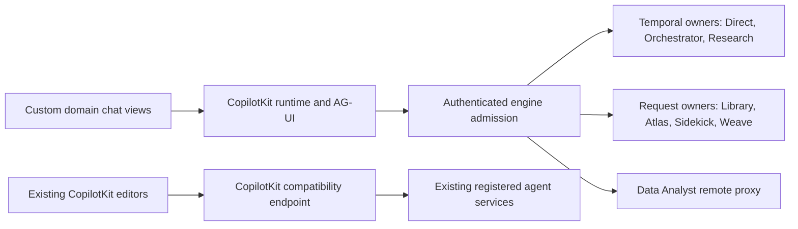

# CopilotKit adoption review

Capability audit, chat inventory, migration recommendation, and proposed follow-on scope.

- **Audience**: Web, AI/Backend, and engineering reviewers
- **Owner**: Agent team
- **Reviewed**: 2026-11-03
- **Source baseline**: `eb7c81baff5060670df1ad7bb6dbab34eab9f0dd`
- **Decision status**: Recommendation for engineering review; not an accepted architecture decision

## Recommendation

**Migrate some.** Standardize compatible chat transports on the CopilotKit
runtime and AG-UI contracts, while keeping the existing domain-specific views
and execution owners. Keep CopilotKit in the editors that already use it. Do not
replace every chat with the stock CopilotKit UI or replace Temporal with an
in-memory runner.

This recommendation follows the source inventory below: short request/reply
chats benefit from shared admission and event handling, but persisted workflows,
document review, source citations, charts, and multi-agent progress have distinct
contracts. A common event protocol does not supply those product contracts.

The shared-runtime adapters are already implemented for Direct, Orchestrator,
Research, Library, project Atlas, Sidekick, Weave refinement, and Data Analyst.
Their availability is gated; implementation is not evidence of organization-wide
rollout. System-map Atlas and other dedicated workflow-template chats are not
silently included. Nexus is retained as a rollback path, and CUGA is retired.

[ADR-026](../adr/026-chat-runtime-execution-boundaries.md) owns the proposed
execution boundary. This review supplies the broader adoption assessment; it
does not change that ADR's Proposed status or record stakeholder approval.

## Why CopilotKit is not used everywhere

The question assumes CopilotKit runs only the Editing Assistant. That is no
longer accurate: the inventory below lists seven experiences that use its UI or
hooks, and eight chats that can now run on its runtime behind rollout flags.
Data Analyst appears in both lists, because its legacy path is the general
CopilotKit chat.

The original reason for the split is not recorded. This repository's history
starts with the squashed public release of 2026-08-26, and no ADR or design
note explains the choice. Only the people who made it can confirm the reason.

The code suggests a likely explanation (an inference, not a recorded decision).
CopilotKit appears where a chat edits shared page state, calls frontend tools
or needs human approval: the editors. The custom chats were built around
Temporal workflows, per-agent progress, persisted runs and reconnects, which
CopilotKit's in-memory runner did not provide. Moving them onto the runtime
required a custom runner (`FabricTemporalRunner`) and per-engine admission,
described below.

## Evaluation method and installed version

The review enumerates application routes, CopilotKit providers and hooks,
AI SDK chat hooks, stream consumers, runtime callers, and their visible mounts.
Shared launchers are listed as entry points, not counted as additional engines.
An editor form or workflow progress monitor without a conversation is not a new
chat experience. Source links identify implementation evidence; estimates and
recommendations below are engineering judgments, not measured delivery times.

The [web manifest](../../apps/web/package.json) pins `react-core`, `react-ui`,
`runtime`, and `runtime-client-gql` to **1.80.0**; AG-UI client/core are **1.0.2**.
The implementation already mixes v1-facing UI/action APIs with v2 agent APIs.
It is inaccurate to describe it as either v1-only or a completed v2 UI migration.

### Current upstream release review

Checked against official GitHub release metadata and documentation on the review
date. Filter core semantic-version releases separately from Channels releases:
the repository's generic latest-release endpoint currently selects
`channels/v0.12.0`, not the latest core SDK release.

| Release | Relevant finding | Assessment for this application |
| --- | --- | --- |
| [1.80.0, October 24](https://github.com/CopilotKit/CopilotKit/releases/tag/v1.80.0) | Includes agent-scoped cancellation, explicit stream errors, tool-result repair, reply feedback, and changed MCP App sandbox/A2UI renderer contracts. | Installed baseline. Preserve cancellation, approval, renderer, and tool-result regressions when changing APIs. Upstream support does not prove remote graph termination or a successful document save. |
| [1.81.0, October 27](https://github.com/CopilotKit/CopilotKit/releases/tag/v1.81.0) | Adds native generative-UI helpers and Learning-management APIs; also changes input-layout and runtime handling. | Generative UI is an optional prototype candidate, not a missing prerequisite for the existing editor review cards or custom chart renderer. |
| [1.82.0, October 27](https://github.com/CopilotKit/CopilotKit/releases/tag/v1.82.0) | Extends chat labels/local-run handling and fixes telemetry, MCP URL logging, and renderer behavior. | Check applicability at actual call sites; a newer SDK does not automatically replace custom labels, billing, or authorization. |
| [1.83.0, October 28](https://github.com/CopilotKit/CopilotKit/releases/tag/v1.83.0) | Latest stable core release at review time. Its short release note only identifies a merge. The [official comparison](https://github.com/CopilotKit/CopilotKit/compare/v1.82.0...v1.83.0) also contains local-thread ownership/Stop checks, scoped Intelligence events, and BuiltInAgent URL-download restrictions. | Do not infer unchanged contracts from the short note. Assess the custom runner, allowed routes, and optional built-in features before a separate version update. No dependency update is proposed by this review. |

The repository's [release-age policy](../../pnpm-workspace.yaml) is an admission
floor, not a compatibility test. The reviewed core release is older than that
floor on the review date; that alone is not approval to install or deploy it.

Official capability references:
[shared state](https://docs.copilotkit.ai/shared-state),
[frontend tools](https://docs.copilotkit.ai/frontend-tools),
[human-in-the-loop](https://docs.copilotkit.ai/human-in-the-loop), and the
[upstream architecture](https://github.com/CopilotKit/CopilotKit/blob/main/dev-docs/architecture/ARCHITECTURE.md).
These current guides use v2 APIs. Examples must be checked against the installed
package exports and the application's compatibility adapters before adoption.

## Editing Assistant capability audit

The current Editing Assistant is not a thin text-chat integration. Project
documents, story grooming, and the registered document generator combine agent
state, frontend actions, review cards, and editor-specific outcomes.

| Capability | Current usage and evidence | Gap or improvement opportunity |
| --- | --- | --- |
| Reactive shared state | [usePageAgent](../../apps/web/modules/saas/shared/components/copilot/use-page-agent.ts) wraps v2 `useAgent`, selects page state, reseeds runs, and handles step/interrupt events. Used by [DocumentEditor](../../apps/web/modules/saas/projects/components/DocumentEditor.tsx), [StoryWorkspace](../../apps/web/modules/saas/projects/components/stories/StoryWorkspace.tsx), and [DocumentGeneratorEditor](../../apps/web/modules/saas/agents/components/DocumentGeneratorEditor.tsx). | Already used. Preserve selective subscriptions rather than subscribing the full editor to every token/state update. Older prose describing these consumers only with `useCoAgent` is not the current implementation. |
| Readable page/RAG context | The editor consumers publish document, story, integration, and selected source context through `useCopilotReadable` and agent state. | Already used. Keep route-owned prompts and tenant identity authoritative on the server; runtime configuration is not itself forwarded agent input. See the [boundary explanation](../solutions/integration-issues/copilotkit-runtime-properties-never-reach-the-agent.md). |
| Frontend tools | [RepositoryFrontendTools](../../apps/web/modules/saas/projects/components/RepositoryFrontendTools.tsx), editor actions, and MCP inline tools expose domain operations. | Already used. Keep tool definitions synchronized when project/repository context changes. Preserve the [registration/remount contract](../solutions/integration-issues/copilotkit-frontend-tool-description-needs-a-remount.md) during API consolidation. |
| Human approval and clarification | `confirm_changes` uses `useCopilotAction` with `renderAndWaitForResponse`; editors render review/clarification actions. | Already used. A move to `useHumanInTheLoop` must preserve acceptance, rejection, stale proposals, collaborative write locks, and actual save outcomes. It is not a new missing HITL feature. |
| Streaming document differences | The [streaming pattern](../DOCUMENT_EDITOR_STREAMING_PATTERN.md) describes baseline/diff/reject behavior; current consumers use the shared page-agent adapter. | Preserve baseline restoration and clean accepted content. The standalone document-generator editor has no independent persistence path; accepting its review must not be reported as a durable project-document save. |
| Custom chat and editor UI | Existing Sidebar/header/input/message components include attachments, reasoning, history, review cards, and persistence bridges. | Retain useful domain UI. Stock chat replacement requires explicit parity evidence, not just a successful text response. |
| Reply feedback | [CopilotReplyRatingSidebar](../../apps/web/modules/saas/shared/components/copilot/CopilotReplyRatingSidebar.tsx) connects project-chat feedback to the application's `ai.feedback` procedures. | Do not label feedback as unused. This application feedback path is distinct from enabling upstream Automatic Learning or its data collection. |
| Mixed API maintenance | Page subscriptions already use v2, while readable/action APIs and some other consumers retain v1-facing hooks; Topic Assistant still uses `useCoAgent`. | A bounded, representative adapter-consolidation pilot is worthwhile. Avoid a simultaneous rewrite of all editors and execution engines. |
| Native generative UI / upstream Learning | Available upstream; the inspected Editing Assistant uses its own review/rendering and feedback contracts. | Optional evaluation only. Demonstrate a concrete product benefit and data/approval contract before replacing existing UI or enabling another collection path. |

The first recommended improvement is consistency of the existing lifecycle and
tool-registration adapters, with real-provider contract tests. Adding another
approval UI, global state subscription, or transcript store would duplicate
capabilities already present.

## Experience inventory and feasibility

All organization routes below are relative to `/app/{organizationSlug}`.
Transport selection is distinct from the visible UI, and some flags deliberately
retain a legacy route for callers who are not eligible for persisted runtime
conversations.

### Experiences already using CopilotKit UI or hooks

| Experience / entry point | Current implementation and constraint |
| --- | --- |
| Project document Editing Assistant, `/projects/{id}/documents/{documentId}` | [DocumentEditorPage](../../apps/web/modules/saas/projects/components/DocumentEditorPage.tsx) and [DocumentEditor](../../apps/web/modules/saas/projects/components/DocumentEditor.tsx): Sidebar, state/context/actions, review and project-document persistence. Keep durable save outcomes separate from UI acceptance. |
| Story grooming Editing Assistant, `/projects/{id}/stories/{storyId}` | [StoryWorkspacePage](../../apps/web/modules/saas/projects/components/stories/StoryWorkspacePage.tsx) and [StoryWorkspace](../../apps/web/modules/saas/projects/components/stories/StoryWorkspace.tsx): specialized stage transitions, review, context, and save behavior. |
| Registered document generator | [AgentChatDocument](../../apps/web/modules/saas/agents/components/AgentChatDocument.tsx) and DocumentGeneratorEditor: split editor/Sidebar. Reuses the editing pattern; it does not independently persist project documents. |
| Registered general and API agents | [AgentChatGeneral](../../apps/web/modules/saas/agents/components/AgentChatGeneral.tsx) and [AgentChatAPI](../../apps/web/modules/saas/agents/components/AgentChatAPI.tsx): CopilotKit/Sidebar with agent-specific approval and API panels. |
| Prompt creation and enhancement | [PromptEditorAI](../../apps/web/modules/saas/prompts/components/PromptEditorAI.tsx), [PromptEnhancePage](../../apps/web/modules/saas/prompts/components/PromptEnhancePage.tsx), and [PromptContentEnhancer](../../apps/web/modules/saas/prompts/components/PromptContentEnhancer.tsx): prompt context, frontend actions, and review. |
| Backlog AI Update, Kanban/roadmap panels | [BacklogChatPanel](../../apps/web/modules/saas/projects/components/stories/BacklogChatPanel.tsx) and [BacklogChat](../../apps/web/modules/saas/projects/components/stories/BacklogChat.tsx): Sidebar with source selection, analysis, and review. Multiple mounts share one implementation. |
| Publishing Topic Assistant | [TopicAssistant](../../apps/web/modules/saas/projects/components/publishing-suite/TopicAssistant.tsx): CopilotKit state/context/actions, topic-thread persistence, and write locks. Preserve those contracts during any v2 hook consolidation. |

### Custom chat views and remaining migration choices

Effort is an initial estimate in **engineer-days** for a stock/v2 UI migration
from the reviewed runtime baseline, not measured effort or unfinished work in
the existing adapter delivery. Assumptions: one developer familiar with the
codebase, existing services available, no new model/provider or infrastructure,
and review plus focused regression checks included. Estimates overlap on shared
platform work and must not be added as an approved project budget.

"Stock UI" below means replacing the custom view with CopilotKit's packaged
chat components. "Runtime" means the shared CopilotKit runtime and AG-UI
transport behind a custom view.

| Experience | Current transport / owner | Technical feasibility | UX impact | Maintainability impact | Recommendation | Estimated incremental UI migration |
| --- | --- | --- | --- | --- | --- | --- |
| Main Direct | [useDirectChatStream](../../apps/web/modules/saas/agents/hooks/useDirectChatStream.ts); custom view, legacy or CopilotKit runtime, Temporal-owned turns. | Feasible with a custom agent adapter; the runtime adapter is delivered. | A stock view must reproduce history, retry, selected-versus-served model labels, attachments and Stop. No user-visible gain is demonstrated. | Shared transport removes a separate stream protocol. A stock view adds a parity layer to keep in step. | Runtime transport; keep the custom view. | 3–5 days |
| Main Orchestrator, including multi-agent mode | [useMultiAgentChat](../../apps/web/modules/saas/agents/hooks/useMultiAgentChat.ts), [OrchestratorEngine](../../apps/web/modules/saas/agents/runtime/orchestrator-engine.ts); Temporal workflows and custom progress/approval UI. | Feasible at high integration cost. Workflow and per-agent turn ownership must stay in Temporal. | Progress, clarification, handoffs, per-agent model labels and reconnect would all have to be rebuilt in a stock view. | Runtime events reduce protocol duplication. A stock view would duplicate the custom progress and approval UI. | Runtime events; keep the custom view. | 6–10 days |
| Main Deep Research | [useResearchRunStream](../../apps/web/modules/saas/agents/hooks/useResearchRunStream.ts) and [DeepResearchInlineChat](../../apps/web/modules/saas/agents/components/fabric-ai/DeepResearchInlineChat.tsx); Temporal execution and persisted report. | Feasible only through the existing workflow observer, resume and Stop contract. A plain message stream cannot replace it. | Clarification, one execution across reconnects, Stop and the persisted report must stay visible. | The runtime adapter reuses shared admission. A stock view would still need the custom report renderer. | Runtime transport; keep the custom view. | 3–5 days |
| Library document chat | [LibraryDocumentChatDialog](../../apps/web/modules/saas/libraries/components/LibraryDocumentChatDialog.tsx); legacy reply or streamed request-scoped runtime. | Good fit: request/reply. | Grounded answers, expandable sources and absent-fact refusal must stay. Flattening citations into text would be a regression. | Shared admission, limits, billing and local cancellation replace route-specific code. | Runtime transport; keep the dialog. | 1–2 days |
| Project Atlas | [AtlasChatPanel](../../apps/web/modules/saas/projects/components/atlas/AtlasChatPanel.tsx); project-scoped runtime adapter or legacy route, persisted interrupted partials. | Feasible with explicit project authorization and partial persistence. | Interruption, reopen, follow-ups and codebase-specific rendering must stay. | Shared events; the codebase rendering stays custom either way. | Runtime transport; keep custom rendering. | 3–5 days |
| Atlas System map | The same Atlas panel explicitly chooses `atlas.systemChat` for `systemScope`, regardless of the project Atlas runtime flag. | Not established. The multi-repository authorization and context boundary needs its own adapter assessment; the project adapter does not cover it. | None now: the existing UI remains. | A second Atlas transport remains until assessed. | Defer. | 4–7 days |
| Builder Sidekick | [useSidekickChat](../../apps/web/modules/saas/agents/sidekick/useSidekickChat.ts); AI SDK legacy or shared runtime. | Good fit for transport consolidation. | Field application, manual edits, suggestions and the draft-versus-save distinction must stay. A generic reply bubble is not enough. | Consolidation removes a separate AI SDK route. | Runtime transport; keep the panel. | 2–4 days |
| Weave refinement | [useWeaveRefinement](../../apps/web/modules/saas/weave/hooks/useWeaveRefinement.ts); legacy `refine` or runtime. | Good fit: request/reply. | Completed refinement, explicit Apply, abort and no unintended plan creation must stay. | Small adapter; plan execution stays separate from this chat. | Runtime transport; keep the form. | 1–2 days |
| Data Analyst | [AgentChatCopilotKit](../../apps/web/modules/saas/agents/components/AgentChatCopilotKit.tsx): legacy CopilotKit general chat or custom DataAnalystChat over the runtime proxy. | Feasible and implemented; this is not a migration from a non-CopilotKit backend. | The runtime view shows tool calls, charts and the answering model. For the same chart request on staging (2026-11-03), the legacy general chat showed the text answer only. | One proxy with restricted forwarded input. Admission, timeout and persistence differ from legacy, as recorded below. | Runtime transport after the recorded differences are accepted. | 3–5 days |
| Other dedicated workflow-template chats | [WorkflowTemplateChat](../../apps/web/modules/saas/agents/components/WorkflowTemplateChat/WorkflowTemplateChat.tsx), `/agent-templates/agents/{instanceId}/chat`; workflow SSE/Temporal. | Possible, but only with the template workflow contracts. Deep Research templates redirect to Main Research and non-dedicated instances to Main Orchestrator, so they are not counted again. | Progress, results, cancellation and template-specific views must stay. | A rewrite would duplicate the workflow SSE UI without removing it. | Defer a stock UI rewrite. | 4–7 days |
| Legacy Nexus parallel chat | [Nexus route](../../apps/web/app/(saas)/app/(organizations)/[organizationSlug]/nexus/page.tsx), [CopilotPage](../../apps/web/modules/saas/ai/components/CopilotPage.tsx), `useMultiAgentStream`. | Not a migration target: a retained rollback implementation. | None by default: default-on `UNIFIED_AGENT_INTERFACE` redirects Nexus to Main. | Retire it through its existing consolidation; a second parallel migration would add work. | Defer; retire with the consolidation. | 5–8 days if independently retained |
| CUGA | Retired SYSTEM identity; no current runtime registration or active launcher. | Not applicable. | None: no active entry point. | Restoring a retired service would add work. | Exclude. | 0 days |

The [FabricAgentLauncher](../../apps/web/modules/saas/agents/components/FabricAgentLauncher.tsx)
is an alternate Direct/Orchestrator mount, not a separate engine; it has no
Research drawer. [McpChatDialog](../../apps/web/modules/saas/mcp/components/McpChatDialog.tsx)
mounts the Orchestrator with locked MCP configuration. Keep those entry-point
constraints in shared-view regression checks. Weave execution monitoring is a
workflow-control view, not an additional conversational migration target.

## Target architecture and non-parity boundaries

The [runtime route](../../apps/web/app/api/agents/runtime/[[...path]]/route.ts)
uses `CopilotRuntime`, `createCopilotRuntimeHandler`, and the custom
[FabricTemporalRunner](../../apps/web/modules/saas/agents/runtime/fabric-temporal-runner.ts).
It resolves authenticated organization/resource access before engine admission.
Existing model selection, billing, audit, and persistence helpers remain the
owners of their behavior; browser-provided tenant or AI headers do not become
authority. See ADR-026 for lifecycle and protocol details.

Migration does not imply identical admission or lifetime behavior:

- [Runtime eligibility](../../apps/web/modules/saas/agents/hooks/useRuntimeEligible.ts)
  for persisted Direct/Orchestrator paths requires a role that can save a
  conversation; other callers keep the applicable legacy path.
- [Request/reply transport](../../apps/web/modules/saas/agents/hooks/useRuntimeChatTransport.ts)
  is selected once at mount. A flag change must not switch a live turn's engine.
- The [Data Analyst flag contract](../../packages/utils/lib/feature-flag-registry.ts)
  records members-only runtime admission versus legacy project guests, a
  20-runs/minute budget, a 240-second runtime limit versus the legacy 800-second
  allowance, restricted forwarded input, no remote images, and no conversation
  persistence. These are rollout decisions to review, not hidden parity claims.
- Closing a runtime proxy propagates cancellation to Fabric's owned request.
  It does not prove an already-submitted remote graph/provider has stopped.
- EOF without a terminal outcome is incomplete. Request-scoped engines do not
  acquire Temporal's durable replay/idempotency merely by using the same SDK.

## Proposed phased follow-on plan

This is a proposed plan for review, not a new implementation authorization or a
claim that every stock-UI rewrite is required. The per-experience estimates above
describe that larger alternative. The recommended narrower plan keeps useful
custom views and builds on already delivered adapters.

| Phase | Scope and gate | Current state / estimated remaining effort |
| --- | --- | --- |
| 1. Review the contract | Confirm the inventory, explicit exclusions, admission differences, and ownership recommendation. Engineering reviewers decide whether to accept ADR-026. | This review supplies the written input; stakeholder decision is not recorded. 0.5–1 day of review, not an implementation task. |
| 2. Baseline the runtime | Use one shared CopilotKit event/admission boundary; preserve Temporal and request-scoped owners. Keep separate organization flags and legacy fallbacks. | Adapters already implemented. No repeat migration is proposed. Additional changes require a concrete uncovered contract failure. |
| 3. Validate and select rollout | For each selected surface, exercise success, refusal, model identity, interruption, Stop, reset/reopen, billing/audit, and relevant resource permissions. Explicitly accept the documented Analyst differences before broad rollout. | Focused code and hosted evidence exist; QA activation is not permanent rollout. Approximately 1–2 days for a bounded rollout decision and its targeted verification, excluding external approvals. |
| 4. Pilot API consistency | If approved as follow-on work, use one representative Editing Assistant consumer to consolidate mixed hook adapters. Preserve real-provider tool registration, diffs, review, collaboration, and save outcomes. | Proposed optional pilot, 2–4 days. Expand only if it removes maintenance work without changing domain behavior. |
| 5. Reconsider deferred views | Revisit System-map Atlas or dedicated workflow templates only with a concrete product benefit and their own admission/ownership assessment. Retire rollback-only Nexus through its existing consolidation lifecycle. | Excluded from the recommended immediate migration. No current delivery estimate is committed beyond the assessment ranges above. |

### Risks, mitigations, and acceptance gates

| Risk | Mitigation and evidence required before a follow-on change |
| --- | --- |
| UI acceptance mistaken for a successful write | Preserve domain outcome/persistence contracts; verify rejection, stale/conflicting proposals, and actual save failures as well as acceptance. |
| Lost or duplicated durable work on reconnect | Keep Temporal ownership and engine-specific run keys. Exercise reconnect/resume/Stop and reject foreign-engine/cross-organization controls. |
| Generic SDK storage bypasses tenant admission | Reuse the server-side organization/resource helpers and custom runner. Test allowed and rejected routes through the real runtime boundary. |
| Agent/tool definitions outlive page context | Keep keyed definition registration or validate the installed v2 dependency contract through the real provider. |
| Rich output slows empty-chat loading or first input | Keep the welcome/composer available independently of generation and rich output. Verify import/render boundaries and deployed LCP/INP on the affected surface. |
| A flag changes behavior mid-turn | Pin the transport at mount; finish or reset a turn before changing its engine. Verify legacy and enabled paths separately. |
| Model selection is reported as the served model | Carry actual producer model metadata into live and restored answers; show the selected-but-not-applied distinction where relevant. |
| A version bump is treated as a completed migration | Review release-specific contracts, admission differences, and affected surfaces. Dependency installation, functional acceptance, deployment, and rollout are separate gates. |

Publication of this review provides the evaluation deliverable. It does not
record stakeholder sign-off, a production rollout, or new verification of every
existing editor. Operational test results and deployment receipts belong to the
implementation change that produced them, rather than being relabeled as fresh
evidence by this document.
