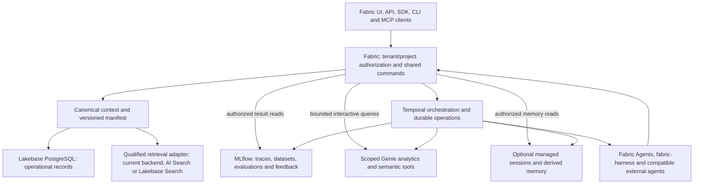
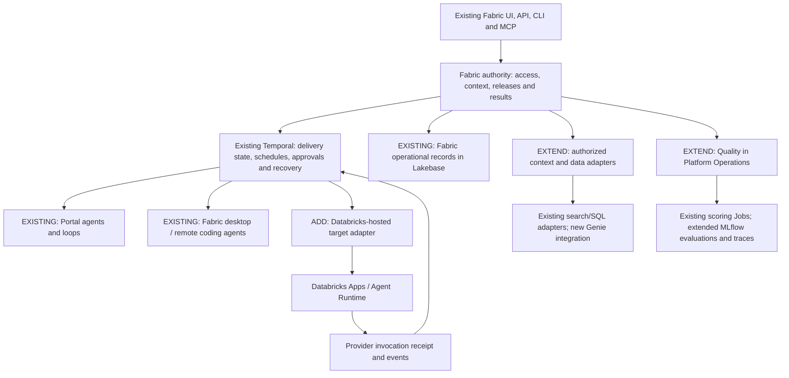

# Databricks-backed context and evaluation platform

Proposed backend architecture and qualification plan for Fabric's context, retrieval, semantics,
memory and AI quality experience.

- **Audience**: Product, platform, context/AI engineers, security and deployment operators
- **Owner**: Product and Platform engineering
- **Status**: In progress; local inspection, deterministic scoring and administrator-approved saved evaluation execution are implemented. Each deployment still requires isolated runtime qualification.
- **Date**: 2026-11-03

## 1. Recommendation and assumptions

Fabric is the software factory delivery teams use; Databricks supplies backend capabilities.
Ordinary users work with Projects, Workspaces, agents, workflows and quality results without
needing a Databricks account or learning its resource model. The default Fabric-hosted experience
must not ask delivery teams to provision jobs, experiments, volumes, notebooks or machine
credentials. Fabric's platform operates approved, isolated backend resources and exposes readiness,
progress and actionable recovery through Fabric. Native links remain optional technical
diagnostics; Fabric must provide the useful result and next delivery action itself.

The subjects being created, run, tested and evaluated are Fabric reports/templates, agents,
prompts, agent loops, workflows, documents and RAG/context behavior. Preserve their existing
Temporal execution and shared MCP/connector infrastructure. Databricks supplies internal data/AI
services through approved adapters; it is neither a separate authoring product nor the primary
test subject. Backend qualification remains an implementation requirement, while product acceptance
demonstrates the complete Fabric user task. A hosted Databricks agent is optional and does not gate
creating, running or evaluating a normal Fabric agent.

The product scope includes creating and deploying team agents, composing workflows and agent
loops, maintaining shared context and documents, delegating coding work, and improving these
capabilities through evaluations. Databricks is the underlying data and AI platform; it is not the
user's administration task. Map its capabilities to concrete Fabric actions:

| Fabric action | Backend responsibility | User-visible result |
| --- | --- | --- |
| Create, run and evaluate a Fabric agent | Retain existing Temporal execution and model/tool adapters; use optional managed hosting only for a qualified requirement | A Fabric-created agent with instructions, shared context/tools, runs and understandable results |
| Generate a report or document | Reuse existing template/document workflows and authorized context/integrations; apply internal data/AI services where useful | A reviewable artifact retained and usable in Fabric, with source and version attribution |
| Build a workflow or agent loop | Combine approved data/AI operations and tools under Temporal orchestration, explicit completion criteria and bounded iteration | One visual studio with triggers, schedules, progress, human checkpoints and actionable failures |
| Add and use shared context | Resolve authorized documents and source revisions; manage qualified retrieval and semantic adapters | Searchable, cited project knowledge usable by Fabric and compatible external agents |
| Ask questions about approved structured data | Connect a scoped Genie Space/Agent through a qualified Fabric analytical tool | Answers with provenance in the relevant Fabric assistant or workflow |
| Compare prompts, agents or workflows | Run versioned cases and supported scorers using MLflow-backed execution and records | Understandable quality comparisons and failures tied to the exact evaluated version |
| Delegate a coding task | Use Fabric Agents and supported coding harnesses with project context and existing execution receipts | A visible session, reviewable changes, PR and validation evidence |

These are planned product contracts. Each adapter needs the phase's live qualification before
Fabric offers that action; an existing package export or backend entitlement does not establish
complete creation, deployment or observation support.

Make Databricks the **preferred managed data/AI backend for Fabric-hosted deployments, qualified
capability by capability behind Fabric's existing product and access contracts**. Preserve provider
portability for self-hosted/customer requirements and an explicit disabled path for unavailable
capabilities. Reuse production Lakebase for operational records, add MLflow-backed quality
capabilities, qualify document retrieval against existing backends, and add governed Genie
analytical tools and optional managed memory. Fabric remains the interface for Projects, document
Workspaces, Pages, prompts, skills, agents and workflows through UI, API, SDK, CLI and MCP.

Production PostgreSQL is hosted on Lakebase. Management access does not establish PostgreSQL
role access, schema readiness or tenant isolation; qualify those through a separately approved
connection and isolated test project before promotion. Cloud, region, Lakebase edition/project generation, PostgreSQL version, feature
entitlements, customer data requirements and Databricks account structure are discovery inputs, not
inferred from that report. AWS documentation does not establish Azure/GCP feature parity.

The default is Fabric-managed infrastructure for ordinary customers. Fabric platform operators
configure authorized processing destinations, service identities, resource access, costs and
retention through deployment operations. An optional customer-managed Databricks path belongs in
enterprise setup. Processing disclosures and organization policies remain available in the
appropriate settings and agreements; backend administration is outside the delivery journey.

This extends the [software factory plan](software-factory.md), not a replacement roadmap. Keep
Temporal as durable delivery orchestration and preserve the independently useful context-only
release. Operational instructions remain in the existing [Databricks deployment
guide](../deployment/DATABRICKS.md). Accepted tenancy, direct-repository instructions, memory write
lanes and CI/governance ADRs remain authoritative.

## 2. Product and capability distinctions

Current terminology and availability were checked against official documentation on the date above.
Revalidate at implementation and record actual cloud/region/account support.

| Capability | Useful role behind Fabric | Qualification boundary |
| --- | --- | --- |
| Lakebase PostgreSQL | Operational project/context metadata, permissions, published versions and execution/evaluation references | Existing hosting does not establish Search, managed memory, Unity Catalog or agent entitlement; PostgreSQL and UC security differ |
| Lakebase Search | Candidate hybrid document/chunk retrieval near operational data | Current requirements include PG16+, irreversible project enablement and compute restart; current release stage must be established for the deployment |
| Databricks AI Search, formerly Vector Search | Managed document retrieval, hybrid ranking, filters and reranking | Index/source synchronization is asynchronous; source row/column permissions do not automatically protect index results |
| Genie Agents / Spaces | Curated analytical questions and, in qualified Agent Mode, multi-step analysis over permitted attached resources | Distinct from Fabric agent loops and a custom TypeScript runtime. Chat, Agent Mode, managed MCP and authoring have different protocol/state/capability contracts |
| Genie Ontology | Governed semantic context and inferred hints used by the Genie family | Current guide says Public Preview; early-November snippets GA is announced, not proof of completed rollout. No generic public inferred-snippet CRUD/search API was established |
| Managed sessions, memory and memory pipelines | Optional reusable agent session state and derived memory through REST | Beta, separately provisioned stores; store ACLs are security boundaries, actor/metadata filters are not ACLs |
| MLflow 3 | Tracing, curated evaluation datasets, deterministic/LLM scorers, feedback and comparisons | Separate compute/identity/retention requirements; managed production monitoring is Beta and SDK/API support varies |
| MLflow Prompt Registry | Optional governed mirror/import of approved prompt versions | Mutable aliases must resolve to exact versions; avoid two independent editors/authorities |
| Databricks Apps / Agent Runtime / AgentKit, plus model endpoints and governed tools | Managed execution target for supported published agents; model/tool access for existing runtimes | Current Azure custom-agent guidance recommends Apps with DurableAgentServer; legacy agent Model Serving and ordinary model inference are different paths. Pin the selected protocol and qualify its maturity, identity, recovery and target capabilities |

Databricks AI Search and Microsoft Azure AI Search are separate products; use explicit provider
labels and contracts. These are complementary layers. A document store, analytical semantic model,
conversation history and agent memory have different write, revision, retention and permission
semantics. Do not create a fictional universal "Context Store" adapter that claims every one is
interchangeable. Relevant primary sources: [Lakebase
Search](https://docs.databricks.com/aws/en/oltp/projects/lakebase-search), [AI
Search](https://docs.databricks.com/aws/en/ai-search/ai-search), [Genie
Ontology](https://docs.databricks.com/aws/en/genie/genie-ontology), [managed
memory](https://docs.databricks.com/aws/en/agents/agent-memory/managed-memory), and [MLflow
concepts](https://docs.databricks.com/aws/en/mlflow3/genai/concepts/core-concepts).

## 3. What already exists in the repositories

| Existing source | Reusable foundation | Remaining integration work |
| --- | --- | --- |
| `@repo/databricks` auth/API/config clients, shared URL security/OAuth helpers and database Lakebase configuration | Token refresh and existing HTTP/config plumbing; Prisma/PostgreSQL connection handling. Bindings must reuse qualified URL/OAuth controls, not assume a config HTTPS-prefix check is sufficient | Separate machine/user identity modes, per-resource bindings, pool/role qualification and capability reporting |
| `packages/databricks/src/genie-lakebase.ts` | Exported conversational Genie REST client with message polling/results | Source inventory did not establish a production caller outside the package; it is not proof Fabric's assistant UI already invokes Databricks Genie |
| `packages/integrations/src/databricks-vector-search/index.ts`, `packages/temporal/src/activities/shared/databricks-knowledge.ts` | Configured Databricks index bindings and activity-aware retrieval | Current specialized path is narrower than generic AI Search and does not expose trusted tenant-row filters; shared-index use needs new security work |
| `packages/ai/model-factory.ts`, Databricks SQL workflow steps | Databricks model-serving and bounded SQL/AI query integration | Preserve existing provider selection and credentials; test policy-denied and statement-failed results, exact supported models and task budgets |
| Local `@fabric-harness/databricks` 7.1.3 source candidate; retained published 7.1.2 certification, Apache-2.0 | Legacy managed-memory client, Genie authoring/Agent Mode client, search/RAG, ontology projection utilities, MLflow tracing/evaluation records and App artifact validation/deployment helpers | Consume public packed contracts through an optional adapter; qualify exact API generation, no sibling `src` imports, transport-allowlist bypass or implicit Temporal upgrade |
| Harness `ontology-drift.ts` and ontology exporter/apply/feed modules | Real curated semantic export/apply/feed logic | Inferred knowledge-store reading is an injected interface, not an established native Context Store/snippet client |
| Harness `mlflow-tracing.ts`, `rag-eval.ts` | MLflow V3 trace payload/export support; MLflow 3 evaluation JSONL and local scorer helpers | Current exporter buffers in memory and posts asynchronously; production-grade redacted export delivery and managed evaluation job lifecycle are new work |
| Current document/object storage, Qdrant and context ingestion | Existing canonical sources and usable retrieval fallback | Qdrant expects 1536 dimensions; recorded Databricks GTE/BGE vectors are 1024. Different models/dimensions require separate indexes and re-embedding |

The inspected local harness 7.1.3 managed-memory client still uses the legacy `/api/2.1/unity-catalog/memory-stores`
generation, with catalog/schema names and scope strings. The current managed session/memory/pipeline
documentation describes `/api/2.0/agents/...` contracts and actor/session semantics. These are not
configuration aliases. No current-generation session-store client was established in the inspected
exports. D5 needs a supported public client/package update or an explicitly reviewed native REST
adapter and packed contract tests before exposing those features. Do not widen a raw transport
allowlist to make an unsupported legacy client appear current.

The retained harness capability matrix describes exact-package, single-user Azure/M2M evidence, not
fresh multi-user agency isolation, all clouds, or all optional services. Run new acceptance against
the selected deployment. Existing source/tests are implementation evidence, not a live certification
result for this task.

## 4. Architecture and authority



Fabric remains authoritative for current tenant/project access, context identity, publication,
prompts/skills and delivery approval. Lakebase is its PostgreSQL persistence, not a second
authorization authority. Existing blob storage continues to hold source files unless a separately
justified migration is approved. Databricks indexes, traces, memory, ontology hints and analytics
are explicitly bound projections/tools with their own operational state.

Ordinary authorized metadata/content reads and qualified bounded interactive queries go through the
synchronous/streaming facade, with the same policy and budgets. Temporal owns durable admission,
schedules, classified retries, cancellation, export/reindex/evaluation operations and recovery; fast
reads do not start a workflow solely to reach a backend. A Databricks Job can perform bounded Python
evaluation or ingestion computation and return a job receipt; it does not become a competing
software-delivery state machine. Job cancellation/request acceptance is separate from confirmed
cancellation and remote effects. Do not move the UI to Databricks Apps or replace existing coding
sessions to obtain these services.

Extend existing seams: canonical authorized context queries and manifest assembly, a retrieval
provider, a quality/evaluation provider, optional memory provider and a governed analytical-tool
provider. One per-resource binding records provider, validated `databricksWorkspaceOrigin`, Fabric
organization/project IDs, document collection ID where relevant, security-domain ID,
connection/principal reference, exact provider resources, capability generation and data policy.
These identifiers are distinct typed fields, not one ambiguous workspace string. Missing
tenant/backend identity fails before dispatch; process-global host/token defaults are not a tenant
fallback. Reuse Connections, token providers, common commands and audit. Validate each approved
workspace origin through the shared `packages/utils/lib/url-security.ts` and strict-origin/OAuth
controls in `packages/ai/lib/databricks-oauth.ts`; preserve approved private-network modes
explicitly and block unexpected redirects. A configuration parser or newly added origin helper alone
is not proof of qualified endpoint validation. Label Portal `@repo/databricks` separately from the
sibling harness package in compatibility records. Unknown cloud/API capabilities fail closed or
appear unavailable; the UI never advertises them solely because a package exports a method.

### Harness and native Genie capability disposition

Keep three kinds of evidence separate: public types/exports and offline tests, retained certification
for an exact published artifact, and fresh acceptance of the actual Fabric integration. The local
Harness Databricks package is a 7.1.3 source candidate; its certification index identifies 7.1.2 as
the published certified artifact at inspection. Pin the selected published package and public
contracts, or complete candidate qualification. Retained Tier R/A evidence is not certification of
Fabric's tenant mapping, workload, deployment, every optional tier, or the source candidate.

| Capability to reuse | Verified boundary | Fabric disposition |
| --- | --- | --- |
| `genie.conversations` / Genie tool | Bounded direct conversation client with conversation continuity, SQL/results and separate author/runtime identity choices | Governed analytical tool for existing agents, report steps and workflows; pin ownership of every conversation and follow-up |
| `genie.manage` / authoring tools / ontology compiler | Create/update/permission/export/import/trash and semantic-spec generation; authoring includes SQL-bearing configuration and durable ownership | Platform-managed provisioning or deliberately authorized advanced domain action; separate author/runtime grants, approved data scope, exact-operation approval and current config fingerprints |
| Managed Genie MCP | Scoped read-only endpoint; native tool discovery and OAuth/OBO support | Reuse the shared MCP action catalog where supported; do not promise multi-turn conversation state from the stateless MCP contract |
| `genie.agentMode` | Harness retains an explicit acknowledgment/gate and offline protocol coverage; published native status and workspace availability are separate | Feature-gated advanced tool only after native grant/feature/protocol qualification; no silent fallback to Chat mode |
| Harness App build (`@fabric-harness/node`) and deploy (`@fabric-harness/databricks`) | Hosts a custom TypeScript agent separately from a Genie resource; `app.genie` emits a resource binding to an existing Space | Author an approved native resource before binding it. Build/deploy a pinned advanced agent artifact only when hosting is required; the Space never runs arbitrary TypeScript code |
| MLflow ResponsesAgent serving proxy | Optional separate proxy/serving integration, not the same certification tier as basic App deployment | Compatibility only for a declared consumer requirement and separate acceptance; ordinary Fabric users do not need Playground or native serving setup |
| UC Agent Service | Beta registration, discovery and grants; runtime invocation is unavailable in the inspected native contract | Optional governance metadata. Call the actual qualified App/proxy endpoint; registration is not an invocation gateway |
| Supervisor adapters | The hosted-loop Supervisor API is end-of-life; the separate Supervisor Agent offering has its own legacy/compatibility boundary | Never invoke the retired API. The distinct legacy Supervisor Agent is unavailable in the managed Fabric path unless separately approved and qualified; neither replaces Temporal/Fabric loops |

Current Azure [release notes](https://learn.microsoft.com/en-us/azure/databricks/ai-bi/release-notes/2026)
announce Agent Mode APIs GA and response cancellation, while the [API
reference](https://learn.microsoft.com/en-us/azure/databricks/genie-agents/conversation-api) still
contains feature-enrollment and `FEATURE_DISABLED` behavior. Keep that native documentation status,
Harness's acknowledgment requirement and actual workspace acceptance distinct. Standard direct
conversation continuity and the scoped [managed MCP
contract](https://learn.microsoft.com/en-us/azure/databricks/generative-ai/mcp/managed-mcp) are not
interchangeable. Current Agent Mode may use approved attached documents/tools; this does not make
a Space a custom-code host or justify copying every Workspace into a native volume.

The [Supervisor API](https://learn.microsoft.com/en-us/azure/databricks/agents/agent-bricks/supervisor-api)
is explicitly end-of-life. Current [Agent
Services](https://learn.microsoft.com/en-us/azure/databricks/ai-gateway/agent-services) supports
management but excludes runtime invocation. Do not claim that registering an App as a service makes
it callable through a universal native gateway or establishes tool policy/rate-limit enforcement.

Model-facing native authoring requires the Harness `governance.stewardAudience` route, an exact
operation/configuration digest, current source/SQL policy and dispatch-time permission checks.
Never enable `allowUnapprovedAuthoring` in managed Fabric. Trusted provisioning may use a bounded
preapproved platform action for the exact resource/specification; it does not confer unbounded
model authority or require another administrator prompt for every report run.

Harness App `POST /responses` with Harness Lakebase session/submission storage and AgentKit
`/api/invocations` with a managed Runtime Store are different implementations. Choose and qualify
one protocol per target, publish its capabilities, and preserve its own idempotency/event/history
semantics. Do not automatically rewrite an advanced TypeScript implementation into a Python
AgentKit template or make one protocol's resume/cancel promises for the other.

### Application identity, ownership and storage adapter

A generated Harness App's default per-principal tenant is not Fabric's organization-only tenant
model. With a shared machine broker, that principal alone also cannot separate Fabric users and
projects. Use a trusted server-resolved organization/project/subject/binding mapping, current live
permissions and purpose-bound downstream grants; reject caller-supplied tenant or approval identity.
Namespace sessions/receipts and invalidate grants on revocation. Test one user in two organizations,
two users in one organization, guests, departed owners and cross-conversation guesses. Users of the
managed Fabric experience do not need Databricks accounts.

The current generated Harness App startup hardwires its Databricks authenticator; its tenant
override is not an adequate shared-machine-broker identity hook. A Fabric-aware server is therefore
an explicit hosted-adapter dependency, not a configuration assumption. Use a maintained source
entrypoint built with public `startDevServer` `authenticate`/`authorize` hooks, or first add a tested
public generator extension upstream. Do not hand-patch generated build output. Validate the native
transport principal separately from the delegated Fabric operation, resolve current Fabric grants,
and return the authorized organization tenant with resource/subject restrictions. Unknown or
missing identity fails closed without a legacy unrestricted-principal fallback. Packed-artifact
acceptance must use the actual shared broker and cover forged headers/claims, two organizations,
two members, private sessions, denied artifact/history access and revocation.

The [OAuth custom-identity
claims](https://learn.microsoft.com/en-us/azure/databricks/dev-tools/auth/oauth-custom-identity-claims)
contract is a candidate for SQL/Genie application users behind a service principal, not an assumed
universal OBO replacement. Qualify deployment/version requirements, fail-closed source policies,
claim-aware token caches and permission parity before use. Otherwise use a scoped principal and
curated views/resource boundaries that cannot answer outside the approved audience. A Fabric actor
ID or an LLM-supplied filter does not itself enforce native access. Fabric separately binds native
conversations and reauthorizes history/follow-ups; source revocation can require withholding/reset.

The public Harness managed-resource store records resource ownership but does not itself provide
Fabric organization/project isolation or application RLS; its Lakebase implementation can bootstrap
schema. Implement the public store interface using reviewed application queries/migrations/RLS,
or qualify an explicitly isolated store. Do not run package auto-DDL against production Lakebase,
assume resource-id ownership equals caller authorization, or create a second unscoped ORM. Resource
mappings include native origin/type/id, owning organization/project/binding, configuration/version
and uncertain-operation/cleanup receipts. Unknown admission is reconciled before another mutation.

Tenant-local mapping uniqueness includes at least `(organizationId, normalizedWorkspaceOrigin,
resourceType, nativeResourceId)`; project/binding restrictions remain independently enforced.
The package's `(resourceType, resourceId)` identity alone is insufficient across workspaces and
organizations. Separate the globally unique native-resource ownership claim from authorized
tenant-local shared read bindings: sharing read access does not grant provisioning, ACL changes
or cleanup ownership. Refuse conflicting ownership claims without revealing another tenant's
resource, and test that deleting one binding cannot trash a resource owned by another tenant.
Resolve the precise constraints in the reviewed schema gap analysis before implementation.

### Semantics and context behind the delivery experience

Keep document Workspaces, repository context and reviewed project facts canonical in Fabric.
Generate approved native Genie specifications from curated metric/table/join definitions using the
public ontology compiler where compatible; track the exact semantic revision and benchmarks.
Examples include delivery lead time, blocked work, deployment/quality trends and authorized
customer-domain metrics. Definitions and factual claims require an accepted source, not merely an
LLM inference. Native inferred ontology hints remain attributed derived context; no undocumented
generic snippet CRUD/search interface is a dependency.

A report/agent may combine permitted direct document reads, RAG citations and a bounded Genie
analytical result. Preserve the source/metric/period provenance of each contribution and report
missing, stale, partial or policy-denied data explicitly. Deletion/withdrawal tracks every derived
index, native context projection, report/dataset and conversation copy under its publication policy.
No backend cutover or new memory pipeline is implicit in adopting semantic tools.

### Current integration targets and authority

The current [Azure deployment guide](https://learn.microsoft.com/en-us/azure/databricks/agents/deploy/)
recommends Agent Runtime on Databricks Apps with AgentKit's `DurableAgentServer` for new custom
agents. It identifies earlier custom-agent Model Serving deployments as legacy. This does not
retire the model/embedding endpoint provider already used by Fabric. The Azure
[quickstart](https://learn.microsoft.com/en-us/azure/databricks/agents/quickstart) labels Agent
Bricks Beta; the [developer CLI guide](https://developers.databricks.com/docs/agents/cli) labels its
commands/custom APIs experimental. Pin the selected release and qualify the actual environment;
do not make its maturity a prerequisite for existing Portal or desktop/remote execution.



The [invocation contract](https://learn.microsoft.com/en-us/azure/databricks/agents/query-llms)
provides client-generated idempotency IDs, background status and reconnectable events. Fabric maps
these to its existing deployment/run identities and reattaches to the same receipt. Apps requires
OAuth, not PAT authentication. A native cancellation endpoint was not established by the inspected
contract: expose capability-aware behavior and never label a disconnected stream as cancelled work.
Human-input continuation binds the current interrupted operation/session and is reauthorized in
Fabric before it is forwarded.

The [agent server contract](https://learn.microsoft.com/en-us/azure/databricks/agents/deploy/agent-server)
allows recovery to execute a handler again and imposes no automatic attempt cap. The hosted
artifact needs bounded recovery and idempotent effects. Its Runtime Store is a separately managed
Lakebase database per deployment, not Fabric's production database or the agent's conversation and
memory stores. Deleting the deployment deletes that Runtime Store. Capture required safe evidence
and resolve active/uncertain work before undeployment. Provider-local run durability is subordinate
to Temporal's delivery/approval authority, not another organization-level workflow engine.

Reuse the existing agent deployment lifecycle rather than create a second registry or editor.
Evaluate the public harness App artifact helpers as an implementation option; their presence in a
local 7.1.3 checkout is not proof of published packed-package compatibility with the selected
AgentKit protocol. Start with one explicitly supported artifact/framework and read-only tools;
reject unsupported dependencies before deployment. A coding harness is not automatically a
portable hosted-agent artifact.

Inspect the complete generated manifest before local execution or deployment. The
[Azure CLI guide](https://learn.microsoft.com/en-us/azure/databricks/agents/custom-agents/agent-bricks-cli)
describes scaffolded session/memory stores and default tracing; deployment can create those declared
resources. Use an approved private trace destination, explicit capture/redaction and retention
policy, and declared data/model/tool destinations. Remove unapproved default memory resources or
choose an artifact that does not enable them; leave the target unavailable if the selected runtime
cannot honor that policy. Distinguish the mandatory provider Runtime Store from optional
conversation storage and derived long-term memory. Provision and grant only the reviewed manifest;
a scaffold default must not bypass the separate managed-memory qualification.

## 5. Hosting and identity models

| Model | User experience | Enforcement and operational obligations |
| --- | --- | --- |
| Fabric-managed Databricks | Fabric login and branded product; ordinary users do not require Databricks accounts | Scoped machine principals/resources per client security domain; Fabric enforces end-user and project rights before every backend operation; declare Databricks as an authorized processing destination |
| Customer-managed Databricks | Customer administrator connects approved workspace/resources; users stay in Fabric | Customer controls permissions and residency. Genuine per-user UC enforcement requires real Databricks user/account identity and consent plus supported OAuth/OBO token lifecycle. Otherwise explicitly declare SP-only/Fabric-enforced access; no silent identity-mode fallback. Qualify each path independently |

Databricks Apps authorization requires actual Databricks account identities; it is not anonymous
SaaS authentication. A backend service principal acts as that principal, not magically as a Fabric
user. User OAuth must be genuine and short-lived, correctly audience/workspace/scope bound;
interactive U2M authorization and explicit scoped background-job SP authorization are different
bindings. User token expiry in a Temporal job pauses/reconciles or renews through an approved
server-held consent flow, never silently switches identity. Do not put access/refresh tokens into
workflow history, job parameters or client artifacts. Current `@repo/databricks` M2M requests use
`all-apis`; the new Genie One API documents the `genie` scope, so scope support and token-cache
isolation must be qualified per API rather than assumed. Do not assume the current provider is
already an OBO vault; do not spoof a user with metadata or pass ambient upstream tokens through. See
[Apps authorization](https://docs.databricks.com/aws/en/dev-tools/databricks-apps/auth) and [Apps
permissions](https://docs.databricks.com/aws/en/dev-tools/databricks-apps/permissions).

Default confidential-client boundaries remain separate Fabric organizations. For Fabric-managed
tenants, separate principals and separate search indexes, memory/session stores and experiments per
Fabric organization are the default mandatory application-security boundary; narrow further for
private/project audiences. Shared-workspace operation does not grant administrative isolation:
workspace/account operators remain trusted and some native metadata may be visible to workspace
users. Ordinary Fabric users receive no backend principal token or direct cross-tenant resource
access. If native metadata/count confidentiality is required, use a dedicated workspace/account; the
broker cannot change native metadata visibility. Customers requiring administrative isolation need a
separately qualified dedicated workspace/account or customer-managed option. D0 must size
resource/principal/endpoint quotas and idle/active unit costs for the actual number of organizations
and private audiences. Provision only features explicitly enabled, not every service on signup. If
isolated resources do not fit quota/cost constraints, retain qualified current backends or partition
into approved dedicated workspaces; do not weaken isolation to fit a shared index/store. Resource
names/descriptions contain opaque synthetic identifiers, not confidential client names: some
managed-store metadata is discoverable by workspace users.

Keep existing organization-only and project-object checks, key scope plus current creator rights,
guest restrictions, actor/target grants and client-owned versus agency-managed organization rules
from the software-factory plan. A provider-side grant is necessary but does not replace those
checks. The harness Apps authorization helper defaults tenant mapping to Databricks principal
identity; Fabric must instead bind authenticated identity to the existing Fabric
organization/project/grants. Do not mount forwarded-user-header trust at public Fabric ingress;
headers from ordinary clients are never identity evidence. Genuine Apps ingress/OBO needs its own
verified trust mode. No model or caller chooses the backend host, tenant, SQL warehouse,
index/store, experiment or access filter outside an approved binding.

## 6. Security boundaries that hosting does not solve

### Unity Catalog as an internal governance layer

Use Unity Catalog for the approved Databricks assets that support Fabric: source projections and
volumes, evaluation datasets, supported trace storage, registered prompts/models and governed tools.
Apply least-privilege principal/group grants, governed classification tags and supported row
filters/column masks, plus native audit and lineage. Fabric provisions and maps these resources
through operator-managed bindings; delivery teams see project access, document sharing and Quality.
See [Unity Catalog governance](https://learn.microsoft.com/en-us/azure/databricks/data-governance/unity-catalog/)
and [ABAC concepts](https://learn.microsoft.com/en-us/azure/databricks/data-governance/unity-catalog/abac/core-concepts).

The effective result is the intersection of the caller's current Fabric source/object rights, the
credential's declared scope and the backend principal's native privileges. A Fabric-managed
principal does not give ordinary users Databricks identities. Use isolated scoped machine resources
under Fabric authorization by default; genuine delegated user identity is an additional qualified
customer-managed mode, never a header, source tag or prompt field supplied by an agent. Keep private
source contents, derived evaluation examples, traces, exports and artifact reads inside their
qualified audience. Unity Catalog registration alone cannot replace the PostgreSQL or search
controls below.

### PostgreSQL, pooling and Unity Catalog

Lakebase direct PostgreSQL roles/RLS and UC analytical permissions are different systems. UC
registration does not turn direct application queries into UC-governed per-user reads. Audit the
existing documented worker/policy bypass modes; do not change RLS, application roles or bypass flags
as incidental setup. Scope new queries independently and repeat background-activity access checks.
See [UC registration](https://docs.databricks.com/aws/en/oltp/projects/register-uc) and the
canonical deployment guide.

The currently documented Lakebase projects built-in PgBouncer transaction pool requires password
roles, not OAuth roles; confirm this against the deployed Lakebase generation. Do not route existing
OAuth async-password connections into PgBouncer by assumption. Session-level tenant `SET` state must
not bleed between pooled requests; qualify transaction-local context, pool reset and concurrency
using actual application roles. Treat token expiry, connection lifetime, scaling and retry behavior
separately from query authorization. [Pooling
reference](https://docs.databricks.com/aws/en/oltp/projects/connection-pooling).

### Search and memory

AI Search does not support source row/column permissions as an automatic index policy. Use
resource/principal isolation, server-built filter pushdown and current source authorization on every
returned candidate before it enters an LLM prompt, trace capture, citation or outward event.
Existing raw RAG-chain helpers can include full prompts/chunks and stream before terminal citation
validation; do not wire them directly to a Fabric client/exporter. The Fabric broker must produce
authorized revision-matching candidates before generation, not attempt to repair leaked content by
postchecking the answer. Source tables with filters/masks have additional indexing limitations. A
global shared index plus an LLM-supplied `organizationId` filter is unacceptable. For a strict
pilot, prefer one security-domain index and principal and qualify narrower project/source filters;
do not advertise same-organization confidential-client isolation.

Managed session/memory stores authorize at store level. `actor_id`, a path prefix and metadata are
grouping/filtering values, not user ACLs. Bind opaque store/session/memory IDs to Fabric ownership
and verify them on read/write/search/append/delete. Use separate store/principal boundaries as
needed for every promised confidentiality domain; a store shared across private users needs a proven
application broker and explicit policy.
[Sessions](https://docs.databricks.com/aws/en/agents/agent-memory/managed-sessions), [memory
tutorial](https://docs.databricks.com/aws/en/agents/agent-memory/existing-agent-tutorial).

### Tools, history and transport outcomes

SQL statement execution can return HTTP 200 with a failed statement state, and Unity Gateway policy
denial can be expressed inside a 200 response. Inspect typed provider result/policy states and
explicit terminal stream events before recording success or scoring the output. Denial, timeout,
partial stream and missing evidence are not good answers. [Service
policies](https://docs.databricks.com/aws/en/data-governance/unity-catalog/service-policies).

The [Genie One API](https://docs.databricks.com/aws/en/genie-one/api) is Beta and warns that saved
history does not recheck underlying source permissions. Do not enable replay/shared history by
default for client data. Bind every conversation to one organization/project/subject and permission
generation; reauthorize history/source references and invalidate/reset on revoked access. If
complete source authorization cannot be established, the capability remains disabled rather than
presenting old protected answers. Ordinary Fabric conversation history and Databricks history are
not interchangeable permission contracts.

## 7. First-class context experience

Workspaces remain document collections. Provide source inventory, upload/import, processing/index
readiness, citations and chat. Projects select permitted collections, repository context,
instructions and structured-data tools. A source inspector shows revision, provenance, freshness,
omitted/stale sources, downstream bindings and indexing/deletion state. Context assembly is
deterministic code over authorized sources; an LLM does not choose its own tenant or instruction
authority. Pages remain reviewed presentation artifacts; Databricks UC Pages are a different
resource type.

The context manifest pins actual content/extraction revision, prompt/skill release hashes, effective
preferences, retrieval/model configuration and data policy. Databricks tool output adds approved
resource/query/agent references and source citations. Retrieved memory/ontology hints carry
derived/untrusted status and never become mandatory instructions or published project facts
automatically. Preserve direct Git commit/configuration pins in ADR-021 and `STORE_ONLY` direct-read
versus implicit retrieval rules in ADR-022.

API/SDK, CLI, MCP, Advisor and the omnipresent assistant consume the same authorized facade.
Preserve bounded full-document paging with expected revisions; memory search cannot substitute for
it. Capability discovery distinguishes document reads, retrieval, analytics, memory, evaluation and
execution. UI setup shows human-readable readiness and connection names; advanced backend IDs stay
in administrative diagnostics. No speculative endpoint or fake success control is exposed.

Disambiguate Fabric organization, document Workspace, agent-file workspace, Fabric Agents server
workspace and Databricks workspace. Likewise distinguish the Fabric assistant from a Databricks Genie Agent,
and a Fabric Page from a UC Page. Preserve compatible transport names such as `space_id` through
explicit adapters rather than renaming identifiers by display text.

## 8. Retrieval strategy and migration

Benchmark three actual candidates on the same authorized corpus and representative workload:

| Candidate | Why evaluate it | What must be proven |
| --- | --- | --- |
| Existing object storage + Qdrant/current retrieval | Working baseline and rollback path | Current access/citation behavior, revision consistency, latency, quality and operational cost |
| Lakebase Search | Potentially simplifies serving near application metadata and SQL access controls | Actual cloud/project entitlement, RLS/query-plan behavior, load isolation and connection impact; enabling Search is irreversible and restarts all computes in that project |
| AI Search | Managed index lifecycle, hybrid retrieval/reranking and Databricks-governed source projections | Resource isolation, trusted filters, source revocation, refresh lag and endpoint/model compatibility; UC table security alone is insufficient |

Start new Search enablement only in a disposable separate project. A branch inside the production
project is not an isolation guarantee because enablement affects all project computes. Lakebase
Search status must be checked in the actual deployment: it was introduced as Beta, while the current
guide does not state a release badge. No extension install or enablement is part of this plan.

Do not copy 1536-dimensional vectors into a 1024-dimensional index or compare raw scores across
providers. Version embedding model, dimension, tokenizer/chunker, reranker and distance/ranking
configuration; rebuild in a new index when incompatible. Query embeddings must match the selected
index. Compare authorized recall/precision/groundedness and latency, not score scales.

Migration uses Lakebase/source records as authoritative writes, a transactional outbox or existing
qualified feed, and versioned idempotent projection updates. Capture only authorized selected
content, never the whole production application database. Lakebase CDF/Delta synchronization has
separate availability/preview/setup gates; it is not assumed available. Track source revision and
ACL generation through chunks, index and evaluation references. Apply the shared source lifecycle to
document Workspaces, `ProjectContext` and its paired `CompanyContextSource`; organization/company
context does not inherit project-guest access. Treat a change to `STORE_ONLY`/indexing exclusion as
projection withdrawal, not canonical source deletion: stop implicit retrieval/summary and stale
index jobs while preserving authorized direct reads under ADR-022. Test both project/company
surfaces through re-embedding, unbinding and revocation.

Distinguish three lifecycle events. Subject/grant revocation invalidates that subject's grants,
caches, conversation access and ACL generations while other authorized users retain the source.
Binding removal stops that binding's jobs and removes only its no-longer-needed projections. Actual
authorized source erasure writes a canonical deletion tombstone, blocks all facade reads, stops
stale jobs and queues deletion of affected provider copies. Do not delete a shared Workspace
document because one user or project attachment loses access. Background consumers recheck
tombstones/version fences so delayed work cannot resurrect content. Verify removal from search,
derived memory, traces, promoted golden/evaluation datasets, job/run artifacts and export
destinations independently. Source erasure invalidates affected dataset revisions and replay
eligibility; an immutable pin does not authorize retaining erased bytes. Respect separately approved
legal/retention obligations through an explicit policy state, not a hidden indefinite copy. Shadow
retrieval runs only on approved/redacted queries and does not become a second answer or unbudgeted
production load. Cut over per binding behind a flag after parity and recovery checks; rollback
returns reads to the qualified baseline, not to an unqualified fallback or another client's
resources.

## 9. Evaluations and observability as a product

The first integrated delivery loop is **Run → Review result → Check quality → Inspect failed
examples → Propose a draft improvement → Compare reruns → Publish**. Reuse the existing saved
agent run inspector and Quality surfaces, with plain-language expectations and separate execution,
task-outcome and quality states. The current quick and saved context checks score recorded answers
and declared source references; they do not establish full live-agent correctness or semantic
answer quality. The saved evaluation Job logs those deterministic results to MLflow. Extending it
to behavioral evaluation needs real target invocation or retained traces and supported scorers,
with explicit cost/effect budgets and immutable version/data bindings.

MLflow supplies the backing evaluation datasets, trace assessments, code checks, LLM judges and
human feedback. Fabric supplies the accessible case editor, explanations, comparisons and authorized
draft-fix/retest/publish actions. Begin with one Fabric-created delivery/report agent and a reviewed
example set before generalizing across prompts, workflows, RAG and agent loops. Use the same scoped
API/SDK/CLI/MCP commands as the Portal. Native MLflow pages remain optional technical diagnostics.
Current references: [evaluation datasets](https://learn.microsoft.com/en-us/azure/databricks/mlflow3/genai/eval-monitor/concepts/eval-datasets),
[scorers](https://learn.microsoft.com/en-us/azure/databricks/mlflow3/genai/eval-monitor/concepts/scorers)
and [trace feedback](https://www.mlflow.org/docs/latest/genai/eval-monitor/running-evaluation/traces/).

Provide a Fabric **Quality** area within Platform Operations, with contextual entry points and
results in the existing agent, prompt, report, workflow and project surfaces. A delivery-team member selects
a versioned agent/prompt/workflow/context configuration, a permitted dataset and scorers, starts an
evaluation, compares results and inspects authorized failures. Users can promote reviewed examples
into a golden set and record human feedback. API/CLI/MCP expose the same scoped
dataset/run/status/results commands. Do not add a second agent registry or make Databricks notebooks
the ordinary user's interface.

Qualify behavioral outcomes before counting a normal-path run as successful. The current
goal-oriented loop can finish with `COMPLETED` while `goalAchieved` is false after iteration
exhaustion; record an explicit unachieved/exhausted outcome and exclude it from achieved-goal
passes. Direct can return a no-tools answer after a failed tool attempt; retain that failed
attempt and classify tool-dependent cases as failed/degraded, even if the fallback reply completed.
Preserve legitimate conversational fallback with a truthful label, rather than treating every
fallback as a transport failure. Evaluation adapters inspect these facts, not just a terminal
status string. Dynamic-loop `agentConfigId` loading is unsupported until tenant-scoped loading
exists; only the qualified inline-definition path can be targeted initially. Add exhaustion,
degraded fallback, missing tools and wrong configuration cases to the normal-path acceptance set;
workflow control-flow changes need versioning and replay against representative histories.

The default journey is to select a task, agent, prompt or workflow, choose representative acceptance
examples, run checks, inspect failures and compare changes. Backend execution destinations resolve
from approved Fabric-managed configuration. Job IDs, experiment IDs, volume paths, notebook hashes
and credential forms belong in platform operations or optional enterprise infrastructure settings.
The current saved-evaluation resource form supports technical qualification; moving those controls
out of the default delivery experience is required before treating it as the finished team-facing
quality product. Show useful results in Fabric, with optional native diagnostics for authorized
technical users.

Evaluate Fabric artifacts through their normal authorized execution paths. For example, run a
Fabric prompt on a reviewed case set, generate a report from a Fabric template, invoke a Fabric
agent/loop, execute an isolated Fabric workflow fixture or check RAG citations and source access.
The internal scoring job receives only the approved output/evidence needed for its checks. A
successful Databricks probe or scoring job is not itself proof that the corresponding Fabric
artifact behaved correctly. Keep creation, run status, failures, comparisons and next actions in
Fabric; use native processing as an implementation service.

Platform Operations presents team capabilities rather than backend resource administration:
evaluate a prompt change against representative examples, compare agent/workflow versions, inspect
an unsuccessful run, review latency and available cost information, and select an authorized
baseline or release. Prompt evaluation pins the exact prompt, model/settings and dataset; a useful
comparison shows changed outputs, failed expectations and score differences rather than only a
numeric score. Show the scope of each check and whether it used recorded outputs or actually ran
the target. Reuse one evaluation command and result model across Platform Operations and contextual
entry points. Role-specific access controls protect datasets, execution and release actions without
turning evaluation into an infrastructure-admin-only feature.

Use MLflow for execution traces, dataset/run records, scorer output and comparisons. Separate rights
to curate datasets, run evaluations, manage scorer/job resources, view aggregate quality, view raw
examples/traces and publish an accepted baseline. Seeing a score does not grant access to the
confidential examples behind it; raw material and derived views retain their own source/publication
policy. Maintain Fabric's authoritative evaluation identity and immutable dataset/configuration
mapping. A release evaluation pins dataset records/version/hash, scorer code/rubric/judge model,
agent implementation, prompt/skill hashes, context/index revision, generation parameters and
relevant policy. Mutable prompt aliases or datasets never identify a reproducible release alone. See
[MLflow evaluation](https://docs.databricks.com/aws/en/mlflow3/genai/eval-monitor), [dataset
schema](https://docs.databricks.com/aws/en/mlflow3/genai/eval-monitor/concepts/eval-datasets) and
[Prompt Registry
evaluation](https://docs.databricks.com/aws/en/mlflow3/genai/prompt-version-mgmt/prompt-registry/evaluate-prompts).

For behavioral comparisons, pin an explicit comparison basis: cases/expected outputs, evidence
snapshot or declared current-source mode, scorer/rubric/judge version, and fixed execution/model
conditions. Record the intended variable separately, such as prompt release or agent
implementation. Prompt A/B evaluation must allow that deliberate target-version difference while
refusing an unexplained change to the comparison basis; do not reuse a blanket all-hashes-equal
rule that makes comparing two prompt versions impossible. Label multiple changed factors as
descriptive/confounded, preserve incomplete/failed cases, and explain incompatibility rather than
subtracting unrelated aggregate scores. Keep existing strict recorded-context comparison semantics
unchanged unless their contract is explicitly extended.

Define two reproducibility modes. **Recorded-output scoring** evaluates retained, consented
immutable inputs/outputs/retrieved context; it must not fetch current source bytes to fill an erased
snapshot. **End-to-end replay** invokes the target against a frozen approved corpus and a
reproducible isolated index build, with pinned model/chunking/retrieval configuration. The current
query APIs do not establish arbitrary historical/as-of search. An index name, timestamp or hash
alone cannot freeze a continuously updated index. If policy or deletion removes required bytes,
report replay unavailable. Test a source update between runs and label live-current evaluation
separately from a frozen comparison.

Keep four result classes distinct:

1. **Deterministic policy/security**: authorization, tenant/source isolation, secrets, schema, cancellation and budget invariants. Mandatory checks are code-based; an LLM judge cannot waive them.
2. **Retrieval/context quality**: relevant authorized sources, citation/extraction fidelity, stale/revoked-source refusal, recall@k and groundedness against reviewed expectations.
3. **Agent/task quality**: acceptance coverage, tool selection, unsupported claims, correct refusal, reproducible artifacts and independent coding/CI evidence.
4. **Operational signals**: latency, queue time, errors, token/cost attribution, freshness, ingestion lag and export/monitoring coverage. Missing telemetry is unknown, not a pass.

TypeScript tracing/OTel and existing harness payload builders can instrument backend operations;
Node tracing support does not imply browser SDK support or a full TypeScript GenAI evaluation API.
Run supported Python MLflow evaluation in a pinned, approved Databricks Job or isolated evaluation
worker, orchestrated through Temporal receipts/status/cancellation. For the initial implementation,
target execution happens in Fabric/Temporal with server-enforced fixture/read-only tool grants and
normal actor/source checks. Capture the permitted immutable inputs, actual retrieved context and
outputs; Python receives an approved scoring snapshot, not a Fabric production access token or an
unrestricted `predict_fn`. Use supported MLflow recorded-output scoring (`predict_fn=None` where the
qualified version supports it). Pass only an approved snapshot/resource reference in job parameters,
not presigned URLs, tokens or secrets; stage through an authorized governed location if needed and
track that additional copy for erasure. Its dedicated Databricks run identity can read the selected
snapshot and write only the selected experiment/artifact targets, plus an explicitly approved judge
endpoint if configured. It has no operational Lakebase roles, customer/platform secret scope,
other-tenant data, arbitrary Fabric API credentials or production tools. This is isolation from
production credentials, not a claim that MLflow itself needs no authenticated identity. Full
end-to-end evaluation still executes under Fabric's governed fixture runner and then hands off
recorded results; reverse callback ingress from Databricks is not a prerequisite. Negative tests
deny cross-schema, cross-org, secret and production tool access. [TypeScript
tracing](https://docs.databricks.com/aws/en/mlflow3/genai/tracing/manual-tracing), [MLflow
SDK](https://mlflow.org/docs/latest/api_reference/typescript_api/index.html).

Do not double-wrap/export the same invocation through harness and application exporters. Correlate
Fabric operation/run/session IDs with provider experiment/run/trace IDs; distinguish retry attempts
and deduplicate deliveries. Existing fire-and-forget tracing becomes a bounded redacted durable
export/outbox with retries, delivery visibility and retention. Reauthorize the export against
current source/consent/ACL and erasure generations immediately before each send or retry; stale
queued exports are dropped/quarantined, not transmitted. Revoke dataset-append eligibility and
stop/reconcile monitoring work when its data-processing grant is withdrawn. Export failure degrades
observability; it does not silently repeat the underlying tool or relabel a completed task as
unexecuted.

Curate client-specific evaluation datasets with explicit release authority and source consent. Keep
synthetic/public agency benchmark packs separate from confidential examples and derived traces.
Current managed dataset docs list size/expectation and CMK-catalog restrictions; qualify those
constraints before choosing the storage mode. A customer requiring CMK must not silently fall back
to a non-CMK catalog. Use reviewed external dataset artifacts or defer that feature if requirements
cannot be met. Alternative dataset storage does not waive CMK, regional, retention or access
requirements for traces, results, job logs, scorer/judge inputs and artifacts. Canonical approved
golden snapshots/feedback stay in the existing Fabric Lakebase/object-storage authority with
explicit version mappings; Databricks datasets are governed publications/projections, not an
uncontrolled second editor. [Dataset
requirements](https://docs.databricks.com/aws/en/mlflow3/genai/eval-monitor/build-eval-dataset).

Add online scoring only after offline evaluation and privacy/cost controls work. Current managed
monitoring is Beta, sampled, and needs supported scorer forms plus experiment/warehouse/serverless
setup; record the scorer job's actual identity. It is asynchronous monitoring, not a synchronous
production-release gate. A Temporal-scheduled offline evaluation remains an optional qualified
alternative.
[Monitoring](https://docs.databricks.com/aws/en/mlflow3/genai/eval-monitor/production-monitoring),
[scorer
lifecycle](https://docs.databricks.com/aws/en/mlflow3/genai/eval-monitor/manage-production-scorers).

## 10. Genie semantics and analytical tools

Use [scoped Genie Agents](https://docs.databricks.com/aws/en/genie-agents/concepts) for questions
such as delivery lead-time trends, quality trends or approved customer-domain metrics over curated
tenant-safe tables/views. Do not attach the raw production application database or all organization
tables by default. D4 initially qualifies one versioned curated Chat-mode operation using the
existing `/api/2.0/genie/spaces/...` client. The product rename does not turn it into the separate
`/api/2.0/genie/agents/{agent_id}/responses` Agent Mode/SSE client. Agent Mode and Genie One have
distinct capability/version/availability/history/cancel contracts and remain off until separately
qualified. The analytical adapter has resource/warehouse/statement budgets and explicit provenance.
Analytical principals are read-only, with approved schemas/tables, result bounds and explicitly
selected tools; external MCP actions are not enabled simply because discovery finds them.
Authorization must apply before the query to the complete possible answer scope, including
aggregates and follow-up turns. Require audience/project-scoped data products/views and a principal
that cannot query broader projects, or genuinely delegated source rights proven equivalent.
Permission to call Genie and postchecking citations cannot secure an aggregate produced by an
overbroad principal. Project-guest/restricted analytics is unavailable until that audience boundary
is demonstrated.

Fabric does not create Genie Code scheduled tasks or another native cron to implement team
reports/agent automation. Their creator-owned, non-shared and automatic tool-approval semantics
are not equivalent to Fabric's team schedule/approval contract. Temporal alone owns cadence for
these flows; native analytical invocation is a bounded step. Tool discovery or Agent Mode
qualification cannot enable automatic write approval, a second schedule, or execution under a
broader/departed creator identity. Existing external native tasks are not silently imported as
approved Fabric automation.

Genie creation/configuration is also a supported integration candidate. The official
[Space management API](https://docs.databricks.com/api/genie/v1/genie-space) labels create, get,
list, update and trash operations GA, and the [Azure conversation/management
reference](https://learn.microsoft.com/en-us/azure/databricks/genie-agents/conversation-api)
documents their use for application and CI/CD integration. Build an allowlisted Fabric create or
connect flow for curated data products; map native IDs internally. Serialized configuration updates
replace the native definition, and fields such as ETags have separate preview status, so qualify
concurrent edits and ownership rather than assume an atomic patch of a few display fields. This
extends the currently exported conversational client into a real product path; it does not mean
Fabric's existing assistant already invokes the native service.

Databricks-native Genie Ontology can supply governed/inferred semantic hints and citations through
supported Genie experiences. Curated metric views, definitions, glossary/domain metadata and native
authoring APIs are different from inferred snippet storage. The harness ontology exporter/apply/feed
utilities may publish approved projections where their contracts are supported; translate an
explicitly allowlisted semantic DTO into their required public manifest/schema, never pass raw
Prisma objects or arbitrary client payloads into native apply operations. Keep any inferred-snippet
reader explicitly unsupported until a documented API exists; the injected knowledge-store reader
does not prove native snippet API access. No UI scraping or undocumented endpoint is a production
dependency.

Keep Fabric project instructions/prompts authoritative unless a resource is explicitly
Databricks-owned. For a mirrored prompt/semantic definition, designate one writer and map exact
native versions; imports are read-only/proposal-based until explicitly approved. Avoid a
dual-editing/dual-publication loop between Fabric and MLflow/UC.

For generic tool access, prefer supported governed Unity Gateway/MCP capabilities with narrow grants
and caller/resource bindings. The older **unscoped** `/api/2.0/mcp/genie` Genie One Beta endpoint
has a retirement notice. Its migration target is `system.ai.genie_one_mcp` through Unity Gateway,
with `ai-gateway` OAuth scope and the required `EXECUTE` grant. This differs from the scoped
`/api/2.0/mcp/genie/{spaceId}` Genie Agent endpoint; never strip its ID to migrate it.
The current [AWS notice](https://docs.databricks.com/aws/en/release-notes/whats-coming) extends
retirement to November 30, 2026; the inspected [Azure guidance](https://learn.microsoft.com/en-us/azure/databricks/agents/mcp-tools/genie-mcp/)
still states October 31. Do not depend on the older endpoint in either cloud; qualify the actual
supported URL, OAuth scope and grants. Databricks Apps/Agent Runtime remains a qualified execution
target alongside retained Fabric Agents and Temporal.

For the hosted-agent phase, Fabric owns the create/test/publish/deploy experience for supported
agent definitions. Resolve the native deployment from an immutable Fabric version and approved
platform configuration; return a Fabric deployment identity and capability-aware status. Qualify
invocation, authenticated result/event access, health, update, rollback and undeployment before
exposing their controls. Fabric Agents remains the coding-session target, and hosted Databricks
agents remain another execution option. Neither a serving endpoint nor a Genie conversation takes
ownership of Temporal's durable workflow and human-approval state.

## 11. Managed memory is optional derived state

Pilot separate session/memory store pairs under scoped identities, with a Fabric-owned mapping for
organization/project/subject/retention. Existing Lakebase hosting does not automatically provision
or authorize these Beta services. Preserve canonical Fabric conversation/run/approval state; managed
sessions hold opaque state, not a replacement durable workflow/checkpoint or approval engine.

Memory pipelines can merge/rewrite/split/delete entries. A managed-memory `put()` is not a
substitute for transactional reviewed context publication, and bounded memory search is not
full-document pagination. Treat recalled content as attributed suggestions; require the existing
proposal/review path before publishing it into project memory/instructions. Never learn shared
agency methods from private client sessions without explicit export/release review. [Memory
pipelines](https://docs.databricks.com/aws/en/agents/agent-memory/memory-pipelines).

Session deletion does not delete distilled memory. Maintain derivation/source lineage and
independently erase or revoke sessions, memory entries, pipeline outputs, indexes, traces and
exports; stop pipeline triggers and fence delayed jobs before deletion. If per-source deletion
cannot be established, use narrower dedicated stores and a documented store-level erasure operation,
or leave the capability unavailable. Provider TTL and asynchronous purge delays must be visible, not
represented as immediate deletion.

## 12. Privacy, operations and failure contracts

Redact/minimize data **before** it leaves Fabric or the authorized execution environment. MLflow
automatic tracing can capture prompts, documents and tool outputs; server-side masking acts after
transmission. Only export permitted content under a retention/data-processing policy. Use separate
experiment/resource scopes for security domains; trace tags and actor IDs are not authorization.
Judge/model endpoints and implicit managed-AI processing must be approved destinations: embedding
generation, reranking, Genie reasoning, memory distillation and managed scorers may invoke models
without an explicit chat call. Establish provider/partner routing, region, data retention and
opt-out policy for each enabled service; no managed-service label bypasses the tenant's processing
policy. Existing user-selected model providers remain supported; Databricks infrastructure does not
force a silent provider/key switch.

Maintain durable per-operation limits and concurrency reservations for indexing, queries,
warehouses/jobs, memory pipelines and judges. Report observed versus estimated/unknown cost;
Lakebase database spend does not include every separate AI service. Use cancellation, query
result/time/row bounds, auto-stop where supported, rate-limit/backoff and circuit breakers. Isolate
export/evaluation worker pools and database connection caps from interactive app traffic. Store
bounded pointer/receipt metadata in Lakebase outboxes; large minimized payloads belong in authorized
encrypted object storage with byte/age/backlog caps. An MLflow outage must not flood operational
WAL, starve OAuth pools or accumulate unlimited sensitive traces. Keep critical
ACL/source-erasure/projection-withdrawal repair separate from lossy telemetry queues; never drop the
only deletion signal. Canonical tombstone/ACL scans must repair missed work even when exports are
paused. Make drop/quarantine/gap policy visible; required evaluation evidence cannot be counted as
delivered when dropped. Unknown effect/charge outcomes require reconciliation, not automatic
repetition of mutating requests. The current application API client limits automatic transport retries to GET/HEAD; retain that
contract when adding providers. Make retry ownership an adapter-level deliverable: classify reads,
idempotent keyed writes and effectful admission separately; disable unsafe lower-layer and activity
replays, store remote receipt/response IDs and reconcile accepted-then-503, lost-response and
worker-retry cases. Do not equate a request key with proof the provider deduplicates it. SSE
disconnect stops observation, not necessarily execution; advertise remote cancellation only for a
supported qualified operation and track acknowledgement or unknown outcome.

For qualified Databricks Jobs submit/run-now calls, use the documented `idempotency_token` with a
stable scope/payload-bound key and retain the returned run receipt. Reusing the token attaches to
the same run; a deleted receipt/error does not authorize inventing a new token for the same
operation. Admission deduplication does not eliminate internal task/scorer retries or their costs:
configure them explicitly, record attempts and prevent duplicate case/result aggregation. Other APIs
need their own replay contract, not a presumed Jobs guarantee. [Jobs
submission](https://docs.databricks.com/api/jobs/v2/submit-run).

Job completion must inspect both lifecycle and result state, validate the declared result artifacts
and expected case coverage, and preserve partial/invalid/unavailable status. A terminated job, an
arbitrary stdout PASS or scores for only the successful subset are not a complete evaluation. Scorer
code and target endpoints are administrator-reviewed/versioned resources, not arbitrary code
accepted from a dataset or MCP input.

Record backend resource generation, actor/principal mode, scoped grant, operation ID, outcome/policy
state and correlation IDs in existing redacted audit/observability infrastructure. Register/reuse
typed taxonomy entries for backend binding changes, resource provisioning/Search enablement,
semantic/prompt publication, evaluation start/baseline promotion, trace/dataset export,
processing-grant withdrawal and erasure/deletion completion. Use `recordAuditFromRequest` for
ordinary authorized request actions; use `recordAuditTx` when a binding/publication/tombstone/outbox
mutation and its audit must commit together, without duplicate request auditing. Background work
records the delegated operation and outcome. Add taxonomy, authorization and redaction tests; never
put raw prompts, tokens or confidential names in audit metadata. Readiness separates
connection/authentication from supported operation and live certification. Check real failure
payloads, including successful HTTP transport with denied/failed business state, partial SSE, OAuth
expiry, revoked UC grants, stale ACLs, index/warehouse offline, delayed CDF and unavailable preview
services.

Keep a resource ownership registry and cleanup/reconciliation for stores/indexes/experiments/job
outputs. No automatic creation/deletion of customer resources during connection tests. Resource
provisioning, processing-destination approval and widening backend grants require explicit
platform-operator authorization. Publishing permitted sources, deploying approved agent releases
and running models/evaluations use their own live action/resource permissions, configured budgets
and approved processing policy. An authorized delivery-team member does not need infrastructure
administrator rights to use an already approved capability. Managed workers act only within that
approved resource/identity boundary.
The retired Supervisor API must not be invoked even if a package exports a client. UC Agent
Services registration is a separate Beta management capability and does not supply runtime
invocation; only separately qualified registration is offered. Saved Genie history remains unavailable for a binding until its
source-revocation contract is proven; user opt-in cannot waive the source authorization requirement.
Production Search enablement additionally requires a reviewed maintenance and fallback plan;
disabling it is not a rollback because project enablement is irreversible.

## 13. Delivery sequence and acceptance gates

The D0–D6 phases below describe backend dependencies. User-facing slices follow the
[software-factory delivery jobs](software-factory.md#1-product-decision-and-scope): bring useful
project context to an agent, deliver a validated change, reuse a successful method, and review or
hand over the result. Qualify the next backend capability when it improves one of those journeys;
coverage of Databricks services alone is not an acceptance criterion. Include the managed default
experience in each slice's tests: an authorized delivery-team member can obtain the result without
opening a Databricks console or entering native resource identifiers.

There is no aggregate date promise before discovery sizes existing permission, data projection and
evaluation gaps. Work can run in parallel only with assigned capacity. The software-factory
context-only milestone remains independently releasable; Databricks preview services do not become
mandatory prerequisites.

| Phase | Owner/workstream | Concrete deliverable | Exit evidence |
| --- | --- | --- | --- |
| D0: Deployment and contract discovery | Platform/security + context/AI leads | Actual cloud/region/version/entitlement/identity/quota matrix; managed versus customer-managed decision, owned commercial/embedded-service and customer processing/DPA review; per-domain resource model; package/API compatibility and data policy | Read-only inventory, no secrets in artifacts, accepted trust map and permitted commercial/managed-service use, current/retired endpoints and per-feature availability. Public API availability or an Apache-licensed client does not establish Databricks account/embedding/resale entitlement. Unknowns are unavailable, not enabled |
| D1: Shared facade and revision/security contracts | Context/API + database | Reuse full-document/source facade, backend bindings with explicit principals, trusted pre-generation authorization, revision/lifecycle fencing, capability descriptor and basic customer-managed connection onboarding where the pilot needs it | Same allowed/denied content and revisions across UI/API/SDK/CLI/MCP and declared assistants; two organizations including the same user in both, separate members, departed owners and project/guest/resource-role tests for offered paths; no production data migration |
| D2: First-class offline quality | AI/evaluation + web | First local deterministic scoring snapshot and Quality result; then redacted durable export, one approved dataset and isolated Python scoring job; add calibrated judges only after destination/consent approval | Dataset/config pinning, producer identity, denied-source/secret tests, duplicate/export/job failure recovery, no unintended mutating calls, budget/cancellation and CMK/retention policy honored |
| D3: Retrieval benchmark and optional cutover | Context/search + operations | Disposable isolated Lakebase Search project and/or security-domain AI Search index; outbox/feed projection; shadow benchmark against baseline | Dimension/model isolation, latency/quality/load and permission parity, revocation/delete/late-job tests, measured sync lag and costs, cutover and safe rollback rehearsed. No production Search enable without separate authorization |
| D4: Governed Genie/semantic pilot | Analytics/integrations + UX | One curated data product/Genie Agent, analytical tool, semantic source inspector and optional approved ontology projection | No raw application DB exposure; warehouse/query bounds; current principal grants, same-user/two-organization conversation and token-cache isolation; source-citation and history revocation tests; no dependency on undocumented snippet or retired APIs |
| D5: Optional memory and online quality | Agents/AI + security | Current-generation managed-store client qualification, dedicated session/memory pilot, reviewable recall, complete erasure lineage, optional sampled production scoring | Public API/transport contract, two users plus the same user in two organizations, non-atomic write/retry tests, no policy promotion, derived-memory deletion, supported monitoring identity/scorers, opt-out and safe disabled path |
| D6: Hosted-agent and enterprise expansion | Platform + customer engineering | Qualified Databricks Apps/Agent Runtime adapter, expanded BYO/OBO administration, resource isolation variants, more provider/features | Runtime/operator identity parity, qualified protocol versions, recovery, deployment/rollback and actual cloud/account acceptance. Existing Temporal/Fabric Agents experience remains valid |

First cut: one synthetic Fabric project and authorized collection → revisioned read on existing
retrieval → one immutable local deterministic scoring snapshot → Quality result through shared
UI/API/CLI/MCP commands. Qualify binding/RLS/audit and current-access parity first. Second cut:
after account/processing approval, send one minimized durable trace/snapshot to a disposable
permitted MLflow experiment and score it in the isolated Python job. No live judge, managed-memory
creation, Search enablement or production target is required for the first cut. Use a synthetic
corpus for isolation and evaluator failure tests. Add a Databricks retrieval candidate only after
access/revision behavior is understood; a successful Lakebase connection is not a search migration.

## 14. Implementation footprint and migration discipline

### Local context-quality interface

The initial interface is available from **Projects → Context → Check answer**. Select one source,
inspect its current text/revision, enter a recorded answer and explicit citation references, and
check literal phrase expectations and source-reference coverage. Results can be downloaded as JSON.
This is synchronous, stateless recorded-output scoring: it does not execute an agent, call a model,
invoke retrieval, publish context, retain evaluation history or export to Databricks. A passed
check establishes only the declared deterministic checks, not semantic groundedness or a security
certification. The source remains in its existing storage and retrieval backend.

The shared commands are also exposed through:

- `GET /api/v1/projects/{projectId}/context-quality/sources/{sourceId}`: an authorized current body and exact UTF-8 SHA-256 revision.
- `POST /api/v1/projects/{projectId}/context-quality/evaluate`: selected source references with mandatory `expectedRevision` pins and recorded-output cases. Raw client-supplied source bytes, actor identities and backend locations are refused.
- SDK `fabric.contextQuality.inspect(sourceId, { projectId })` and `fabric.contextQuality.evaluate(evaluation, { projectId })`.
- CLI `fabric context inspect <sourceId> --project <id>` and `fabric context evaluate <evaluation.json> --project <id>`; the latter exits nonzero when any case fails.
- MCP `fabric_inspect_context_quality_source` and `fabric_evaluate_context_quality`, including project-bound connections.

All surfaces require current project visibility and `context:read`; key-backed REST additionally
requires `projects:read`, and MCP uses its existing specific/umbrella scope rules. Wildcard scopes
do not waive live permissions. Reads include explicitly selected `STORE_ONLY` sources, without
implicitly adding them to search or generation. Source reads are capped at 96 KiB, evaluations at
eight selected sources, fifty cases and 128 KiB of serialized scoring input. Oversize/truncated
sources are refused, not scored as complete. A changed source requires fresh inspection; historical
content and frozen retrieval replay are unavailable. Caller-recorded references do not prove what
a model actually retrieved. Reports omit source bodies, answers and phrase strings; inspection
responses necessarily contain authorized source text and should be handled accordingly.

Recorded cases use the following JSON structure, with identifiers/revisions obtained from inspection:

```json
{
  "version": 1,
  "sources": [{ "sourceId": "source-example", "expectedRevision": "<sha256-from-inspection>" }],
  "cases": [{
    "id": "case-example",
    "recordedAnswer": "Appointments can be cancelled online.",
    "retrievedSourceIds": ["source-example"],
    "citedSourceIds": ["source-example"],
    "expectations": {
      "expectedSourceIds": ["source-example"],
      "requiredPhrases": ["cancelled online"],
      "forbiddenPhrases": ["phone only"]
    }
  }]
}
```

The local check remains stateless. The saved-evaluation implementation below adds approved
bindings, durable histories and isolated scoring jobs. Broader behavioral evaluations and optional
managed Search/Genie/memory integrations remain additional work. Local interfaces do not
automatically create Databricks resources.

The isolated [Databricks capability pilot](../../deployment/databricks/context-quality-pilot/README.md)
provides a read-only workspace preflight and a portable serverless job that verifies MLflow
tracking with fixed synthetic answers, including expected failures. It is not connected to Fabric
context exports, product evaluation history or Temporal job orchestration. Passing this probe does
not qualify production tenancy, retrieval, model evaluation or Lakebase migrations.

### Saved evaluations

The same Quality dialog includes **Quick check**, **Saved runs**, and administrator **Settings**.
Quick checks remain stateless. Saved runs explicitly export a bounded immutable snapshot to an
approved Databricks job; they do not generate answers or invoke retrieval. An administrator selects
an active organization-shared **Databricks Platform** OAuth machine connection and explicitly
approves the project's dedicated job, MLflow experiment and Unity Catalog volume. Fabric pins the
actual notebook SOURCE hash and revalidates it before export and dispatch. SQL warehouse access
and Direct SQL enablement are not prerequisites. Provision the restricted resources using the
[saved-evaluation bundle](../../deployment/databricks/context-quality-evaluations/README.md).

Organization members with project edit and context-read rights can start/cancel runs. Current
project readers, including invited guests, can inspect minimized history. Guests cannot borrow the
organization's machine connection. API keys require both their declared scope and their creator's
current permissions. Historical results remain available after normal source edits; deleting or
revoking source access withholds reports and native links. Comparisons show score deltas only when
dataset, configuration and scorer hashes match.

- REST: `GET .../context-quality/runs/capabilities`, `POST .../context-quality/runs`,
  `GET .../context-quality/runs`, `GET .../context-quality/runs/{runId}`,
  `POST .../context-quality/runs/{runId}/cancel`, and
  `GET .../context-quality/runs/compare?baselineId=...&candidateId=...` under
  `/api/v1/projects/{projectId}`. Reads need `projects:read`; mutations need `projects:write`.
- SDK: `fabric.contextQuality.capabilities`, `create`, `list`, `get`, `cancel` and `compare`.
- CLI: `fabric context runs --help` exposes saved-run operations.
- MCP: the context-quality tool family exposes capabilities, create/list/get/cancel/compare through
  the same commands and live authorization gates.

Creation requires a stable idempotency key; reuse the same key and input after a lost response.
A durable QUEUED row survives workflow-start outages. Temporal receives four IDs, with I/O and
private snapshot loading confined to activities. Dedicated `context-quality` workers keep long native-job polling out of foreground project-operation slots. A minute recovery schedule attaches to existing
admissions, retries blocked cleanup and purges expired local snapshots. Its worker needs the existing
worker RLS policy mode. Deploy the reviewed migrations before deploying API and worker changes.

Cancellation acceptance distinguishes a workflow from its external effect. A durable cancel flag
must be recorded before any recovery/start attempt; a never-dispatched cancelled run cannot
export or submit new native work. Starting a settlement workflow is allowed only to observe or
cancel an already-admitted/uncertain effect and clean its owned receipts. Preserve this existing
saved-run fence and test start-outage followed by cancel before a worker runs, plus cancellation
races at export/admission. Recovery reuses the same identity; it never mints a fresh admission token
to escape cancellation or uncertainty.

Execution status and report outcome are separate: a successful job can report failed checks.
Cancellation is acknowledged before native termination is confirmed; ambiguous admission remains
`RECONCILIATION_REQUIRED`. Cleanup is independently `NOT_REQUIRED`, `PENDING`, `CONFIRMED` or
`BLOCKED`. Local snapshots are scrubbed on settlement and otherwise expire within one hour; remote input is erased after settlement.
Cleanup failures retain bounded receipts and prevent hard deletion from losing unresolved remote
work. Administrators can disable new evaluations without working cloud credentials. Disconnecting
the destination requires explicit confirmation to delete saved history and refuses unresolved
execution or cleanup receipts. Native Jobs/MLflow links require access to those Databricks resources; Fabric's minimized
report is available without a Databricks account. Native administrators are trusted data-processing
operators. Qualify real Files upload, machine identity, job output, MLflow readback, cancellation,
retention and erasure in each environment before promotion.

| Area | Reuse/extend | Proposed work |
| --- | --- | --- |
| Authentication/API client | `packages/databricks/`, existing Connections and AI provider resolution | Capability/resource-scoped adapters and status normalization; optional public `@fabric-harness/databricks` consumption, no duplicate secret resolver |
| Canonical context and storage | `packages/database/`, existing context/source queries, object storage and row-store adapter | Per-binding revisions/ACL generations, provider mappings, projection outbox/tombstones and minimal missing immutable manifest/source records |
| Retrieval | Current Qdrant and Databricks integration/knowledge activities | Shared authorized result DTO with citations, supported AI Search/Lakebase Search providers, trusted filtering and current object postchecks |
| Evaluations/traces | Harness public MLflow/eval exports, existing OTel/usage/audit infrastructure | Durable minimized export, dataset/run/artifact mapping, approved Python jobs, result/trust/version normalization and retention/deletion lifecycle |
| UI and protocols | Workspaces, Projects, agent/workflow results, existing SDK/CLI/MCP | Source readiness/inspection, Quality view and comparison, governed analytical source/agent selection; shared commands/errors, existing design-system components and paired navigation/tour/translation updates |
| Temporal and operations | Existing activity patterns, deterministic IDs, correlation, cancellation and schedules | Bounded ingestion/export/evaluation orchestration and repair; replay compatibility for changed workflow control flow; no database or serving migration hidden in a package install |

Design new persistence only after comparing existing records. Candidate additions are
backend/resource mappings, revisioned projections, delivery receipts/outbox, evaluation
snapshots/result references and deletion lineage. Link existing approval/audit/run IDs rather than
adding a second authority. New tenant-aware tables/fields require additive reviewed Prisma
migrations, generated clients and updates to `packages/database/scripts/apply-rls-direct.ts`, plus
per-table policy-present tests using actual application/worker roles, RLS/tenant/query tests, source
backfill fencing and explicit rollout/rollback. Tests alone do not install missing policies. Never
use `prisma db push` or alter production Search/RLS/roles to make a prototype pass.

## 15. Minimum qualification matrix

- **Isolation**: two synthetic client organizations/principals/resources; the same user in both organizations, separate members, project guests, departed owners and revoked roles; direct content, search/filter, Genie query/history, memory/session IDs, experiment/results and exports. Attempts must not leak content, citations, private resource names or cross-client counts.
- **API keys**: every new scope and wildcard `*`, current creator revocation, object-level access and distinct scope-versus-permission failures; cover evaluation start/results, analytics, source/trace export and memory operations.
- **Identity/pooling**: OAuth refresh/expiry, OBO revocation, M2M current grants, transaction pooling/reused connections, worker roles and missing request context; prove no tenant session-state bleed or unscoped fallback.
- **Revision/deletion**: mutate source between pages, stale index, deleted/revoked source, grant removal with another user retaining access, source erasure, project/company `STORE_ONLY` and unbinding changes, reindex after tombstone, pipeline late writes, session deletion with surviving memory, trace/dataset retention and provider-confirmed erasure lag.
- **Quality**: reviewed representative datasets, public versus confidential corpus separation, deterministic permission/schema/citation checks, calibrated judges, model/rubric/dataset pinning, unsupported scorer and CMK restrictions, unknown/missing telemetry.
- **Remote operations**: HTTP 200 policy denial/statement failure, partial SSE, duplicate/ambiguous writes, failed export/job dispatch, worker restart, cancellation, warehouse/index outage, rate limits and budget exhaustion. No duplicated underlying effect or false pass.
- **Migration**: old/new embedding dimensions, re-embedding and index revisions, actual query/filter semantics, shadow traffic approval, backfill completion, cutover/revert and isolated-project Search activation failure. Baseline remains usable until a qualified cutover.
- **Usability**: one coherent Fabric setup and source/quality view, real readiness, keyboard/focus/error states, explainable missing/stale/denied content, operator-only diagnostics and first-class API/CLI/MCP parity. Update `get-started-registry.ts`, `tour-steps.ts`, anchors and translation copy with their drift tests when navigation/tabs/settings change. Genuine customer-managed user OAuth can require an explicit sign-in/consent step; the ordinary application workflow does not require console use.

Source and fixture tests, retained package evidence and live account acceptance are separate labels.
The isolated saved-evaluation path has retained live Jobs/MLflow, cancellation/erasure and
Lakebase migration/auth/restricted-role evidence. This qualifies that test path and identity only.
It does not certify production/staging, every assistant, hosted agents, analytics, retrieval or
memory. Each additional capability and deployment requires its own evidence and explicit resource
authorization.
