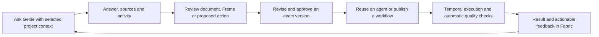

# Genie delivery experience and quality completion plan

An active implementation plan for completing workflow quality and making Fabric's assistant and
interactive deliverables coherent for software delivery teams.

- **Audience**: Product, design, application engineering, platform engineering and pilot teams
- **Owner**: Product and Platform engineering
- **Status**: In progress; incremental implementation and qualification. Milestones remain open until their acceptance evidence is complete.
- **Date**: 2026-11-05

## Product outcome

A delivery team can ask a question with project context, see what an agent actually did, inspect
the sources and quality of its answer, refine a useful deliverable, and make the work repeatable.
The same authorized operations work through Portal, API/SDK, CLI and MCP. Databricks stays behind
Fabric terminology; Temporal remains the durable execution engine.

Use **Genie** for the omnipresent Fabric assistant, consistent with the current Portal and product
request. Reconcile the older Advisor/Nexus/Copilot references in the
[software factory vocabulary](software-factory.md#current-assistant-and-directory-terminology)
when implementation changes those surfaces. Do not introduce another assistant, agent registry or
navigation destination. Databricks Genie is a separate internal analytical capability.

## Evidence and limits

The baseline is current source plus browser inspection, not older feature-completion summaries.

| Area | Existing Fabric foundation | Work still required |
| --- | --- | --- |
| Workflow lifecycle | Published snapshots, rollback, pause/resume, schedules and manual recorded-output checks across transports | Automatic assessment after execution, durable assessment records and useful quality summaries |
| Saved agents | Single-turn and goal-oriented Temporal execution, draft Preview, saved tests, Insights and run inspection | Qualify these together with Genie handoffs; reuse saved tests rather than add a second agent-testing product |
| Genie | Dedicated page, omnipresent launcher, contextual actions, Simple/Advanced modes, attachments, memory, voice and history | Consistent presentation, context selection, truthful activity, output actions and drawer/full-page continuity |
| Responses | Existing Markdown response, source components, tool renderers, approval cards, feedback and MCP App rendering | An explicit shared presentation contract across direct, orchestrated, multi-agent and builder surfaces |
| Frames | First-class content, templates, inline cards, viewer shell, sandbox, exports, edits/history/revert and sharing services | A coherent review/edit experience, current-conversation discovery, revision-fenced edits, provenance and complete external transport coverage |
| Evaluation backend | Context-quality scorer, saved evaluations, Temporal processing and governed Databricks/MLflow destination adapters | Qualified richer evaluators and linkage to exact Fabric executions and deliverable revisions |

Concrete source findings:

- `FabricDirectChat.tsx` and `AgentResponseBlock.tsx` already render formatted answers; the shared
  Copilot assistant renderer is another path. Do not replace them with a new chat implementation.
- `FramesPanel.tsx` uses conversation, organization and actor-scoped queries with bounded offset
  pagination. Preserve published pagination; any cursor alternative is additive and explicitly versioned.
- `frames/router.ts` exposes mutations/history/sharing internally. The public `v1/frames.ts`, SDK
  `FramesResource` and CLI now provide list/get plus content edit, history and restore. MCP reuses the
  same database commands. Creation, validation, sharing and export parity remain separate M2 work.
- Frame content update, string-edit and restore procedures now require reviewed revision tokens;
  remaining proposal, approval, sharing and export transport work is tracked in M2.
  The database serializes history/content/audit writes and checks `expectedUpdatedAt`; no new
  revision table or schema migration is introduced by these controls.
- The viewer has browser capture/export helpers, and a separate authenticated API starts the existing
  `exportFrameToPDF` Temporal workflow with activities and a status route. Qualify that end-to-end
  path and consolidate commands; do not propose another export engine. API-key access, exact-revision
  export, cancellation, safe rendering, signed downloads and retention still need individual proof.
- The current Frame shell distinguishes project/static content and declared runtime tools. Preserve
  that boundary; do not silently enable scripts on unattended output.

Dust browser inspection used a synthetic delivery fixture and did not search company content or
publish/share the result. Observed: capability menu, agent/model selection, completion indicator,
formatted table, feedback/copy, inline Frame card, split view and Frame View/Code, Edit, Share,
Export, Draft/Validate and Close controls. The generated cross-origin Frame preview remained loading;
filter interaction, export completion, publication semantics and collaborative editing were not
verified. Controls and documentation are evidence for design requirements, not reliability proof.

Dust's [Frames description](https://dust.tt/blog/introducing-frames-interactive-data-visualized),
[product overview](https://dust.tt/home/product) and
[context attachment release](https://docs.dust.tt/changelog/chrome-extension-major-update)
inform the parity target. Edition, rollout and account access may differ.

## Experience to deliver

### One composer and one conversation

- Keep the composer pinned to the bottom of the visible panel. Headers and panel tabs start at the
  top; transcript and output panels scroll independently without competing page scrollbars.
- Show compact chips for the active project, selected context and agent. A single Add menu offers
  files, permitted knowledge, skills, tools and prompts. Model and advanced execution settings stay
  secondary. Context inferred from the current page is visible and removable where supported.
- Offer three useful project-aware starters rather than a large catalog on every empty screen.
  Capability discovery uses the existing registries and current permissions, never grants access.
  Put model telemetry and agent/tool counts in Details. Separate memory controls from attached
  knowledge; explain what can be remembered and reuse the existing inspect/delete/reset operations.
  Conversation-added context or tools affect this conversation only. Persisting a changed saved agent
  is a separate reviewed edit. Selected source boundaries are enforced by server retrieval/tool
  adapters, not just chips or prompt instructions; broader company search requires deliberate scope.
- Preserve thread, active task, context selection and artifact selection when opening, closing or
  expanding the launcher. X closes the surface and returns focus; it does not cancel background work.
  Stop is a separate explicit execution action with an acknowledged terminal/intermediate state.
  Reuse native admission/stream receipts: stable conversation, client-turn and execution IDs,
  server-side send deduplication, ordered event IDs/resume cursors and terminal-snapshot reconciliation.
  An uncertain send reconnects to that admission. Show Stopping until acknowledgement; stopped never
  implies rollback, and a late external-effect receipt remains visible as confirmed or uncertain.
- Keep existing execution engines compatible. Simple/Advanced presentation changes must not silently
  change the engine or rewrite the saved conversation. Qualify existing mismatch/restore notices.
- History is searchable, paged and deep-linkable. A long conversation restores the relevant position
  and has an explicit jump-to-latest control; new tokens never pull a reader away from earlier work.

Each admitted turn has a context manifest: organization/project, engine/agent, selected knowledge,
attachments, tools/skills, admission actor and evidence cutoff, plus source revisions when actually
read. Reuse existing stored inputs/receipts. Display that turn's real context, not today's composer
state; removing a chip changes future turns. Current permissions still govern execution and viewing.

### A consistent answer, not a wall of tool logs

Use existing renderers behind a shared typed view model: answer, citations, safe activity summaries,
deliverable references, proposals/approvals, execution status, optional usage and feedback identity.
Normalize each existing runtime's events through adapters; retain the raw native execution reference.
Classify deliverables explicitly: a fenced JSON/code snippet is not automatically a durable Frame or
a retrieved source. Only actual authorized artifacts and source-read receipts drive those controls.

- Default to readable Markdown with tables, lists, code highlighting, copy/wrap, accessible links,
  diagrams and bounded wide-table scrolling. JSON/XML are inspected as data; HTML/MCP Apps execute
  only in the existing approved sandbox, never by inserting generated markup into the host DOM.
- Show a concise outcome first. Put **Sources**, **Activity** and diagnostic details behind disclosure.
  Expandable activity describes tool actions and actual receipts, not private chain-of-thought.
- Distinguish input supplied by the user from retrieved citations. Source chips open the permitted
  document/excerpt and show revision/freshness where known. A model-written URL is not proof of a read.
- Show real states: queued, working, waiting for approval/input, reconnecting, completed, stopped,
  failed or outcome uncertain. A text answer must not conceal failed tools or unconfirmed effects.
- Put Copy and feedback below completed answers. Offer only relevant follow-ups: open deliverable,
  save as document/prompt/skill, propose tasks, or configure an automation. Existing commands own
  those actions; a proposal does not claim to have applied a mutation.
- Feedback may propose a reusable test after human review; thumbs-up is not correctness evidence and
  a raw conversation is not automatically copied into an evaluation dataset.

### Frames as delivery artifacts

Use a small inline card to open a resizable adjacent panel. Keep conversation and Frame visible
together on desktop; mobile uses a full-screen panel with X/back and retained conversation state.
The existing Pages destination remains the durable library. Project Artifacts and conversation
deliverables use the same Frame identity; do not add another top-level Frames library.

The panel header contains title, draft/saved state, View/Code, revision history, export, sharing and
X. Advanced controls are in a menu. Source provenance and quality are secondary tabs/disclosures.
Opening a preview never publishes, shares, refreshes external data or executes declared write tools.
Keep navigation-level Pages, conversational deliverables and project Artifacts linked to the same
objects. Do not make a user learn three storage models for the same output.

Conversation editing proposes a new content revision against an expected base. Show a meaningful
change summary and preview before Apply. Conflict prompts retain the proposal and offer a comparison;
they never overwrite another editor. Reuse history/revert after auditing their snapshot behavior.
Separate content validation, approval of a revision, and permission to share; passing a code validator
does not mean an answer is factual or its data can be shared. Keep the reviewed version readable if
an edit fails. An agent may save a private draft, but cannot broaden its audience implicitly.

Validation, human approval, publication and share references name an immutable content revision.
All update, string-edit, agent-apply and restore paths use expected-base fencing. Restoring creates
a new revision, never rewinds history or restores grants. A new draft is unapproved; an existing
approved publication continues serving its pinned revision until explicitly replaced or revoked.
Duplication creates a private draft without inherited approvals or grants. Machine-readable conflicts
retain proposal identity and expose safe base/current revision metadata, diff and explicit rebase/apply
operations. Retries reuse the mutation identity; a conflict never triggers a blind overwrite.

Prioritize delivery brief, release readiness, sprint review, risk register, architecture explanation
and incident summary templates. Each stores the producing run, input/source references, content
revision, evidence cutoff and quality results; unknown freshness and missing evidence remain visible.
Refreshing a Frame is an explicit authorized run, and recurring refresh uses existing Temporal
schedules. Charts and filters must have useful loading, empty, failure, keyboard and screen-reader
states; a valid iframe handshake alone does not prove a useful Frame.

Sharing must inspect original project/source permissions and the derived artifact audience. Linking
or generating content does not grant source access. Broader distribution requires an explicit,
reviewable authorized action and the existing organization policy; private or project-only sources
cannot be re-exposed through an agent, export, thumbnail, history or a public Frame. Signed public
shares render approved static content only; they carry no viewer credentials or live Fabric tools.
Define and test retention/revocation behavior for already-derived artifacts before enabling broader
sharing. Export/share workers recheck access, version and approved destination at execution time.
Revoke hosted links and future access explicitly; explain that a downloaded copy cannot be recalled.
Track a conservative source-boundary union per content revision, including earlier turns, attachments,
retrieved/tool content and transformed/copied blocks. Manual or unknown content remains unverified
and cannot automatically broaden its audience. Any organization-approved declassification is a
separate human review. Without sufficient lineage, keep derived output private/project-scoped.
Apply this rule to retained transcripts, activity, run details, evaluation evidence and previews;
if restricted portions cannot be separated safely, withhold the derived view rather than only its
citation chip. A public snapshot contains only the reviewed, sanitized approved revision.

Audit the existing sandbox before extending it. Enforce default-deny network egress and asset origins,
sanitize HTML/SVG/Mermaid/Markdown URLs, and forbid ambient credentials/cookies. Bind every runtime
tool call server-side to current viewer, organization/project, Frame revision, allowed tool and
validated arguments. Read-tool output cannot feed arbitrary external requests. Public/static output
uses embedded or explicitly approved assets and never calls live Fabric tools. Preview is passive;
refresh or a runtime invocation requires its own explicit action and applicable approval.

## Outcome parity scorecard

M0 records observed, documented and unverified behavior for each row. A row becomes qualified only
after the listed Fabric journey passes; neither an existing handler nor a competitor's menu is proof.

| Product area | Fabric target and reuse | Completion milestone |
| --- | --- | --- |
| Composer and answer | One context/capability menu, rich readable response, sources/activity and relevant actions | M1 |
| Agent authoring | Existing Sidekick, Preview, Insights and saved tests; describe a job, review proposed fields/diffs, test and publish deliberately | M1, M5 |
| Skills and prompts | Existing conversation/scratch/import authoring; clear package previews, reusable inputs and explicit apply/publish | M1 qualification; fixes sized at M0 |
| Enterprise knowledge | Existing Workspaces/context/RAG; selected documents, current access, freshness and attributable answers across clients | M1, M4 |
| Frames and documents | Inline result to adjacent review/edit panel, approved revision, history, export and sharing | M2 |
| Repeated and autonomous work | Existing schedules, workflow triggers, native agent loops and remote/desktop delegation; inspect progress and recover | M3, M4 |
| Team collaboration | Existing conversation sharing, mentions and Inbox; distinguish read/continue-a-copy from shared-thread participation | M6a |
| Connections and MCP | One authorized capability registry, truthful connection/action health and portable failures | M0, M4 |
| Governance | Existing roles/scopes/object checks; understandable creation/publication/use/share capabilities in current settings | Every milestone |
| Quality and improvement | Exact checks followed by schema/rubric/grounding and a reviewed feedback-to-test-to-change cycle | M3, M5 |
| Responsive and accessible use | Stable launcher, independent scrolling, keyboard, zoom, mobile and long histories | Every milestone |
| Broader computer/Office/multiplayer capabilities | Explicit competitive backlog; no full parity claim or new subsystem until a delivery use case and staffing justify it | Subsequent scoped proposal |

## Delivery sequence and acceptance

These are completion gates, not promised dates. Size them after the focused contract inventory.
Deliver each slice independently; specialist agents remain after the foundation gates.

### M0 — Freeze the operation and journey inventory

Create a baseline matrix for Genie, agents, workflows, documents, Frames, evaluations and connectors.
For each operation identify its current server command, actor/object checks, scope, audit, status,
result, cancellation and schedule support. Mark absent/unsupported operations explicitly. Map the
same synthetic journeys in Dust and Fabric as observed, documented or unverified. Resolve vocabulary
and overlapping Page/Frame/Artifact labels without changing stored identities.

Done when: product/design approve the desktop/mobile interaction contract; engineering has identified
the common command seams, required additive migrations and any existing exposure gaps. Test plans
include a two-member project and a source-restricted member, not just an organization owner.

### M1 — Genie response and continuity polish

Implement the composer, answer hierarchy, contextual source disclosures, safe activity and shared
deliverable cards on the existing engines. Qualify direct, orchestrated and multi-agent modes and
builder Sidekick/Preview with the shared components; do not assume one renderer covers every path.

Done when: a user can ask with selected context, inspect citations/activity, open and close a result,
expand/reopen the launcher and reconnect to running work without losing thread or duplicating a
turn. Formatting and failures remain intelligible in every mode, including a saved goal-oriented
agent. No engine is advertised as qualified solely because the direct path passes.

#### Implementation record — 2026-11-04

The first M1 increment is implemented in the shared chat components:

- Project/workspace context remains visible; configured capabilities open through a named,
  keyboard-accessible Details disclosure. Context lookup caches include the organization.
- The Add menu opens existing attachment, memory and chat-tool controls. Memory and tool inspection
  remain available during execution; attaching a file waits until the running turn finishes.
- Routine tool activity folds once. Failures, authority requests and completed Frame/chart actions
  remain visible, including serialized MCP error and authority envelopes.
- Artifacts selects populated content, follows the first arriving result only before an explicit
  tab choice, and identifies summary-only source references as agent-reported. Markdown documents
  retain their authored headings and literal code; HTML inspection remains inert.
- Chat answer headings use an explicit presentation option, consistently for streamed and completed
  answers. Authored Pages retain their own outline. Code colors use Fabric theme tokens.

Qualification for this increment: 476 focused component/launcher/navigation tests, web typecheck,
scoped formatting/lint, identifier guard and changeset validation passed. Local browser checks
covered 1600/900/390-pixel layouts, context/memory/artifact controls and draft retention. The scanned
answer area and open Details disclosure had no accessibility violations. Two synthetic live replies
proved closing/reopening and expansion from launcher to full page during execution; each admitted
one Temporal workflow and completed. These checks do not replace outage/retry or restricted-member
qualification.

Claude high, Droid GPT 6.1 Sol high and Kimi 3.1 Pro high reviewed the isolated increment read-only.
Confirmed findings were corrected and regression-tested. At this increment the broader M1 gate
remained open for cross-mode qualification; the subsequent record below updates that evidence.
M2–M6 remain planned; this record does not claim their completion.

#### Cross-mode qualification — 2026-11-04

Preview, Sidekick and saved run results now share safe answer formatting. User input remains literal;
assistant headings, tables and code render consistently. Unicode normalization in ordinary chat also
preserves fenced, nested, indented and unfinished code blocks. An explicit code language takes
precedence over diagram inference.

Saved results show failed tools and failed goal steps even with their raw details collapsed. Live
activity distinguishes success, failure, pending confirmation, inspection, cancellation and skipped
work. Older progress records that omit outcomes remain labelled Recorded; they are never promoted
to Completed by inference. The existing Temporal producer and admission protocols are unchanged.
Structural `success: false` remains a failure signal, consistent with native tool execution.

Generated diagrams use the existing SVG sanitizer for both rendering paths. The renderer serializes
its temporary Mermaid configuration with the existing shared lock and restores it afterwards.
SVG labels remain visible without admitting HTML labels, event handlers or external resource loads.
The editor reuses the same extracted sanitizer; its public sanitizer export remains compatible.

| Journey | Qualification evidence |
| --- | --- |
| Direct chat | Actual model reply, formatted headings/table/code, refresh restore and retained engine selection |
| Orchestrated chat | Refresh while the native workflow was Running; one user-message admission followed by an execution-ID-only attachment to that same workflow; completed answer restored |
| Saved single-turn agent | Actual Portal start, native deployment execution completed, authoritative result visible after refresh |
| Saved goal-oriented agent | Actual Portal start, native goal workflow completed with goal achieved, result visible after refresh |
| Builder Sidekick | Actual provider-generated instruction proposal; no application before review; accepted proposal changed only the draft |
| Draft Preview | Actual Temporal preview used the accepted unsaved instructions; refresh restored the receipt/result and identified the earlier draft; saved agent stayed unchanged |
| Diagrams and literal code | Real browser retained Python as code and rendered labelled SVG; component tests cover both diagram renderers, active-content removal and shared configuration restoration |
| Authorization | 86 focused API tests and 58 background-access/activity tests passed, including current authority, scope, organization and revoked-source cases; these are not live restricted-member UI proof |
| UI and accessibility | 534 focused UI/security tests passed; desktop/mobile layouts had no document overflow; scanned saved-result and Preview panels had no accessibility violations |

Claude high and Droid GPT 6.1 Sol high completed read-only reviews. Confirmed findings were corrected
and regression-tested. Web typecheck passed. No workflow control flow, schema, authorization policy
or product operation changed; the existing API/SDK, CLI and MCP commands remain authoritative.

A feature-flagged local multi-agent qualification has now produced two independent approvals,
answers and completed native `orchestratorExecutionWorkflow` receipts. A synthetic restricted member
can open an assigned project; the API and Portal refuse an unassigned project. Temporary flag and
selection overrides were restored. These checks do not certify production rollout or all roles.
An intermittent development render-loop failure and an unnecessary operation-verification notice on
a text-only answer remain follow-up qualification items. No worker outage/recovery exercise has been
performed; the existing Temporal durability contracts remain authoritative.

### M2 — Frame review, editing and transport completion

Extend the existing Frame shell/card, wire authorized current-conversation/project list filters and
compatible pagination, and make draft/revision/approval behavior explicit. Extract/reuse shared
commands across internal API, REST, SDK, CLI and MCP for create, inspect/list, propose/edit/apply,
validate, history/restore, template creation, export job status/cancel and sharing/revocation.
Operations not applicable to a credential class fail clearly rather than acquire ambient access.
Do not expose email invitations without explicit send intent; use disposable fixtures for tests.

Make these specific contract repairs before broadening the transport surface:

- Content edits cannot carry `isPublic`, audience or sharing-grant fields in the new shared edit
  contract. Qualify/deprecate legacy edit/publication adapters without permitting an agent to bypass
  explicit share intent, current authority or policy. Do not add a new permission system; reuse the
  existing audited capabilities, and add a specific share capability only if the inventory requires it.
- Choose a canonical sharing command path for both legacy public-token and multi-scope grants.
  Distinguish Remove public link, Remove invitation and Make private/revoke all. The last operation
  invalidates every applicable live grant/token atomically or through a durable fenced operation,
  with clear partial-failure state; content restore never restores an old share token or audience.
- Remove bearer share tokens/URLs from general list/get DTOs. Only an explicit authorized share
  operation can return a usable link. Test read-only keys, shared viewers, thumbnails and histories.
- Add mutation audit emission in the canonical command/transaction, not just audit assertions: create,
  edit/apply, restore, delete, share/invite/revoke and export admission/cancel use safe IDs and version
  metadata. Never include tokens, invitation secrets, generated/source text or raw tool errors.
- Keep retired `personal` parameters as documented organization-only compatibility no-ops where
  required; do not copy them into new inputs or reintroduce a null tenant. Verify the existing resolver.
- Reuse the current PDF workflow/status route and approved storage. Audit renderer script/network
  behavior, authorize downloads after rendering, pin content/permission versions and use bounded TTLs
  and cleanup. PNG/JSON and any missing external export/cancel controls are separately scoped; do not
  assume a browser screenshot hook is a headless renderer or a validated server download.

Inventory legacy records, historical edits and existing public links/grants before changing writes.
Backfill only verifiable revision metadata; old content starts with unverified provenance and no
invented approval. M0 chooses an explicit per-class disposition for existing shares: retain only
policy-verified snapshots, or quarantine with a customer-visible reapproval path. No silent mass
auto-approval or unannounced deletion. Read DTOs and offset list results stay compatible; version new
proposal/conflict contracts. Legacy writes without a fence get a documented upgrade-required outcome
or a bounded compatibility adapter that cannot bypass concurrent-edit and sharing policy.

Done when: one delivery Frame is generated, revised twice, conflict-tested, restored and exported;
permissions and revision identity survive every transport. Preview/source/script failures have
actionable states. Runtime tools execute as the current authorized viewer, only from the declared
allowlist, with existing approvals for writes; denied and public/static views cannot invoke them.

#### Current discovery and read boundaries

Genie's Frames panel defaults to the current conversation and offers an explicit all-my-frames
scope. Offset pages use a bounded lookahead, stable timestamp/ID ordering and separate loading,
empty and retry states. Organization, authenticated actor, conversation and page identify the query;
changing actor or conversation resets the panel. Unresolved identity or organization defers reads.
Frame titles wrap, and destinations stay within organization routes.

The existing list operation accepts conversation and pagination filters through the Portal/API,
SDK, CLI and gateway MCP. Owned lists remain creator-scoped; workspace/project reads retain their
existing access rules and default page sizes. Ordinary read/update responses do not disclose bearer
share tokens or URLs. Explicit authorized sharing controls retain link access, and existing live
grants are unchanged. The owner sharing sheet remains the place to inspect and change audiences.

#### Current revision controls

Owners can edit a page or open version history from the Frame viewer and Pages history entry point.
The shared dialog preserves unsaved drafts, confirms restore and discard, and reports a stale save
without overwriting newer content. A successful write followed by a failed refresh is identified as
saved; retry refresh never repeats the mutation. Restoring uses a stable saved-entry ID, creates a
new revision, and preserves current sharing and runtime tool configuration. The dialog currently
loads the latest 200 entries; it does not claim unlimited history browsing.

Content edit, history and restore are available through the existing internal API and MCP tools,
REST `/frames/:id/history`, `/frames/:id/update` and `/frames/:id/restore`, SDK Frames methods, and
CLI `frames history`, `frames update` and `frames restore`. Public mutation contracts require an
expected `updatedAt` revision and reject publication/audience changes. They enforce credential
scope, current creator authority, organization and object ownership. Legacy native activity callers
may omit a revision only through the bounded read/compare-and-swap adapter. Full edits, string edits
and restores serialize history and content updates with mutation audit rows in the same transaction;
an audit failure rolls back the write. New string edits include restorable content snapshots.
Historical snapshotless entries remain visible but cannot be restored.

The existing native Temporal PDF admission and content-read activity now check the requested
revision. Legacy workflow histories still replay: inputs without the new optional revision preserve
the previous command shape. Qualification includes a real loopback-database concurrent-save test,
two edits and exact-entry restore, browser edit/conflict/reload/restore checks, desktop/mobile
accessibility checks, and replay of a recorded 23-event legacy export history. No schema migration
or shared worker restart was performed.

#### Native exports and sharing controls

Saved, authenticated Frames now offer native PDF creation, progress, cancellation and explicit
download from the existing export menu. Browser capture remains a separately labeled path for
unsaved/public content and PNG output. Closing the export dialog preserves the current session's
job identity. Retrying an uncertain admission retains the request UUID instead of starting another
job automatically. Request-ID deduplication follows Temporal’s retained-history window; use a fresh
UUID for new work. These controls are exposed through internal API, REST, SDK, CLI and MCP using
the same authorized commands. API-key starts and cancellations require `frames:write`; status and
explicit download require `frames:read`. Current actor, organization and object access apply on
every command; only the original admitted actor can inspect or download a job. Project/page-bound
credentials cannot broaden into organization-wide export or sharing commands.

The existing `exportFrameToPDF` workflow retains its legacy branch for replay. New managed exports
compose the existing read, static Chromium renderer and private upload helpers inside one activity,
keeping PDF bytes out of workflow history. JavaScript, service workers and external networking stay
disabled during rendering. Content and file limits bound work. The worker rechecks the original
actor's current access and reviewed revision before storage. Native query state exposes progress;
a deterministic 24-hour timer deletes the fixed storage object at expiry. Cancellation/failure also
runs idempotent deletion under a non-cancellable cleanup scope with retries. Operators must supply
private export storage and the matching Playwright browser in the worker image.

Ordinary status never includes storage keys or bearer URLs. Explicit download rechecks current
access and revision before signing an attachment link for at most 60 seconds, further bounded by
artifact expiry. An already issued URL remains usable for its short residual lifetime; these links
do not promise instantaneous revocation. Changing content or sharing metadata invalidates subsequent
download admission. Compatibility HTTP routes delegate to these commands and do not reissue old
workflow-result bearer links; callers need a request UUID and reviewed revision for new admissions.

Sharing commands now serialize grant/token/audience changes and safe audit rows with the reviewed
revision. Remove public link preserves invitations; Remove invitation affects one address; Make
private clears every invitation and legacy public token atomically. Restoring or editing content
never restores grants. Share-scope changes retain `WORKSPACE_UPDATE`; link/invitation revoke
commands retain their established `WORKSPACE_DELETE` capability. The UI explains unavailable revoke
actions and uses the existing PRIVATE scope command for Make private. External credentials require
exact scopes and the corresponding creator's current permission, including wildcard credentials.
Existing public links are retained only while current organization public-sharing policy permits
access and the organization is undeleted. They still serve live content; no immutable approved
snapshot or provenance verification is inferred or silently backfilled.

Qualification includes a real SDK-to-authenticated-API-to-Temporal-to-Chromium-to-private-S3 PDF
round trip, repeated admission under the same identity, denied read-only admission and stale download,
attachment response, cancellation and short native-timer expiry deletion, and replay of managed
and legacy histories. Synthetic local fixtures were used without sending invitations. Sharing
qualification exercises real PostgreSQL revocation isolation, concurrent writers, safe audits and
owner/tenant refusals. Portal initial states passed desktop/mobile accessibility checks; actual PDF
execution was qualified both through isolated current-source worker/API instances and through the
actual local Portal with its updated full worker. The Portal Create PDF → ready → browser attachment
journey passed. Local worker rollout preserved all eight prior long-running workflows; storage and
authentication settings stayed in process memory. A stale development hot-reload episode was isolated
from authentication and export commands; subsequent cold-cache loads and the full Portal export passed.
This does not claim a permanent framework-level hot-reload repair. The Skills onboarding regression
and explicit credential-scope regression expectations are also repaired. No production deployment
or cloud certification is claimed.

M2 still has separate proposal/apply, immutable approved-publication snapshots, source-provenance
controls and creation/validation/template transport completion on its roadmap. Export and sharing
completion does not mark those features or the later quality milestones complete.

### M3 — Automatic recorded-result checks

Expose per-workflow automatic checking as an explicit setting. Default to selected deterministic
checks, with bounded output size, check count and concurrency. Model grading and cloud export are
separate opt-ins. Set per-run limits, tenant/workflow daily spend caps and operator stop controls;
reserve budget before work and reconcile actual usage. Budget exhaustion never reruns the business
task. Disabling checking prevents new admissions; in-flight assessments are cancelled explicitly.

At admission capture the selected immutable check definitions and workflow version, their revision,
actor and source/connection ceilings, and the native execution identity. Add only the persistence
missing from existing run/evaluation records; review additive migrations, RLS and retention first.
Store results/check outcomes and response hashes rather than another transcript copy.
The snapshot is a ceiling, not frozen authority: use the original admitted/delegated run identity
plus current role, object, source and credential permission checks at assessment, storage, read and
export boundaries. Missing identity or revoked access yields Unavailable without revealing output.
Record admission actor, native execution identity and assessment/export service identity separately;
the latter is an explicitly approved narrow binding, never an implicit privileged replacement actor.

Assessment attaches to an existing business execution and never admits another one. Qualify each
native entrypoint's existing stable request/occurrence/effect identities. Where a start seam is
missing, allocate the admission and deterministic Temporal workflow identity before side effects,
atomically persist pending admission/outbox state, and reconcile Temporal start using that same ID.
An acknowledged or ambiguous retry returns the same native execution. Use existing native admission
and receipt helpers; do not replace Temporal or build a parallel business-invocation engine.

The completion evidence manifest pins native execution/run, node, attempt, exact output reference,
revision/hash, workflow/check revisions and source-read receipts. Read that output and verify its
hash, never the latest mutable log or today's retrieved document. A later attempt produces a separate
explicitly superseding assessment. Retain referenced evidence within the approved policy until a
terminal assessment; deletion or expired evidence yields Unavailable rather than a substituted input.

Audit existing completion receipts/outbox mechanisms first, reuse them where present, and add only
the missing atomic receipt/outbox seam to durably start or attach assessment. Include bounded
reconciliation for a missed completion handoff. Database admission/outbox writes are atomic;
Temporal owns retries, timers and recovery. An idempotency key covers the native execution, check
revision, node and attempt/output revision. A redelivery never starts another business workflow or
grades a later output silently. Use existing agent-test observation for saved agents.

Business completion and quality are separate. Run history shows execution state plus **Checking**,
**Passed**, **Needs attention**, **Not checked**, **Unavailable** or **Inconclusive**. Failed/cancelled
business work, missing evidence and an assessment crash cannot produce Passed. The business run is
not changed to failed merely because an informational check fails. Notifications are opt-in/deduped;
automated retries must not spam the team's Inbox.

| Business/assessment condition | Quality state | Meaning |
| --- | --- | --- |
| No selected checks, disabled or explicitly sampled out | Not checked, with reason | No quality conclusion |
| Business run in progress | Not checked: awaiting result | Execution status remains independently visible |
| Completed result and assessment admitted/retrying | Checking | Durable work is pending; no pass yet |
| Completed evidence and every required check passes | Passed | All required checks evaluated successfully |
| Completed evidence with one or more conclusive check failures | Needs attention | A requirement failed; execution may still be completed |
| Business failed/stopped, missing/non-text evidence, revoked authority, exhausted budget or expired assessment deadline | Unavailable, with safe reason | The required assessment cannot complete; never a pass |
| Grader completed but cannot decide, or required evidence is insufficient for judgment | Inconclusive | No reliable quality conclusion |

Optional checks do not mask required failures or unavailable requirements. Counts show evaluated,
failed, skipped and unavailable cases; history denominators include failures and unknowns. An
assessment infrastructure exception retries within its deadline, then becomes Unavailable. An
explicit assessment cancellation is Unavailable: cancelled; it does not cancel the business run.
Aggregate required results with a fixed precedence: any conclusive failure is Needs attention;
otherwise any unavailable requirement is Unavailable; otherwise any inconclusive requirement is
Inconclusive; otherwise pending required work is Checking; only all required passes yield Passed.
Show coverage and the exact check set beside the verdict. A pass certifies those checks only.
Fence terminal transitions against cancellation/revocation and the active attempt; ignore/audit late
results from superseded attempts. Temporal deadlines and durable recovery bound Checking; there is
no application lease/polling scheduler to reinvent.

Done when: manual, scheduled, webhook and external API admissions are qualified; worker restart,
duplicate completion, cancellation, edited/removed checks, source revocation and outage recovery
retain one attributable assessment and truthful status. Native workflow control-flow changes are
versioned compatibly and replay-tested; no second polling scheduler or custom durability engine.

### M4 — Real connector certification

Inventory the advertised connector/MCP actions and qualify each supported provider/action against
actual credentials. Start with a repository/CI connection, one ticket provider, a remote MCP read
and an existing Fabric Agents remote/desktop delegation. Expand the same matrix across every
advertised connector; mark untested/unavailable entries visibly instead of declaring global success.

Test connection, discovery, invocation, real output propagation, expired/revoked credentials,
timeouts, rate limits, schema drift, tool-level error payloads, permission changes, wrong tenants,
write approvals, effect receipts and ambiguous outcomes. Read tests do not mutate providers; write
tests use approved disposable fixtures and verify cleanup. Unavailable accounts are recorded with
the precise operation and required test access. Provider idempotency limits remain explicit.
Classify writes by provider-supported idempotency and reconciliation capability. Propagate stable
effect IDs through every retry layer, retain uncertain outcomes, and reconcile through provider
lookup/receipts or explicit manual resolution. Native activity retries must not repeat a write with
unknown outcome. Genie, agents and workflows display the same effect record; dependent work waits
for confirmation instead of treating a timeout as proof that no ticket/PR was created.

Done when: each advertised operation has an owner, evidence, supported runtime/auth versions and a
useful user-facing failure message. A green connection badge means only the demonstrated connection
test; it does not certify every action. One connected tool is exercised from Genie, an agent and a
workflow under the same authorization contract. Retries cannot repeat an uncertain external write.

### M5 — Richer quality and governed backend linkage

Add structured-output/schema validity and checklist completeness before model-graded evaluation.
Source-grounding evaluates claims against the sources actually read by the pinned execution; no
retrieval evidence means unavailable, not grounded. Model judgments include rubric/model revision,
budget, explanation and uncertainty; calibrate them against human-reviewed examples. They do not
prove factual correctness. Preserve failures and inconclusive cases in comparisons and denominators.
Version evaluator/rubric configuration independently of phrase-only check collections. Preserve
version-1 parsing and immutable historical results; introduce any richer schema through an explicit
versioned contract and additive migration, never reinterpret stored phrase checks. Keep bounded
per-workflow smoke checks distinct from larger reviewed evaluation datasets. Define capability/version
negotiation and migration behavior across transports before exposing a new evaluator type.

Reuse the existing saved context-quality and agent-test records and Databricks/MLflow adapters where
applicable. Platform operators qualify evaluation destinations, service identities, allowed datasets,
retention and regional handling. End users see **Quality**, sources and improvement suggestions.
Lakebase remains the product record store; a qualified MLflow destination holds linked evaluation
evidence. Do not silently export raw prompts, answers or sources: export only the explicitly approved
bounded dataset through the existing governed admission, actor and source checks.
The grader's model/provider is an approved data destination too. Apply source classification,
regional/retention policy, bounded payloads, safe logging, rate/concurrency limits and the live actor
ceiling before sending any answer or evidence. Unknown egress policy fails closed.

Unity Catalog may enforce backend data-product/function permissions where a qualified binding exists;
it does not replace Fabric organization/project/Workspace ACLs or make a shared machine identity a
per-user identity. Databricks ontology/analytical adapters can enrich approved structured context
behind the same source facade. No new Databricks Genie resource, agent hosting, search migration or preview API is a
dependency of this UX/quality release. Optional runtime adapters require their own live qualification.
MLflow datasets or trace tables are isolated to the intended organization/project audience. Do not
put different customers' private traces into a shared table and rely on experiment labels for
isolation. Qualify actual cloud/API/library versions and downstream-reader permissions before enabling
exports; no new Unity Catalog tables, trace storage migration or monitoring jobs are created implicitly.
Databricks documents [evaluation datasets governed by Unity Catalog](https://docs.databricks.com/gcp/en/mlflow3/genai/eval-monitor/build-eval-dataset)
and [trace-table permissions](https://docs.databricks.com/aws/en/mlflow3/genai/tracing/trace-unity-catalog).
These are backend options to qualify, not proof that Fabric's selected destination or cloud supports
the desired contract. Databricks' [analytical agent](https://docs.databricks.com/aws/en/genie-agents/)
remains distinct from Fabric Genie and its retained Temporal execution.
Export admission pins destination, approved dataset/policy revisions and an idempotent export ID.
Track remote write and local link confirmation separately; an ambiguous remote success is reconciled
under that same identity, not exported again. Platform Operations owns downstream ACL, retention and
deletion proof. An export is complete only when the authorized destination receipt and Fabric link
agree; partial or uncertain states stay visible and cannot be reported as success.

Done when: a nontechnical reviewer compares two exact versions, sees failures and unknowns, proposes
an instruction/context change, reviews the diff, reruns the same examples and verifies the outcome.
Use the existing Sidekick to propose field-level instruction/tool/context changes from authorized
feedback and check evidence. Accept/dismiss the diff, then rerun before choosing to publish.
The checked agent/workflow/Frame version is pinned; publishing is explicit, never triggered by a
passing score or feedback. Cost and missing metrics are shown honestly.

### M6a — Team handoff and pilot qualification

Pilot the complete journeys below with a delivery lead, engineer and project-limited guest. Resolve
blocking defects and measure unaided completion before expanding the catalog. Qualify existing
conversation sharing, file/story/user mentions, Inbox and notification preferences. Show precisely
whether a recipient can read, continue a private copy or participate in the same thread. If shared
thread participation is absent, add it as its own scoped contract rather than describe read-only
sharing as multiplayer parity. No mention/notification is sent without explicit recipient intent;
test notification duplication, recipient access loss and transcript/source disclosure independently.

### M6b — Specialist templates after foundation qualification

Package existing
qualified capabilities as documentation maintainer, delivery reporter, release-readiness reviewer and
ticket-to-PR templates. Rebind project context, tools, credentials and approval policy per installation;
templates never copy another customer's authority or claim a fully deployed outcome from a PR alone.

Dependencies: M0 gates sizing and interface contracts. M1, connector qualification in M4 and backend
design in M3 can proceed in parallel after M0; M2 extends the shared presentation from M1. M3/M5
cannot certify an external action before its M4 operation is qualified. M5 builds on M3 records and
qualified evaluation destinations. M6a integrates each completed slice; M6b follows its pilot gates.
Product/design own M0/M1 journeys; UI/API/artifact owners own M2; Temporal/quality/database owners own
M3/M5; integrations/security own M4; delivery pilot owners own M6. Size persistence, export rendering
and collaboration separately rather than hiding them inside a cosmetic-polish estimate.

## Retention and operating controls

Use existing organization policy and approved storage; choose concrete durations and limits at M0
before migrations/export enablement. Missing policy keeps the affected operation disabled.

| Material | Required retention/deletion contract |
| --- | --- |
| Native answer and source-read receipts | Existing authorized execution store; bounded evidence references, live access, no assessment copy of transcripts; missing evidence cannot pass |
| Assessment/check records | Immutable revisions, safe outcomes/hashes and attempt identity; explicit archive/delete policy and no resurrection of revoked content |
| Frame revisions and proposals | Current object/source policy applies to history and diff; deleted content is not exposed by restore or duplication |
| Export files and download URLs | Approved store, revision-bound access, short configured URL lifetime, cleanup proof and no credential-bearing logs |
| Thumbnails and public caches | Audience/version-scoped caches, explicit invalidation and known revocation delay; no private image in a public cache key |
| Model grading payloads and MLflow evidence | Approved minimized fields, region, provider/destination retention and verified deletion owner; local link deletion alone is insufficient |

Apply tenant/project/workflow budgets and concurrency limits, bounded queues and fair scheduling.
Do not coalesce away required quality evidence; under overload preserve identity and show delayed or
Unavailable outcomes with a reason. Any sampling/coalescing policy is explicit in coverage. Repeated
delivery of the same assessment/effect/export identity does not create another usage charge record.

## Release proof and regression coverage

| Journey | Required proof |
| --- | --- |
| Ask and trust | Select permitted Workspace/project context, inspect actual citations, handle a missing/revoked source, retain focus and thread after close/reopen |
| Produce and revise | Generate delivery Frame, inspect formatted result, revise with expected version, resolve a concurrent edit, restore, export exact approved revision |
| Make repeatable | Convert a reviewed outcome to an existing agent/workflow, publish exact version, execute on real Temporal schedule and webhook, inspect separate quality status |
| Recover | Disconnect/reopen browser, restart worker, replay representative histories, repeat callbacks and uncertain admissions; no duplicate business effect or false completion |
| Improve | Turn reviewed feedback into a test, compare same-rubric versions, distinguish regressions, failures, costs, unknowns and unreviewed changes |
| Collaborate safely | A second project member and guest repeat the journey with current ACLs; revoked source, cross-org ID, wildcard key, denied scope and removed actor all fail safely |

Every operation gets transport-parity tests, current-role and object/source authorization negatives,
auditing/redaction and applicable status/result/cancel/schedule coverage. Sharing/export includes
downloaded files, thumbnails and retained history. Sandbox tests cover script/network policy, forged
messages, wrong window/origin, declared tools, public/static output and access revocation.

Run focused component/adapter tests, visual fixtures and keyboard/a11y tests for desktop, tablet,
mobile, dark mode, zoom and long content. Include 100+ messages, paged histories with thousands of
runs, long names, wide tables and large bounded tool output. Validate stable scroll and rendering
under streaming, focus return and stale-request isolation after project/organization switches.

Measure first useful answer, context attachment success, source inspection, artifact revision/export
completion, saved automation reuse, successful reconnect, actionable failure recovery and quality
cost/coverage. Use a staffed pilot to set numeric release thresholds; do not invent production SLAs.
Separate calibration from final qualification: pre-register task scripts, role-specific evidence,
severity definitions and go/no-go thresholds before an independent unaided confirmation pass. Report
assistance and unknown outcomes explicitly. Include conflict recovery, revocation, uncertain effects,
reconnect, export/share failure and accessibility per role; averages cannot hide a guest-access failure.
Each milestone ships only after its acceptance evidence, relevant Get Started/tour/i18n updates,
release decision and independent advisory review. Production promotion remains a separate approval.

## Deliberate limits

Parity means comparable delivery outcomes and interaction quality on qualified journeys. It does not
mean copying Dust's branding or claiming all its integrations, a collaborative computer, simultaneous
multiplayer editing, generated-image/Office authoring, or arbitrary runtime tools are already present.
Those remain an explicit backlog after core adoption evidence. Fabric's differentiator is a coherent
context-to-task-to-agent-to-PR-to-release journey with durable execution and reviewable evidence.

Specialized agents, model optimization and autonomous publication are not shortcuts around these
gates. Avoid a new admin dashboard, evaluation engine, scheduler, permission system or artifact store.
Reuse [software factory contracts](software-factory.md),
[workflow checks](../workflows/workflow-editor.md#saved-result-checks) and the
[Databricks backend plan](databricks-context-platform.md).
