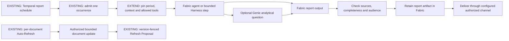
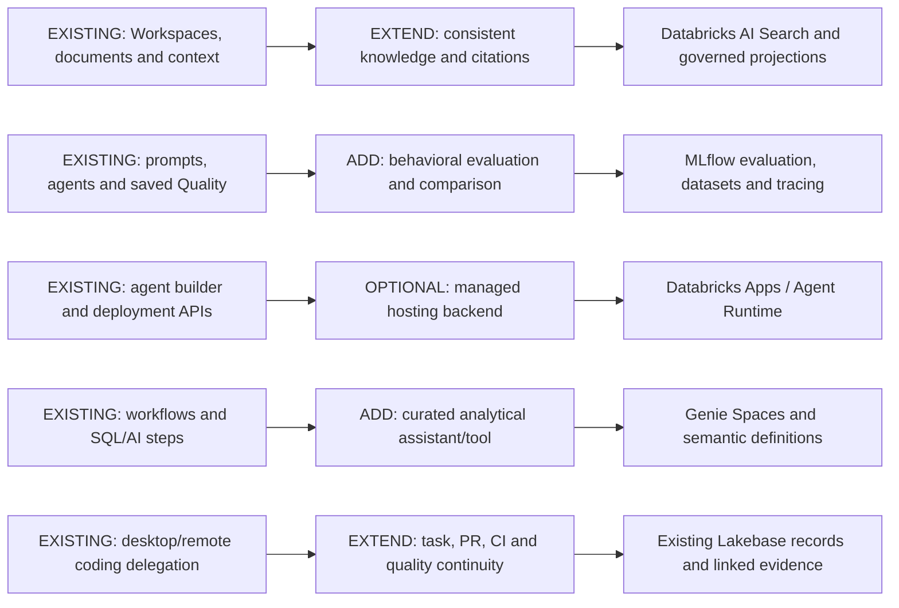
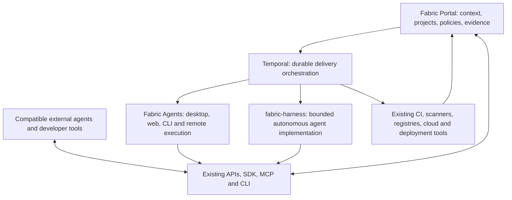
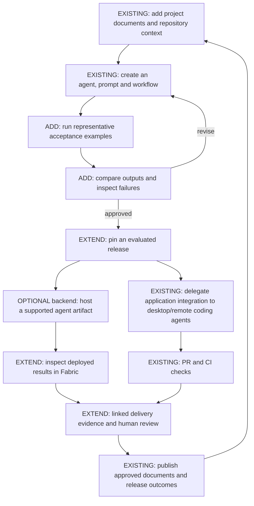
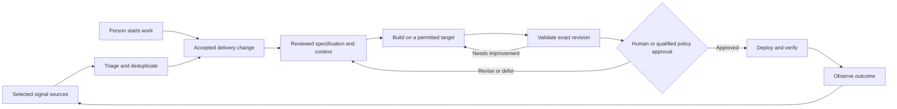

# Software factory for agencies and development teams

Product strategy and proposed delivery plan for portable project context, governed agent work, and
evidenced software delivery.

- **Audience**: Product, design, engineering, platform operators, and pilot owners
- **Owner**: Product and Platform engineering
- **Status**: In progress; existing context, agent, report and reviewed-artifact foundations are implemented incrementally. The signal-driven delivery sequence below remains subject to independent plan agreement and per-slice runtime qualification.
- **Date**: 2026-11-06

The active [Genie delivery experience and quality completion plan](genie-delivery-experience.md)
sequences automatic workflow checks, connector certification, richer evaluations, consistent
assistant responses and Frame review/transport parity. It extends the contracts below rather than
introducing a second assistant or execution engine.

## Current product boundary

### Reusable delivery skills

Skills use one authoring flow with three starting points: a reviewed conversation, a blank draft, or
an imported package/public repository. A conversation proposes changes only after an explicit Send;
Apply updates the unsaved draft and never publishes it. Package previews show instructions, files,
content hashes, warnings and pinned repository commits. Imported code is stored for inspection,
not executed. Private repositories use an uploaded bundle in this flow.

Drafts belong to their creator inside the organization. Publication to members and automatic agent
discovery are independent choices; archive removes availability, and restore creates a private draft.
Catalog inspection preserves the selected collection, search and page. Current source permissions
remain independent from publication, including copied agent memory and report instructions.

Organization administrators can restrict skill creation, publication and discovery through actual
Fabric role capabilities. UI, API, CLI and MCP share these policies and live permission checks;
API keys also require declared scopes. Group rules and user-specific Unity Catalog identity mapping
are additional qualified capabilities, not implied by Lakebase hosting. The author sees reusable
procedures and project access, rather than Databricks administration. See the [Skills guide](../../apps/web/content/docs/features/skills.mdx) and [governance boundary](databricks-context-platform.md#delivery-team-skill-governance).


### Reusable saved-agent tests

The builder's **Insights → Your tests** keeps reusable tasks and exact, case-sensitive required or
forbidden text checks. Save a completed Preview as a test, or write a test directly. Tests start fresh:
include any context the task needs. Saving a test retains its task and expectations, not the unsaved
draft configuration. Expectations from an unsaved preview can deliberately test a saved baseline;
the builder warns when unsaved edits are not included. Save knowledge/access changes and preview again before copying a result whose
source selections differ from the saved agent.

Choose a saved version, run the test, and inspect its actual execution. Tests use the existing
single-turn or goal-oriented Temporal executor, live connections, normal permissions and native
cancellation. They may invoke the same external tools as an ordinary saved-agent run. Preview remains
the bounded read-only development surface. An assessment workflow waits on the pinned native execution
and checks its verified text answer; it does not implement another execution or polling engine.

A failed text check is distinct from an agent failure or unavailable assessment. A failed, cancelled,
uncertain-effect or non-text execution cannot pass. The native executor enforces the admitted saved
configuration and selected source boundary before retrieval, tool use and model decisions; a changed
configured source cannot be used merely because the assessment would later withhold its report. Reports retain check outcomes,
a response hash and available native duration/token/cost metrics, rather than copying the native answer
or transcript. Unknown metrics remain unknown. Open the execution inspector to read the actual answer
with its existing access checks.

Cases and reports belong to their creator inside an organization. Reads recheck current agent, project,
Workspace/document and skill access against the original source boundary and execution snapshot.
Externally authenticated runs additionally require the saved agent's API exposure; declared key scopes
and the creator's current permissions are both enforced. Revoking source access withholds retained
reports. Pinned project service credentials cannot use this owner-scoped surface.

History is paged per test and identifies both the tested agent version and immutable test revision.
Compare completed runs of the same test revision to see check, latency and cost changes. Sources, connections and the agent’s normal runtime memory remain live, so the comparison is not a
controlled experiment with frozen external data.
Reuse the original request key after an uncertain admission to reconnect to the same native execution;
a retry never switches to a newer agent version.

| Interface | Saved-test operations |
| --- | --- |
| Portal | Agent builder → Preview: Save as test; Insights → Your tests: manage, run, history, compare |
| oRPC | `agents.tests.cases.{list,create,update,archive}` and `agents.tests.runs.{start,get,list,cancel,compare}` |
| REST | `/api/v1/agent-tests/cases`, `/api/v1/agent-tests/runs`, `/api/v1/agent-tests/compare` |
| SDK | `client.agentTests`: case management, start/get/listRuns/cancel/compare |
| CLI | `fabric agents tests --help` |
| MCP | Nine `fabric_*agent_test*` tools for the same case/run commands |

API keys need `agents:read` for inspection and `agents:execute` for mutations, plus `workspaces:read`
and `skills:read` when those source types are selected. This release provides deterministic text checks;
it does not claim model-graded correctness, automatic optimization, or live certification of every
third-party connector.

### Context-aware agent draft preview

The builder’s **Preview** tab runs an explicitly captured unsaved draft as a separate bounded Temporal
workflow. It uses the caller’s current organization access and AI connection. It supports single-turn
instructions, up to 30 selected ready Workspace documents, instruction-only skills, and the six existing
project document/source/feature read tools; project semantic search and meeting transcripts require saved-agent runs. Document text is fetched in bounded revision-aware pages;
it is never retrieved through an unfiltered Workspace search. The response shows sources actually read
and expandable activity. Follow-up messages retain a bounded conversation only while the draft stays
unchanged; changing the draft starts a fresh conversation. Closing or refreshing can reconnect through
an opaque per-user browser receipt. Browser storage contains no prompt, document text or response.

Every model decision and document read is its own Temporal activity. Completed activities are retained
by Temporal rather than replayed by an application retry loop. Preview never creates a saved agent,
deployment or schedule. Temporal metadata contains only identifiers and a hash; retained authorization uses the first recorded workflow input, not a copy of the instructions in searchable metadata. Current organization, agent, project, Workspace and selected-skill access is
checked before execution, at activity boundaries and before returning retained results. API keys need
`agents:execute` for start/cancel and `agents:read` for inspection, plus `workspaces:read` when Workspace
sources are selected and `skills:read` when skills are selected; the creator’s current permissions remain mandatory. Project-bound and runtime
service credentials cannot use this owner-scoped surface.

Unsupported goal loops, MCP/integration connections, non-project capabilities and skills with attached
files are refused explicitly. They are not silently omitted. Use a saved-agent run for those settings.
Preview is limited to five minutes and 128 KiB requests/continuations; it is a development check rather
than a substitute for saved-run evaluations or externally side-effecting execution.

| Interface | Preview operations |
| --- | --- |
| Portal | Agent builder → Preview: Run preview, follow-up, Stop preview, source and activity inspection |
| oRPC | `agents.previews.start`, `get`, `cancel` |
| REST | `POST /api/v1/agent-previews`; `GET /api/v1/agent-previews/{workflowId}`; `POST .../{workflowId}/cancel` |
| SDK | `client.agentPreviews.start`, `get`, `cancel` |
| CLI | `fabric agents previews start <request-file>`, `get <workflow-id>`, `cancel <workflow-id>` |
| MCP | `fabric_start_agent_preview`, `fabric_get_agent_preview`, `fabric_cancel_agent_preview` |


### Selected context and external agent controls

Fabric extends existing Context, Workspaces and saved-agent execution. A caller selects
project sources or specific Workspace documents and receives bounded, attributable reference excerpts
with the actual source revisions, excerpt hashes, citations and explicit omissions. Optional expected
revisions refuse changed content. This is an authorized current read, not historical retrieval or a
new immutable context store; independently read sources do not form a global database snapshot.
Project and Workspace permissions remain independent, and every transport repeats the same current
organization, object and credential-creator checks. Excerpts are reference data, never execution
instructions or permission grants. Required unavailable sources fail closed, optional unavailable
sources reveal no server-side metadata, and a late permission/revision change invalidates the packet.

The same contract is callable from Portal, REST, SDK, CLI and the existing Portal MCP server.
The user-facing addition is an inspectable export for external agents beside existing project Context,
with existing ingestion readiness and source management retained. Automatic attachment of private
Workspace content to a team remote server, ticket audience or broadly shared report is excluded until
the recipient audience and current access can be proved. Existing remote/Desktop/BYO CodingRun
delegation remains the execution path; selecting context does not start an agent or coding task.

Saved-agent run history, inspection, cancellation and managed schedules gain shared API/SDK/CLI/MCP
commands over the same authorized command service as Portal. External invocation retains its explicit
API-access policy. Read and mutation scopes are checked independently from the creator's current
permissions, including wildcard keys; one transport cannot borrow a different actor's credentials.
Recurring external work requires both `agents:execute` and the deliberately granted `agents:schedule`
scopes, plus current execution/update permission. New external schedules require API exposure;
pausing an existing owned schedule remains possible after that exposure is disabled. Disabling API
exposure prevents new external invocations and schedule enablement; it does not cancel already
accepted schedules. Those stop through pause, deployment controls or loss of current authority.
Temporal remains responsible for durable execution, cancellation checkpoints and scheduling.

Databricks remains an internal data and AI provider. Existing Lakebase storage, retrieval and connector
adapters are reused. Managed search, semantic/ontology-backed Genie tools, evaluations and optional
hosted agents must implement these same source, permission, release and result contracts. They are
qualified independently against their actual API generation and packaged runtime. This increment
does not enable an irreversible database feature, migrate search, create cloud agents or claim that
local protocol fixtures certify a production workspace.

Acceptance covers Unicode/UTF-8 bounds, required/optional omissions, source changes and late access
revocation, cross-organization and project/Workspace isolation, scope versus current-role refusal,
transport parity, no side effects on inspection, stable run retry/cancel/schedule identity, and a
local delivery example using the same explicit source revisions from Portal and external-agent tools.

The explicit context-selection entrypoints are:

- Portal: **Projects → Context → Inspect or export context**. Inspect selected sources and verify their
  revisions before downloading JSON. Closing the panel discards excerpts.
- REST: `POST /api/v1/projects/{projectId}/contexts/assemble`, body `{ "selections": [...] }`.
- SDK: `client.contexts.assemble(projectId, { selections })`.
- CLI: `fabric context assemble --project <id> --selection-file <json-file>`.
- MCP: `fabric_assemble_project_context`, with `projectId` and the same selections.

A selection names either `{ sourceKind: "project_context", sourceId }` or
`{ sourceKind: "workspace_document", workspaceId, documentId }`. Returned pinned references can be
reused with `expectedRevision`; Workspace continuation offsets count Unicode code points and require
that pin. Limits are 12 sources, 16 KiB per excerpt and 96 KiB for the entire JSON packet. REST input
is limited to 16 KiB. API keys need `projects:read` and additionally `workspaces:read` for any Workspace
reference, including optional references. Project-bound connections cannot reach Workspace documents
through this endpoint. Fabric runtime service credentials do not gain this tool automatically.

Saved-agent SDK controls are `client.agentRuns.list`, `get`, `cancel`, `getSchedule` and `setSchedule`.
CLI exposes these under `fabric agents runs`; MCP offers the matching `fabric_*_agent_run*` tools.
These owner controls use organization connections and remain unavailable through project-bound or
runtime service credentials. Existing project-bound execution inspection retains its prior contract.

### Delivery priorities: linked documents, runs and quality

Project Context now includes **Workspace documents → Add from Workspace**. Choose ready documents
from accessible Workspaces, review the selection, and add references without re-uploading originals.
The list shows **Ready**, **Updated since added**, **Processing**, **Needs attention** or **Unavailable**,
with a current preview and an action to open the original Workspace. Editors can remove a reference
without deleting its source. The separate **Inspect or export context** section stays collapsed until
needed for a one-time, revision-checked packet.

Links store source identifiers and the revision at the time of linking, never document contents.
Reads use the current authorized source revision; the linking revision is a freshness comparison,
not retained historical content. Link creation requires the inspected current revision and is
idempotent. Current project and Workspace access are checked independently, including after an
asynchronous read. A project member without source access receives an opaque unavailable reference,
without the document title, Workspace name or source identifiers. Linking does not grant sharing,
add content to project-wide search or automatically attach private content to delegated work.

The same operations are available through the following interfaces:

| Interface | Operations |
| --- | --- |
| Portal | Project Context → Workspace documents: add, list, preview and remove |
| REST | `GET/POST /api/v1/projects/{projectId}/contexts/workspace-documents`; `DELETE .../{linkId}`; `GET .../{linkId}/content` |
| SDK | `contexts.linkedDocuments`, `linkWorkspaceDocument`, `unlinkWorkspaceDocument`, `readLinkedDocument` |
| CLI | `fabric context documents list`, `add <document-id>`, `remove <link-id>`, `read <link-id>`, each with `--project` |
| MCP | `fabric_list_project_workspace_documents`, `fabric_read_project_workspace_document`, `fabric_link_workspace_document`, `fabric_unlink_workspace_document` |

API keys require `projects:read` and `workspaces:read` to list/read links, `projects:write` and
`workspaces:read` to add them, and `projects:write` to unlink. Current creator/object permissions are
also required, including for wildcard keys. Explicit linked reads are available to matching
project-bound connections; this does not expose the generic Workspace catalog or selected-context
assembly to those connections. Runtime service credentials gain read tools only under existing
runtime and source permissions; link mutations require a user or external-agent connection.
Mutations commit their content-free audit record atomically with the reference change. Metadata is
paged at 20 links by default, at most 50; source continuation uses Unicode code-point offsets and
requires the current revision pin.

| Priority | Current foundation | Remaining user outcome and acceptance |
| --- | --- | --- |
| 1. Reuse Workspace documents in projects | Persistent references, multi-document selection, freshness, current preview and removal across Portal/API/SDK/CLI/MCP | Qualify deployed database roles and user cohorts; project-wide linked-source indexing and audience-safe delegated handoff remain separate work |
| 2. Carry context into delivery | Existing tickets, CodingRun delegation and saved-agent execution | Assign a ticket with approved context to Remote/Desktop/BYO agents; the execution and viewer audience may access every supplied source; expose one useful status/session/result in Fabric |
| 3. Understand runs | Agent details drawer, readable output, paged history, tool details, downloads and managed schedules | Present outcome and quality separately, explain failures with evidence and the next permitted action, and link ticket, run, sources, output and evaluation; provide a project/team view only under explicit run-viewer policy |
| 4. Improve behavior | Recorded-output context checks, saved evaluations, comparisons and MLflow-backed execution | Turn a reviewed real run into a test case, describe expected behavior, compare pinned agent/prompt/workflow versions, inspect failed examples, propose a draft fix and rerun before authorized publication |
| 5. Govern and qualify managed backends | Lakebase, existing Databricks adapters and approved evaluation bindings | Qualify source isolation, Unity Catalog asset privileges, private retrieval, trace/dataset access and revocation using real principals; users keep using Fabric terms and controls |

Saved-agent details place the recorded result and run history before the new-task form. Starting a
run requires an explicit task and returns focus to its progress and result. The directory labels
template metadata as **Source**, with full names available on keyboard focus. The builder keeps
single-turn execution as the default; goal-oriented execution requires a goal and a bounded iteration
limit. Sidekick suggestions remain drafts until accepted, and failed responses offer an explicit retry.

New goal-oriented runs evaluate the latest complete text deliverable, with only the current plan's
supporting variables. Rejected drafts remain in the execution trace rather than being concatenated
into the answer. Successful and iteration-limited saved records retain step outputs separately; a
limit reached without achieving the goal is a failed outcome. A Temporal patch preserves existing
histories. Goal verification is an assessment, not an independent guarantee of factual correctness.

All operations follow the [transport-parity engineering contract](../../AGENTS.md#product-operations-and-transport-parity).

The next Quality experience belongs alongside an existing run and in Platform Operations, using
one evaluation implementation. A user chooses **Check this result**, supplies examples and expected
facts in plain language, and sees **Passed**, **Needs attention**, **Not evaluated** or
**Could not evaluate**, with the actual result, expected behavior and supporting evidence.
Execution completion is separate from task achievement and evaluation quality. Judge feedback is an
assessment with its rubric and limitations, not proof that a proposed cause or fix is correct.

Start with reviewed examples and relevant supported checks: requirements covered, facts supported
by sources, expected tool/task outcomes and output format. Present speed/cost only when measured.
Preserve source, target, prompt, model/settings, tool and scorer versions and comparable dataset
pins. Recorded-output checks and live target reruns are distinct modes; disclose changed/live
sources or unavailable historical replay. Feedback and failed cases enter reusable datasets only
through an explicit authorized action, with separate aggregate and raw-evidence permissions.
Suggested prompt/context/tool changes remain drafts; users compare the rerun with a baseline and
publish through existing release permissions. Automated improvement cannot silently edit production.

### Check an actual agent result

A completed, project-bound saved-agent run offers **Check this result** inside its selected run in the agent drawer.
Quality loads the actual server-recorded text as a read-only answer. Enter required or forbidden
phrases, one per line, and choose **Check recorded answer**. The result identifies each expectation
that passed or failed. **Verify and download report** reloads current authorized evidence before
exporting an owner-held JSON receipt. **Edit current agent** opens the existing agent editor; changes
apply to future runs and require a separate explicit run. Nothing is edited or rerun automatically.

This mode uses the existing deterministic Quality scorer. It checks literal, case-sensitive phrases;
it does not judge facts, grounding or citation/retrieval quality, invoke a model, replay a historical
agent configuration or certify goal achievement. Execution completion and check outcomes remain
separate. The receipt names the original admitted project, execution and Temporal workflow/run,
execution-state source and exact output hash/revision. It reports whether evidence came from Temporal
or an archived database record. Admission metadata does not retain an immutable agent/prompt/model
version, so no version-replay claim is made. Empty, unsupported, unbound legacy and oversized results
are refused rather than silently truncated. Changes to output, identity, access or binding invalidate
the inspected pin. Checks load only the same human-readable answer shown in the run inspector.

Run output remains private to its owner under current organization, agent and project permissions.
These checks do not save to project-shared evaluation history or export to a managed evaluation job.
Enabling that path requires durable run-origin and evidence-audience checks throughout admission,
background export and history reads. The separate manual project-context Quality mode is unchanged.

| Interface | Inspect | Check |
| --- | --- | --- |
| Portal | Completed saved-agent run → Check this result | Enter phrase expectations; Check recorded answer |
| REST | `GET /api/v1/projects/{projectId}/context-quality/agent-results/{executionId}` | `POST .../{executionId}/evaluate` |
| SDK | `contextQuality.inspectAgentResult(executionId, { projectId })` | `contextQuality.checkAgentResult(executionId, expectations, { projectId })` |
| CLI | `fabric context inspect-run <execution-id> --project <project-id>` | `fabric context check-run <execution-id> --project <project-id> --revision <sha256> --require <phrase> --forbid <phrase>` |
| MCP | `fabric_inspect_agent_run_result` | `fabric_check_agent_run_result` |

API keys require both `projects:read` and `agents:read`, plus the creator's current run-owner and
object permissions, including wildcard keys. A project-bound connection may inspect only that
project's admitted runs. Runtime service credentials do not gain these owner-only tools.
The check input contains only `expectedRevision`, `requiredPhrases` and `forbiddenPhrases`;
clients cannot supply an answer, actor or output identity. Limits are 16,384 UTF-16 code units for
the untruncated answer, 20 phrases per category and 512 characters per phrase. At least one phrase
expectation is required. REST bodies and the combined answer/expectation scoring packet are bounded
to 128 KiB in UTF-8; an oversized combined packet is refused safely. No schema or workflow-control-flow
change is required for this read-only mode.

### Existing implemented foundation

The default Agents builder retains Temporal execution and offers a selected Project, expected
output and one Advanced configuration section. Sidekick runs only after an explicit request;
its proposed changes require review. Draft projects remain selectable. Missing template or
provider setup is visible without discarding the draft. Legacy project bindings survive editing
and duplication, and request and activity boundaries repeat current organization/project checks.

| Delivery capability | Implemented contract | Qualification still required |
| --- | --- | --- |
| Portable agents | Strict v2 artifact, entrypoint, schema and logical-binding descriptors; disconnected imports; unavailable implementations cannot publish, expose an API or fall through to native chat | Operator-qualified finite target, durable admission store and credential broker; full immutable agent releases and authorized rebinding |
| Workspace documents | Authorized bounded content reads through Portal RPC, REST, SDK, CLI and MCP; Unicode code-point offsets and revision checks | Production restricted-role RLS and broader indexed/live source parity for each assistant transport |
| Project context discovery | Bounded metadata manifest through Portal RPC, REST, SDK, CLI and the existing MCP context-list tool; source identity, readiness, direct-read references, exact bounded inline revisions and explicit omissions | Historical snapshot assembly; the manifest is discovery and selected-context assembly is a separate current-read contract, not a frozen execution input |
| Project reports | Existing report builder and Temporal engine; distinct reporting periods and cadence; pinned configuration and skills; stable occurrence identity; bounded start recovery; current project audience and artifact/delivery authorization | Complete historical source attestations; external source-to-project audience qualification; production-history replay |
| Project knowledge for reports | Bounded shared project notes and completed generated project documents with source, revision and cutoff fences | Imported/private/integration sources remain unavailable until their derived audience can be proved |
| Execution receipts | Business admission retains actor/organization-scoped keys, payload conflicts, atomic execution-count allowance and audit. Temporal owns execution: stable workflow-ID start/reconnect, workflow-owned receipt persistence, durable model/tool steps and verified native status/results. Supervisor producers use execution UUIDs | Missing/expired legacy histories remain unresolved; database-first requests never accepted by Temporal require caller retry. Signal request deduplication, lifetime concurrency accounting and external provider idempotency remain separately qualified |
| Native platform features | Existing context-quality and saved-evaluation interfaces remain behind Fabric terminology | Each deployment's search, ontology, memory, Genie and hosted-agent capabilities require their own qualified adapter and acceptance evidence |

Report workflow compatibility has [repeatable SDK-recorded synthetic history tests](../../packages/temporal/__tests__/report-execution-replay.test.ts) for legacy success, current-protocol success and provider refusal. Deployment qualification still requires representative production histories.

The opt-in [live report qualification](../../apps/web/tests/e2e/reports/project-knowledge-live.spec.ts)
uses the actual Portal create/generate/preview/download flow against an existing local full worker
and a configured provider. Run it with the [dedicated Playwright configuration](../../apps/web/playwright.report-live.config.ts)
and its documented synthetic fixture settings. It does not start services or change provider settings.
The qualified source mode is shared Project knowledge; cloud deployment, scheduled report pickup,
external source audiences and outbound delivery require separate acceptance.

Project context discovery uses the existing Project Context store and current project permissions.
Read one page with `projects.contexts.manifest`,
`GET /api/v1/projects/{projectId}/contexts/manifest`, `client.contexts.manifest(projectId)`,
`fabric context manifest --project example-project`, or `fabric_list_project_contexts` with
`format: "manifest"`. Pages contain at most 50 sources and no source bodies, storage paths or
provider metadata. Code-index sources are omitted by default with a count; callers may explicitly
include them. Workspace documents retain their separately authorized catalog and content reader.
Pagination is a live offset view, so concurrent changes can move rows between pages. An inline
completed body of at most 96 KiB has an exact UTF-8 SHA-256 revision; pending, composite and oversized
sources explicitly explain why no revision is asserted. Read references inspect current content:
compare the returned revision before using it, rather than treating discovery as historical retrieval.

Saved instances exposed for API access have a distinct execution contract from registry discovery.
`agents.invokeInstance(instanceId, { input, idempotencyKey })` starts the existing native Temporal
workflow; retain that key and unchanged input/priority/organization to recover an unresolved request.
`agents.getInstanceExecution(executionId)` reads the current authorized result. The CLI equivalents
are `agents invoke-instance` and `agents instance-execution`. SDK mutations do not retry implicitly;
the CLI prints the request key and receipt for recovery. A changed payload with the same key conflicts.
Recovery also repeats current execution/project checks and cannot borrow another owner's credentials.

A registry entry's healthy interactive endpoint does not establish background execution support.
The legacy generic invoke/trigger path now explains that limitation before creating a task; its
previous readiness-only activity cannot claim completed work. Interactive chat remains available.

New saved-instance admission reserves existing daily/monthly execution-count allowance in the same
transaction as the intent and content-free audit event. Identical retries do not reserve again, and
uncertain starts retain their allowance conservatively. This does not certify monetary/token budgets,
concurrency limits or exactly-once external effects. The older supervisor signal path has corrected
producer/receiver identity and cancellation contracts; its broader reconciliation and metrics remain
separately qualified. No new scheduler, arbitrary remote-execution service or agent registry is added.

Temporal is the execution authority. A new API admission starts a distinct native workflow type
using its stable business workflow ID, native running-ID reuse and closed-ID rejection. The first
retryable Activity verifies the actual workflow, actor, organization, instance and admitted project,
then writes its run identity before model/tool work. The API's acceptance no longer depends on a
second database receipt write. A lost start acknowledgement reconnects through Temporal's native
handle and validates the admission memo. New workflow types prevent older workers from silently
running the prior implementation; deploy capable workers before sending new API traffic.

Live execution reads verify the Temporal run identity and expose its status, progress and result
after the existing current object/tenant checks. Database rows retain artifacts, history, costs and
authorized archival results. Missing or stale run IDs do not require a background poller or a write
from the read path. If no live state can be verified, nonterminal rows report UNKNOWN with their
last recorded status; terminal archival results are explicitly labeled as database-backed.

New workflow histories use discrete model-decision and selected-tool Activities through the existing
agent executor. Completed decisions/results are retained in Temporal history. Effectful or unknown
tool outcomes stop for inspection instead of triggering a whole-agent retry. This does not promise
exactly-once behavior from arbitrary external tools or eliminate a provider's own retry semantics.
Native Activity retries keep idempotent identity and completion projections live without rerunning
completed model/tool work. Existing histories retain their original command path through patching.
Completion persistence verifies the original execution identity without requiring the actor to retain
permission to start another job. Current grants and deployment termination are checked before further
model/tool work, and current permissions still govern reads. New supervisor completion notifications
use native Temporal signals; an absent parent cannot invalidate a stored result. Delegated child
agents remain within one tool Activity and do not yet receive separate internal step checkpoints.

Saved-agent names open a right-hand details drawer over the directory; only **Edit** opens the
full builder. **Overview** loads the definition without fetching run outputs. Owners can explicitly
start a background task with **Run agent**, inspect recent metadata under **Runs**, or configure
recurring work under **Triggers**. Selecting a run loads its verified status, readable result,
generated-file downloads and recorded tool steps on demand. Closing the drawer leaves execution running.

The full-height builder aligns the left-pane title and close control with the assistance tabs
at the top of the right pane. Configuration and assistance scroll independently. Sidekick begins
with a welcome question and keeps its composer pinned below the conversation, visible without scrolling
the configuration form. Suggestions change the draft only after deliberate review and application.

The agent editor separates Sidekick, Preview, and Insights. Sidekick suggests instructions and tools
for explicit review before applying them to the draft; Save persists accepted changes. Preview runs
an explicit, single-response instruction test through the existing organization-authorized draft
preview API, without tools, knowledge, skills, or goal loops. Results identify when instructions have
changed since the test. Full configuration tests use the saved agent's existing durable run surface.
Insights loads paged saved-agent execution metadata and fetches output only when a run is selected;
it does not infer global analytics from a sample. The X and Cancel return to the prior view, with
confirmation before discarding unsaved configuration. Editor scrollbars stay hidden while wheel,
touch, and keyboard scrolling remain available. Mobile users switch between Configuration and Assistant without losing unsaved form or conversation state.

**Runs & History** names the selected agent in its heading and keeps an Agent column in the full
view. Selecting an agent name narrows history; **All agents** restores the combined view. It
provides server-filtered, cursor-paged execution metadata across the owner's
agents, including earlier versions of the same logical agent. It filters by status, trigger, date and
task/run identifier without loading every result or trace. Each page rechecks current organization,
owner and original project access; denied rows and counts are not exposed. Historical rows do not
poll Temporal; active status checks use describe-only reads and never download workflow outputs.
Unverifiable statuses stop automatic polling; verified live views pause after five minutes until
Refresh is chosen. The same authorized search is available through
oRPC, REST, SDK, CLI and MCP. Selecting a result still uses the authoritative native run read. Cancellation requests
stop new model/tool work at the next safe boundary, preserving acknowledged effects and partial
results. Each agent can have one managed recurring-task schedule with explicit input, cron and
timezone. Edits and pauses reconcile the same Temporal schedule; other triggers are preserved.
Every firing uses a stable occurrence identity and the native admission protocol. Unconfirmed
scheduling state remains visible and can be reconciled by saving the same definition again.
Managed dispatch has distinct workflow and Activity names so older workers cannot interpret it as
legacy supervisory signaling. Temporal retries idempotent dispatch across transient outages;
deployment pause/resume preserves the task definition and previously paused triggers.

The former five-minute receipt observer is paused at startup. Its implementation remains available
for recorded-history compatibility; it is not part of normal execution recovery. Fabric still owns
business authorization, quota and request-key admission. Temporal cannot resume a request it never
accepted: if the API dies after business admission but before start, the caller retries the same key.
Older ambiguous records without the workflow-owned receipt protocol are observation-only; missing
history is never taken as permission to run them again after Temporal's retention window.

The public Harness finite-client adapter is a tested integration boundary, not an available hosted
runtime. It requires validated actor/project grants, exact artifact/schema pins, a trusted target,
a credential broker and a durable admission implementation. A local failure before dispatch is
recorded as not started; a possible remote dispatch retains an uncertain receipt and cannot be
blindly retried. Persistent and effectful hosted execution remain unavailable.

Direct chat supports ordinary reads. Approval-required actions use Genie Simple (Orchestrator).
Legacy Direct approval inputs are refused before tools or models execute; Direct does not advertise
approval resumption until a durable per-action result contract is available. External deployment
execution follows the owner-only in-app credential contract and also rechecks the API credential
creator's current project access.

These boundaries deliberately preserve working product surfaces while the wider roadmap below
remains active. Specialized delivery agents follow qualification of these foundations.

## 1. Product decision and scope

Position Fabric as **the shared context and delivery platform for teams working with any compatible
agent**. An agency should retain its delivery methods and client knowledge as people, models, and
coding tools change. An internal software team should gain the same continuity between requirements,
code, validation, and operations.

The product promise is: **create agents and delivery methods or bring your existing tools; Fabric
supplies shared context, repeatable execution, and evidence of what happened**. This is a proposed positioning hypothesis to
validate with pilots, not a claim of proven market demand or current feature parity with Harness.

Fabric is a software factory for delivery teams. Its default experience does not require users to
know which Databricks services provide storage, search, evaluation or analytics. Fabric operates
those services behind its own project, context, execution and quality contracts. Databricks resource
administration is an implementation responsibility, not a delivery-team workflow or a measure of
product completion. Optional customer-managed infrastructure belongs in enterprise setup, outside
the ordinary engineer's path.

Fabric owns the authoring, execution and evaluation experience for its reports, agents, autonomous agent
loops, workflows, documents and project context. Retain the existing Temporal-backed runtimes and
Fabric Agents desktop/remote coding paths. Creating or using a Fabric agent does not require a
Databricks deployment. A hosted backend adapter is an optional implementation choice for a proven
requirement, not the default product journey. Evaluation measures the behavior and outputs of
things created in Fabric; a backend connectivity probe is operational evidence, not that product
outcome. Reuse Databricks services internally instead of reproducing its administration interfaces.

Prioritize complete delivery jobs rather than backend feature coverage:

| Team job | Fabric experience | Outcome to measure |
| --- | --- | --- |
| Understand a project and resume work | Attach authorized documents and repositories; ask questions with citations and inspect missing or stale context | Less repeated briefing and faster first useful contribution |
| Build a team agent | Create and version an agent with instructions, context, skills, tools and typed outputs; test and publish it to a supported execution target | A reusable agent that completes its declared task with reviewable results |
| Automate a delivery process | Compose agents, integrations and human steps in the existing visual workflow studio; publish, trigger or schedule through Temporal | Less manual coordination and reliable recovery when a step fails |
| Iterate toward a result | Configure an agent loop that plans, acts, checks and revises against explicit completion criteria, limits and human checkpoints | A completed task or an actionable blocker with bounded execution |
| Implement a story | Assign from Projects to a compatible agent; follow progress, resolve supported requests and review the resulting PR | Shorter time from assignment to independently validated change |
| Reuse a successful delivery method | Apply published workflows, prompts and skills with current project connections and pinned versions | Successful reuse on another task, project or service |
| Produce a report or document | Configure an existing report template or document flow with approved project context and shared integrations; generate, review and retain the output | Less manual assembly and attributable, reusable deliverables |
| Equip an agent or workflow | Create or update authorized MCP server configurations and connections in existing management surfaces; select supported tools across the application | Reuse integrations without repeating credentials or incompatible setup in every feature |
| Improve an agent or workflow | Run representative acceptance examples and compare versions alongside tests and CI evidence | Actionable failures and fewer regressions |
| Review and hand over the result | Inspect the diff, checks, decisions and selected client-facing outcomes | Less review and handoff effort |

Every implementation slice must identify its team job, entry point, resulting artifact or action,
failure/recovery experience and acceptance evidence. Infrastructure qualification supports these
slices; it does not replace proving the delivery journey. Use the adoption measures in section 14
to decide whether a backend capability improves the product.

Compete first on a complete agency/team experience: context onboarding, assignment from Projects,
visible remote execution, validated PRs, client review, and handoff. Broader CI/CD and platform
capabilities follow demonstrated demand. Existing CI, scanners, registries, cloud platforms, and
delivery products remain useful execution providers.

This plan owns the cross-product experience and integration sequence. It references rather than
replaces [agent productization](agent-productization.md), [delivery
tracks](inverted-loop-delivery-tracks.md), [Fabric Agents
acceptance](fabric-agents-execution-acceptance.md), and [Temporal
durability](../workflows/temporal-durability.md). Their implementation claims must be checked
against the current checkout and live evidence before reuse.

## 2. Target customers and jobs

| Customer | Primary job | What would make Fabric valuable | Pilot evidence |
| --- | --- | --- | --- |
| Agency owner / delivery lead | Deliver multiple engagements consistently and hand projects over cleanly | Reusable approved methods, client-specific knowledge and credentials, clear progress and review evidence | Less re-explanation and handoff work; repeat use on a second engagement |
| Agency engineer / contractor | Join an unfamiliar codebase and deliver a change | One authorized project brief, cited documents and code, preferred agent, live session and actionable failures | First accepted PR without manually reconstructing the brief in several tools |
| Client stakeholder | Understand and accept delivered work | A deliberately shared preview, acceptance criteria, release notes and approvals | Completes review without seeing agency-private prompts, other clients, secrets, or raw internal transcripts |
| Internal development team | Preserve knowledge and standardize reliable delivery | Existing repositories and CI, versioned workflows, approved connections, durable execution | Reuses the workflow across services with current ownership and permissions |
| Platform / security engineer | Enable self-service without unrestricted production access | Scoped workers and credentials, execution evidence, policy controls, revocation and recovery | Can explain, stop, and audit an operation, including during failure |

Treat agencies and internal teams as two onboarding profiles on the same domain model, not separate
products. Start with interviews and three agency plus two internal-team design partners; those
counts are recruitment targets, not statistical market validation.

## 3. Product vocabulary and existing features

| Capability | Role in the factory | Required behavior |
| --- | --- | --- |
| Organization | Sole tenant and policy context | Every request, credential use, retrieval, run and artifact resolves an explicit authorized organization |
| Projects | Engagement or software-product hub | Repository, work items, context, documents, agent assignments, delivery runs, decisions and outcomes stay connected |
| Workspaces | Document collections | Upload, ingest, inspect readiness, retrieve and chat with cited document content; explicit authorized attachment to project context |
| Documents | Source material and delivery artifacts | Create, upload, edit and reference permitted documents using existing document surfaces; preserve revisions, provenance and source access |
| Context store | Shared product capability over existing authorized sources | Select and inspect project knowledge, Workspace documents, repository context and approved structured data through one read/assembly contract; preserve each source's ownership and storage authority |
| Pages | Generated or authored presentation surfaces | Reviewed briefs, status pages, client outcomes and runbooks; derived content inherits source restrictions unless an authorized publication explicitly releases a sanitized projection |
| Reports and report templates | Repeatable generated deliverables | Reuse existing template/instance execution, schedules, artifacts and delivery; select shared context, prompts, skills and supported integrations |
| Prompts | Reusable instructions for a task or role | Version, test, publish and pin the effective prompt; resolve existing user preferences only inside the authorized organization |
| Skills | Reusable capability/instruction packages | Declared contents, version/hash, compatibility and required tools; loading a skill does not mean executing a program |
| Agents | Team-created and externally registered implementations | Create, version, test, publish, discover, invoke, observe, cancel and evaluate through the existing registry; deploy supported published artifacts through qualified target adapters |
| Agent loops | Iterative execution of a defined task | Compose bounded plan/act/check/revise behavior with completion criteria, budgets, cancellation and human checkpoints; reuse agents and Temporal orchestration rather than introduce another editor or durable authority |
| Workflows | Versioned orchestration of people, agents and tools | One persisted visual studio, published execution semantics, schedules/triggers, evidence and durable approval waits through Temporal |
| Connections | Authorized integrations and MCP servers | Reuse existing create/update/connect management, shared credential resolution, tool discovery, scope, live permission checks, action classification and audit across agents, workflows, reports and context features; no parallel secret store |
| Living Memory / coding instructions | Maintained project knowledge and rules | Reuse existing repository sync and reviewed write lanes; preserve the explicit administrator opt-in exceptions in accepted ADRs |
| Platform Operations | User-friendly operation and improvement of team automation | Run agent, workflow, context and prompt evaluations; compare versions, inspect failures, monitor runs and costs, and manage authorized releases with links back to the relevant resource |

This table defines product scope across existing and planned capabilities, not a completion claim.
The context store is a coherent Fabric experience over existing source and permission contracts;
it does not turn documents, search indexes, analytical semantics and derived memory into one
interchangeable store. Platform Operations is a Fabric team-facing product area. Evaluation use
does not require infrastructure-administrator rights; source, run, comparison and release actions
retain their specific permissions. Backend identities and native resources remain operational
configuration.

There is a naming conflict to resolve before onboarding work: [CONCEPTS.md](../../CONCEPTS.md)
currently also calls an organization a user-facing Workspace. The latest product direction restores
document Workspaces and distinguishes Pages. Proposed copy is **Organization** for the tenant
selector and **Workspaces** for document collections. This is a terminology/copy correction, not a
tenant migration. Reconcile the glossary, navigation, tours, translations and documentation together
when implemented. Also distinguish agent workspace files, Fabric Agents server workspace/session
grouping, and legacy frame-as-Workspace transport/tool descriptions. Use typed document-collection,
agent-file, remote-workspace and Page identifiers in manifests and grants; never infer equivalence
from the shared word. Preserve legacy transport names through explicit mappings rather than changing
identifiers by display label.

Proposed terms in this plan:

- **Context manifest**: a bounded, attributed selection of authorized source revisions and applicable instructions for an operation. It does not contain credentials or confer access.
- **Delivery run**: the correlated record of a software-change attempt across existing work items, coding/workflow executions, PRs, validation, reviews and deployments. It is a projection and correlation contract, not a replacement executor.
- **Delivery template**: a published workflow with versioned dependencies, typed inputs, policy requirements and a declared output contract. Use existing Templates navigation rather than adding another marketplace.
- **Execution target**: an authorized personal-owned or team-shared server/worker within an organization. Ownership visibility is not a second tenant model.
- **Evidence**: an attributed result from an authenticated producer, tied to the relevant commit, artifact, workflow version and operation. Agent prose is useful explanation, not independent proof.

### Current foundation and the actual additions

The current checkout already implements the major product surfaces. **Existing** below means source
implementation was inspected; it does not mean every path was exercised in a fresh browser or
certified in production. The isolated paid-workspace saved-evaluation acceptance qualifies that
specific Jobs/MLflow/Lakebase path. Deployment and assistant parity need their own live evidence.

| Foundation already present | Source evidence | Actual increment |
| --- | --- | --- |
| Agent creation, registry, template instances and version history | [Current creation page](../../apps/web/modules/saas/agent-templates/components/CreateAgentPage.tsx), [unified directory](../../apps/web/modules/saas/agents/components/UnifiedAgentView.tsx), [version/restore routes](../../packages/api/modules/agents/router.ts) | Consistent evaluated release snapshots and dependency pins; retain the builder, registry and Temporal execution |
| Goal-oriented and inline-config dynamic loops | [Goal-oriented workflow](../../packages/temporal/src/workflows/goal-oriented-agent/index.ts), [dynamic workflow](../../packages/temporal/src/workflows/dynamic-agent/index.ts) | Improve stopping/outcome contracts and budgets; dynamic `agentConfigId` loading is not implemented and must not be advertised as a working configured-agent path |
| Agent deployment lifecycle APIs and Temporal supervisor | [Deployment router](../../packages/api/modules/agent-deployments/router.ts), [deploy command](../../packages/api/modules/agent-deployments/procedures/deploy.ts) | Complete the team-facing deployment experience and add a Databricks target adapter; API presence alone does not establish a finished deployment UI |
| Visual workflows, publishing, manual/webhook/scheduled runs | [Editor](../../apps/web/modules/saas/workflows/components/WorkflowEditor.tsx), [published versions](../../packages/api/modules/workflows/lib/workflow-commands.ts), [schedule sync](../../packages/api/modules/workflows/lib/sync-workflow-schedule.ts) | Add selected tools and understandable results in this studio; qualify missing-schedule repair and immutable historical evidence |
| Private/team Fabric Agents servers, desktop launch and remote sessions | [Server procedures](../../packages/api/modules/coding-runs/procedures/remote-servers.ts), [desktop/remote controls](../../apps/web/modules/saas/projects/components/coding-runs/LaunchFabricDesktopBar.tsx), [session reads](../../packages/api/modules/coding-runs/procedures/session-messages.ts) | Strengthen context-to-task-to-session-to-PR/CI continuity; qualify installation, isolation and observation rather than create a second dispatcher |
| Document Workspaces, upload/processing and persisted document chat | [Workspace router](../../packages/api/modules/workspaces/router.ts), [document chat](../../apps/web/app/api/workspaces/chat/route.ts) | Consistent revision-aware source selection and reads across assistants and external tools; retain the existing document stores and chat |
| Workspace MCP reads, source-attributed project context and SDK/CLI access | [Workspace tools](../../packages/temporal/src/lib/fabric-workspace-tool-definitions.ts), [project context](../../packages/api/modules/agents/procedures/context.ts), [workspace SDK](../../packages/sdk/src/resources/workspaces.ts), [CLI](../../packages/cli/src/commands/workspaces/index.ts) | Add missing SDK/CLI document reads and revision pins to existing MCP paging; qualify the actual Genie engines on its dedicated and omnipresent surfaces |
| Prompt editing, versions, bindings, text diffs and restore | [Prompt routes](../../packages/api/modules/prompts/router.ts), [version comparison](../../apps/web/modules/saas/prompts/components/PromptVersionCompareDialog.tsx) | Add model-executed prompt evaluation against reviewed examples; current [test/render](../../packages/api/modules/prompts/procedures/test.ts) is a preview, not behavioral evaluation |
| Skills, templates and version counters | [Skills queries](../../packages/database/prisma/queries/skills.ts), [template execution](../../packages/api/modules/automation-templates/procedures/execute-template.ts) | Immutable dependency releases and authorized rebinding for repeatable team methods |
| Project Quality, saved history/comparison and Databricks scoring | [Quality dialog](../../apps/web/modules/saas/projects/components/ContextQualityDialog.tsx), [saved commands](../../packages/api/modules/context-quality/lib/saved-commands.ts) | Broaden recorded-answer checks into prompt/agent/workflow execution, reviewed datasets and one Platform Operations experience |
| Report templates, instances, execution and artifacts | [Report routes](../../packages/api/modules/reports/router.ts), [execution](../../packages/api/modules/reports/procedures/instances/execute.ts) | Shared context/tool parity and report-output evaluation; retain the existing Temporal template-instance workflow |
| MCP management and shared integration execution | [MCP management](../../packages/api/modules/mcp/router.ts), [server management UI](../../apps/web/modules/saas/mcp/components/McpServersView.tsx), [executor registry](../../packages/integrations/src/executor-registry.ts) | Consistent authorized create/update/configuration and supported tool availability across application surfaces; qualify each advertised surface/action combination |
| Databricks model/embedding provider, SQL/AI-query nodes and configured index queries | [Model factory](../../packages/ai/model-factory.ts), [SQL plugin](../../apps/web/modules/saas/workflows/lib/plugins/databricks-sql/index.ts), [index adapter](../../packages/integrations/src/databricks-vector-search/index.ts) | Managed configuration, curated discovery, approved context projections and measured retrieval improvements; these adapters are not greenfield |
| Databricks Genie conversational client | [Client](../../packages/databricks/src/genie-lakebase.ts) | A governed create/connect/query product integration is new; a production caller of this client was not found in the inventory |

Agent versions and a deployment ID currently do not freeze an evaluated release. The
[instance update](../../packages/api/modules/agent-templates/procedures/instances/update.ts) permits
in-place mutation; [instance queries](../../packages/database/prisma/queries/agent-templates.ts)
can repoint deployments on version creation; [execution](../../packages/temporal/src/activities/deployment-execution.ts)
reads the current joined configuration. The release increment must capture exact instructions,
model/settings, tools, skills, context configuration and artifact digest without changing draft
editing semantics. Runtime source access is still checked independently of those pins.

The agent/deployment foundation includes current organization matching, actual polled supervisor
queues, team-owned credential policy, authorized mentions and complete skill/API snapshot restore.
Treat these reused lifecycle paths as qualification work, not as already reliable simply because
their handlers exist. [Agent productization](agent-productization.md#4-agent-as-code-and-publication)
defines the release/restore boundary and prevents rollback from restoring revoked authority.

### Current assistant and directory terminology

Use **Genie** for the existing omnipresent assistant and its dedicated page, consistent with the
current Portal and product direction. Qualify its Simple/Advanced interface modes and actual
Direct/Orchestrator/Research engines individually. Older Advisor, Nexus, Copilot and Loom references
are not additional assistant products. Preserve only explicitly approved legacy identifiers/card copy;
reconcile ambiguous directory labels and remove the web `PERSONAL` tenancy filter. Private-owned
execution credentials can still exist inside an organization. Expose native analytical tools as
Fabric **Structured Data** / **Analytical Assistant** capabilities; keep Databricks Genie names
in connector/platform diagnostics and this technical plan. Update Get Started, tours and translated
copy with the eventual UI changes. This is not a new navigation or agent registry.

Genie's composer keeps attached project and Workspace context visible. Enabled agent, tool and
connection counts are inspected through **Details**, with keyboard-accessible capability controls.
The **Add context and tools** menu exposes existing file, memory and chat-tool controls when available;
Simple/Advanced mode and saved-agent tool locks still determine which actions can be configured.
Opening a menu does not send a message or change the current execution engine.

Routine tool logs can be folded into **Activity** while errors, authority requests and interactive
Frame results stay visible. Explicit MCP/provider failure envelopes are shown as failures even when
the transport completed. Agent-reported source labels are identified as reported references rather
than proof of a document read. The artifact inspector opens a populated tab, preserves the chosen
tab during updates, and formats Markdown documents while keeping HTML inert.

### Current Agents page and retained execution path

The existing Agents page combines registered agents and template instances in the
[unified directory](../../apps/web/modules/saas/agents/components/UnifiedAgentView.tsx). Its custom
and from-template creation flows use the existing
[creation page](../../apps/web/modules/saas/agent-templates/components/CreateAgentPage.tsx). They
save instructions, selected Workspaces/knowledge, tools, skills, triggers and execution mode through
[instance creation](../../packages/api/modules/agent-templates/procedures/instances/create.ts).
The server validates tenant/source/connection access, persists the Fabric instance, initializes
its instruction/skill files and synchronizes configured triggers. Saving a definition is distinct
from running it; no per-agent worker or Databricks deployment is created by this step.

Execution retains the existing Temporal workers. The
[deployment supervisor](../../packages/temporal/src/activities/agent-supervisor.ts) routes to
`deploymentExecutionWorkflow` for single-turn work or `goalOrientedAgentWorkflow` for goal-oriented
iteration; the [general trigger](../../packages/api/modules/agents/procedures/trigger-agent.ts)
starts `agentExecutionWorkflow`. The
[Direct chat admission path](../../apps/web/app/api/agents/fabric-ai/stream/direct-turn.ts) also
requires Temporal. These are distinct existing entry paths, not one new universal workflow. Model,
RAG and integration calls remain in authorized activities/adapters. External registered agents keep
their negotiated adapters. Improvements add evaluation, common context/tool access, immutable
release evidence and clearer results around these paths rather than replacing them.

### What current Temporal agents need, and what Harness/Genie adds

Temporal is the retained orchestration engine. Existing agents already have creation, single-turn
and goal-oriented execution, retries, cancellation paths, triggers and worker queues. Existing
Reports already has daily, weekly, biweekly, monthly and quarterly cadence, agent-loop execution,
duplicate-safe occurrence admission, schedule repair and retained artifacts. Do not propose these
as new engines or attribute their presence to a Databricks migration.

| Actual increment | Existing foundation | Harness/Databricks contribution | Product proof |
| --- | --- | --- | --- |
| Consistent usable project knowledge | Workspaces, project/company context, RAG, instruction sync and shared tools | Qualified semantic/data tools and optional search projections behind the same source facade | The same permitted revision/citation is available to an agent, report, coding task and advertised external client |
| Advanced domain agents | Existing builders, loops and execution/deployment records | Public strict finite/persistent Harness definitions and typed tools; native Genie analytical resources used through governed adapters | An advanced implementation appears in the same agent lifecycle and returns accountable results without replacing basic agents |
| Reliable documentation and visibility | Existing report templates, cadences, dispatcher and document surfaces | Bounded synthesis, ontology-derived metric definitions and Genie data questions where useful | A source-grounded report/document proposal contains the right evidence period, cutoff, missing-data state and authorized audience |
| Repeatable quality | Prompt versions, current Quality/saved runs, CI and usage/audit | Experiments test/evaluation contracts and MLflow-backed scoring/tracing | Compare actual Fabric-created behavior and retain failures/partial cases with exact target/configuration/data references |
| Safe reusable releases | Existing instance history, skills and workflows | Public artifact builds plus qualified provider bindings | Draft edits cannot alter the evaluated release; bindings, effects and approvals remain scoped and attributable |
| Idea-to-deployment continuity | Projects, coding targets, PR/CI and workflow/artifact records | Family deployment/operations references where adopted | A second engineer follows an idea through a real healthy deployment and produces the next report without borrowed credentials |

### Recurring reports and documentation as a delivery feature

Use existing Reports and Project surfaces for a small set of outcomes. A daily brief summarizes
changes/blockers/next actions; a weekly delivery review compares commitments with actual PR/check
and task evidence; monthly health and quarterly outcomes use explicitly defined measures and
available historical data. Documentation maintenance extends existing per-document Auto-Refresh,
version-fenced Refresh Proposals and the recognized Refresh Agent author identity for selected
runbooks, decisions and project documents. It does not create another writer/scheduler inside
Reports. The same report can use RAG and approved
Genie analytical tools; a model does not manufacture missing history or treat a self-verification
message as independent CI evidence.

**Recurrence and evidence period are different contracts.** Existing quarterly scheduling is an
anchored three-month interval, not proof of a calendar/fiscal-quarter reporting window. Preserve
current recurrence and skip-missed-occurrence behavior. Add a versioned evidence window, timezone,
cutoff, comparison baseline, audience, partial-data behavior and publication mode where the schema
gap review shows they are missing. Make calendar/fiscal selection an advanced business setting,
not four new scheduling products. Qualify DST, short months, leap years, overlap, pause/revocation
at dispatch, unavailable dependencies and any explicitly added catch-up behavior.



One Temporal occurrence dispatches a bounded finite step; it can invoke a persistent agent if the
interaction needs it. Harness `createAgent()` rejects cron schedules, so do not attach a parallel
native schedule to the persistent agent. A disconnected stream is not cancellation. Persist the
operation key before dispatch; reattach after ambiguous start, and retain unresolved effect/delivery
receipts. Reuse the existing occurrence identity and compare it with target/configuration/window
hashes rather than invent another report scheduler or one App per cadence.

The current scheduled identity is `scheduled-report-{instanceId}-{dueAtMilliseconds}`. Keep
configuration/window/target hashes in the pinned occurrence payload, never in its deduplication
key. After admission, an edit does not mint a second occurrence for that tick: continue with the
original snapshot only while still authorized, otherwise block/reconcile. If instance versioning
changes physical IDs, retain a stable schedule-lineage/tick identity before enabling that change.
An explicit manual rerun links the original occurrence and needs a separate request identity;
it cannot duplicate an external delivery without separately authorized delivery intent.

Report instances remain organization-level resources under the current domain contract; they
are not silently reparented to Projects. Before offering restricted project evidence in Reports,
add a validated single-project source/audience binding and constrain instance discovery, reads,
execution, artifacts, citations, downloads and delivery by both current organization permission
and `hasProjectAccess` (`canEditProject` for project writes). Same-org membership alone must not
reveal a restricted project report. If current instance/output policy cannot express that
intersection, withhold this report type until the reviewed authorization/schema addition exists.
Invited-guest access to Reports is not implied by project membership; it needs a separate approved
contract. Living Documents retain their existing project access rules.

Background/team report runs use an explicit organization-billed execution principal with current
resource grants and fail on missing organization or departed-owner authority. They never inherit
the manual Generate button's optional personal-plan eligibility. Extend durable admission and
start/receipt reconciliation to manual report execution too: a post-start receipt write failure
is an uncertain outcome to reconcile, not proof that a running workflow failed.

Generate/update a stable artifact with expected revisions so retries cannot create duplicate
reports or overwrite a newer document. External delivery uses an authorized configured audience
and destination plus idempotent receipts; generating a report alone does not authorize sending it.
Default changes to canonical project knowledge remain proposals/reviewed writes under existing
policy. Restrict source/derived copies and support revocation/deletion lineage, including analytical
conversation history. Different organization/client domains are not silently aggregated.

### Fabric family composition

Fabric remains the coherent authoring and delivery product. Reuse family mechanisms through public
contracts; do not recreate their engines or force users through their infrastructure consoles.

| Concern | Reused owner/mechanism | Application boundary |
| --- | --- | --- |
| Agent implementation and Databricks tooling | Fabric Harness | Domain instructions, typed inputs/outputs, selected tools, artifact/version bindings and result interpretation belong to Fabric |
| Domain schedules and delivery workflows | Existing Temporal runtime | Keep admitted workflow roots, human waits, retry/reconciliation and project/report semantics; no implicit worker-generation upgrade |
| Governed business actions and approvals | Existing authorized Fabric commands; public Fabric Platform mechanisms where adopted | Harness tools call the governed application boundary; a composition/ADR and gap review precede any material adoption, with no parallel mutation/approval ledger |
| BDD, parity, A/B/evaluation contracts | Fabric Experiments public packages where qualified | Fabric owns user-facing cases, resource policy and accepted baselines; evidence references MLflow/CI providers without creating competing authorities |
| Releases, deployment and rollback | Existing delivery adapters; Fabric Runway where enabled | Retain exact artifact/environment foreign references and qualified producer evidence rather than copy another deployment state machine |
| Monitoring and anomaly truth | Existing observability; Fabric Radar where enabled | Show authorized observations/links in Platform Operations and preserve the monitoring owner's state |

Declare the selected composition modes and package/protocol compatibility before implementation.
Repository ADRs and current source contracts govern the existing application; family adoption is
incremental. Initial context/report/agent value does not require installing every sibling product,
replacing current API handlers, or synchronously depending on all family services. Size missing
public-package/adapter work explicitly rather than assume a local checkout proves integration.

M0 records exact public package names, versions, licenses, protocol generations and composition
modes. Keep `@fabric-harness/sdk/strict` authoring, `@fabric-harness/node` App build/server hooks and
`@fabric-harness/databricks` native tools/deploy helpers distinct. A family adapter without a
qualified published contract remains out of band; it is not an assumed runtime dependency.

### How backend capabilities augment the existing product



The search row includes existing index-query support; managed ingestion/projection and any cutover
are additional work. Databricks does not execute the desktop/remote coding session in the final
row. Existing CI remains the independent producer of test/scan evidence. The context store remains
a Fabric capability spanning canonical sources; an index is a derived read model.

## 4. Agency confidentiality and handoff

The default confidential-client deployment is **one organization per client/security domain**, with
agency staff explicitly authorized in each. Choose ownership at onboarding:

- **Client-owned organization**: client administrators govern the tenant and can inspect or administer
  its authorized material and configured connections. Store only client-approved method content and
  treat prompts/transcripts sent to client-controlled runtimes as disclosed to that client. Keep generic
  agency-private source methods in an agency organization and import only the explicitly released
  package. A restricted reviewer UI does not establish secrecy from tenant owners or operators.
- **Agency-managed, single-client organization**: the agency governs the tenant and exposes a curated
  authenticated review audience. Agency-private methods/internal transcripts stay restricted under that
  model. The initial handoff exports selected approved artifacts into a client-controlled destination;
  it does not flip ownership of the whole organization with its old history and credentials. A full
  ownership transfer requires separate classification, credential rotation and retention review.

The client-review job in section 2 refers to the restricted review audience, not a client tenant
administrator or infrastructure operator. Do not promise to conceal material from administrators who
control its storage/runtime. In both modes, avoid placing confidential clients as Projects in one
agency organization: company context, collections, shared connections and default instructions may
be organization-wide.

A shared agency organization can be used for internal work and clients that knowingly share the
security domain. Confidential same-organization clients are not advertised until every retrieval,
artifact, prompt, credential, workflow, MCP/API/CLI and background activity has demonstrated project
isolation. This is a separate qualification milestone, not a toggle that changes existing
organization-wide resources into project resources.

An agency portfolio initially contains approved metadata and links to authorized
organizations/projects. It does not perform cross-client semantic search or aggregate transcripts,
source documents, secrets or unrestricted evidence. Switching organizations is explicit. An absent
or ambiguous organization never falls back to an arbitrary last-active tenant for an unattended run.

Client review uses a specific authorized audience and selected artifacts: acceptance criteria,
preview, approved status, release notes and review request. Read permission does not grant execution
or production approval. Project guest access is not assumed to grant document Workspace membership;
project-scoped document attachment/read access must be implemented and tested before that path is
offered. M1 permits only non-null organization-scoped document collections: membership is necessary
but not sufficient; preserve current Workspace administrator/contributor/stakeholder read rules,
require independent project read/attach rights, and grant no document access merely by attaching a
collection. Reject legacy organization-null resources at every new boundary rather than reviving
personal tenancy. A project-guest document-sharing design requires an explicit proposed/accepted
architecture decision plus RLS/tenant/role tests before rollout; it is not part of M1a. Reuse the
existing restricted customer-outcomes projection in
`packages/api/modules/outcomes/lib/customer-outcomes.ts`. It intentionally excludes acceptance
criteria and internal story details. Its public bearer share link is a read-only capability, not a
named client identity or approval. Richer acceptance review requires a separately authorized
allowlisted projection and identity-bound review command; do not widen the public DTO silently.
Confidential pilot review requires authenticated audience checks, not a forwarded bearer link.

Handoff exports an explicitly selected package: repository and release references, approved
documents/runbooks, portable prompt/skill/workflow definitions, dependency versions, evidence index
and connection placeholders. It excludes credentials and internal transcripts by default. Import
requires destination authorization and explicit resource rebinding. Client-owned organization
handoff is preferred to a cross-tenant data move. Cross-organization transfer/copy remains a
separate reviewed operation with retention/deletion and ownership decisions. The first handoff uses
a client-owned organization plus selected exports and credential rotation; cross-organization
project transfer is deferred. Agency methods sent to client-controlled runtimes are visible to those
runtimes. Agree licensing/disclosure contractually; do not promise prompt secrecy or centralize
client context in an agency tenant to conceal a method.

## 5. Architecture and runtime ownership



Portal remains authoritative for organization/project access, shared context references,
publication, policy and delivery evidence. APIs/MCP/CLI are adapters over the same authorized
commands, not independent implementations. Existing SDK/CLI packages are extended rather than
replaced.

Temporal owns durable Portal delivery state, schedules, retries, cancellation, human waits and
recovery. Fabric Agents owns the actual coding session, local worktree and supported
provider/harness dispatch. Its session ID and durable receipt link to the delivery run. Reconnecting
a viewer does not resend work.

Users can create an agent, invoke an existing agent, compose a workflow, run a bounded agent loop,
or delegate repository work to a coding agent. These operations share context, permission,
versioning and observation contracts while retaining their distinct execution behavior. A
Databricks deployment is another qualified target for supported team agents. A published version
must declare its portable artifact, dependencies, tools and context requirements; unsupported
capabilities are explained before deployment. Deployment, invocation, update and rollback expose
Fabric-owned status and results. Temporal retains responsibility for durable delivery orchestration
when execution is delegated to a hosted target.

fabric-harness is a reusable implementation toolkit for selected autonomous agents, not a new Portal
workflow engine. Start with finite `defineAgent()` implementations from the strict/no-defaults SDK
entry point behind a narrow executor adapter. A Portal-started job is admitted by Temporal; its
activity dispatches or reattaches to a durable remote receipt, heartbeats, and returns bounded
outputs/evidence. Long human waits remain outside the agent loop. Introduce persistent
`createAgent()` only for a demonstrated continuous-assistant requirement with explicit ownership,
shutdown and retention semantics.

The existing [ADR-001](../adr/001-temporal-only-dynamic-agents.md) requires Temporal-only dynamic
agents. Before the harness adapter ships, document and approve the precise interpretation/addendum:
Portal delivery orchestration remains Temporal; a remote agent/tool implementation does not become a
parallel durable authority. If the integration would move orchestration authority, it requires an
explicit architectural decision rather than a silent exception. Existing Portal-native agents remain
supported; external agents can use read/propose interfaces without Fabric taking over their entire
lifecycle.

Portal's registry is the authorized organizational catalog. A fabric-harness registry
definition/hash describes an implementation and its enrollment; it cannot grant tenant rights. Bind
that definition/hash to the existing Portal registration. Avoid separate user-managed catalogs and
conflicting approval stores.

Use one application-owned task-execution contract with capability-specific providers: the existing
Portal-native runtime, the existing Fabric Agents coding bridge, an optional public fabric-harness
jobs/client adapter, and the new qualified Databricks-hosted adapter. Preserve native execution and
select the provider from the authorized target and artifact contract; Databricks invocation does
not have to pass through a harness service. Artifact-build helpers and invocation transports are
separate implementation choices. Each provider advertises its supported operations. The shared
contract must represent
readiness/capabilities, idempotent submit, status/receipt reconciliation, bounded event observation,
artifact references, reauthorized `provideInput`/approval resolution, cancellation acknowledgement
and cleanup. Input and approval commands bind the current waiting operation/revision, expire,
deduplicate, audit and reject stale or observer-only requests. Keep delivery-run, task-execution,
product-session and provider-execution identities distinct and correlated. Use the public HTTP/jobs
client across a process boundary initially. Portal currently pins `@temporalio/*` to `~1.23.0`,
while the harness Temporal adapter requires `^1.24.0`; do not co-install incompatible
worker/workflow generations in Portal or make a worker upgrade an implicit prerequisite. The public
client has no Temporal dependency. The initial remote finite-job service has no autonomous schedule,
nested Temporal delivery workflow or independent promotion/approval authority: its durable receipt
records execution settlement only. Outer Temporal retries observe/reconcile it under the explicit
replay policy. A later in-process adapter is a separately staffed dependency-alignment,
packed-consumption and representative-history replay change, not a new orchestration engine.

Targets need explicit initialize/execute/cleanup states, leases, capacity, queue limits, routing
tags and stale-worker recovery. A Git worktree is repository isolation, not an operating-system
security boundary. Confidential client execution needs a dedicated host or qualified container/VM
isolation, separate credentials/profiles, protected volumes/process boundaries and network/egress
controls. A profile name alone does not isolate arbitrary shell execution. General-purpose host
credentials or a shared filesystem do not establish client isolation. Use durable atomic
budget/revocation storage before any customer-funded multi-worker execution; the harness in-memory
budget helper is only a test/local default. Hard admission bounds cover turns, tool calls, fan-out
and concurrency. Reserve estimated maximum model usage before dispatch, settle observed usage
afterward, retain reservations for uncertain responses and account for retries. Cost/token
observations are partly post-hoc: disclose estimated/unknown usage and possible bounded in-flight
overshoot rather than promising an exact monetary ceiling. Budget-store failure stops new actions,
and restart cannot reset limits or revocation.

Integration discovery must resolve both the stale Temporal-generation instruction and the concrete
1.23/1.24 package-range mismatch. Pin independently versioned SDK/client/optional adapter packages
and protocol generations in a tested matrix; packed consumption, license/package availability, type
checks, activity contracts and representative replay determine support. Early registry/boundary
packages are pre-1.0 contracts: adapt behind the application seam, pin versions and prove durable
behavior rather than assuming a deployed stable service. No Temporal migration is needed for the
first HTTP/client integration.

The proposed [Databricks context/evaluation backend](databricks-context-platform.md) provides a
specific deployment option for the shared context and quality interfaces. It preserves Fabric
permission/publication authority and Temporal orchestration, qualifies actual cloud/region features,
and keeps context-only adoption independent of preview services or a search migration. Operational
Lakebase hosting alone does not establish the permissions or availability of every Databricks AI
tool.

## 6. Portable context as the first product milestone

Implement one context assembly/read contract using existing project knowledge, document ingestion,
repository integration, company context, instructions and search. It resolves the requesting
subject, organization, project and requested purpose before retrieval, and applies the same policy
to direct reads, chunk search, citations, downloads and background refresh.

A manifest records source IDs, revisions/hashes, provenance, timestamps, ingestion readiness,
requested/omitted sources, applicable prompt/skill versions, token budget and assembly policy. Keep
bytes in existing stores and retrieve bounded authorized excerpts; do not copy every document into
Temporal history. Source classification and retention remain attached. A hash verifies identity, not
trust or permission. At admission, persist the immutable effective manifest after resolving
preferences, including the actual prompt/skill content hashes; a nominal published version alone is
insufficient. Document pages, chunks and citations require an expected extracted-content revision
plus original-file/extraction identity. Read retained version-addressed bytes from existing object
storage, or fail with a revision-changed result and require explicit reassembly. Do not mix pages
from different extractions. Distinguish reproducible retained bytes from hash-only historical
evidence, and honor retention/deletion and current authorization even for pinned content.

Missing, processing, stale, deleted and inaccessible content are distinct states. Do not silently
replace inaccessible project content with organization-wide or cross-client search. A run may refuse
required missing context or explicitly continue with optional omissions. Reauthorization applies
when new content is fetched and before consequential actions; a pinned revision never overrides
revocation. Cached content has a TTL, encrypted storage where applicable, and purge policy.
Revocation prevents future authorized retrieval but cannot make an external agent forget bytes it
already received; document that limit and minimize disclosed content.

Workspaces must support full-document paging and bounded excerpt retrieval through API/SDK/CLI as
well as MCP. Current pointer-only query results are not equivalent to document content. The contract
must work for Genie on its dedicated and omnipresent surfaces, Fabric Agents and an external MCP/CLI client,
respecting each caller's rights. Agents may submit supported context/memory proposals; publication
follows existing review semantics. [ADR-021](../adr/021-direct-repository-coding-instructions.md)
ordinary REPOSITORY instructions are read directly from Git with commit/configuration-generation
pins and no Fabric proposal/import/write lane; editing/review stays at the Git provider. UPLOAD
instructions retain snapshot publication. Preserve those mode-specific read and freshness rules
rather than copying repository instructions into a new manifest store.
[ADR-022](../adr/022-living-memory-agent-write-lane.md) separately permits administrator-approved
Living Memory write folders, default PR review and explicit per-folder direct-push exceptions;
neither path grants CI/instruction writes through memory.

Untrusted documents and tool output are data. They cannot grant tools, alter execution policy,
select a different tenant, reveal credentials or become organization instructions automatically.
Explicitly test retrieval prompt injection, malicious skill content, citation spoofing, stale
permission caches and unauthorized source enumeration. Client processing policy also constrains
allowed model providers, execution hosts, egress destinations and telemetry/export sinks. Reuse
organizational policy and provider resolution, and record actual destinations; compatibility or
model fallback cannot widen approved processing locations. Default derived Pages inherit the
intersection of source restrictions. An authorized publisher may explicitly release a reviewed
allowlisted projection to a new audience, recording provenance, policy and publication decision.
Live-bound pages hide restricted bodies after revocation; deliberately released snapshots follow
their explicit retention/revocation policy. Do not imply revocation can erase copies already
received.

Context assembly is deterministic application logic, not an LLM choosing its own authority. Reserve
non-truncatable slots for mandatory policy and required instructions; if they exceed the configured
budget, refuse with a specific configuration error rather than silently dropping them. Budget
remaining space among explicitly classified data excerpts and record truncation/omissions. Apply
ADR-022 `STORE_ONLY` exclusion to semantic search, implicit context selection and automatic
summaries. Explicitly authorized direct file reads remain available as the ADR requires, record
their non-indexed status in the manifest, and never cause reindexing. Do not confuse `STORE_ONLY`
with a universal read prohibition.

Project and company context remain paired consumers of shared ingestion/read queries, while their
authorization scopes stay distinct. Pages/legacy frames require their existing audience checks when
explicitly selected. M1a qualifies only its declared project/document path; broader Company Context,
Pages and assistant parity enter M1b after their actual read paths are inventoried.

### Instruction authority

| Layer | Authority and conflict behavior | Manifest treatment |
| --- | --- | --- |
| Current organization/project security policy and action grants | Mandatory server-enforced floor; prompts cannot widen it; conflict or unreadable required policy refuses the action | Policy/grant identities and decision recorded; rechecked at action time |
| Project/repository coding instructions and selected delivery method | Task instructions subject to policy; incompatible mandatory project requirements require human resolution rather than model guessing | Pin effective revisions and record conflicts/omissions |
| Organization prompt defaults and existing user overrides | Preserve current in-organization user-preference precedence; a default prompt is not an enforcement mechanism | Pin effective content/hash and make overrides visible and non-portable by default |
| Skill/informational source content and external tool output | Untrusted data/behavior constrained by approved tools and policy; no implicit permission or policy promotion | Source/trust/version attribution; reviewed inclusion only |

## 7. Any-agent access and compatibility

Expose a versioned capability descriptor through the existing discovery surfaces. A client can see
supported operations, schemas, protocol versions, output formats, streaming/replay behavior,
cancellation semantics and required scopes before starting work. "Any agent" means a compatible
authenticated client; tool approval, streaming, sessions and cancellation are negotiated
capabilities, not a universal promise.

Unify honest asynchronous admission before advertising invocation parity. The current v1
general-agent path can return accepted/PENDING after Temporal start fails, while oRPC reports
refusal; no reliable retry path has been established by source review. An accepted response must
identify a durably admitted operation and its observed state, not imply a worker started. Definite
rejection, admitted/queued, running, uncertain start and terminal failure must be distinguishable.
Add streaming/replay to the existing SDK only with qualified producer and consumer semantics;
observation must never replay commands.

| User intent | Shared authorized operation | Required surface coverage |
| --- | --- | --- |
| Find project context | Search, inspect sources, page content, assemble manifest | API/SDK, MCP, CLI, in-app assistants |
| Reuse methods | Resolve/pin prompt, skill and workflow dependencies | Same content/version through every advertised surface |
| Delegate work | Validate task and context, choose target, admit idempotent run | Project Coding tab first; API/SDK/MCP/CLI adapters |
| Follow work | Run status, events/cursor, evidence, authorized session link | Portal and compatible desktop/web/CLI clients |
| Stop work | Request cancellation and reconcile remote acknowledgement | Shared command with visible pending/confirmed states |
| Contribute knowledge | Submit attributed proposal, inspect review result | Existing memory/instruction write rules preserved |

Both interactive machine clients and unattended runs bind organization/project explicitly at
operation admission; interactive clients show and confirm the selected context instead of silently
inheriting last-active navigation state. Machine identities resolve that explicit scope rather than
browser session state. Require both declared credential scope and the creator's current rights,
including wildcard keys. Use applicable OAuth/MCP standards for remote clients and short-lived
delegated access. Do not forward a generic unrestricted fabric-harness principal: its optional
permissions default is not a Portal authorization contract.

Separate ability to view a run/session, execute code/tools, change shared context, manage
credentials and approve deployment. Never expose host bearer tokens, passwords, provider keys or
HMAC secrets in links, prompts, event streams or browser storage. For private/team remote sessions,
prefer a Portal-authorized launch exchange issuing a short-lived, audience/action/run-bound grant;
direct host login remains a clearly qualified fallback until that protocol is implemented. Embedding
is optional and depends on the host's origin, cookie and frame policies. A session link itself is
not proof that session sharing works. The host or an enforcing broker must validate grants on every
HTTP/RPC operation, WebSocket subscription, artifact download and reconnect, including
existing-connection revocation. Never exchange a narrow launch grant into the current unrestricted
24-hour `webui` cookie. Bind launch exchange to audience, subject, organization, target, run,
action, request digest, expiry and single-use nonce. Until this is qualified, expose
Portal-authorized redacted transcripts/results to observers and keep native host UI operator-only.
Direct host login is never a guest/client observer fallback. Environment QA sign-in credentials must
not appear in manifests, Pages, preview links, events or exports.

## 8. Delivery run and evidence contract

Reuse existing coding runs, workflow executions, proposals, project artifacts, approvals and audit
records. First implement stable correlation and a read projection; add storage only where existing
entities cannot represent a necessary relationship or immutable evidence reference. Do not introduce
a second state machine that races Temporal.

The run links the work item, organization/project/subject, published workflow and dependency hashes,
context manifest, target and implementation version, dispatch receipt, agent session, commits/PR, CI
checks, artifact digests, approvals, preview/deployment, health outcome, cost attribution and audit
events. Store redacted summaries and authorized references; large raw outputs stay in bounded
artifact storage with retention and access checks.

Outcome contracts depend on the selected delivery track. IMPLEMENT/service-change expects a PR and
validation; DISCOVERY expects an `INTEGRATION_CONTRACT` completed only through the existing
run-completion procedure; SPIKE expects a branch/demo/findings and acceptance, never a fabricated
PR. Branch-only Fabric Agents Spike support remains unqualified/disabled until real branch push
without PR is demonstrated. It gates any future Spike method, not the first SPECIFY/service-change
slice. "Completed" means the chosen outcome contract was satisfied, not that every run deployed
software.

User-visible stages are Context ready, Queued, Running, Waiting for input/approval, Validating,
Review ready, Promoting, Verifying, Completed, Failed, Cancelled and **Outcome unknown / recovery
required**. Needs attention is an attention flag, not a safe-to-retry terminal status. Each derives
from authoritative execution/evidence state. "PR opened" is not "deployed"; "cancel requested" is
not "cancelled"; an unknown external outcome is not a failure known safe to retry.

Use a stable run/operation ID and idempotency key for admission and external dispatch. Persist the
intent/receipt before reporting acceptance; duplicate requests attach to the same logical operation.
Validate webhook signatures, replay identifiers and current permissions. After an ambiguous external
write, reconcile the target receipt or require operator resolution. The UI exposes Outcome unknown
and disables new-attempt/remediation dispatch until the prior effect is reconciled or terminally
stopped; observing an error is not proof that nothing happened. Do not promise exactly-once effects
across arbitrary providers. Workflow/control-flow changes use Temporal compatibility versioning and
representative history replay. Admission deduplication and effect replay are separate contracts. In
the current fabric-harness Node finite-job runtime, supplying an idempotency key asserts whole-job
replay safety and can restart the job after a crash. The adapter must not automatically forward a
Portal admission key for effectful jobs. M0 must prove a protocol separating deduplicated admission
from `replayPolicy`/effect safety, or restrict the adapter to bounded read-only work and fail closed
for mutating jobs. Effectful support requires per-effect stable identities, durable receipts and a
crash-after-effect/before-settlement test; exactly one layer owns each retry. A Temporal activity
retry must reattach or reconcile rather than silently restart an unsafe agent job.

Admission must have an explicit settlement owner. Reuse stable existing execution/workflow IDs and
bind each operation to the resolved organization/project, operation type, idempotency identity and
payload hash. A database intent alone does not mean work is queued. For the initial
synchronous-start path, confirm Temporal acceptance before reporting admitted execution; definite
refusal marks the intent rejected/failed and returns the applicable typed error. An RPC timeout
becomes `ADMISSION_UNCERTAIN`/Outcome unknown, not a fictitious queued retry. A bounded
reconciler/outbox worker uses describe/receipt lookup to settle, attach or expire uncertain
operations under current permissions, with alert/manual recovery. Set duplicate conflict/reuse
policy to prevent a finished operation from starting again, retain operation
deduplication/tombstones for the supported retry window, and test an API crash after intent commit
and after Temporal acceptance. Any future asynchronous queued response requires a genuinely durable
outbox and an assigned dispatcher before it can promise eventual start.

Extend existing CI ingestion rather than making webhooks a new evidence authority.
[ADR-010](../adr/010-qa-pull-based-ingestion-with-webhook-acceleration.md) keeps the scheduled pull
sweep authoritative; authenticated optional webhooks accelerate the same ingestion path and detailed
artifacts arrive through bounded fetches.
[ADR-011](../adr/011-fabric-does-not-register-provider-webhooks.md) forbids
creating/updating/deleting provider registrations: Fabric shows endpoint/instructions and the
customer configures it if desired; basic evidence works without it.
[ADR-012](../adr/012-junit-normalised-core-with-thin-provider-fetchers.md) retains thin provider
fetchers and the JUnit-normalized core; ambiguous provider statuses are not passes.
[ADR-014](../adr/014-qa-reuses-the-repository-integration-credential.md) and
[ADR-016](../adr/016-qa-results-come-from-the-code-repository-not-the-pm-tool.md) require the
code-repository integration and its credential, not PM tools or a duplicate QA credential.
Exact-revision/trust-policy checks extend these paths.

Evidence comes from authenticated CI/webhook/API producers or an explicitly classified agent/local
runner. Record producer, observed commit/digest, timestamps, schema/version, trust class, outcome
and provenance. A user's supplied "passed" field or an agent summary is not a release check.
Agent/local-runner reports remain advisory unless that producer has been separately enrolled and
qualified under the required independent validation policy; a trust label alone never upgrades them
into a mandatory CI or promotion gate. Required evidence also binds repository ID, approved
producer/workflow/job identity, validation-definition revision, event type, run attempt and
artifact-producing build provenance. Decide explicitly whether a PR-modified CI definition is
trusted; unknown, skipped, missing and cancelled checks cannot satisfy a required gate. Legitimate
reruns replace earlier attempts only through an ordered provider-specific rule. Reject forged,
duplicate, stale, out-of-order or mismatched-revision results. Redact secrets and ensure viewing
evidence independently rechecks current access.

Approval binds the approver, exact action, environment, commit/artifact digest, workflow/policy
version and relevant evidence/context hashes, with expiry. Re-check permission and binding
immediately before the action. A new commit, artifact, action or materially changed policy
invalidates the approval. AI can explain risk and recommend; only the authorized policy/actor can
approve. Drafting-stage governance remains the existing
[ADR-020](../adr/020-engagement-profiles-and-delivery-tracks.md) choke point:
`enforceStageTransition`/`writeStage` and `StageTransitionRequest` with configured project
approvers. Delivery-run status cannot bypass or independently approve that transition.
Artifact/environment promotion is a distinct operation approval class using existing authorized
Temporal approval commands/receipts; correlate its canonical ID rather than creating a second
approval ledger. Agent tool checkpoints remain native authenticated Fabric Agents operations until
the qualified input/approval adapter exists; ordinary Portal chat never substitutes for sign-in,
tool input or approval.

Observation and control revalidate current actor/project/target access on reconnect, bounded stream
heartbeats and each consequential command. If the initiator loses rights, stop new tool/effect
dispatch, revoke delegated grants and reconcile any in-flight action; mark recovery required where
the outcome is unknown. A different engineer may inspect authorized evidence or start a new
caller-owned instance after settlement, but does not silently adopt the removed user's credentials
or privileged waiting operation. Register security-relevant admission, grant, publication, export,
revocation and approval actions in the existing audit taxonomy, record canonical IDs, and test
redaction. Agency/Internal Team onboarding presets select the existing governance settings; neither
can weaken mandatory security policy or enable production writes by default.

## 9. First end-to-end experience

The pilot workflow is **deliver one service change**:

1. An organization administrator connects a repository and test CI, configures an approved AI provider and registers a personal-owned or team-shared Fabric Agents target. Readiness identifies missing authentication, unsupported versions and repository access before assignment.
2. A delivery lead opens a Project, attaches authorized documents, chooses relevant instructions/skills and a published delivery template, and confirms acceptance criteria. Show an inspectable context manifest and explicit missing/stale sources.
3. The engineer selects an authorized remote target from the Coding tab and starts the run. Portal displays the receipt, queue/health state and a working authenticated session launch. The engineer can use another compatible agent through MCP/CLI with the same context contract. Native permission/sign-in/tool-input checkpoints are initially resolved in the authenticated Fabric Agents client; Portal displays the waiting state and an operator-only resolution route. In-Portal checkpoint controls appear only after capability negotiation and the qualified reauthorized input/approval adapter.
4. The coding agent works in an isolated worktree, creates a PR and returns references. Existing CI runs tests and scans; Fabric correlates actual results to the PR commit. Failures expose outputs and a scoped remediation action after the prior operation is definitively settled; unknown effects require reconciliation before another attempt. Retain the original evidence.
5. An authorized reviewer sees the diff, acceptance checks and evidence. A preview is not required for the context-only or validated-PR releases. Each agency pilot declares whether its client review needs a preview; if so, the preview qualification gate must pass before client use. Otherwise review uses explicitly approved outcomes and artifacts. Preview setup uses a designated disposable environment with an owner, actual application authentication, synthetic/non-production data and expiry. From its first release it needs durable access revocation, cleanup retries, deletion receipts, orphan reconciliation and a manual-recovery alert. Showing an expiry timestamp or an authorized Portal link does not secure or delete the preview application.
6. A client sees only selected outcomes and can accept or request changes. This does not itself authorize merge/deployment. The configured code-review and promotion permissions remain separate.
7. Where the pilot includes deployment, an authorized operator approves the exact artifact/environment. An existing deployment system performs the action. Fabric records observed health, the configured rollback decision and any manual recovery requirement.
8. Approved release notes, decisions and runbook proposals update project context through the existing write lanes. The next agent and the client handoff can reuse them with attribution.

The developer does not need to assemble the same brief repeatedly or guess whether a chat reply
means execution finished. The delivery lead and client can inspect an outcome without learning the
underlying worker commands.

### Internal-team variant

An internal platform team publishes an approved service-change method. An engineer instantiates it
for service A using their current project permissions and rebound connections, observes a remote run
and independently produced CI evidence, and completes code review. A second engineer uses that same
pinned method for service B and can inspect the authorized context/evidence without impersonating
the author or taking over the author's private workflow. Completion is validated PR/review
continuity across two services, not a fictional client handoff. Preview and production promotion are
optional later milestones. Each pilot declares the agency or internal-team variant before success is
measured.

## 10. Reusable agency methods and autonomous agents

Start with **one fully qualified service-change template**. Integration discovery and maintenance
are follow-on methods after that slice repeats successfully; the table describes the target family,
not three parallel MVP deliverables:

| Template | Agent roles | Outputs and controls |
| --- | --- | --- |
| Service change | Brief/context assembler, implementer, independent validator | Cited brief, PR, CI evidence, preview/review; production action optional and separately approved |
| Integration discovery | Contract investigator, compatibility/test author | Verified API/credential assumptions, integration contract, bounded test evidence; no fabricated connector readiness |
| Maintenance/security patch | Triage, patch implementer, independent review | Dependency/change evidence, PR, regression checks, release notes; constrained repositories and budgets |

Reuse the existing SPIKE/DISCOVERY/SPECIFY tracks and governance profiles rather than creating
competing task classifications. Map template outputs to existing story/project artifacts and
acceptance requirements.

Current workflow commands are owner-bound even inside an organization. The proposed MVP sharing
model is **discover/publish a non-executing method package, then instantiate a caller-owned
workflow** in the chosen project. Define separate discover, instantiate, execute, edit and publish
rights. Instantiation uses an allowlisted immutable published definition and explicit
caller-authorized connection/resource rebinding; it is not the current raw duplicate operation,
which copies project/configuration state. Published methods may depend only on immutable
organization-scoped or explicitly approved system definitions. Reject USER/personal-scoped
prompts/skills and unbound source-client dependencies in portable publication; a caller preference
override remains a visible per-run binding, not an exported dependency. Current mutable skill/file
version integers require real immutable snapshot history. Execution runs as the actual caller, not
as the method author. Author removal does not grant another user the author's credentials;
authorized handoff starts a new owned instance after old work is settled. Direct shared-workflow
execution or a team service identity is a later explicit authorization/migration decision. Test two
members, author removal, denied connections and project mismatch before M3.

Keep reusable agency methods in an agency-owned organization containing no client context, or in
reviewed built-in definitions. Publishing/importing a method requires explicit authority in source
and destination. Maintain separate export allowlists: method package (workflow/prompt/skill schemas,
versions, non-client examples and unresolved resource placeholders), delivery evidence (authorized
references/redacted summaries), and client handoff (selected client-owned documents). Method
packages contain no source-document bytes, excerpts, derived client summaries, credentials,
run/session history or live client resource bindings. Inspect prompt text, skill attachments, node
configuration, examples and URLs, not just secret fields. Test planted confidential values through
source organization A → clean method package → destination organization B; reject missing/denied
dependencies. Cross-org live federation is not required for the pilot; selected authorized method
export/import is separate from deferred full-project transfer. Agency-proprietary method content
sent to a client's agent remains subject to the agreed disclosure/license policy.

Use fabric-harness first for a **read/propose-only context investigator** or **bounded evidence
summarizer** and then a constrained triage agent. Keep code implementation on Fabric Agents and
independent validation in CI or a separately scoped reviewer. Share reviewed prompt/skill
definitions with pinned hashes and explicit resource rebinding. A published skill may declare
required tools, compatible runtimes, input/output expectations and approval needs; installing it
never grants those permissions.

Autonomy is an explicit per-operation policy: read, propose, execute bounded non-production work, or
request promotion. Each role has a tool allowlist, target restrictions, step/time/token/cost limits,
cancellation and an evidence contract. Agent-authored requirements cannot approve their own
production action. Multi-agent parallelism has a fan-out cap and aggregates failures honestly; no
unbounded retry/reflection loop. A model or provider fallback preserves scope and budget and is
recorded; credential or authorization failure does not trigger a silent fallback to another client's
resources.

## 11. Harness lessons, integration choices and competitive boundary

| Pattern supported by Harness documentation | Fabric decision | Sequence |
| --- | --- | --- |
| Versioned templates and runtime input sets | Extend published workflows with typed inputs, dependency pinning, explicit upgrades and named profiles | After context-only and sharing/ownership qualification |
| Service catalog, scorecards and contextual self-service | Extend Projects/services with evidence-linked readiness and actions; unknown/stale is distinct from failed | After the delivery timeline has reliable evidence |
| CI and supply-chain orchestration | Integrate CI/scanners/registries and normalize commit/artifact evidence | One provider in MVP; expand through contract tests |
| Governed connectors, secrets and policy-as-code | Reuse Connections and existing permission/audit infrastructure; add constrained action policies and optional policy-engine adapter | Baseline authorization in MVP; advanced policy later |
| Ephemeral environments and progressive delivery verification | Integrate deployment tools, preview expiry and objective health checks; explicit application-specific rollback contracts | Preview in pilot, production promotion after qualification |
| Delivery context inside developer tools | Same context/run/session contract in Portal, desktop/web, API/MCP/CLI | MVP for declared capabilities |

Build Fabric's context/provenance, correlation/evidence, agency workflow UX and portable contracts.
Integrate GitHub Actions initially, then other CI/CD systems, Harness, Azure DevOps or GitOps when a
pilot requires them. Reuse existing repository-provider support; do not imply a CI connector is
qualified merely because its repository connection works. Retain Databricks SQL/AI workflow nodes
but qualify a real authorized warehouse before advertising live support.

Do not build a source-control host, artifact registry, vulnerability scanner, secrets vault, cloud
provisioning engine or full cost-management suite for the initial release. Treat feature flags, test
selection, canary analysis and richer reliability/cost products as integrations or later demand-led
capabilities. Harness Test Intelligence is unit-test selection, not a substitute for
integration/end-to-end tests. Harness AI Verify v2 is beta with incomplete v1 parity; do not treat
marketing examples as mature acceptance requirements.

The differentiator to validate is reusable permissioned context plus freedom of agent/runtime and
client continuity. Do not claim that Harness lacks AI agents, APIs or a developer portal, or that
Fabric has achieved equivalent enterprise delivery maturity.

## 12. Delivery sequence, dependencies and acceptance

Effort ranges below are discovery hypotheses for roughly four staffed engineers plus explicitly
allocated product/design, security/platform and pilot support. They are not calendar commitments and
cannot all run in parallel with the same people. M0 assigns cross-repository owners, inventories
each remaining foundation defect, estimates migration/authentication work and reserves
qualification/support capacity before publishing a dated roadmap. Do not add the optimistic ends of
these ranges into a customer promise.

| Milestone | Indicative effort / ownership | Deliverables | Exit criteria |
| --- | --- | --- | --- |
| M0: Product and technical qualification | 1–2 weeks; product + platform + security | Pilot interviews, one-client reference scenario, five-use terminology map, existing/proposed inventory, compatibility/trust model, named workstream ownership | Agreed jobs and exclusions; explicit client isolation mode; sized workflow/invocation backlog; architecture decision on harness integration before shipping that adapter. A packed read-only harness spike runs in parallel and does not block context-only value |
| M1a: Independently releasable context-only slice | 1–2 weeks after scope confirmation; context/API + UX | One organization/project, authorized member, one document Workspace, revision-consistent content reads, minimal manifest, one named external client/version | Same advertised read/deny contract in API/SDK/CLI/MCP; source revision changes fail safely; explicit organization, citations, readiness, omissions and revocation demonstrated. Zero coding targets, CI, workflows or harness execution required. Guest document access is explicitly unsupported in this slice |
| M1b: Broader qualified context access | 2–3 weeks; context/API + assistant owners | Second independent client/transport, in-app retrieval call-site inventory, richer manifest/inspector and selected project-guest attachment path | Named client/version capability matrix; Genie Direct/Orchestrator/Research and launcher qualification only after their actual retrieval paths are inventoried; direct/chunk/download parity and object-level denial tests. This does not certify confidential same-org clients |
| M1c: Useful recurring reports and document maintenance | Size at M0; reports + Temporal + Quality, with document owners | Existing report templates/cadences with pinned evidence window/cutoff/audience; project-aware source/output access; existing Living Document refresh/proposal integration | Daily/weekly/monthly/quarterly and fiscal/calendar evidence windows, DST, partial/missing data, duplicate dispatch/delivery, two-member use, same-user/two-org and revoked-source cases; evaluated report output and version-fenced document proposals. Depends on the selected context and report-admission contracts, not Genie or App hosting |
| F: Honest invocation and workflow foundations | Size at M0; parallel only with allocated workflow/API capacity | False accepted-start fix, published/scheduled semantics, schema/config contracts, schedule reconciliation and historical graph accuracy | Each verified foundation gap has source path, owner and closure test; no false queued-retry or live-schedule claims. F gates managed invocation/templates, not M1a context-only release |
| M2a: One isolated remote coding target | 2–3 weeks; agents + Temporal + UX | One dedicated host or qualified isolated container/VM, separate server profile and credentials per client security domain; existing receipts; correlated timeline; Portal-authorized transcript/results; operator-owned native UI | Task → receipt → real session → PR; cross-org routing denied; OS/process/credential isolation demonstrated; durable bounds/revocation before customer-funded execution; duplicate/unknown/restart/cancel behavior tested. No client observer is sent to unrestricted host login |
| M2b: Scoped native sessions and harness adapter | 2–4 weeks after protocol spike; cross-repo agents/security owners | Host/broker-enforced observe/act grants and finite read-only harness executor using strict public SDK/client contracts | HTTP/WS/download/reconnect denial and active revocation; observer cannot prompt/cancel/shell/download unauthorized artifacts. Durable budget/reservation tests; admission vs whole-job replay semantics proved. Effectful harness work remains off until safe recovery is qualified |
| M3: One repeatable validated change | 2–3 weeks after F; workflow + CI + UX | One service-change method; caller-owned instantiation; immutable dependencies/typed inputs; one trusted CI producer; results-first inspector and code review | Two authorized members instantiate without impersonation; exact repository/commit/validation-definition/attempt evidence; stale/forged evidence refused; repeated task reaches validated PR. Preview and the other two methods are not required to exit M3 |
| M4: Agency/client review and internal-team pilot | 2–4 weeks; product + platform + pilot owners | Declared pilot variant; authenticated client review; selected export/handoff; clean method reuse; optional separately qualified preview | Agency variant: approved outcomes/review and client-owned-organization handoff; internal variant: second service/engineer reuse with correct rights/evidence. Method package works across two synthetic orgs without source-client content. Preview, if offered, must pass authentication, expiry/deletion/orphan tests before client use |
| M5: Qualified production promotion | Size after deployment discovery; delivery/platform | One deployment adapter; artifact-bound approval; objective health; rollback/compensation; operations | Disposable environment failure/recovery and rollback evidence; stale approval refusal; application-specific data-migration recovery and explicit operator authorization. Separate release from PR/preview pilot |
| M6: Demand-led expansion | After pilot evidence | Additional methods/providers, service scorecards, approved metadata portfolio, outcome/cost insights; optional team-owned execution model | Proven permission boundaries, repeat usage and support cost. Full confidential same-org client isolation and cross-org project transfer remain separate qualification programs |

Release M1a independently and measure its adoption before funding the entire roadmap. Qualify one existing
remote target to M2 entry and one existing CI provider to M3 entry. Production promotion, broad connector
certification, cross-client semantic search and portfolio management are outside the initial
release. M0 produces the staffed calendar estimate after those prerequisites are sized; publish
customer dates only after that qualification.

### Product increments and acceptance contracts

These increments extend the baseline above. The M milestones qualify complete delivery outcomes;
the Databricks D workstreams supply backend dependencies. Neither is a mandate to recreate an
existing feature. Backend discovery can run in parallel, but it does not replace team-facing
acceptance.

| Increment and entry point | Precisely what changes | Backend reuse/addition | Required user outcome |
| --- | --- | --- | --- |
| Knowledge continuity: existing Project Context and Workspaces | Select permitted collections/sources; inspect readiness, revisions and omissions; pass the same manifest to existing agents, coding tasks and compatible API/MCP/CLI tools | Existing Lakebase/source stores and RAG; existing Databricks query adapter; optional new managed projection | A member and a replacement engineer/agent read the same permitted revision; revoked content is denied before generation; changing a document mid-page is detected |
| Shared integrations: existing Connections/MCP, agent/report builders and studio | Create or update authorized server configurations/connections once; discover and select supported actions from the same catalog in each surface | Existing connector/MCP management, executor schemas, credentials and authorization | One permitted integration is usable by an agent, workflow and report where supported; unavailable operations are explained; current role/scope and source restrictions apply on every invocation |
| Reports and documents: existing report templates, artifacts and document surfaces | Generate an output from selected context and connections; retain source attribution; evaluate representative outputs against the intended template/task | Existing report/document Temporal workflows, artifact storage and shared context; optional internal MLflow scoring | A configured report generates and is retained in Fabric, can be inspected by its authorized audience, and reflects the tested template/context version; retry/cancel and scheduled behavior are proven |
| Quality and prompt comparison: Platform Operations plus resource shortcuts | Create reviewed example sets; evaluate exact prompt/agent/workflow versions; compare outputs and failed cases; record feedback and select an authorized baseline | Existing saved-run/Temporal/Jobs contract; MLflow execution/scorers/datasets; optional Prompt Registry mapping | Prompt A/B runs a real model on the same cases; recorded-output checks remain explicitly labeled; failed/partial cases remain in denominators; cancel and access revocation preserve safe receipts |
| Evaluated releases and managed hosting: existing Agents | Publish an immutable release; select a supported target; deploy, invoke and observe it from Fabric; expose only qualified lifecycle actions | Existing registry/deployment/supervisor; new artifact and Databricks Apps/Agent Runtime adapter; qualified public harness helpers | One supported agent version deploys and returns results; editing its draft cannot alter it; duplicate admission/reconnect/restart does not duplicate effects; update/rollback and cleanup are proven |
| Data-aware agents and workflows: existing Connections, Agents and studio | Select approved data products; create or connect a curated analytical assistant; invoke it from an agent or workflow; inspect answers/query provenance | Existing SQL/AI nodes; new Genie management/conversation adapter and selected governed tool bindings | A real business/delivery question receives attributable bounded results; a restricted actor cannot query a broader answer scope; failed SQL is shown as failure |
| Delivery continuity and reuse: Projects Coding, run details and Templates | Link the task/context release, existing session, PR revision, trusted CI checks and evaluations; reuse the same method with rebound connections | Existing Fabric Agents/Temporal/CI/usage/audit; linked Lakebase evidence and permitted MLflow references | A story reaches a validated PR with reviewable evidence; a second authorized member repeats it on another service without copying credentials or impersonating the author |

Prioritize shared context/integration access and useful behavioral quality around existing Fabric
execution. A hosted-agent compatibility spike is optional; offer it only for an established product
requirement after release-pin and invocation-contract checks. It does not gate agent creation,
reports, loops, workflow execution or evaluations on the existing workers. Curated analytics can
follow independently of search migration.
Adopt a new retrieval backend only after its benchmark improves the declared workload. Managed
memory, autonomous publication and extra hosting providers follow demonstrated use and deletion,
isolation and recovery proof. Scope each release to named supported target/tool types rather than
promise every existing agent can deploy unchanged.

Before extending the deployment lifecycle, characterize its inherited authorization paths at the
real command and worker boundaries. Require a resolved organization, matching instance/deployment
organization and current actor permission even when the actor owns the instance. No owner exception,
legacy null-tenant arm or connection-readiness result may authorize a foreign-organization run.
Check actual credential resolution separately from historical discovery comments; a readiness
boolean is not execution authority. Test one owner in two organizations, a non-member/departed
owner, missing tenant, private/shared connection scope and revoked credentials. Fix any proven
failing legacy path before exposing a new provider; do not claim a credential leak solely from a
stale source comment.

### Implementation dependencies and proof

The next release slices are additive to current features. Start with a useful existing-runtime
report/agent journey while qualifying the advanced adapter in isolation; no feature waits for every
Databricks service or family product.

| Slice / owner | Reuse and scoped change | Exit evidence |
| --- | --- | --- |
| Shared access and simple creation / context, integrations, agent UX | Existing builders/Sidekick, Workspaces, source readers, SDK/CLI/MCP and executor catalog; add missing revision-aware reads and one supported-action descriptor | A basic agent produces a cited answer and a report uses the same permitted context; source/role/credential revocation fails closed; advanced configuration preserves draft values |
| Report and documentation quality / reports, Temporal, Quality; M1c | Existing cadence/occurrence admission, report loop, artifacts, Living Document refresh and saved Quality; add period/cutoff/audience and project-access contracts, exact evaluated versions and reviewed cases | Period/calendar and partial-data states are proven; repeated dispatch/delivery is idempotent; unauthorized project readers cannot see derived reports; document proposals preserve current refresh/version policy; failed/degraded behavior stays in comparisons |
| Bounded Harness and Genie integration / agents, platform adapter, data domain | Public pinned packages, existing execution/deployment records, a finite read/propose-only definition, adapted ownership store, curated direct conversation tool and optional approved authoring | Packed-consumption tests, identity/tenant/RLS mapping, operation approval, deadlines/cost reservations, restart/ambiguous-start/cancel/history/cleanup proof; no copied source or production auto-DDL |
| Advanced persistent/managed execution / agents and platform | One reviewed implementation artifact, existing lifecycle plus a protocol-specific remote target when a persistent or hosting requirement exists | Same user-facing agent identity; immutable artifact/bindings; correct session ownership and no duplicate effects; truthful supported lifecycle; clean undeployment/retention; memory/proxy/preview features remain individually gated |
| Idea-to-deployed pilot / projects, coding, CI/deployment, reports | Existing tasks, Fabric desktop/private/team remote target, PR/CI, approved deployment adapter and post-release report/documentation | Exact revision/artifact validation, separate code-review/deploy approval, observed healthy deployment and failure/rollback recovery in a disposable environment; second-engineer reuse with their own live permissions |

Before schema work, compare existing agent/template/version, deployment/execution, report
instance/occurrence/artifact/delivery, coding/task, integration/MCP, approval and audit records.
Reuse fields and receipts that already represent the fact. Missing implementation-kind/artifact,
immutable release, reporting-window and native-resource mapping data uses a focused versioned
contract; add columns/tables only after the gap review, with reviewed additive migrations, generated
clients, RLS and tenant tests. Do not create a generic parallel automation database or import a
package's schema bootstrap into production.

Every advertised tool action has a shared descriptor: input/output schema, connection/resource
binding, supported surfaces, read/write classification, current permission checks, approval needs,
retry/idempotency and timeout/cancellation capabilities. MCP server create/update/configuration
uses the existing governed management surface and authorized API; registering a server does not
make every tool safe or supported in every agent/report/workflow. Harness mutating tools call the
same Fabric command boundary and receive verifiable receipts. No private credential or approval
state travels in a model prompt, portable definition or Temporal input.

Map existing Task/CodingRun/Execution states explicitly. Remote admission, active work, waiting for
input, a completed coding session, PR ready for review, passed checks, merged change, deployment and
healthy application are different facts. A provider completion message cannot mark the whole task
or release delivered. Preserve user-authorized completion semantics and the existing provider
mapping; add missing stage/evidence references rather than silently invent new task enums. A
missing/unknown effect or deployment status requires reconciliation, not another unkeyed attempt.

Test at the production command/adapter seams. Maintain separate evidence labels for contract/unit,
actual Temporal replay/integration, real restricted-role PostgreSQL, retained provider certification,
isolated live Fabric acceptance and deployment-specific rollout. Acceptance includes two
organizations, two members, a project guest, revoked/departed actors, bound sources and positive
as well as denied paths. Test the exact scope of the claimed feature; a successful native query,
LLM self-check or source-file test does not certify an entire product flow. Quality results and
CI/deployment observations identify their actual independent producer and immutable target.

Schedule repair must preserve the published missed-run/overlap policy rather than rely on native
defaults. Newly offered effectful factory methods default to skipping missed occurrences and
preventing overlap; historical backfill is a separate explicitly approved bounded operation.
Existing schedules with a different catch-up contract retain their recorded semantics until an
explicit versioned change. Use an admission/not-before fence and a supported native catch-up
window: Temporal's [policy contract](https://typescript.temporal.io/api/interfaces/proto.temporal.api.schedule.v1.SchedulePolicies._Properties)
has a ten-second minimum, so a literal zero-duration setting is not a reliable implementation of
skip-missed. Test late recreation, multi-tick outages, delayed workers, overlap, duplicate dispatch
and approved backfill separately; degraded/unavailable reconciliation is not "nothing desired."

Deployment success requires an independent read-only health observation of the approved
environment and actual artifact digest. The observer cannot deploy, and resolves a configured
trusted target rather than an agent-supplied health URL. A deployment action's own terminal success
cannot satisfy this gate. Store the producer, environment, deployment/artifact identity, observation
time and freshness. Unknown, forged, stale or wrong-digest health stays unresolved. Reuse a
qualified existing monitor/CI read probe or Radar reference rather than build another monitoring
engine; test failed health and authorized rollback with application-specific migration limits.

### One team journey through the augmented factory



Example: a team builds a support assistant from approved project documents, compares two prompt
versions on reviewed questions, publishes the selected agent for use through Fabric, and uses an
existing coding agent to integrate its Fabric API into an application. Existing Temporal workers
remain the default execution path; managed hosting is optional. A workflow runs
regression checks on the next revision. The deployed answer, code change and CI checks remain
separate evidence linked to the same task; none is inferred from an agent's completion prose.

The engineer sees documents, examples, versions, readiness, progress, outputs and next actions.
Resource IDs, service credentials, native deployment manifests and Databricks consoles are outside
this default path. Platform Operations is the team's quality/run/release workspace; private native
configuration remains a separate platform-operator responsibility.

### Foundation qualification before M3 templates

Baseline code and tests provide a starting point, not proof of a deployed factory release.
Source-backed qualification and remaining work are mapped below. Before relying on workflows as
delivery methods, qualify structured AI output/schema validation, visible schedule-sync failures
with retry/reconciliation, webhook admission and external-effect retry safety, republish trigger
controls, historical execution graph accuracy, and editor-to-executor configuration contracts.
Vendor fixture tests do not certify actual vendor accounts.

| Foundation item | Accountable workstream and current source seam | Closure evidence before dependent release |
| --- | --- | --- |
| F0: Truthful agent/report admission and deployment lifecycle | API/Temporal; `packages/api/modules/v1/agents.ts`, `packages/api/modules/agents/procedures/trigger-agent.ts`, `packages/api/modules/agent-deployments/`, report manual execute and scheduled dispatch | Engine outage, ambiguous start and post-start receipt failure reconcile idempotently; explicit non-null organization and matching instance ownership; actual polled supervisor queue; current team execution grants; identical typed status across transports. Missing/ambiguous tenant fails before writes. Gates the dependent agent/report slices and M2 |
| F1: Published graph/trigger ownership | Workflow API/Temporal; `packages/api/modules/workflows/lib/workflow-commands.ts`, execution-definition and publish procedures | Saved draft cannot alter live HTTP/cron behavior; republish preserves explicit trigger choices; two-member instantiation contract remains separate; gates M3 |
| F2: Schedule repair and operator truth | Workflow/operations; `packages/api/modules/workflows/lib/sync-workflow-schedule.ts`, publish dialog, schedule reconciler | Unavailable Temporal yields visible degraded state; desired-state repair creates missing schedules and removes invalid ones with receipts; real clock, timezone/DST and duplicate kickoff checks; gates scheduled methods |
| F3: Structured AI output and editor contracts | AI/workflow UX; `packages/temporal/src/activities/lib/steps/ai-generate-text.ts`, shared validation, node config/inspector | Actual schema-validated nested output; invalid schema refused before provider spend; boolean/body/header/reference configurations round-trip to real executors; gates methods using those nodes |
| F4: Admission/effect retry safety | Temporal/integrations; webhook route, shared execution admission, external step retry classification and target receipts | Duplicate/replayed webhook and crash after external effect cannot silently repeat an unsafe write; replay validation for changed workflow control flow; gates effectful methods |
| F5: Historical execution fidelity | Workflow UI/API; execution graph/step inspector and version loader | Editing/deleting draft nodes cannot change the graph, sources or outputs presented for an older run; no secret/raw-output leakage; gates evidence-backed review |

Branch-only Spike qualification is a separate prerequisite for future SPIKE methods: real branch
push, demo/findings, no PR, existing completion/acceptance rules and replay checks. It does not
block the initial service-change method.

M0 estimates and assigns named engineering owners for these items from the current working tree;
none is considered free capacity or complete merely because a unit fixture passes. An unresolved
item prevents advertising the dependent capability, while independently qualified context-only reads
can still ship. Remove retired personal-mode options from the web agent directory and new SDK/CLI operations and deprecate
misleading legacy flags explicitly; do not carry a second tenancy branch into the compatibility
descriptor.


### First implementation slices

1. Release M1a: characterize current reads, add missing bounded full-document API/SDK/CLI parity and revision binding, and expose one inspectable manifest with the existing stores. No coding/CI setup is needed.
2. In parallel, qualify packed fabric-harness strict SDK/client and retry/budget semantics with a synthetic read-only agent. This research does not block M1a or authorize writes.
3. After truthful invocation and isolation gates, assign one Project story to a dedicated Fabric Agents target through existing receipts; add correlation and Portal-authorized observation. Add native observer grants only after the host/broker enforcement gate.
4. Ingest one trusted CI provider result with approved validation identity and exact revision/attempt; expose one delivery timeline and human code review.
5. Publish one service-change method and qualify two-member instantiation plus clean cross-org method reuse. Add the declared agency/client-review or internal-team variant. Preview provisioning and production promotion remain separately gated.

Each slice includes server authorization, audit, API/SDK/MCP/CLI adapters for its advertised
capabilities, UI error states, contract tests, documentation and release decision. New persisted
data requires reviewed additive migrations, generated clients and RLS/tenant tests. Do not expose a
button before its complete path is qualified.

### Persistence and package work is scheduled, not implicit

M0 completes a schema/contract gap review before implementation estimates. M1a may use
revision-change refusal and hash-only historical manifests without retaining old document bytes;
make that limitation visible. Managed delivery must persist the immutable effective manifest and its
run binding before it claims reproducible evidence. The candidate work below is an explicit
migration/qualification budget, not permission to create every listed table or introduce another
state machine.

| Dependency | Earliest required milestone | Reuse-first design / acceptance |
| --- | --- | --- |
| Revision-bound source reads and manifest contracts | M1a; durable managed-run binding by M2 | Current document/object storage and authorized source IDs; retained immutable extraction references only where required. Hash-only history is labeled; pages changed mid-read refuse/reassemble |
| Immutable portable skill/method snapshots | Before that dependency is advertised; M3 for managed methods | Extend existing version/artifact infrastructure, adding release records where no immutable history exists. Organization/system scope, content/file hashes, current access and import/rebinding tests |
| Durable admission/idempotency and uncertain-start repair | F0 before M2 | Existing operation/execution receipts plus minimal missing intent/outbox/dedup records; bounded reconciler and crash/duplicate tests |
| Atomic budget, reservations and revocation | Before customer-funded managed execution, including M2 | Reuse appropriate usage-limit storage or add a focused durable ledger; concurrent consumers, uncertain usage and restart cannot reset enforcement |
| Correlation, evidence trust and action bindings | M2/M3 | Link existing runs, CI/TestResult records, approvals and audit; add missing producer/revision/attempt/provenance fields. No duplicate drafting-stage or promotion approval ledger |
| Reporting window, audience and dependency pins | M1c | Extend current report schedule/configuration, occurrence and artifact/delivery contracts with immutable period/cutoff/baseline/target references and source/output authorization. Hashes are payload, not occurrence identity; no second scheduler. Project binding restricts an organization report rather than silently changing its ownership domain |
| Guest document sharing and scoped native grants | M1b/M2b only if those capabilities are offered | Separately reviewed scope/role design and focused additive records as needed; organization/project/session denials, expiry and revocation |

New tables/fields use additive reviewed Prisma migrations, generated clients, tenant filters and RLS
policies, with rollout/backfill/rollback and audit-taxonomy tests where applicable. Pure manifest
schemas and selection rules belong in a shared dependency-neutral module within existing packages
(for example, a proposed `packages/agent-core/src/context-manifest/`); shared data reads belong in
`packages/database/prisma/queries/`. API, gateway and Temporal consumers depend on that interface.
Neither the database nor a worker imports API handlers, and an HTTP read does not invoke an activity
implementation as a substitute for authorization. Preserve the existing paired Project/Company
row-store behavior while extracting genuinely shared queries.

### Implementation map

| Workstream | Existing implementation to extend | Proposed addition and limits |
| --- | --- | --- |
| Context assembly | `packages/api/modules/agents/procedures/context.ts`, `packages/temporal/src/lib/context-row-store.ts`, existing knowledge/instruction queries | One reusable authorized manifest/read module; source references and bounded excerpts rather than another document database |
| Document/protocol parity | `packages/api/modules/workspaces/`, `packages/api/modules/v1/workspaces.ts`, `packages/sdk/src/resources/workspaces.ts`, `packages/cli/src/commands/workspaces/`, shared workspace MCP definitions | Full-document paging/content and guest attachment semantics; shared authorization and response contracts |
| Invocation and discovery | `packages/api/modules/agents/`, `packages/api/modules/v1/agents.ts`, existing SDK/CLI/gateway definitions | Capability/version descriptor and common admission/status/events/cancel contract; fix false accepted/start-failure divergence |
| Remote task adapter | Existing coding-execution Temporal activities and target connection/receipt APIs; fabric-agents coding bridge | Small task-executor adapter and session-launch grant exchange; target-bound credentials, no selected-target fallback |
| Autonomous agent adapter | fabric-harness SDK strict entry point, public client/jobs, Temporal adapter, boundary/registry/eval contracts | One finite read/propose agent, explicit principal and durable budgets; compatibility-pinned optional dependency |
| Reports and Living Documents | `apps/web/modules/saas/reports/components/schedule-update-builder.ts`, `packages/database/prisma/queries/lib/report-schedule.ts`, `packages/api/modules/reports/procedures/instances/execute.ts`, `packages/temporal/src/activities/scheduled-report/dispatch-scheduled-report.ts`, existing report-agent loop and `packages/temporal/src/workflows/document-refresh.ts` | M1c adds evidence windows, immutable occurrence inputs, audience/project binding, truthful admission and quality cases; document maintenance uses existing proposal/apply commands and recognized automated authorship |
| Delivery timeline | Existing CodingRun, AgentTask, WorkflowExecution, project artifacts, approvals, audit and UI | Correlation/read projection first; minimal new linking/evidence records only after schema gap analysis |
| Reusable methods | `packages/api/modules/prompts/`, `packages/api/modules/skills/`, workflow command/validation modules and existing Templates UI | Immutable skill/dependency snapshot history where missing, typed inputs, schema validation, explicit upgrades and sanitized import/export; current mutable version integers are insufficient |
| CI and preview/promotion | Existing integration executors and project QA/environment/readiness modules | Authenticated exact-revision CI evidence and one disposable preview/deployment adapter; existing QA target URLs do not provision infrastructure |
| UX and onboarding | Project Coding tab, current workflow studio, Workspaces, Pages, Connections, Get Started registry/tours | Progressive setup and a clear delivery timeline using existing design tokens/components; reconcile all paired navigation/copy surfaces |

Integration modules should be deep enough that authorization, idempotency, error semantics and
evidence are implemented once behind the shared commands. API/MCP/CLI tests must cross the same
interface as the UI rather than duplicating behavior in adapters.

## 13. Qualification matrix and operational readiness

| Area | Required evidence |
| --- | --- |
| Client/tenant isolation | At M1a, two synthetic organizations, the same user in both, and separate authorized members exercise document/context direct reads, search/chunks, citations, caches and revocation; deny cross-org content/existence leakage. At later enabled surfaces, extend to project guests, artifacts, session viewing, workflow starts, evidence ingestion and export. These tests do not certify complete confidential same-org client isolation |
| Context accuracy and trust | Source/version/citation fidelity, deleted/stale/in-progress content, pagination, budget truncation, missing required source, malicious instruction/document/tool output, permission revocation and cache purge; evals use authorized fixtures |
| Surface parity | Same operation through UI, API/SDK, MCP and CLI for advertised support; equivalent denial, pagination, typed errors, identity and source revision; capability negotiation for unsupported streaming/cancellation |
| Remote execution | Real authenticated target and repository, private/team visibility, target offline/unsupported, worker restart, duplicate request, ambiguous dispatch, current permission loss, expired session grant, observer-only access and cancellation acknowledgement |
| Temporal durability | Clock-driven cron and timezone/DST cases, publish/draft/rollback isolation, missing schedule repair, duplicate kickoff activity, cancellation during approval/tool dispatch, deterministic control-flow versioning and representative history replay |
| Validation and evidence | Actual CI/scanner outputs, signature/authentication verification, forged pass, duplicate/out-of-order event, wrong commit/digest, redaction, expiry, missing evidence, independent validation and stale approval refusal |
| Preview/release | Disposable deployment target, isolation/expiry, objective health failure, manual gates, rollback with documented data-migration limits, failed cleanup alert and recovery |
| UX/accessibility | One workflow studio, usable navigator and filters, keyboard/focus/labels/contrast, 1280px and narrow layouts, results-first failures, no secret-bearing links, clear run vs draft/published states and client preview permissions |
| Operations | Metrics/tracing correlated to existing IDs; kill switch, quotas/fan-out limits, budgets, queue age, stuck/unknown outcome alerts, retention/purge, backup/restore, rate limits, incident runbook and measured cost of the pilot |

PR checks use focused tests plus relevant sibling rendering and tenant regressions. Live
qualification uses designated disposable resources and scoped credentials; no production messages,
writes or deploys are authorized by this planning document. Record which checks are fixture-based,
live, failed or unavailable. Readiness is an evidence-backed release decision, not a reviewer
verdict or green unit-test count.

## 14. Adoption, packaging and success measures

Offer two progressively useful entry points: **context-only** (connect existing agent tools without
changing delivery) and **managed delivery** (publish templates and use remote agents/CI). Support
the current self-hosted path and BYOK model; packaging/cloud hosting commitments depend on
demonstrated support and security costs. Keep documented API/MCP/CLI integration available and
export/rebinding usable so adoption does not require replacing repositories or agents.

Onboarding asks the customer's job and tool choices, then checks the minimal dependencies for that
path. Context-only onboarding does not require a remote coding server. Coding onboarding checks
repository/target credentials. Deployment onboarding separately checks an environment, artifact and
rollback contract. Present actual provider names and readiness; no QA labels or false configured
states.

Measure by organization/project and consented team aggregates. Proposed pilot targets, calibrated
against a baseline:

- First cited external-agent context interaction within 30 minutes after authorized credentials and a usable document are available; report ingestion waiting separately.
- A configured project reaches a PR with independent validation and an inspectable run/session in the first guided pilot session; record setup and human review time separately from agent time.
- At least three design partners repeat a delivery method on a second task/project or service under their declared pilot variant, and a replacement engineer or different compatible agent can resume using the recorded context.
- Compare re-explanation effort, review waiting, lead time, escaped defects and recovery time against each team's baseline; make no percentage savings claim before observation.
- Every promoted pilot artifact has authenticated revision-matching required evidence and a valid approval; no critical isolation finding remains open at pilot expansion.
- Show observed token/provider/worker/deployment usage and attribution coverage; distinguish unavailable or estimated costs, and never treat generated line count or token spend as productivity.

Business packaging experiments can consider context seats, shared execution capacity and
managed-delivery features after pilots. Do not assume client acceptance, data residency, cloud
margins or a pricing advantage without customer and operating evidence.

## 15. Decisions and risks to resolve at M0

| Decision / risk | Proposed default | Evidence needed / owner |
| --- | --- | --- |
| Confidential client model | Separate organization per client/security domain; explicit authorized agency access | Test invited agency/guest routes and document access; product/security |
| Organization vs document Workspace copy | Organization for tenancy, Workspaces for document collections, Pages for presentation | Product decision and glossary/navigation/tour/translation reconciliation; product/design |
| Agent runtime ownership / ADR-001 | Temporal outer orchestration; bounded fabric-harness implementation adapter | Architecture addendum/interpretation and packed/replay spike; platform |
| Remote session sharing | Scoped short-lived launch grants, separate observe/act rights | Host protocol and browser origin/cookie/frame compatibility; agents/security |
| Context/version portability | References and manifest with explicit destination rebinding | Authorization, export/import, revision/citation and deletion tests; context/API |
| Template dependencies | Pin immutable workflow/prompt/skill/tool definitions; explicit upgrades | Existing immutable history coverage, migration needs and compatibility tests; workflows |
| Initial providers | One repository/CI path and one target; use existing integrations | Disposable-account live acceptance and support owner; integrations |
| Agency portfolio | Authorized metadata only | No cross-org search or copied restricted content; product/security |
| External effect recovery | Idempotent admission/receipts; reconcile ambiguity | Provider-specific idempotency and failure experiments; Temporal/integrations |
| Scope and staffing | Pilot first; production promotion and parity expansion separate | Design partner commitments, staffed capacity and evidence at each gate; product/engineering |

## 16. Primary references

Harness capabilities inform requirements; they are not a claim that Fabric already implements them
or that they are available in every Harness edition/rollout.

- [MCP authorization](https://modelcontextprotocol.io/specification/2026-07-28/basic/authorization): audience/resource-bound access, transport-specific discovery and no upstream token passthrough; qualify the supported protocol/client versions rather than assuming the latest spec is already implemented.
- [Harness Delegate 3.x](https://developer.harness.io/harness-platform/3.0/harness-platform-resources/delegates/delegate-closed-beta/delegate-overview): init/execute/cleanup, selector routing and capacity; this version is closed beta and self-hosted module coverage differs.
- [Input sets and overlays](https://developer.harness.io/docs/platform/pipelines/input-sets): reusable runtime profiles.
- [Pipeline template FAQ](https://developer.harness.io/docs/platform/pipeline-faq): template versioning and explicit reconciliation.
- [Scorecards](https://developer.harness.io/internal-developer-portal/use-idp/scorecards/scorecard) and [linked workflows](https://developer.harness.io/internal-developer-portal/use-idp/self-service-workflows/link-workflows-to-entities): evidence-based service views and contextual actions.
- [SBOM ingestion](https://developer.harness.io/software-supply-chain-assurance/use-scs/open-source-management/ingest-sbom-from-sto-scanners): external evidence formats and optional attestation.
- [Environment management](https://developer.harness.io/internal-developer-portal/use-idp/environment-management/environments): blueprint versions and ephemeral environment lifetime.
- [Policy as code](https://developer.harness.io/docs/category/policy-as-code/), [AI Verify v2](https://developer.harness.io/continuous-delivery/use-continuous-delivery/verify-deployments/configure-cv/configure-verify-step-with-ai/overview), and [Test Intelligence](https://developer.harness.io/docs/continuous-integration/use-ci/run-tests/ti-overview/): governance, qualified deployment verification and unit-test selection.
- [Developer tool integration](https://developer.harness.io/harness-platform/use-harness-ai/core-capabilities/in-your-ide/vscode-extension): pipeline observability and approvals alongside development.

Repository evidence for the current baseline is in the linked canonical feature documents and
source/tests. The current product boundary above describes implemented contracts; the remaining
roadmap still requires its acceptance evidence. This document does not authorize deployment or commits.

## Signal-driven delivery implementation

This active implementation sequence extends the existing delivery contracts above. Its product goal
is to turn selected enterprise signals into attributable, validated software outcomes with deliberate
human control. It is implemented incrementally; passing one slice never certifies later slices or all
provider actions. Workstreams remain inside Projects, and an organization remains the only tenant.

### S0 — Inventory and review agreement

Freeze the implementation contract and review it independently with Droid GPT 6.1 Sol high,
Claude high through the canonical wrapper, and Grok 4.7 high. All three must return no unresolved
substantive plan findings before implementation starts. Resolve concrete disagreements in the plan
and seek agreement on the changed contract. A failed or unavailable reviewer is not agreement.
Review findings remain advisory; this sequencing requirement comes from the explicit task request.

The repository already supplies:

- Slack event-driven monitoring, Teams channel/chat polling, and shared `PendingBacklogProposal`
  review/application receipts (`packages/temporal/src/workflows/{slack-channel-monitor,teams-channel-monitor,teams-chat-monitor}.ts`,
  `packages/database/prisma/queries/projects/pending-backlog-proposals.ts`). These are extracted
  candidate changes, not a lossless raw event stream. Existing filters, queue limits and legacy
  missing provenance must remain explicit.
- Jira, Azure DevOps and Fizzy PM read/sync through the selected MCP/server/container bindings,
  `pm-integration/pm-state-poll.ts`, `fetch-pm-ticket.ts` and `UserStory` external provenance.
  Synced work items are accepted project records, not proof of a new-event capture or current
  remote connectivity. `StorySource` already distinguishes those providers.
- Existing incident and CI feedback paths: `packages/temporal/src/workflows/recurring-error-scan.ts`,
  `activities/recurring-errors/{fingerprint,incident-clusters,scan-project}.ts`, `RecurringErrorSignature`,
  `UserStory.bugFingerprint` and `originTestCaseId`. Extend their deduplication, proposal and test-case
  attribution rather than creating a second incident-to-bug pipeline.
- Project-scoped coding-run commands (`packages/api/modules/coding-runs/lib/implementation-commands.ts`),
  Remote/Desktop sessions, current role checks, follow-up/cancellation receipts, QA ingestion,
  existing Quality, Frames, reports, context references and audit records.
- `packages/agent-runtime/src/harness/` pins `@fabric-harness/client` 6.3.0 and already models
  qualified targets, exact release/schema pins, actor/project assertions, uncertain admissions,
  status/events/cancel and read-only recovery. The sibling Harness checkout may use a different SDK
  generation; inspect its manifest at qualification time. Neither source presence nor digest equality
  certifies a published package or deployed target. Prove the
  supported packed package/protocol combination before selecting dependencies or enabling a target.

Keep unrelated current working-tree changes intact. New schema changes are additive reviewed
migrations, never database push or edits to previously applied migration history. Release packaging
of earlier unpublished migrations is separate from implementing this product increment.

### Product model and UX

A **Signal** is attributed evidence that software may need to change. A **Workstream** is a bounded,
ongoing project goal with watched sources, owner, permitted execution targets and policy. A
**Delivery change** correlates accepted work with its specification, context, attempts, PR/build,
validation, approvals, deployment and observed outcome. Existing stories/tasks and CodingRun remain
canonical; first add reference/projection seams, not a duplicate work-item or execution store.
Use qualified `DeliverySignal*` names in code/types/modules to distinguish this domain from Temporal
workflow signals. The project UI may use the shorter Signals label within Delivery.

Both human and workstream intake converge on the same change contract:



Reuse Project navigation and Inbox; introduce one Delivery entry using the existing customizable
project-tab registry. Inside it, use Signals, Changes and Workstreams, progressively enabled with
working capabilities. Do not advertise an interactive empty workstream builder before its commands
and runtime exist. Start with the real Signals view and clear source/readiness explanations.

After S2 source-audience qualification, incoming signals use a compact paged list with source, short
summary, timestamp and next action. Selecting one opens its source-authorized drawer with suggested
change and isolated review links; raw source content requires its own permission. S1 implements only
the project-record history drawer specified below and never reads proposal content. Changes show authoritative stage,
owner/agent, next action and linked evidence. Needs you reuses existing Inbox decisions. Workstream
setup asks goal, sources, owner, targets and permitted actions; budgets and advanced controls stay
collapsed. Full-page editors are reserved for substantial specification/agent/workflow editing.

### Source contract and provider sequence

Use one typed provider adapter contract, with provider/installation/container identity, immutable
external item/event revision, occurrence/observation times, stable deduplication key, authorized source
reference, redacted summary, deletion/revocation state, schema version and adapter version. Distinguish
raw observations, triage proposals and already accepted work. A semantic duplicate suggestion never
deletes evidence or joins security audiences automatically. Several signals may support one change.

| Provider | Reuse first | New qualification and lifecycle work |
| --- | --- | --- |
| Slack | Existing signed Events receiver, linked channels, thread batching, backfill and proposal receipts | Event retry/replay, selected workspace/channel binding, bounded history repair, late replies, edits/deletes, revoked scopes and own-bot suppression. Never assume all messages were captured. |
| Microsoft Teams | Existing Graph-backed channel and chat monitors, continuation tokens and proposals | Keep chat/channel permission distinctions, bounded pagination and quiet-window semantics; qualify expiry, access changes and deleted content. Existing polling remains valid; Graph subscriptions are an optional later optimization with renewal/lifecycle handling. |
| Jira | Existing selected PM MCP/server/project binding and issue/story sync | Incremental updated-issue search, stable issue ID plus revision/cursor overlap, issue-security access, pagination/rate limits and source deletion. Qualify supported Cloud/API versions; server variants need separate adapters. |
| Azure DevOps | Existing PM connectors, selected project/area/board and work-item sync | WIQL/work-item revision changes, project/area access, pagination and event replay. Optional customer-installed service hooks accelerate reconciliation. Preserve ADR-011: Fabric never registers/updates/deletes GitHub, GitLab or Azure DevOps hooks, including Azure DevOps work-item service hooks. |
| Fizzy | Existing account-slug, board/card and comment integrations and PM sync | Account/board identity, card and comment changes, pagination/cache validators, private-board access, reopen/delete events and token revocation. Qualify the deployed hosted/self-hosted API version; optional board webhooks require explicit provider-specific enrollment and secret handling. |
| Other sources | Manual authenticated admission and explicit API/CLI/MCP ingress, then qualified existing connectors | Expand through versioned adapters, including GitHub/CI and incident sources. An arbitrary HTTP/MCP endpoint is never implicitly trusted as a validation producer. |

Polling runs through existing Temporal activities/timers or schedules. Webhook notifications are hints
unless the adapter proves a complete authenticated event contract; use bounded authoritative reads
for repair. Persist capture before advancing its cursor. Duplicate deliveries reuse the same receipt;
out-of-order revisions cannot silently replace newer observations. Bounded queues expose dropped or
incomplete coverage. Avoid one model invocation per chat message: batch by authorized thread/window.

A project's primary outbound PM destination remains its existing single PM configuration. S2 watched
source bindings are a separate many-per-project relationship: watching a Jira project, an Azure
DevOps area and a Fizzy board together never changes where existing outbound sync writes. Each watch
pins provider, installation/account, container and credential-owner/audience; the same external ID on
two instances is never the same source. Acceptance maps to an explicit existing work item/outbound
target or a local-only change. It does not implicitly enable PM auto-sync or redirect its credential.

Provider hook/subscription enrollment is not enabled in S1. S2 initially reuses existing Slack
installation and Teams polling paths. Any future app-managed Teams subscription or Fizzy/Jira hook
needs a separately reviewed enrollment command with explicit named-resource consent, least scopes,
audit, secret reference, visible owner, renewal/expiry, drift, disconnect and deletion semantics. It
cannot be added by a connection test. GitHub/GitLab/Azure DevOps registration, including work-item service hooks, remains forbidden by ADR-011;
customer-managed optional acceleration gets exact setup instructions and authoritative pull repair.

Operational capture states belong to S2: paused capture, connection refusal, capture failure and
freshness/coverage must describe a particular operation and binding. A saved connection is not a
live test. Record a successful check only from an actual dated receipt for that exact binding,
actor, adapter/version and operation. S1 provides only the three saved-configuration labels defined
in its explicit matrix below. It has no operational health/freshness states and does not infer
certification from `pmStatusSyncLastRun` or proposal timestamps.

### S1 — Source-backed project history, first implementation batch

Begin with **Signals → Already in project**, a read-only history of existing Fabric work items with
recorded upstream origins. This is deliberately not a new raw inbox: unaccepted Slack/Teams proposals
and provider events enter the unified intake only in S2 after source grants/capture are qualified.
The Portal explains this scope beside the list; no new-capture or autonomous-triage claim is made.
S1 adds no product entities, ingestion scheduler, remote dispatch or product mutation. It proves the common product
surface, authorization, source vocabulary and transport contract against data Fabric actually owns.

Eligibility is positive and SQL-filtered: an existing `UserStory` in the requested project, with
`draftingStage != DECLINED` and one of the exact source predicates below. All AI_RECOMMENDED records
are outside this first source-backed history, protected or unprotected; do not infer human acceptance
from aiBatchProtectedAt. Other drafting
stages, including PLACEHOLDER, DRAFT, PUBLISHED and CLOSED, are shown literally. These are materialized
project work items, not a claim of human acceptance, publication, delivery readiness or deployment.
No stage transition, proposal application or governance decision is implied by appearing here.

The following single disclosure matrix governs list, search, detail, links, pagination and counts:

| Record / caller condition | S1 result |
| --- | --- |
| Eligible `UserStory`, current organization and project match, live project access plus `PROJECT_READ` and `STORY_READ` | Include only the minimized project-record DTO under its existing project audience. Member and invited guest receive the same result when their effective permissions match. |
| Same eligible record, upstream credential paused/unlinked/revoked or original proposal pruned | Keep the materialized Fabric record under project ACL. Revoking upstream access does not retract a materialized project record. Do not fetch or expose original source content, external item ID, transcript, source URL or private connection details. |
| Pending/unaccepted proposal of any source, even its creator | Exclude entirely in S1: no title, summary, suggested change, count, id, cursor anchor or review link. Existing project-only Inbox disclosure is not a sufficient source grant. S2 must introduce the explicit source-audience contract before this record class enters Signals. |
| Legacy project record with unprovable origin | Exclude from source-filtered history; a fixed scope explanation says older/unattributed work may remain in Roadmap. Do not count omitted records or infer a provider from arbitrary URLs or untrusted sourceMetadata. |
| Wrong organization/project, revoked project access, or disallowed project-bound credential | Same opaque not-found refusal before data reads. A guessed record ID never distinguishes an inaccessible record from an absent one. |
| Project visible but missing effective `STORY_READ`, or external credential missing the required exact scope | Deny before querying records. Scope denial remains distinguishable from current actor permission denial. Wildcard keys still repeat all live permission checks. |
| Service runtime or embedded Page credential | S1 exposes no new service/Page tools. External API/OAuth keys are permitted only through their existing project binding and current actor checks; new native service admission needs a separately reviewed grant contract. |

A work-item source label is its **recorded origin**, not proof of source access or successful capture.
These mutually exclusive predicates define both SQL eligibility and the displayed provider:

- Direct `source` JIRA, AZURE_DEVOPS, FIZZY or SLACK maps to that provider, irrespective of
  `reporterSource`. Direct source wins; a different reporter channel is not a conflicting origin.
- Only when `source` is MANUAL, CUSTOM_AGENT, APPROVED_PROPOSAL or AI_UPDATE may `reporterSource`
  SLACK or TEAMS map to that provider. A missing/manual reporter value is ineligible.
- Every other source, including known GitHub/GitLab/Linear/security/incident origins and
  AI_RECOMMENDED, is outside S1 coverage regardless of reporter value. No unknown provider inference.

Define one classifier `recordedProvider(row)` and its equivalent ORM predicate `providerWhere(provider)`
from the three bullets above. For JIRA/AZURE_DEVOPS/FIZZY, providerWhere is the direct source equality.
For SLACK it is direct source SLACK OR (source in the four fallback sources AND reporterSource SLACK).
For TEAMS it is (source in the four fallback sources AND reporterSource TEAMS), never reporterSource
alone. The public DTO `source` uses a separate DeliverySignalProvider enum (SLACK, TEAMS, JIRA,
AZURE_DEVOPS, FIZZY) and is ALWAYS recordedProvider(row), not the raw stored StorySource.
When a provider filter is selected, SQL uses that exact providerWhere BEFORE take; without a filter
it uses their union. Classification, filtering, schema/provider labels and tests share one contract.
The canonical query ANDs this predicate with exact project/organization, drafting-stage and bounded
search predicates. There is no post-take provider/eligibility filtering. Tests
assert these ORM predicates, including unsupported-known sources and direct-source precedence. No
rows are omitted after pagination for origin or audience reasons.

List AND detail use the SAME explicit Prisma select and strict response schema: `id`, `identifier`,
`title` (max 240 code points), `source`, record kind `PROJECT_WORK_ITEM`, `draftingStage` and
`createdAt`, plus a server-built same-project internal work-item route. DB select may additionally
read only `reporterSource` for the above classification. Detail adds NO other fields. Never select or
return description, acceptanceCriteria, externalId, externalUrl, createdFromProposalId, sourceMetadata,
transcript, credentials, names/IDs of other owners or host/session information. Metadata projection
is not a source-content read. No external hrefs or raw provider errors.

Use one bounded tenant-filtered Prisma `UserStory` query for S1, not a cross-table union. Explicitly
bind `projectId` AND the owning Project's `organizationId`; current access checks precede the query.
Filter eligibility, source and bounded title/identifier search before pagination. Native drafting stages are shown
as-is, separate from signal disposition; S1 has no shared `open/pending/completed` status filter and
never equates Closed, PR opened, merged or execution completed with deployed software.

Sort by immutable `createdAt DESC, id DESC`. The opaque versioned keyset cursor binds organization,
actor, project, normalized source/search filter, supported record kind, ordering and the timestamp/id
anchor. Do not embed raw proposal/provider IDs. A cursor never grants authority; repeat current access
on every page/detail, reject cross-query/cross-project/cross-actor reuse, and validate the anchor in its
current authorized query. Use page size 20 by default, at most 50, fetch at most page-size plus one,
no fetch-all/offset merge and no total count. Every malformed, foreign-actor/project/query, unsupported-version, removed or newly ineligible
anchor receives the SAME generic `BAD_REQUEST` invalid-cursor response, with no echoed token/id or
binding facts; there is no error-code distinction for a formerly valid foreign cursor. A deletion or
filter change may therefore invalidate an anchor; the Portal offers Reset filters/reload rather than silently mixing
pages. S2 cross-class pagination requires its own scoped design and tests, not reuse of a source-local
cursor as a global cursor. Raw SQL is unnecessary in S1; any future raw read requires explicit tenant
predicates on every arm/join and transaction-local `withRLSContext`, proved under non-owner DB roles.

S1 configuration labels are a separate actor-visible saved-settings projection, never capture
readiness. Source configuration is a NEW, deliberately narrow self-setup projection. It does not claim an
existing shared-binding ACL: current monitor panels are project-wide and their policy is unchanged.
Use one canonical requireDeliverySignalProjectAccess(actor, projectId) for BOTH history and setup.
Reuse the existing projectNotFoundUnlessVisible policy through a small exported pure
assertProjectVisible(projectId, userId) extracted from that middleware: both the current middleware
and this canonical gate call the same hasProjectAccess predicate and shared
PROJECT_NOT_FOUND_MESSAGE. Its existing behavior stays unchanged. The canonical gate additionally
resolves resolveEffectiveProjectPermissions(projectId, actor.userId), refuses
isProjectSoftDeleted(projectId) with the same opaque NOT_FOUND, takes the organization from
that loaded project, and rejects an absent, null, empty or whitespace-only organization ID with
opaque NOT_FOUND. Require typeof id === string AND id.trim().length > 0, then use the ORIGINAL
exact stored ID (do not rewrite it by trimming) for credential comparison and data predicates. It also
uses the shared visibility assertion described above. hasProjectAccess's optional third organization argument is ignored
in current source and is NOT tenant verification. The real authorization boundary is current
object access plus effective permissions and any issued credential binding. Exact project/parent-org
predicates below are defense in depth, never a substitute for that gate; do not remove it as redundant.
The two bounded authorization helpers are intentionally retained rather than changing shared access
semantics in this feature. This conjunct is deliberate:
an org role alone does NOT grant project visibility; even an org admin without the project access
that the normal work-item UI requires is refused. Test this negative case as well as the positive
invited guest. A missing guest session organization is not a refusal; no org membership is needed
for history when accepted project access and effective PROJECT_READ/STORY_READ hold. A human
session in another live organization may read this specifically authorized project (including an
invited guest); it is not an organization-bound credential. All data still uses the target project's
host organization. API/OAuth issued tenant/project bindings remain mandatory and cannot switch.

Credential organization/project bindings are guards on that resolved project, never alternative
sources of its tenant. Mismatch is opaque NOT_FOUND. Portal passes its authenticated user; it does
not construct a second actor organization from the same project merely to compare it back. No
client actor/tenant/owner fields are accepted. All downstream data predicates receive the nonempty
organization resolved by this gate, never an undefined/null tenant arm.

Portal uses tenantProtectedProcedure for authentication/context, then invokes this canonical gate
before data reads instead of chaining the legacy requireProjectPermission/resolveOrganizationId
pair for these new queries. This is a deliberate local composition choice: the legacy pair emits a
bare permission refusal and a different null-project error before the query can apply this contract.
No legacy middleware/global policy is changed. These canonical reads deliberately use the existing
unextended @repo/database db client (prisma/client.ts). Existing project-delivery code is precedent
for the CLIENT ONLY: its where:{projectId} is NOT the new predicate contract and must not be copied.
The new queries add explicit projectId AND Project.organizationId AND Project.deletedAt:null on EVERY work-item
read, including cursor anchors/detail; config uses the same resolved project predicate plus actor/org.
They do NOT call getTenantDb or depend on allowedProjectIds/effectiveWriteOrgId. This avoids relying
on a guest carve-out the omitted middleware would otherwise have seeded; no ambient tenant grants
are written. The actual production client/predicates, including guest calls, must be tested under the
restricted DB role. A tenant-extended compatibility test is separate: seed its carve-out through the
existing permission middleware and compare its projection, never present it as the production path.
Refusal ordering is explicit: authenticate/declared scopes and issued binding guards; then object
visibility and the nonempty project tenant defined above; then project soft deletion; then inspect
the already-loaded effectiveAccess.organizationDeleted for the TARGET project organization and
emit the shared deletion refusal if true; then evaluate live permissions; only then data reads. The canonical gate directly checks pure
hasPermission(access.permissions, PROJECT_READ) and STORY_READ on the CURRENT effective project
result, plus object visibility as above. Do not substitute org roles or rely on RBAC_DRY_RUN skips.
Once the narrower project visibility above is established, effectiveAccess.organizationDeleted is
the target-host deletion signal (including a guest visiting from another live session organization).
Check it BEFORE hasPermission and emit the existing deleted-organization restoration refusal: ORPCError FORBIDDEN with data.errorCode = DELETED_ORGANIZATION_ERROR_CODE (shared constant,
wire value ORGANIZATION_DELETED). No project history or settings are read after this refusal. A caller lacking this feature's narrower
project visibility still receives opaque NOT_FOUND using PROJECT_NOT_FOUND_MESSAGE, even with an
org owner role, IF the request reaches this feature gate. The existing upstream
tenantProtectedProcedure session-context guard is an explicit exception: if the caller's active
session organization is deleted AND the caller retains its Member row, it already returns
FORBIDDEN/ORGANIZATION_DELETED before any project lookup. If that membership is absent, the earlier
stale-session-pointer check instead returns FORBIDDEN/MISSING_ORGANIZATION_CONTEXT; preserve this
existing precedence too, rather than infer deletion from a pointer. Preserve that existing refusal; it reveals the caller's known session organization,
not the guessed project. HTTP tests cover both that deleted-session-org path and a different live
session org reaching the feature gate, plus the missing-Member stale-pointer case. Pin the
surviving Member fixture for the ORGANIZATION_DELETED case. A currently visible project can yield the restoration code. This explicit policy does not widen source visibility.

For sourceConfiguration ONLY, run a separate requireDeliverySignalIntegrationRead(actor, resolvedOrg)
after the history gate. Load the actor's live Member row in resolvedOrg and directly evaluate
hasPermission(resolveOrgPermissions(member.role), INTEGRATION_READ). This is org-level; never seek
it in project-role permissions. A guest without this org grant still reads permitted project history,
but config returns 403. Both helpers are unconditional even under RBAC_DRY_RUN; personal-owner
arms and middleware skips cannot satisfy them.

The NEW operations emit permission ORPCError FORBIDDEN with data.code INSUFFICIENT_PERMISSION and
neutral current-actor text; missing declared external scopes use FORBIDDEN/data.code INSUFFICIENT_SCOPE.
They do not rename any existing API or claim identical existing Portal/MCP vocabulary. The shared
transport mapper uses data.code for these refusals, preserves the existing data.errorCode for the
organization-deletion case, and otherwise falls back to the native error.code. REST returns
error.code, MCP returns code, SDK/CLI preserve that semantic value; Portal reads the native data
field: data.code for permission/scope, data.errorCode for organization restoration (do not rely on
getOrpcErrorData alone, which reads only code). The Delivery error view needs a NEW small
organization-deleted explanation linking the existing organization restoration surface when applicable;
it does not claim such an in-tab consumer already exists. Test both code branches and the actual middleware/HTTP path, not only the handler. No denied
permission becomes Not configured. Required scopes are checked before credential project-binding
refusal; adapters must account for earlier global scope/binding guards to preserve this order.
After these preconditions, setup eligibility uses only saved
row facts. For chat, require binding.userId === actor.userId AND a matching active/enabled
credential owned by that actor. No team/shared/other-member or null-owner chat binding is supported
in S1. Creator equality alone never grants permission. An ineligible individual row is discarded;
only the provider aggregate can return Not configured. The UI calls this panel Your saved sources
and explains that shared and older ownerless setup is outside this view, without revealing whether
such setup exists. Existing project-wide monitor panels are unchanged; broader sharing needs an
explicit S2 grant.

Resolve and recheck the target Project organization first. ALL Slack/Teams binding and credential
queries explicitly AND projectId (where applicable), organizationId === resolvedProject.organizationId,
userId === actor.userId and owning Project.organizationId. Never rely on a binding-table tenant
extension; null/missing organizationId on any binding or credential is ineligible, never matched
to a null tenant. Teams chat bindings also have no RLS backstop.

PM pointers on Project have NO separate binding owner. Do not use Project.userId/creator as an
ownership grant. Reuse the target/provider matching semantics of resolvePmTarget and
resolveProjectPMConfigForUser, but apply this narrower read-side contract: the exact referenced
MCP configuration must itself belong to the actor and resolved organization, be enabled, and match
the saved provider/instance/container. A resolver's substitution of another configuration for a
teammate's pinned configuration does not qualify that pointer for this S1 projection. No network
probe, configuration write, credential decryption or GitLab fallback is needed. Unknown local
matching metadata, null owners and wrong organizations fail closed. Project primary PM selection
is read under the same Project predicate. Do not use a project-wide panel's query as authority.

Evaluate bindings first, and aggregate only afterwards. Run the following algorithm SEPARATELY for
each provider. selectedBindings contains ONLY that provider's rows: Slack channels for SLACK;
Teams channels AND Teams chats together for TEAMS; the selected pinned PM pointer only for its
JIRA/AZURE_DEVOPS/FIZZY provider. Never mix Slack survivors into the Teams result or vice versa.
The row-kind branch defines eligibility, not provider aggregation scope. This is the complete
per-provider algorithm:

```text
requireDeliverySignalProjectAccess(actor, projectId) // history AND setup; live object/project/story access
requireDeliverySignalIntegrationRead(actor, resolvedOrg) // sourceConfiguration ONLY; never history
survivors = selectedBindings.filter(row => {
  if (row.kind is SLACK_CHANNEL or TEAMS_CHANNEL or TEAMS_CHAT) {
    return row belongs to actor and exact nonnull project organization
      AND row matches locally verified provider/instance/container
      AND its matching credential is actor-owned, same nonnull organization and active/enabled
  }
  return row's exact pinned MCP config is actor-owned and same nonnull project organization
    AND that config is enabled and matches the saved provider/instance/container
})
if survivors.length == 0: providerState = NOT_CONFIGURED
else if survivors.some(binding => binding.deactivatedAt == null): providerState = CONFIGURED_NOT_CHECKED
else: providerState = PAUSED
```

Only PM providers (Jira/AzureDevOps/Fizzy) have deactivatedAt treated as null, so they cannot be Paused in S1. Rule 1 below
means discard that individual binding, NOT immediately return the provider summary. Rule 2 means
mark that surviving binding deactivated, NOT immediately return the summary. Only the algorithm
above returns a provider state after every selected binding was evaluated. Mixed active+deactivated
and active+disabled/unknown bindings therefore return Configured, not checked. Return only provider
and summary: no counts, channel/chat/container names, owner IDs or matching IDs.

1. A selected row that fails its chat or exact-PM ownership branch above is discarded. A row that
   has missing/disabled owned credentials or
   lacks a locally verifiable provider/instance/container match is discarded. No network probe,
   credential creation or remote diagnosis; do not disclose the reason or another member's config.
2. A surviving linked Slack channel, Teams channel or Teams chat with non-null `deactivatedAt` is
   marked deactivated. This persisted field is the ONLY S1 pause evidence.
   Slack `monitorEnabled = false` or a project-level Teams monitor toggle alone never means paused:
   they may mean never started. Jira/Azure DevOps/Fizzy have no S1 pause evidence and cannot be Paused.
3. Every other survivor is marked not deactivated. These are saved configuration facts only;
   token presence, last-sync blobs and monitor flags never establish reachability.

The permitted stored facts are actor-authorized binding existence, exact provider/instance/container
match, saved credential enabled/active state and the above linked-row deactivatedAt. Do not return
these private matching IDs or credential material. If matching metadata cannot be verified locally,
fall back to Not configured. No field named lastCheck/lastSuccess/freshness/health/error is emitted.
S1 never renders Needs reconnect, Capture failed, Healthy, Connected, coverage rate or raw errors.
`pmStatusSyncLastRun`, proposal counts/timestamps and newest work items are not inputs to these labels.
The UI says these are saved settings, offers the existing setup surface only when permitted, and
explains that live source capture is qualified in S2. Configuration is not required to read eligible
project history. Capture pause never changes the project ACL of a materialized work item.

Expose the same canonical queries as Portal/oRPC, REST/SDK, CLI and MCP: `list`, `get`, and
`sourceConfiguration`. List/get require `projects:read` AND `features:read` on external credentials,
plus the SAME live `PROJECT_READ` and `STORY_READ` checks as the matrix. Feature is the product name
for the `UserStory` record; `features:read` is its existing external credential scope and `STORY_READ`
is its existing live actor permission, not a separate feature permission. Configuration additionally requires
`integrations:read` and live INTEGRATION_READ, plus the new self-setup predicate above. No shared
configuration permission is inferred. Lacking that extra permission hides only this optional panel,
not existing project history. Preserve exact scope
errors versus actor-permission errors. Project-bound API/OAuth callers remain limited to their bound
project; new MCP discovery/call policies must match and do not grant service/Page access implicitly.
Uniform refusal order: authenticate and validate declared credential scopes first (401/403 independent
of object existence); reject a disallowed project binding with opaque NOT_FOUND; resolve current
project/organization and access (opaque NOT_FOUND); then check the visible project's effective
PROJECT_READ/STORY_READ permissions (FORBIDDEN/data.code INSUFFICIENT_PERMISSION if missing). Detail returns NOT_FOUND when its record
is absent, foreign or outside the current eligible project query. Cursor errors use the generic rule
above after project authorization. Configuration uses the same PROJECT_READ/STORY_READ checks plus live org-level
INTEGRATION_READ and integrations:read; both refusals use HTTP 403 but distinct stable codes
INSUFFICIENT_SCOPE versus INSUFFICIENT_PERMISSION, identically across transports. Missing declared
projects:read/features:read uses INSUFFICIENT_SCOPE; revoked visible-project read permission uses
INSUFFICIENT_PERMISSION. An invisible/ineligible individual binding is discarded and can yield
Not configured through the aggregate algorithm. No refused role check is converted into a state. No response echoes source/secret facts.
No new security mutation or audit action is introduced by these read-side queries; this is an explicit
read-only no-audit decision, consistent with the repository's mutation-auditing requirement.

Portal implementation: one Delivery entry in the existing customizable project-tab registry,
initially showing only Signals → Already in project, source/search filters, a compact paged list and
an isolated minimized detail drawer. Its only work action opens the existing authorized work-item
surface. Do not mount/link `PendingBacklogProposalsInbox`: opening it fetches project-wide proposals
and arbitrary sourceMetadata. No accept/dismiss/retry/new-workstream buttons until their canonical
commands and source contract exist. Explain fixed source-backed coverage and separate it from the
existing Inbox; never reuse Inbox counts. Clear private cached detail on actor/project/scope changes,
refusal and drawer close; reauthorize detail on reopen. Update Get Started registry/tour/anchors,
translations and project-tab preference/readiness registries together.

Acceptance tests cover every matrix row, all five provider tags, precedence, unknown legacy source,
minimized output, bounded search/filter queries, equal timestamps, multi-page ordering, removed
anchors, query/actor/project-bound cursor misuse, current permission revocation and invited guests.
Assert no proposal/source-content/Inbox read occurs during list/detail/navigation. Exercise the actual
unextended production query under a restricted database role with
two organizations/projects. This proves application predicate isolation, NOT `user_story` RLS: that
table currently has no RLS backstop. Include a negative fixture with a foreign story visible to the
DB role so the test proves the combined authorized project isolation under the actual DB role.
For UserStory, the parent-org conjunct derives from the same project and is defense in depth;
removing it alone cannot be distinguished by a valid relational fixture. Verify its presence by
structural/query assertions covering BOTH Project.organizationId and Project.deletedAt:null on
page/detail/cursor-anchor queries, rather than claiming that fixture independently proves it load-bearing.
For binding tables with their own organizationId, wrong-org fixtures directly test that predicate.
Test API/SDK plus built CLI and HTTP MCP, including missing/wildcard scopes, project-bound refusal,
no service/Page discovery and minimized errors. For setup aggregation CHAT means ALL linked conversation rows: ProjectLinkedSlackChannel,
ProjectLinkedTeamsChannel and ProjectLinkedTeamsChat. All three use the chat ownership branch
and their own deactivatedAt; PM means only the pinned Jira/AzureDevOps/Fizzy selection. No channel
row takes the PM branch or the PM non-deactivated override. Configuration tests separately cover
Slack channel, Teams channel and Teams chat, every precedence branch, per-binding deactivatedAt versus never-enabled
monitor flags; mixed active+deactivated, active+disabled and all-deactivated cases; missing
integrations:read versus missing INTEGRATION_READ with distinct error codes; another member's or
null-owner binding, null/empty/whitespace target project or issued credential-bound organization
(where a credential carries that binding), null binding/config organization, missing STORY_READ/PROJECT_READ
and authorization refusal unaffected by RBAC_DRY_RUN at the canonical pure-permission seam. Set
the env BEFORE resetModules/dynamic first import, so a future accidental legacy-helper dependency
cannot evade the test through a previously captured false constant; also assert the gate has no
downgrade-helper dependency. This future-proofs the check without claiming it executes today's
omitted legacy middleware downgrade. Additional required cases are positive invited-guest history
with unavailable organization configuration, authoritative
project-member role overriding an org role, org-role-only caller without project visibility denied,
trashed-project opaque refusal, and visible deleted-organization restoration refusal using the shared
wire code (hidden org-owner caller remains NOT_FOUND); own binding with another owner's credential, wrong-organization binding/config,
provider/instance/container mismatch, disabled/absent credentials, no forbidden health fields and no
use of sync blobs/proposal timestamps. Repeat the restricted-role cross-organization test for
Teams chat binding/configuration queries, with foreign rows visible to the DB role, proving their
explicit predicates rather than claiming RLS. Missing optional configuration permission hides only the panel.
Current role sets all include PROJECT_READ/STORY_READ, and all organization roles include
INTEGRATION_READ. Permission-denial branches are defense in depth: exercise them with mocked
resolver/predicate outputs at the canonical gate seam, not invented role records or claims of live
role-based 403s. Real DB tests cover accepted guest reads, membership revocation/expiry, project
visibility, deletion and tenant mismatches. The project-role precedence check at the mock seam
proves the project permission array is used, without claiming current read rights differ by role.
Profile the keyset query on a representative large project with a bounded statement timeout; inspect
existing indexes and query plan. If a new index is required, review a focused additive index migration
before rollout rather than silently changing schema or claiming arbitrary-scale performance.
Component/a11y and real 1440/390 browser checks prove
empty/loading/failure states, pagination, keyboard drawer close and project-work-item handoff.

After S1, review its exact incremental implementation with Droid, Claude and Grok, fix confirmed
issues and rerun relevant checks. S1 is not completion of signal intake or this overall plan. S2 must
add source-authorized observations/proposals to the same UI, with the disclosure matrix extended and
reviewed before enabling any unaccepted content or review/apply control.

An authorized project whose organization lacks a usable workspace address cannot supply the required
work-item link. List/detail return the explicit `ORGANIZATION_ROUTE_UNAVAILABLE` conflict (REST 409),
not a false not-found result. Invisible projects remain opaque. This is a malformed organization
routing condition, not missing project access; the workspace owner must repair its address.

### S2 — Complete bounded source capture and triage commands

The initial internal adapter boundary is
[`capture-contract.ts`](../../packages/connectors/src/delivery-signals/capture-contract.ts).
It validates selected, bounded metadata for the five named provider families and derives stable
receipts separated by organization, project, watched source, source audience/revision, installation,
container, external item and revision. Retries cannot create a new receipt merely by changing
observation time, adapter version or display summary. Same-revision evidence conflicts remain
explicit; opaque revisions require authoritative reconciliation, and deletion markers contain no
source content. This helper neither authenticates a source nor performs provider reads, persistence,
cursor advancement or scheduling. It is not connected to incoming Signals or any public operation
until the remaining S2 source-grant and durable-storage contracts below are implemented and verified.

Add only the missing durable observation/cursor/binding records after a schema/retention review;
reuse existing source receipts when they can represent the required guarantees. Include tenant RLS,
current source ACL, encrypted secret references, retention/deletion and immutable evidence revision.
A content hash is evidence identity, never a permission grant or proof of provenance.

Canonical source commands must have Portal, REST/SDK, CLI and MCP parity. In the initial private
Slack slice, **test** maps to `inspect`, **run now** maps to `capture(RECENT)`, and **continue** maps
to `capture(CONTINUE)` over the same pinned recent window; configure, pause, resume, disconnect,
status, cancel, list and evidence reads complete that slice's command matrix. Continue is not
historical backfill. Explicit bounded older-window backfill remains a separate S2 deliverable after
that slice, and review/apply uses the existing proposal/Inbox path after source-qualified triage.
Neither unsupported backfill nor unimplemented proposal review counts as completed S2 parity.
Source selection is explicit by channel/chat/project/board; show inspected
permissions and projected audience before enabling capture. Do not send chat messages, modify PM
records or install provider hooks as a side effect of connection testing. Qualify one real source
at a time across the five named providers and keep unavailable credentials/actions clearly marked.
Apply prompt-injection defenses: external text is untrusted evidence and cannot redefine tools,
owner, policy, target, budget or approval. Accepted changes use stable request identities and the
existing proposal/story application receipts. Ambiguous external effects stay Outcome unknown.

### S3 — Harness agents and qualified remote execution

Create reusable finite agents using the published `@fabric-harness/sdk/strict` `defineAgent` contract:
**signal triager**, **specification drafter**, **validation evidence analyst**, and **delivery reporter**.
Use bounded typed inputs/outputs, explicit sandbox/runtime/limits, shared Fabric prompt/skill/context
references, source citations and test fixtures. Agent proposals cannot grant themselves permissions.
For durable addressable agents use Harness `createAgent` only when its persistent lifecycle is
actually needed; Temporal remains owner of project workstream scheduling and outer coordination.

Prove a supported packed SDK/Node/client combination using Harness's public exports and runnable
local finite-job contract tests. Avoid importing sibling checkout internals or assuming a newer SDK
is compatible with the current client 6.3.0 adapter. Inspect the actual SDK manifest and packed
publication at qualification time. Upgrade through pnpm and protocol tests only.

Packed qualification supports [`@fabric-harness/sdk/strict` 6.9.0](https://registry.npmjs.org/@fabric-harness/sdk/6.9.0),
[`@fabric-harness/node` 6.7.0](https://registry.npmjs.org/@fabric-harness/node/6.7.0) and
[`@fabric-harness/client` 6.3.1](https://registry.npmjs.org/@fabric-harness/client/6.3.1) on Node 24.22.1;
the existing client 6.3.0 also passes the bounded protocol fixtures and remains unchanged.
Sixteen controlled native-loop and client checks cover typed citations, identity mismatches,
revocation, tool restrictions and cancellation; they do not qualify a live remote endpoint.
SDK tenant labels and principal objects do not verify caller authority, and its ordinary cost
ceilings apply after model spend. A verified host/broker registry, current source-grant checks,
configured model bridge and durable pre-call budget reservation remain required before a product
triager is registered or invoked; conversation-turn budget records are not finite-job authority.

The reusable [finite signal-triage engine](../../packages/agent-runtime/README.md) now uses the pinned
strict SDK with a required verified-host interface, stable per-call budget identities, current
source checks, bounded native-loop execution and owner-only cited proposals. Its normal package
suite exercises the actual SDK against controlled host ports. Its first private review workbench now includes an API-owned local host, native Temporal execution,
separate finite-job and organization-budget accounting, encrypted proposal/cache storage and shared
Portal/API/SDK/CLI/MCP operations, including an MCP App for cited results. The initial configured bridge
supports saved direct OpenAI API configurations. Keep/dismiss decisions remain private; ticket
application, scheduling, other provider bridges and qualified generic remote execution remain separate
work. Dedicated-worker and migration rollout must precede enabling starts. Live source/model/remote qualification is the final rollout
milestone, after those integrations have been built and tested locally.

The deployment unit has an immutable artifact digest, entrypoint, input/output schemas, runtime
versions and permitted tools. A trusted registry supplies the target URL and qualification; users
select a target binding rather than supplying executable code or arbitrary endpoint URLs. A broker
passes short-lived, audience-bound organization/actor/project/run assertions and scoped credentials.
Remote target authorization rechecks those claims, permitted release and current access on each
start/status/events/results/cancel operation. Bounded results retain source/audience checks.

Prefer a qualified Fabric Remote Server for unattended execution. Desktop is eligible only while
reachable and permitted; display offline/unavailable explicitly. BYO targets must pass the same
versioned capability/identity contract. Reuse the existing Harness admission store/client and coding
run Remote/Desktop protocol where applicable; do not invent a parallel remote session protocol.
A generic server session is not proof that it can host a finite Harness release. Add a scoped broker
adapter only if the server lacks that runtime, with its own independently tested admission contract.

First offload read-only Harness jobs. Persist intent and exact payload hash before dispatch, attach
to the same remote receipt after uncertainty, and test crash-after-remote-acceptance before local
acknowledgement. Never map the Portal request UUID blindly to a whole-job replay-safe assertion.
Temporal activity retries reattach/reconcile; they do not restart an uncertain effectful job. Budget,
concurrency, cancellation and revocation must be durable and enforceable. Coding mutations continue
through existing CodingRun controls until per-effect recovery is qualified. Closing the browser
must not stop an admitted remote job; actual offline Desktop starts are not promised.

Acceptance: author/package a real Harness agent, execute it on the selected qualified runtime,
inspect its actual typed result/events, reconnect, cancel, revoke its source/actor and prove one
logical admission after duplicate requests and a lost acknowledgement. In-process fake jobs or
invented remote URLs are contract tests, never live remote certification.

### S4 — Goal-driven project workstreams and change continuity

After source and remote contracts are proven, persist the missing workstream goal/owner/source
selection/target/policy/revision and change-reference edges. Reuse stories, CodingRun, native agent
runs, existing Inbox approvals and work-item drafting governance (ADR-020). One workstream may
propose many changes; one change may link several signals and implementation attempts.

A Temporal parent uses bounded activities and native timers/signals/continue-as-new; workflow code
contains no network/database/model I/O. Native schedules own recurrence. Every new admission uses
organization/actor/object checks and the correlation memo. Workflow changes require compatible
versioning and representative-history replay. Stopping intake is distinct from requesting running
job cancellation; pending and confirmed cancellation remain distinct. No custom polling scheduler,
lease/recovery engine or mirrored execution state machine.

Start with Suggest and Prepare; both require human review of accepted scope and progression. Scope
review includes the exact context audience, repository, target, limits and relevant artifact version.
Allow people to edit a brief or ask a question without navigating agent/runtime settings. The Delivery
change drawer projects existing authoritative state and links source → specification → session → PR
→ validation; PR opened or merged is never presented as deployed. Expose stage, blocker, owner and
next action rather than a wall of tool logs.

### S5 — Validation, deployment evidence and production feedback

Use one policy-selected validation path regardless of human/agent author. Pin repository/commit,
artifact/build digest, producer/job/run attempt and policy/check versions. Reuse CI ingestion and
QA evidence contracts; unknown/skipped/stale/mismatched results never satisfy required checks.
Use independent review/security checks plus sandboxed preview QA where qualified. An optional
risk assessment receives author metadata removed and records its prediction before outcomes;
it is advisory until calibrated and authorized. Separate model opinion from deterministic evidence.

Reuse current approvals, but bind promotion to the exact action/environment/artifact/evidence/policy
revision and recheck immediately before action. Qualify one disposable deployment adapter, health
observation and rollback path before production automation. A passing test or review does not itself
authorize merge/deploy. No provider branch protection or deployment policy is bypassed.

Extend the existing recurring-error scan, incident clustering/fingerprinting, pipeline-results RCA
and case-to-bug deduplication with selected production release/commit correlation. Do not create a
second incident pipeline or reset an existing dedup identity when adding delivery references. Distinguish
suspected association from confirmed cause and preserve an unknown outcome where telemetry is
missing. Link a regression to the original change and its check set; propose a regression case or
instruction/context improvement for explicit review and rerun. Recurring reports use existing Reports,
evidence windows and approved branded Frames; do not build another reporting scheduler.

Lakebase retains Fabric product records. Existing Databricks/MLflow/Unity Catalog bindings may hold
approved evaluation evidence and support governed context/metric analysis behind Fabric terminology.
Qualify the actual Azure workspace, service identities, per-customer source/trace audiences and
retention/egress/deletion before enabling exports. Databricks Genie analytical tools remain distinct
from Fabric Genie and the Temporal delivery loop. No preview feature or new Databricks hosting is
required to release signal intake or local workstreams.

### S6 — Earned autonomy and team pilot

Only after the complete reviewed path works, qualify narrow categories for policy-governed automatic
progression. Explicit limits include repository/path/environment/action, spend, concurrency, current
required checks, observation coverage and escalation. Default to a human decision; source text and
an agent-generated risk score cannot raise autonomy. Pause or revoke policies without losing evidence.

Measure time from signal to accepted outcome, review effort, cost with unknowns, escaped defects,
rollbacks and reopened work. A regret-free outcome requires an explicit observation window and
comparable risk cohort; immature/missing observations remain unknown and stay in denominators.
Changes to the factory's own prompts, skills, policies and evaluators follow the same reviewed path.

Pilot with a delivery lead, engineer and restricted project guest, including source revocation,
duplicate/out-of-order events, webhook forgery, rate limiting, worker restart, lost remote acknowledgement,
wrong artifact, failed validation, stale approval, target offline, cancelled work and suspected/confirmed
production regression. A second project/team must reuse the method without inheriting client data,
credentials or authority. Specialist templates follow those proven journeys.

### Cross-cutting transport and validation contract

For every new operation define its canonical command/query, actor and object checks, exact scopes,
audit action (or explicit read-only no-audit decision), strict input/output schemas and bounded result before adding transports. REST/SDK, CLI,
MCP and Portal must share it, including current status, results, cancellation and schedule controls
when supported. Unsupported operations are omitted or explicitly labelled; visible nonfunctional
buttons and advertised missing tools do not count as parity.

Each implementation batch has focused unit/property tests, real PostgreSQL tenant/transaction tests
where needed, negative authorization/source tests, API/SDK/CLI/MCP contracts, relevant component
accessibility checks, desktop/mobile browser evidence, and live provider/runtime evidence for any
certified capability. Record model/runtime/provider versions and evidence scope. Temporal control-flow
changes require replay evidence. Run identifier/guidance/navigation-drift checks and an explicit
public-safe changeset decision. No production deployment, external messaging, provider mutation or
migration-history rewrite is implied by a successful local qualification.

Before enabling `FABRIC_PRIVATE_SOURCE_CAPTURE_ENABLED`, deploy and verify the reviewed capture
storage, configure the worker connection as the actual `fabric_worker` identity, and qualify its
retention authority through either actual BYPASSRLS/superuser privileges or the explicit permissive
`worker_bypass` policy on private observations. Worker startup registers the native daily
`delivery-source-observation-retention` schedule only after storage and that connection qualify;
verify the registered workflow, schedule and bounded deletion under the deployed worker identity
before enabling ingestion. The ordinary application role is not sufficient, and a skipped
registration is not proof of retention readiness. Cleanup remains active when ingestion is disabled;
read access independently withholds expired text before physical deletion.

### Live delivery awareness and suggested next steps

This is an active extension of S2–S6, not a second factory implementation. Delivery awareness means
Fabric can explain current work, relevant evidence, execution state, permissions and observed
outcomes, including what it cannot yet establish. The Portal says **Suggested next steps**; it does
not describe every fixed fallback as a personalized discovery. Fabric Genie consumes the same
authorized state and recommendations as the dashboard rather than inventing a separate account of
the project. Databricks capabilities remain invisible in delivery-team flows.

#### Starting point and implementation order

The current `buildCuratedCards` function selects an existing action, the first favorite/recent project,
then fixed creation/context/automation fallbacks, deduplicated by URL and capped at three. It does not
inspect context sufficiency, all accessible projects, workflow coverage or action capabilities.
Its inputs arrive from existing authorized work, notification and shortcut queries; this is not a
learned recommendation model or a live Databricks computation. Dashboard work and delivery insights
currently refresh every five minutes. Do not promise event-driven updates from that implementation.

S1 source-backed project history remains available. The first S2 Slack adapter has bounded protocol
tests. Owner-only capture storage is implemented and locally verified on an isolated database;
canonical command and Temporal drafts have isolated tests, including native restart/history replay
with controlled fixtures. Full transport integration, worker retention qualification and live source
qualification remain unfinished. Portal/API/CLI/MCP registrations and the SDK command facade remain
detached until the schema and complete command path are ready in the selected test environment.
Transport/component drafts and fixture-based runtime proof are not an enabled or live-qualified feature.

| Batch | Work and existing implementation to reuse | Completion evidence |
| --- | --- | --- |
| A — Private capture foundation, first | Finish the proposed scoped watch (including cursor/checkpoint), grant, observation, command and page-receipt records after storage review; additive migration, owner/org RLS, current actor/project/integration checks, strict encrypted snapshots, immutable evidence variants and expiry. Reuse S1 project guards, audit helpers and the Slack adapter | Fresh disposable migration replay and drift check; restricted-role two-organization/two-owner tests; duplicate page/lost acknowledgement/CAS/expiry/revocation tests; no change to shared database history |
| B — One real Slack journey | Complete configure/inspect/pause/resume/disconnect/capture/status/cancel/list/evidence through one command module and all transports. Connect finite native Temporal capture, then restore the private Portal section | Build and API/SDK/CLI/MCP tests before live registration; real selected test channel; current human and bot membership, root-only coverage, page continuation, retry, worker restart, cancellation, changed permission and disconnect tests; desktop/mobile inspection |
| B2 — History repair and continuous selected intake | After on-demand Slack qualification, add explicitly selected bounded historical backfill, native Temporal schedules and then verified provider events where useful; qualify Teams, Jira, Azure DevOps and Fizzy against the same source/audience contract one at a time | Reviewed historical window and source coverage; current owner/source permissions at each scheduled run; bounded overlap/rate limits; pause/revoke stops admissions; verified signatures/subscriptions for events; duplicate/out-of-order/deletion tests; backfill/schedule/trigger controls through every transport |
| C — Grounded suggestion foundation | Replace client-only curation with a bounded authorized candidate query, real capability checks, completeness-aware project/context facts and per-recipient feedback | Same candidates/reasons and current refusal behavior through Portal/SDK/CLI/MCP; no false first-project or missing-context claims; no inaccessible item/count leak; deterministic ordering, safe stale states and persisted dismiss/snooze behavior |
| D — Harness triage, after source qualification | Package finite signal triager, specification drafter and reporter with public Harness exports. Reuse existing proposal/Inbox/work-item application and qualified execution target | Source-linked typed proposals; no effect from untrusted source instructions; one admission after retry/lost acknowledgement, cancellation/revocation/budget tests; actual remote run before advertising remote support |
| E — Databricks enrichment, after approved projection | Qualify existing content-free delivery export; add only missing governed facts and semantic definitions, bounded analytical tools and evaluation datasets | Real selected workspace/identity/warehouse, projection watermark, current source/audience isolation, deletion propagation, analytical answer citations, outage fallback and measured recommendation improvements |
| F — Outcome learning and team pilot | Use accepted/dismissed/completed suggestions, agent evaluations and observed delivery outcomes to propose ranking/prompt/skill improvements | Shadow comparison against the deterministic baseline, explicitly scoped observation windows, holdout quality/cost/latency evidence and reviewed version promotion; no automatic policy/autonomy elevation |

Batches C and E can be developed against synthetic fixtures while B awaits a test connection, but
source-derived recommendations remain disabled until B qualifies. Missing credentials are a live-test
dependency, not a reason to mark protocol simulations as live certification. Harness packaging and
target contract inspection can proceed early; dispatch of private source jobs depends on B.
The first Databricks pilot can run alongside C using already approved operational delivery facts;
it does not wait for Harness triage or permission to export private Slack content. Richer historical
patterns require enough qualified observations and remain explicitly unavailable until then.
The first Slack slice is on demand, not continuous monitoring. Until B2 is qualified, show the last
completed capture window and explicitly request another capture; do not call a configured watch live.
Each additional provider has its own permission and revision semantics, not a copied Slack ACL test.
The five proposed records implement the earlier observation/cursor/binding requirements rather than
replacing their reuse-first review: the watch holds the binding and checkpoint. Existing chat links,
seen-message receipts and proposals do not provide an owner-only immutable encrypted snapshot plus an
atomic page/checkpoint receipt. Reuse them for their existing monitor/proposal roles, not for raw private
evidence disclosure. Complete S2 also includes bounded history repair and source-qualified proposal
review; completing Batch B alone does not complete S2.

#### Current implementation checkpoint

Private on-demand Slack root-message capture is integrated across the Portal, API/SDK, CLI and
MCP behind a default-off server readiness gate. The local qualification exercises the registered
HTTP authorization middleware and packaged CLI, native Temporal execution and replay, encrypted
PostgreSQL capture, fresh evidence checks, owner isolation, cancellation and retention. Unknown capture outcomes use bounded status checks with an explicit manual recheck. When native
history is missing after the original admission window, the owner can record a stop fence and start
a fresh capture only after a qualified native absence check. The old cancellation fence remains in
force and existing observations are retained; this never fabricates a terminal execution result.
The dedicated isolated PostgreSQL CI job requires real owner/RLS, recovery and worker cases with
zero skipped tests. Provider responses in local qualification are controlled protocol fixtures;
they do not certify live Slack permissions. The shared deployment must remain disabled until its actual source, schema, worker
identity and retention execution have been qualified.

The Databricks delivery assets now render only for an explicitly bound organization/project
audience and dedicated query identity, with CDC deduplication, deletion handling and native metric
semantics for Genie. Offline SQL fixtures and CLI resource-schema checks establish renderer
correctness; native Unity Catalog access, caller identity, feed freshness and erasure, and Genie
answers still need workspace qualification before Fabric may disclose analytical results.

Published Fabric Harness packages have been exercised in an isolated consumer. Autonomous triage
still requires a verified execution target and source-authority bridge plus a durable finite-job
budget binding. A Harness tenant label does not grant project/source access. This checkpoint does
not implement continuous monitoring, additional source providers, recommendation ranking or
outcome learning; those remain the later batches above.

#### One attributable state model

Reuse existing stories, context, workspaces, runs, workflows, report schedules, approvals and
deployment evidence. Add projections only for missing facts rather than cloning those lifecycle
records. References form the useful delivery relationships: source → proposed change → accepted
feature → specification → execution → PR → checks → deployment → observed outcome. An absent edge
is unknown, not a fabricated deployment or inferred completion percentage.
Every fact retains its organization/project/actor or source-audience/grant identity, audience revision,
provenance and evidence revision throughout joins, ranking and exports. A common query contract is
not a common visibility bucket. Never aggregate away audience restrictions before authorizing
contributing facts; the projection builder must verify them again for the destination.

An awareness response records `computedAt`, policy/schema revision, authorized subject references,
evidence revisions, source-specific `observedAt`/watermark, coverage and expiry. Facets are independently
available, delayed, partial or unavailable. A context facet distinguishes no approved context,
processing context, available context and unknown visibility; document counts alone do not establish
quality. Never infer “no projects” from an empty favorites/recents list or “all clear” from a failed
work query. A capability facet uses actual current create/edit/execute rights rather than an admin
boolean. These are proposals for the shared query contract, not claims of current implementation.
Where private projects may be invisible, say “no accessible projects” rather than asserting that the
organization is empty. A global absence claim requires authority over the complete relevant scope.

Capability readiness also separates installed/configured, recently verified, degraded and unavailable.
Reuse existing model, connection, worker/target and run diagnostics; an OAuth row is not proof that
a read succeeds, and an online remote session is not proof that it accepts a particular Harness
release. Preserve the checked time, capability/release version and safe failure code. Fabric Genie
uses this registry to offer actions it can currently support, explain what is missing and link to
the existing repair flow. Do not perform intrusive provider probes on each dashboard render or expose
operator infrastructure controls to delivery-team users. Recovery suggestions are read-only proposals
until the user invokes their separately authorized command.

```mermaid
flowchart LR
    Sources[Selected enterprise sources] --> Capture[Authorized capture]
    Capture --> Private[Private evidence in Lakebase]
    Work[Projects, context, approvals and runs] --> Facts[Current Fabric facts with audience identity]
    Private -->|Current source audience| Facts
    Temporal[Temporal execution and schedules] --> Facts
    Facts --> Candidates[Evidence-backed next steps]
    Facts -->|Approved minimized projection only| UC[Governed analytical data]
    UC --> Analytics[Databricks analytics and semantic tools]
    Analytics -->|Timestamped enrichment| Candidates
    Candidates --> Portal[Dashboard and Fabric Genie]
    Candidates --> Transports[API, CLI and MCP]
    Portal -->|Explicit action and current checks| Work
    Work --> Outcomes[Observed outcomes and feedback]
    Outcomes --> Evals[Versioned evaluations]
    Evals -->|Reviewed improvements| Candidates
```



#### Recommendation rules and interaction

Every candidate has a stable opaque ID, kind, subject/evidence revisions, machine-readable reason,
plain-language explanation, urgency, freshness/coverage, expiry, policy version and a canonical action.
Authorization gates candidate construction, counts and reasons before ranking. Ranking initially uses
explicit rules: work blocked on the recipient, decisions/reviews due, recoverable failures, then
confirmed project gaps and optional improvements. Recency breaks relevant ties; a favorite is a
navigation preference, not evidence that its work is most urgent. Deduplicate by subject/action intent
across Needs you, Continue and suggestions, not only by an identical URL. Return bounded continuation
for additional candidates rather than scoring every tenant record on every page load.
Use explicit project priorities and workstream goals where authorized and available; do not infer
urgency from a favorite. A dismissal is not invalidated merely by translated wording, cosmetic copy
or a ranking-policy revision when its underlying evidence and reason remain materially unchanged.

| Existing limitation | Required behavior |
| --- | --- |
| Generic “Add context” | Recommend a particular gap only when an authorized readiness check establishes it; explain the needed requirement, decision or source and link the existing context flow. Processing/unavailable context gets an accurate status, not a deficiency claim |
| “Create your first project” from no shortcuts | Use an authorized project-existence fact. Existing projects offer choose/continue; genuinely empty organizations offer creation only to users who can create |
| Static role-based workflow suggestion | Check actual workflow-create access and existing qualifying automations. Suggest a recurring update only with a demonstrated need; show no ineffective action |
| Duplicated or repetitive cards | One primary action per subject across dashboard panels; dismissal applies to the evidence/reason revision, snooze has an explicit expiry, and materially changed evidence can produce a new suggestion |
| No explanation or feedback | Show a one-line “because” and a Why this? drawer with sources, checked time, coverage and expected action. Offer Dismiss, Snooze and Not relevant with undo; feedback does not mutate the work item |
| Delayed or failed reads appear complete | Preserve timestamped readable results on transient failures, label them delayed and retry. An authoritative denial removes the item immediately; unknown data never produces an all-clear or manufactured gap |
| No outcome learning | Resolve/retract candidates when evidence changes; measure successful actions and downstream outcomes, not click-through alone. Qualify learned reranking in shadow before enabling it |

Keep three suggestions visible at most, with a quiet View all. Avoid a new settings-heavy dashboard.
Details, evidence and feedback are progressively disclosed in drawers. Fabric Genie can answer
“Why this?”, “What changed?” and “What is blocking this project?” from the same bounded facts;
its explanation cites the recorded evidence and distinguishes model interpretation from verified state.
Private source-derived reasons, evidence and counts are withheld when current source authorization
cannot be established, including an unavailable permission check; a cached success is insufficient.
This restriction does not hide independently authorized ordinary project work during a transient
analytical outage. Old client state must not reintroduce a withheld private candidate.
Opening a suggestion or asking a question does not execute its action. Execution uses the existing
preview/review/approval and agent/workflow interfaces with a fresh server authorization check.

First live refresh uses explicit Refresh and focus invalidation. Retain the existing five-minute
heavy-query cadence until a measured query-count/latency/concurrency budget proves a replacement.
A proposed 30-second active-page interval is limited to a cheap scoped digest/invalidation query,
stopped when hidden; it must not refetch all dashboard queries unchanged. Audit all actual mounts and
query keys before consolidating polling: the legacy MyWorkPanel has a separate one-minute poll,
but it is not mounted in the current OrganizationDashboard. Add the existing authorized event mechanism
only after invalidation, load and reconnection tests, with bounded polling as recovery. Events carry opaque scoped
invalidation references, not private source text. Data is called current only against its recorded
window/watermark; “live” never means an event or external system was observed when it was not.

#### Databricks responsibilities and privacy

| Capability | Fabric value and boundary |
| --- | --- |
| Lakebase PostgreSQL | Authoritative product state, encrypted private observations, command receipts and scoped recipient preferences. Current Fabric authorization and PostgreSQL RLS remain necessary |
| Delta/Unity Catalog and existing delivery export | Approved historical facts, governed analytical views, semantic definitions and quality/cost/flow trends. Reuse the existing delivery-event projection and its idempotent export/reconciliation path where qualified; preserve event identity, tombstones, audience revision and observed watermark |
| Genie analytical tools and curated semantics | Bounded questions such as where reviews accumulate, which checks regress and how delivery outcomes change. Query through qualified actor/audience bindings with citations; never treat a shared backend principal as the end user's permission grant |
| AI Search | Optional retrieval over approved context and similar resolved cases, with trusted audience restrictions and live source reauthorization. Search/index lag and incomplete revocation prevent disclosure; retain the current qualified retrieval fallback |
| MLflow evaluation and existing Fabric evals | Versioned datasets, trace/scorer evidence and regression comparison for triage, grounded answers and recommendation usefulness. Export only approved minimized/redacted material; tests and model judgments remain distinguishable |
| Genie Ontology | Optional semantic enrichment when its supported contract and audience qualify. It is neither the operational context store nor a prerequisite for this delivery path |

Lakebase hosting does not itself grant Unity Catalog protection to a direct PostgreSQL connection.
Registering Lakebase creates a read-only UC surface and currently requires serverless compute; it is
not a reason to expose the application database to a broad analytical principal. AI Search does not
inherit row/column policy enforcement automatically. The current Ontology external-knowledge-source
path makes its snippets account-wide, so private Slack, project/client evidence and confidential
metric definitions must not enter that lane. Do not assume an undocumented generic Ontology CRUD API.
See the [verified Databricks capability reference](../research/fabric-live-awareness-databricks.md)
and the [canonical context-platform contract](databricks-context-platform.md).

Start the analytical pilot with content-free delivery facts and explicitly approved metric semantics.
No raw private Slack text, titles, summaries, embeddings or trace payloads enter shared exports,
analytics, ontology or retrieval merely because the watch owner can read them. Aggregate metrics can
also reveal private sources; authorize their contributing audience and suppress unsafe cohorts.
Qualification includes delayed exports, missing events, wrong-tenant results, cross-client cache
reuse, revocation, deletion, stale indexes and unavailable analytical compute. Databricks failure
leaves current authorized operational recommendations usable and marks analytical enrichment
unavailable; it cannot block basic project work or silently substitute stale model-generated facts.

#### Shared transport, recovery and release contract

Define one authorized recommendation query and command set before exposing UI: list/get/refresh,
dismiss/snooze/undo/feedback and supported run/result/cancel controls. Preference writes belong to the
current actor inside the organization, never a personal tenancy branch. Freeze the scope matrix in
the first implementation: a proposed `dashboard:read`/`dashboard:write` pair covers this surface,
while evidence from projects, features, agents, workflows, integrations or reports additionally
requires the corresponding exact read scopes and live permissions. Dismissal grants no permission
to execute the action. Direct calls repeat checks even if discovery hid the item. Do not expose
pending scope names as supported credentials or tools before all transports enforce them.
When a private candidate requires a fresh provider read to verify source access, it also requires
`integrations:execute`, as the canonical source-evidence command does; dashboard read scope cannot
silently bypass that ceiling. Omit ineligible private candidates without exposing their existence.
Batch C must update `ORG_API_KEY_SCOPES`, the documented scope-to-permission table, picker, API/MCP
discovery and route classification together. Make the viewer-clamp decision explicit: a viewer with
current dashboard-read access may write only their own recommendation preferences, never another
actor's preferences or underlying work. If `dashboard:write` names those preferences, admit that
narrow scope to the read-only minting allowlist with its justification and unconditional live actor,
organization and object checks, including after demotion and for already-issued wildcard keys.
Executing the suggested action still requires its separate scopes and current mutation permission.

Feedback mutations use stable request IDs, bounded expiry/reason codes and security-appropriate
auditing without copying evidence text. Changing actor, organization, project access, credential
binding, source grant, subject revision or policy invalidates relevant cached candidates and opaque
continuations. Model output cannot add a source, permission, recipient, tool, budget or autonomy level.

Temporal retains orchestration, schedules, retries, cancellation and history. Use a fixed request-bound
workflow identity and native duplicate-start behavior for capture/triage, with a qualified admission
horizon shorter than native history retention. Duplicate requests within that horizon reattach to
the same native execution; after expiry, a missing history is outcome unknown and never authorizes
a fresh replay. Atomic page/effect receipts are for external/DB effects, not a second workflow state
machine. New finite workflows need activity tests, recorded-history replay and crash/retry evidence.
Bind admission to the qualified Temporal namespace identity and connection binding as well as the
request; an operator routing change cannot silently start the same intent on another backend.
Persist a requested cancellation before its native RPC, fence later admission/page effects with that
intent, and report outcome unknown until the native execution proves its actual terminal state.

Acceptance includes synthetic complete/partial/missing facts; read-only members, invited guests,
revoked users and wildcard/narrow API keys; no role-only capabilities; no source/count/embedding
leaks; stable ranking/feedback; current permission changes at action time; projection lag/outage;
live Slack and actual Harness qualification; and desktop/mobile/keyboard/empty/error UX. Measure
freshness and time-to-useful-action alongside false gaps, repeated suggestions, accepted/completed
actions, human correction, agent quality, cost and escaped regressions. Improvements to the factory's
own prompts/ranking/evaluators remain reviewed, versioned changes with rollback.
The Portal rename and drawer/list changes also update Get Started registry entries, tour steps,
covered anchors and English/German translation keys together, including previously hardcoded card
copy. Run the navigation/registry drift test and the sibling dashboard render tests.

Keep incomplete modules and routes isolated. Each batch must type-check and pass its focused
security/transport checks before live imports are restored; migration-compatible schema must be in
place in the test environment first. Evidence distinguishes implemented, locally verified, live
qualified and production enabled. A local feature test never certifies a production binding.

Primary provider contracts: [Slack request verification](https://docs.slack.dev/authentication/verifying-requests-from-slack),
[Slack Events](https://docs.slack.dev/apis/events-api/),
[Microsoft Teams notifications](https://learn.microsoft.com/en-us/graph/teams-changenotifications-chatmessage),
[Jira enhanced issue search](https://developer.atlassian.com/cloud/jira/platform/rest/v3/api-group-issue-search/),
[Azure DevOps service hook events](https://learn.microsoft.com/en-us/azure/devops/service-hooks/events?view=azure-devops),
and [Fizzy API](https://github.com/basecamp/fizzy/blob/main/docs/api/README.md).
Provider documentation describes available interfaces, not proof of qualification in Fabric.


#### Bounded history implementation checkpoint

Private Slack capture now accepts an explicitly selected `BACKFILL` window in addition to `RECENT`
and `CONTINUE`. A new window spans at most seven days and starts within the preceding 90 days;
its end cannot be in the future. The original dates and request digest are durably bound to the
owner-scoped capture receipt and native execution. Continue resumes that same checkpoint/window,
including a partially captured historical window; it never silently expands coverage. Capture
retention starts when evidence is captured, and existing observations remain subject to current
source access and erasure. No thread replies, files, source writes or continuous monitoring are claimed.

The Portal progressively discloses local-time window selection and shows captured UTC-backed
window coverage. API/SDK, CLI (`sources capture --mode BACKFILL --from ... --to ...`), hosted MCP
and the SDK-backed MCP server expose the same canonical capture operation. The SDK-backed MCP
server also exposes all eleven private-source operations when the supplied SDK implements them;
unsupported partial SDKs do not advertise unusable tools. These controls remain behind the existing
operator readiness gate. Native schedules, event-driven intake, additional providers, proposal
application, remote finite-agent hosting and live qualification remain separate roadmap items.


Capture readiness verifies the historical-intent columns and validated constraints before enabling
commands. Base-table qualification remains separate so expiry cleanup continues while ingestion is
disabled or a command rollout is incomplete. Worker startup now checks an existing native source
retention schedule for its actual active UTC calendar, expected workflow/queue, empty arguments,
unlimited actions and bounded overlap/catch-up policy; a conflicting schedule needs operator repair
and is never silently unpaused or overwritten.
